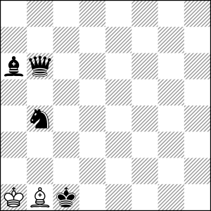
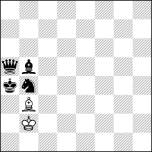

# helpmate-tablebase

Every helpmate in a material class, solved: for every legal position, how
many moves the mate takes and how many different solutions reach it.
Complete through five pieces, six pieces under way. MIT licensed; the tables
are a free download.



**h#5** &nbsp; (2+4)

**Black moves first and helps White mate in five.** White has a king and a
single bishop. Black has a queen, a bishop and a knight, and all three end up
working for White. There is exactly one way to do it.

<details>
<summary>Show the solution</summary>
<br>

**1.Bb5 Ba2 2.Kc2 Bb1+ 3.Kb3 Ba2+ 4.Ka4 Kb2 5.Qa5 Bb3#**



The black king walks into a corner its own army has walled off. Queen,
bishop and knight block a5, b5 and b4, the white king covers a3 and guards
b3, and the bishop mates from b3 after swinging a2, b1, a2 to steer the king.
Every piece on the board takes part: an ideal mate.

</details>

Nobody composed this. The table holds **900,409,280** h#5 positions with
this material; **4,509,985** of them, about one in two hundred, have a
unique solution, and the table knows which.

## What the table stores

In a helpmate both sides cooperate: Black moves first and helps White mate
in the fewest moves. Composers publish these as `h#n` problems, and a problem
is only sound if its solution is **unique**.

For every legal position in a material class, the table stores:

- **dtm**, the distance to mate in plies under optimal cooperation, which is
  where the composer's `h#n` comes from;
- **count**, how many *distinct* optimal solutions tie for shortest.
  `count=1` is a sound problem, `count=2` has a dual.

The count is the point. Anyone can search one position for a mate; the
tablebase says whether the mate is unique, for every position at once.

Because both sides want the same thing, solving is a cooperative
shortest-path problem rather than the min/max game tree an ordinary
tablebase faces. That is what makes whole material classes tractable.

```console
$ helpmate mine KQvk --dtm 2 --count 1 --max 3
8/8/8/8/8/8/8/k1KQ4 b - - 0 1
8/8/8/8/8/2Q5/8/k1K5 b - - 0 1
8/8/8/8/4Q3/8/8/k1K5 b - - 0 1
```

Three h#1 positions with exactly one solution each: sound problems,
enumerated rather than found.

## Sixty seconds

```console
$ helpmate gen KQvk --tables tables
tables/Kvk.hm max_dtm=255
tables/KQvk.hm max_dtm=14

$ helpmate probe "8/7k/5K2/8/8/8/8/6Q1 b - - 0 1"
dtm=2 (h#1) count=4

$ helpmate line "8/7k/5K2/8/8/8/8/6Q1 b - - 0 1" --all
Kh6 Qh2#
Kh6 Qh1#
Kh6 Qg6#
Kh8 Qg7#
```

Black king h7, White king f6, White queen g1. Mate in one move, four
different ways, so as a problem it is unsound. The table answered without
searching: generation is a one-off cost, and every query afterwards is a
lookup.

## What is solved today

| pieces | classes | status |
| --- | --- | --- |
| 2–4 | 66 | **complete** |
| 5 | 220 | **complete** |
| 6 | <!-- contrib:six-total -->715<!-- /contrib --> | <!-- contrib:six-done -->306<!-- /contrib --> done (<!-- contrib:six-empty -->75<!-- /contrib --> proven empty), <!-- contrib:six-open -->409<!-- /contrib --> to go |
| 7+ | — | needs an out-of-core generator that does not exist |

**<!-- contrib:tables -->592<!-- /contrib --> tables, <!-- contrib:gib -->1204.7<!-- /contrib --> GiB** block-compressed, published as a
[Hugging Face dataset](https://huggingface.co/datasets/osick/helpmate-tables).
The deepest mate in the corpus is <!-- contrib:deepest -->h#17.5<!-- /contrib -->.

```bash
helpmate-tables pull --tables ./tables --repo osick/helpmate-tables
```

The server can also stream tables on demand, fetching and caching each class
the first time someone asks for it.

### Contributors

Most of the six-piece tables were not computed here. They were generated on
other people's machines, sent as pull requests to the dataset, verified, and
merged with credit. Some were computed twice, independently, and their data
matched exactly; that is the *reproduced* column.

<!-- contrib:contributors-table -->
| contributor | tables | reproduced | dataset PRs | notes |
| --- | --- | --- | --- | --- |
| [**T31M**](https://huggingface.co/T31M) | <details><summary>194 tables</summary>KBBvkbp, KBBvknp, KBBvkpp, KBBvkqb, KBBvkqn, KBBvkqp, KBBvkqq, KBBvkqr, KBBvkrb, KBBvkrn, KBBvkrp, KBBvkrr, KBvkbbb, KBvkbbn, KBvkbbp, KBvkbnn, KBvkbnp, KBvkbpp, KBvknnn, KBvknnp, KBvknpp, KBvkppp, KBvkqbp, KBvkqnp, KBvkqpp, KBvkqqp, KBvkqrp, KBvkrbn, KBvkrbp, KBvkrnn, KBvkrnp, KBvkrpp, KBvkrrb, KBvkrrn, KBvkrrp, KNvkbbb, KNvkbbn, KNvkbbp, KNvkbnn, KNvkbnp, KNvkbpp, KNvknnp, KNvknpp, KNvkppp, KNvkqbb, KNvkqbn, KNvkqbp, KNvkqnn, KNvkqnp, KNvkqpp, KNvkqqb, KNvkqqn, KNvkqqp, KNvkqqr, KNvkqrb, KNvkqrn, KNvkqrp, KNvkqrr, KNvkrbb, KNvkrbn, KNvkrbp, KNvkrnn, KNvkrnp, KNvkrpp, KNvkrrb, KNvkrrn, KNvkrrp, KNvkrrr, KPvkbbb, KPvkbbn, KPvkbbp, KPvkbnn, KPvkbnp, KPvkbpp, KPvknnn, KPvknnp, KPvknpp, KPvkppp, KPvkqbb, KPvkqbn, KPvkqbp, KPvkqnn, KPvkqnp, KPvkqpp, KPvkqqb, KPvkqqn, KPvkqqp, KPvkqqq, KPvkqqr, KPvkqrb, KPvkqrn, KPvkqrp, KPvkqrr, KPvkrbb, KPvkrbn, KPvkrbp, KPvkrnn, KPvkrnp, KPvkrpp, KPvkrrb, KPvkrrn, KPvkrrp, KPvkrrr, KQvkbbp, KQvkbnp, KQvkbpp, KQvknnp, KQvknpp, KQvkppp, KQvkqbb, KQvkqbn, KQvkqbp, KQvkqnn, KQvkqnp, KQvkqpp, KQvkqqb, KQvkqqn, KQvkqqp, KQvkqqq, KQvkqqr, KQvkqrb, KQvkqrn, KQvkqrp, KQvkqrr, KQvkrbp, KQvkrnp, KQvkrpp, KQvkrrp, KRBvkbb, KRBvkbn, KRBvkbp, KRBvknn, KRBvknp, KRBvkpp, KRBvkqb, KRBvkqn, KRBvkqp, KRBvkqq, KRBvkqr, KRBvkrb, KRBvkrn, KRBvkrp, KRBvkrr, KRNvkbb, KRNvkbn, KRNvkbp, KRNvknn, KRNvknp, KRNvkpp, KRNvkqb, KRNvkqn, KRNvkqp, KRNvkqq, KRNvkqr, KRNvkrb, KRNvkrn, KRNvkrp, KRNvkrr, KRRvkpp, KRvkbbb, KRvkbbn, KRvkbbp, KRvkbnn, KRvkbnp, KRvkbpp, KRvknnn, KRvknnp, KRvknpp, KRvkppp, KRvkqbb, KRvkqbn, KRvkqbp, KRvkqnn, KRvkqnp, KRvkqpp, KRvkqqb, KRvkqqn, KRvkqqp, KRvkqqq, KRvkqqr, KRvkqrb, KRvkqrn, KRvkqrp, KRvkqrr, KRvkrbb, KRvkrbn, KRvkrbp, KRvkrnn, KRvkrnp, KRvkrpp, KRvkrrb, KRvkrrn, KRvkrrp, KRvkrrr</details> | 25 | <details><summary>41 PRs</summary><a href="https://huggingface.co/datasets/osick/helpmate-tables/discussions/1">#1</a>, <a href="https://huggingface.co/datasets/osick/helpmate-tables/discussions/16">#16</a>, <a href="https://huggingface.co/datasets/osick/helpmate-tables/discussions/17">#17</a>, <a href="https://huggingface.co/datasets/osick/helpmate-tables/discussions/18">#18</a>, <a href="https://huggingface.co/datasets/osick/helpmate-tables/discussions/20">#20</a>, <a href="https://huggingface.co/datasets/osick/helpmate-tables/discussions/22">#22</a>, <a href="https://huggingface.co/datasets/osick/helpmate-tables/discussions/23">#23</a>, <a href="https://huggingface.co/datasets/osick/helpmate-tables/discussions/24">#24</a>, <a href="https://huggingface.co/datasets/osick/helpmate-tables/discussions/25">#25</a>, <a href="https://huggingface.co/datasets/osick/helpmate-tables/discussions/26">#26</a>, <a href="https://huggingface.co/datasets/osick/helpmate-tables/discussions/27">#27</a>, <a href="https://huggingface.co/datasets/osick/helpmate-tables/discussions/28">#28</a>, <a href="https://huggingface.co/datasets/osick/helpmate-tables/discussions/29">#29</a>, <a href="https://huggingface.co/datasets/osick/helpmate-tables/discussions/30">#30</a>, <a href="https://huggingface.co/datasets/osick/helpmate-tables/discussions/31">#31</a>, <a href="https://huggingface.co/datasets/osick/helpmate-tables/discussions/32">#32</a>, <a href="https://huggingface.co/datasets/osick/helpmate-tables/discussions/33">#33</a>, <a href="https://huggingface.co/datasets/osick/helpmate-tables/discussions/34">#34</a>, <a href="https://huggingface.co/datasets/osick/helpmate-tables/discussions/35">#35</a>, <a href="https://huggingface.co/datasets/osick/helpmate-tables/discussions/36">#36</a>, <a href="https://huggingface.co/datasets/osick/helpmate-tables/discussions/37">#37</a>, <a href="https://huggingface.co/datasets/osick/helpmate-tables/discussions/38">#38</a>, <a href="https://huggingface.co/datasets/osick/helpmate-tables/discussions/39">#39</a>, <a href="https://huggingface.co/datasets/osick/helpmate-tables/discussions/40">#40</a>, <a href="https://huggingface.co/datasets/osick/helpmate-tables/discussions/41">#41</a>, <a href="https://huggingface.co/datasets/osick/helpmate-tables/discussions/42">#42</a>, <a href="https://huggingface.co/datasets/osick/helpmate-tables/discussions/43">#43</a>, <a href="https://huggingface.co/datasets/osick/helpmate-tables/discussions/44">#44</a>, <a href="https://huggingface.co/datasets/osick/helpmate-tables/discussions/45">#45</a>, <a href="https://huggingface.co/datasets/osick/helpmate-tables/discussions/47">#47</a>, <a href="https://huggingface.co/datasets/osick/helpmate-tables/discussions/48">#48</a>, <a href="https://huggingface.co/datasets/osick/helpmate-tables/discussions/49">#49</a>, <a href="https://huggingface.co/datasets/osick/helpmate-tables/discussions/50">#50</a>, <a href="https://huggingface.co/datasets/osick/helpmate-tables/discussions/51">#51</a>, <a href="https://huggingface.co/datasets/osick/helpmate-tables/discussions/52">#52</a>, <a href="https://huggingface.co/datasets/osick/helpmate-tables/discussions/53">#53</a>, <a href="https://huggingface.co/datasets/osick/helpmate-tables/discussions/54">#54</a>, <a href="https://huggingface.co/datasets/osick/helpmate-tables/discussions/55">#55</a>, <a href="https://huggingface.co/datasets/osick/helpmate-tables/discussions/56">#56</a>, <a href="https://huggingface.co/datasets/osick/helpmate-tables/discussions/57">#57</a>, <a href="https://huggingface.co/datasets/osick/helpmate-tables/discussions/58">#58</a></details> | Computed on a 192-thread, 369 GiB machine; the six-piece pawn tables need about 85 GiB of RAM each. Also made the generator 15 to 19 times faster (GitHub PR #64). |
| [**popeye37**](https://huggingface.co/popeye37) | <details><summary>49 tables</summary>KQvkbbb, KQvkbbn, KQvkbbp, KQvkbnn, KQvkbnp, KQvkbpp, KQvknnn, KQvknnp, KQvknpp, KQvkppp, KQvkqbb, KQvkqbn, KQvkqbp, KQvkqnn, KQvkqnp, KQvkqpp, KQvkqqb, KQvkqqn, KQvkqqp, KQvkqqq, KQvkqqr, KQvkqrb, KQvkqrn, KQvkqrp, KQvkqrr, KQvkrbb, KQvkrbn, KQvkrbp, KQvkrnn, KQvkrnp, KQvkrpp, KQvkrrb, KQvkrrn, KQvkrrp, KQvkrrr, KRRvkbb, KRRvkbn, KRRvkbp, KRRvknn, KRRvknp, KRRvkqb, KRRvkqn, KRRvkqp, KRRvkqq, KRRvkqr, KRRvkrb, KRRvkrn, KRRvkrp, KRRvkrr</details> | 25 | <details><summary>16 PRs</summary><a href="https://huggingface.co/datasets/osick/helpmate-tables/discussions/2">#2</a>, <a href="https://huggingface.co/datasets/osick/helpmate-tables/discussions/3">#3</a>, <a href="https://huggingface.co/datasets/osick/helpmate-tables/discussions/4">#4</a>, <a href="https://huggingface.co/datasets/osick/helpmate-tables/discussions/5">#5</a>, <a href="https://huggingface.co/datasets/osick/helpmate-tables/discussions/6">#6</a>, <a href="https://huggingface.co/datasets/osick/helpmate-tables/discussions/7">#7</a>, <a href="https://huggingface.co/datasets/osick/helpmate-tables/discussions/8">#8</a>, <a href="https://huggingface.co/datasets/osick/helpmate-tables/discussions/9">#9</a>, <a href="https://huggingface.co/datasets/osick/helpmate-tables/discussions/10">#10</a>, <a href="https://huggingface.co/datasets/osick/helpmate-tables/discussions/11">#11</a>, <a href="https://huggingface.co/datasets/osick/helpmate-tables/discussions/12">#12</a>, <a href="https://huggingface.co/datasets/osick/helpmate-tables/discussions/13">#13</a>, <a href="https://huggingface.co/datasets/osick/helpmate-tables/discussions/14">#14</a>, <a href="https://huggingface.co/datasets/osick/helpmate-tables/discussions/15">#15</a>, <a href="https://huggingface.co/datasets/osick/helpmate-tables/discussions/19">#19</a>, <a href="https://huggingface.co/datasets/osick/helpmate-tables/discussions/46">#46</a></details> |  |
<!-- /contrib -->

Every other table was generated by the maintainer.

> [!IMPORTANT]
> **<!-- contrib:six-open -->409<!-- /contrib --> six-piece tablebases have never been computed, and <!-- contrib:six-open-p0 -->174<!-- /contrib --> of them need
> only 32 GiB of RAM and about a day of CPU each.** If you have a machine that
> idles overnight, you can compute something nobody ever has, and your name
> goes in the table above.
> [How to contribute a tablebase](docs/CONTRIBUTING-TABLES.md)

## Problems to look at

- **[The deepest sound problem in every material class](docs/DEEPEST.md)**,
  with a diagram and the solution, also as a
  [printable A5 booklet](docs/DEEPEST.pdf). Each problem links to the
  [Helpmate Analyzer](https://helpman.komtera.lt/) with the stipulation
  already set.
- **[The showcase site](https://osick.github.io/helpmate-tablebase/)** plays
  them through on a board and has 1071 unique-solution puzzles to solve,
  filtered by theme. Every material has a page of its own
  ([KQvk](https://osick.github.io/helpmate-tablebase/material/KQvk.html), for
  example) with its deepest unique and deepest dual problems, and a
  [theme index](https://osick.github.io/helpmate-tablebase/themes.html) links
  every theme to every problem that shows it. Static, no server, built from
  the same data.

> **These positions were enumerated, not composed.** No authorship is claimed
> over any of them, none will be entered in a composing tourney, and a
> generated database anticipates nobody: a composer who arrives independently
> at one of these positions is unaffected. Where a position is already a
> published composition it is credited to its author.
> [Authorship, anticipation, and what this corpus is for](docs/AUTHORSHIP.md)

## The command line is the front door

`helpmate` is the primary interface, and
**[USAGE.md](docs/USAGE.md)** documents all of it:

| | |
| --- | --- |
| `gen` | build every table a material class needs |
| `probe` | look up one position |
| `line` | print optimal solutions as SAN |
| `mine` | scan a class for compositions by dtm, solution count, shape and theme; annotate, export as JSON, or refine interactively |
| `stats` | generation statistics and corpus summaries |
| `themes` | list the pattern detectors `mine --theme` accepts |
| `compact` | compress tables, or shrink provably-unsolvable ones to markers |

`mine --theme` recognises named composition patterns — model mates, echoes,
battery mates and more. The **[theme catalogue](docs/THEME-CATALOG.md)** has
the full list with the exact definition each detector uses.

## Mining, from a scan to a shortlist

`mine` is where compositions come from, and since 0.18.0 a scan is something
you can hold on to rather than a stream of FENs you have to probe one by one.

**Annotate every hit.** `--themes` adds the themes each position shows,
`--solutions` adds every optimal solution. Text stays greppable: the FEN is
the only unindented line.

```console
$ helpmate mine KRvkb --dtm 6 --max 1 --themes --solutions --tables ~/tb
8/8/8/8/8/8/8/K1k1bR2 b - - 0 1
  themes: pure model ideal mirror switchback single-piece single-piece:black nocheck
  Kd1 Ka2 Kc1 Kb3 Kb1 Rxe1#
  Kc2 Ka2 Kc1 Kb3 Kb1 Rxe1#
  Kd2 Ka2 Kc1 Kb3 Kb1 Rxe1#
```

**Take everything.** `--max infinity` (or `inf`) lifts the cap, and `--json`
turns the result into one document with the material, the filter that was
asked, and a `positions` array carrying `fen`, `dtm`, `count` and, with the
flags above, `themes`, `starts`, `ends` and `solutions`. For a result too
big to parse in one piece, `--jsonl` writes the same records one per line,
streamed as the scan finds them, between a header line and a footer line
with the counts:

```console
$ helpmate mine KRvkb --dtm 6 --max infinity --json --themes --solutions --tables ~/tb > krvkb-h3.json
$ helpmate mine KRvkb --dtm 6 --max infinity --jsonl --themes --tables ~/tb | jq -c 'select(.fen and (.themes|index("ideal")))'
```

**Refine instead of rescanning.** `--interactive` runs the scan once, keeps
the hits in memory, and opens a prompt. Narrowing by theme, solution count
or shape works on the held set; each position's themes and solutions are
computed the first time they are needed and cached, so `back` is free and
a second filter on the same set costs nothing.


| Command | Effect |
| --- | --- |
| `theme NAME`, `not theme NAME` | keep or drop positions showing NAME (`promotions:qrr` works too) |
| `count N`, `starts N`, `ends N` | keep positions with exactly that value |
| `back`, `reset` | undo the last narrowing, or return to the loaded set |
| `list [FROM [N]]`, `show I` | page through the FENs; print one hit with its themes and every solution |
| `themes` | how many positions in the current set show each theme, the map for what to narrow on next |
| `save FILE` | `.json` writes the document above, `.jsonl` the JSON Lines form; anything else writes bare FENs |
| `help`, `quit` | |

Results go to stdout and the prompt, progress and notes to stderr, so a
scripted session (`helpmate mine ... --interactive < script > out`) leaves a
clean file. There is no line editing built in; `rlwrap helpmate ...` adds
history. The whole thing is in [USAGE.md](docs/USAGE.md#mine--scan-for-composition-candidates),
with the JSON keys and the exact text layout.

### Also available

- **Python.** `from helpmate import Tablebase` — probe, enumerate lines, and
  mine from a script. See [USAGE.md](docs/USAGE.md#python-api).
- **HTTP API and web dashboard.** `helpmate-server` serves a read-only JSON
  API and a browser board for exploring positions. Secondary to the CLI, and
  documented in [USAGE.md](docs/USAGE.md#api-server).

## Documentation

| | |
| --- | --- |
| [USAGE.md](docs/USAGE.md) | the full guide — every command, every flag, every field |
| [DEEPEST.md](docs/DEEPEST.md) | **the deepest sound problem in every material class**, with diagrams |
| [DEEPEST.pdf](docs/DEEPEST.pdf) | the same showcase as a printable A5 booklet, numbered problems with diagrams, solutions and themes |
| [DEEPEST.tex](docs/DEEPEST.tex) | the booklet's LaTeX source — `make booklet` rebuilds the PDF |
| [BUILD.md](docs/BUILD.md) | prerequisites, build targets, offline dependencies, troubleshooting |
| [CONTRIBUTING-TABLES.md](docs/CONTRIBUTING-TABLES.md) | **contribute CPU time and tables** |
| [CONTRIBUTING.md](docs/CONTRIBUTING.md) | contribute code — CI checks and PR requirements |
| [INTERNALS.md](docs/INTERNALS.md) | indexing, generation, storage format, verification, limits |
| [the showcase site](https://osick.github.io/helpmate-tablebase/) | deepest sound problems on a board, puzzles to solve, the corpus table by table (source in `site/`) |
| [COOPERATIVE-TABLEBASE.md](docs/COOPERATIVE-TABLEBASE.md) | the short technical account for people who know Syzygy: why a cooperative game changes the algorithm, and what the data says |
| [THEME-CATALOG.md](docs/THEME-CATALOG.md) | every theme detector and its definition |
| [ROADMAP.md](docs/ROADMAP.md) | where this is going |

## Why you can trust it

A tablebase is worth exactly as much as your reason to believe it. This one
does not grade its own homework:

- **An independent oracle** — a from-scratch cooperative search sharing only
  the move generator with the real generator — re-solves sampled positions
  from every slice and checks both dtm and solution count.
- **Every one of the 368,452 legal `KQvk` positions** is cross-checked against
  a reference implementation written directly on python-chess, with no
  helpmate code involved in computing the expected answers.
- **Multithreaded output is required to be byte-identical** to
  single-threaded output, and that is asserted, not assumed.

[INTERNALS.md](docs/INTERNALS.md) has the full account, including measured
coverage and one unresolved bug stated plainly rather than buried.

## Building

```bash
git clone https://github.com/osick/helpmate-tablebase
cd helpmate-tablebase
make install
```

Needs a C++20 compiler and CMake. No PyPI release yet.
[BUILD.md](docs/BUILD.md) covers the rest.

## Licence

MIT. See [LICENSE](LICENSE).
