# The deepest sound problem in every material class

One position per material: the deepest position with a **unique solution**.

In problem chess uniqueness is the quality criterion. A second solution is a
dual and the composition is unsound, so `count = 1` is what makes a position
worth anything as a problem.

**The deepest problem in a material class is almost never the longest one.**
Across all 452 classes here, the deepest *unique* position is shallower
than the class maximum **every single time** — 452/452, mean gap
4.4 plies, worst case 20. The reason is visible
in the data: in 438 of 452 classes every position at maximum depth has a
**saturated** solution count (255 or more). The longest helpmates have hundreds
of ways to reach mate, which is exactly what disqualifies them as compositions.

The extreme case is **KRBvkp**: it runs to h#16,
but its deepest sound problem is h#6 — 20 plies shallower.

These positions are also rare. 41 classes contain **exactly one** unique
position at their deepest sound depth; 190
contain ten or fewer.

Black moves first and cooperates. `h#n` means mate after n moves by each side;
`h#n.5` means White is to move and needs one extra half-move. Under each
diagram stands the stipulation and the material count, white men + black men;
each problem carries its number (the same one as in the booklet), the themes it
shows (see the [theme catalogue](THEME-CATALOG.md)), and a *solve* link that
opens it in the Helpmate Analyzer with the stipulation set. The piece drawings
are Cburnett's (Wikimedia Commons, CC BY-SA 3.0). When a database of published
helpmates has been cross-checked (`tools/published_problems.py`), a problem
the database contains carries a *Published* line and is followed by an
unpublished sibling of the same material and stipulation, numbered *N b*.
Every position is also graded as a problem: a *Note* says when the solution
begins with a capture, when the side to move is in check in the diagram, or
when the diagram has no legal last move; an unpublished showcase position
with such a weakness was swapped for a cleaner unique position of the same
material and depth whenever the tablebase had one. The index's *published by*
column names the composer and year of the first source.

Generated by [`tools/deepest_showcase.py`](../tools/deepest_showcase.py) and
rendered by [`tools/render_deepest.py`](../tools/render_deepest.py) — nothing here
is hand-written. Depths and position counts come from each table's exact
`uniqueness` histogram, not from sampling; every FEN is verified by probing
before it is used.

The same data is also typeset as a print booklet:
[`docs/DEEPEST.tex`](DEEPEST.tex), built by
[`tools/deepest_booklet.py`](../tools/deepest_booklet.py).

Deepest sound problem in the whole corpus: **h#13** (KBvkrp, 2 such positions).

## Index

Sorted by how deep a *sound* problem gets. `class max` is the longest helpmate in that material at any solution count.

| material | pieces | deepest sound | class max | gap | unique positions there | published by |
| --- | --- | --- | --- | --- | --- | --- |
| [KBvkbbp](#kbvkbbp) | 6 | **h#13** | h#16.5 | −7 | 2 |  |
| [KBvkrp](#kbvkrp) | 5 | **h#13** | h#16.5 | −7 | 2 |  |
| [KBvkqbp](#kbvkqbp) | 6 | **h#12.5** | h#16.5 | −8 | 59 |  |
| [KBvkqqp](#kbvkqqp) | 6 | **h#12.5** | h#17.5 | −10 | 210 |  |
| [KBvkqrp](#kbvkqrp) | 6 | **h#12.5** | h#16.5 | −8 | 495 |  |
| [KBvkrpp](#kbvkrpp) | 6 | **h#12.5** | h#16.5 | −8 | 14 |  |
| [KBvkrrp](#kbvkrrp) | 6 | **h#12.5** | h#16.5 | −8 | 79 |  |
| [KPvkbpp](#kpvkbpp) | 6 | **h#12.5** | h#15.5 | −6 | 7 |  |
| [KBvkqp](#kbvkqp) | 5 | **h#12** | h#17 | −10 | 3 |  |
| [KBvkrbp](#kbvkrbp) | 6 | **h#12** | h#16.5 | −9 | 6 |  |
| [KRBvkrp](#krbvkrp) | 6 | **h#12** | h#17 | −10 | 3 |  |
| [KBvkbp](#kbvkbp) | 5 | **h#11.5** | h#16 | −9 | 8 |  |
| [KBvkbpp](#kbvkbpp) | 6 | **h#11.5** | h#16 | −9 | 34 |  |
| [KBvkqnp](#kbvkqnp) | 6 | **h#11.5** | h#16.5 | −10 | 2 |  |
| [KBvkqpp](#kbvkqpp) | 6 | **h#11.5** | h#16.5 | −10 | 3 |  |
| [KBvkrnp](#kbvkrnp) | 6 | **h#11.5** | h#16.5 | −10 | 10 |  |
| [KPvkppp](#kpvkppp) | 6 | **h#11.5** | h#16.5 | −10 | 4 |  |
| [KBBvkrp](#kbbvkrp) | 6 | **h#11** | h#17 | −12 | 1 |  |
| [KBvkppp](#kbvkppp) | 6 | **h#11** | h#15.5 | −9 | 1 |  |
| [KBPvkp](#kbpvkp) | 5 | **h#10.5** | h#16 | −11 | 1 | Szentai (1958) |
| [KBvkbnp](#kbvkbnp) | 6 | **h#10.5** | h#16.5 | −12 | 1 |  |
| [KBvknpp](#kbvknpp) | 6 | **h#10.5** | h#14.5 | −8 | 1 |  |
| [KNvkqqp](#knvkqqp) | 6 | **h#10.5** | h#12.5 | −4 | 11 |  |
| [KPvkbbp](#kpvkbbp) | 6 | **h#10.5** | h#15 | −9 | 41 |  |
| [KBBvkbp](#kbbvkbp) | 6 | **h#10** | h#16 | −12 | 51 |  |
| [KBBvkqp](#kbbvkqp) | 6 | **h#10** | h#17 | −14 | 7 |  |
| [KBvkbbn](#kbvkbbn) | 6 | **h#10** | h#12 | −4 | 10 |  |
| [KBvkqnn](#kbvkqnn) | 6 | **h#10** | h#13 | −6 | 5 |  |
| [KPvkpp](#kpvkpp) | 5 | **h#10** | h#15.5 | −11 | 2 | Ban (1967) |
| [KRBvkbp](#krbvkbp) | 6 | **h#10** | h#16.5 | −13 | 1 |  |
| [KRBvknp](#krbvknp) | 6 | **h#10** | h#15.5 | −11 | 1 |  |
| [KRBvkqn](#krbvkqn) | 6 | **h#10** | h#13 | −6 | 4 |  |
| [KRBvkqp](#krbvkqp) | 6 | **h#10** | h#17 | −14 | 4 |  |
| [KRBvkrn](#krbvkrn) | 6 | **h#10** | h#13 | −6 | 3 |  |
| [KBBvknp](#kbbvknp) | 6 | **h#9.5** | h#14.5 | −10 | 7 |  |
| [KBBvkpp](#kbbvkpp) | 6 | **h#9.5** | h#16 | −13 | 4 |  |
| [KBBvkqn](#kbbvkqn) | 6 | **h#9.5** | h#13 | −7 | 3 |  |
| [KBvkbnn](#kbvkbnn) | 6 | **h#9.5** | h#12.5 | −6 | 109 |  |
| [KBvknnn](#kbvknnn) | 6 | **h#9.5** | h#12 | −5 | 35 |  |
| [KBvknnp](#kbvknnp) | 6 | **h#9.5** | h#12.5 | −6 | 209 |  |
| [KBvknp](#kbvknp) | 5 | **h#9.5** | h#15.5 | −12 | 2 |  |
| [KBvkqbn](#kbvkqbn) | 6 | **h#9.5** | h#12.5 | −6 | 90 |  |
| [KBvkqn](#kbvkqn) | 5 | **h#9.5** | h#13 | −7 | 46 |  |
| [KBvkqqn](#kbvkqqn) | 6 | **h#9.5** | h#12.5 | −6 | 341 |  |
| [KBvkqrn](#kbvkqrn) | 6 | **h#9.5** | h#12.5 | −6 | 394 |  |
| [KBvkrbn](#kbvkrbn) | 6 | **h#9.5** | h#12.5 | −6 | 27 |  |
| [KBvkrn](#kbvkrn) | 5 | **h#9.5** | h#12.5 | −6 | 24 |  |
| [KBvkrnn](#kbvkrnn) | 6 | **h#9.5** | h#13 | −7 | 36 |  |
| [KBvkrrn](#kbvkrrn) | 6 | **h#9.5** | h#12.5 | −6 | 128 |  |
| [KNvkpp](#knvkpp) | 5 | **h#9.5** | h#11.5 | −4 | 2 |  |
| [KNvkppp](#knvkppp) | 6 | **h#9.5** | h#11.5 | −4 | 17 |  |
| [KNvkqb](#knvkqb) | 5 | **h#9.5** | h#11.5 | −4 | 1 | Sheglow (1998) |
| [KNvkqbb](#knvkqbb) | 6 | **h#9.5** | h#11.5 | −4 | 23 |  |
| [KNvkqbn](#knvkqbn) | 6 | **h#9.5** | h#11.5 | −4 | 3 |  |
| [KNvkqbp](#knvkqbp) | 6 | **h#9.5** | h#10.5 | −2 | 50 |  |
| [KNvkqnp](#knvkqnp) | 6 | **h#9.5** | h#11.5 | −4 | 50 |  |
| [KNvkqp](#knvkqp) | 5 | **h#9.5** | h#11.5 | −4 | 194 |  |
| [KNvkqpp](#knvkqpp) | 6 | **h#9.5** | h#11.5 | −4 | 993 |  |
| [KNvkqqb](#knvkqqb) | 6 | **h#9.5** | h#11.5 | −4 | 140 |  |
| [KNvkqrb](#knvkqrb) | 6 | **h#9.5** | h#11.5 | −4 | 1 |  |
| [KNvkqrp](#knvkqrp) | 6 | **h#9.5** | h#11.5 | −4 | 351 |  |
| [KNvkrpp](#knvkrpp) | 6 | **h#9.5** | h#11.5 | −4 | 1 |  |
| [KPvkbnp](#kpvkbnp) | 6 | **h#9.5** | h#14.5 | −10 | 14 |  |
| [KPvkbp](#kpvkbp) | 5 | **h#9.5** | h#14.5 | −10 | 9 | Locker (1966) |
| [KPvknnp](#kpvknnp) | 6 | **h#9.5** | h#11.5 | −4 | 1 |  |
| [KPvknpp](#kpvknpp) | 6 | **h#9.5** | h#15.5 | −12 | 112 |  |
| [KPvkqbp](#kpvkqbp) | 6 | **h#9.5** | h#14.5 | −10 | 9 |  |
| [KPvkqnp](#kpvkqnp) | 6 | **h#9.5** | h#11.5 | −4 | 6 |  |
| [KPvkqpp](#kpvkqpp) | 6 | **h#9.5** | h#15.5 | −12 | 236 |  |
| [KPvkrbp](#kpvkrbp) | 6 | **h#9.5** | h#15 | −11 | 11 |  |
| [KPvkrpp](#kpvkrpp) | 6 | **h#9.5** | h#15.5 | −12 | 105 |  |
| [KBBvkbn](#kbbvkbn) | 6 | **h#9** | h#12 | −6 | 244 |  |
| [KBBvkn](#kbbvkn) | 5 | **h#9** | h#12 | −6 | 2 |  |
| [KBBvkp](#kbbvkp) | 5 | **h#9** | h#16 | −14 | 1 |  |
| [KBBvkrn](#kbbvkrn) | 6 | **h#9** | h#13 | −8 | 8 |  |
| [KBvkbn](#kbvkbn) | 5 | **h#9** | h#12 | −6 | 57 |  |
| [KBvknn](#kbvknn) | 5 | **h#9** | h#12.5 | −7 | 34 |  |
| [KBvkpp](#kbvkpp) | 5 | **h#9** | h#16 | −14 | 51 |  |
| [KNPvkp](#knpvkp) | 5 | **h#9** | h#14 | −10 | 9 |  |
| [KNvkbpp](#knvkbpp) | 6 | **h#9** | h#10.5 | −3 | 2 |  |
| [KNvknpp](#knvknpp) | 6 | **h#9** | h#10.5 | −3 | 2 |  |
| [KPvknp](#kpvknp) | 5 | **h#9** | h#14.5 | −11 | 4 |  |
| [KRBvkbn](#krbvkbn) | 6 | **h#9** | h#12 | −6 | 37 |  |
| [KRBvknn](#krbvknn) | 6 | **h#9** | h#12 | −6 | 35 |  |
| [KRBvkpp](#krbvkpp) | 6 | **h#9** | h#16 | −14 | 4 |  |
| [KRNvkqb](#krnvkqb) | 6 | **h#9** | h#11 | −4 | 18 |  |
| [KRNvkqp](#krnvkqp) | 6 | **h#9** | h#12 | −6 | 81 |  |
| [KBBvknn](#kbbvknn) | 6 | **h#8.5** | h#13 | −9 | 17 |  |
| [KBvkbbb](#kbvkbbb) | 6 | **h#8.5** | h#10 | −3 | 446 |  |
| [KBvkqbb](#kbvkqbb) | 6 | **h#8.5** | h#10.5 | −4 | 25 |  |
| [KBvkrbb](#kbvkrbb) | 6 | **h#8.5** | h#9.5 | −2 | 2 |  |
| [KNvkbb](#knvkbb) | 5 | **h#8.5** | h#10.5 | −4 | 69 |  |
| [KNvkbbb](#knvkbbb) | 6 | **h#8.5** | h#10.5 | −4 | 1,145 |  |
| [KNvkbbn](#knvkbbn) | 6 | **h#8.5** | h#10.5 | −4 | 18 |  |
| [KNvkbbp](#knvkbbp) | 6 | **h#8.5** | h#10.5 | −4 | 1,621 |  |
| [KNvkbnn](#knvkbnn) | 6 | **h#8.5** | h#9.5 | −2 | 9 |  |
| [KNvkbnp](#knvkbnp) | 6 | **h#8.5** | h#10 | −3 | 2 |  |
| [KNvkbp](#knvkbp) | 5 | **h#8.5** | h#10.5 | −4 | 12 |  |
| [KNvknn](#knvknn) | 5 | **h#8.5** | h#9.5 | −2 | 3 |  |
| [KNvknnn](#knvknnn) | 6 | **h#8.5** | h#9.5 | −2 | 4 |  |
| [KNvknnp](#knvknnp) | 6 | **h#8.5** | h#10 | −3 | 211 |  |
| [KNvknp](#knvknp) | 5 | **h#8.5** | h#10 | −3 | 1 | Sheglow (1998) |
| [KNvkqnn](#knvkqnn) | 6 | **h#8.5** | h#9.5 | −2 | 7 |  |
| [KNvkqqn](#knvkqqn) | 6 | **h#8.5** | h#9.5 | −2 | 34 |  |
| [KNvkqqr](#knvkqqr) | 6 | **h#8.5** | h#9.5 | −2 | 2 |  |
| [KNvkqr](#knvkqr) | 5 | **h#8.5** | h#9.5 | −2 | 8 |  |
| [KNvkqrn](#knvkqrn) | 6 | **h#8.5** | h#9.5 | −2 | 13 |  |
| [KNvkrbb](#knvkrbb) | 6 | **h#8.5** | h#10.5 | −4 | 130 |  |
| [KNvkrbn](#knvkrbn) | 6 | **h#8.5** | h#9.5 | −2 | 5 |  |
| [KNvkrbp](#knvkrbp) | 6 | **h#8.5** | h#10.5 | −4 | 98 |  |
| [KNvkrn](#knvkrn) | 5 | **h#8.5** | h#10.5 | −4 | 1 |  |
| [KNvkrnn](#knvkrnn) | 6 | **h#8.5** | h#9.5 | −2 | 1 |  |
| [KNvkrnp](#knvkrnp) | 6 | **h#8.5** | h#10.5 | −4 | 54 |  |
| [KNvkrp](#knvkrp) | 5 | **h#8.5** | h#11.5 | −6 | 46 |  |
| [KNvkrr](#knvkrr) | 5 | **h#8.5** | h#9.5 | −2 | 5 |  |
| [KNvkrrn](#knvkrrn) | 6 | **h#8.5** | h#9.5 | −2 | 7 |  |
| [KNvkrrp](#knvkrrp) | 6 | **h#8.5** | h#9.5 | −2 | 167 |  |
| [KPPvkp](#kppvkp) | 5 | **h#8.5** | h#14.5 | −12 | 6 |  |
| [KPvkbbn](#kpvkbbn) | 6 | **h#8.5** | h#9.5 | −2 | 11 |  |
| [KPvkbnn](#kpvkbnn) | 6 | **h#8.5** | h#9.5 | −2 | 20 |  |
| [KPvknnn](#kpvknnn) | 6 | **h#8.5** | h#9.5 | −2 | 8 |  |
| [KPvkp](#kpvkp) | 4 | **h#8.5** | h#14.5 | −12 | 2 |  |
| [KPvkqbn](#kpvkqbn) | 6 | **h#8.5** | h#11.5 | −6 | 2 |  |
| [KPvkqn](#kpvkqn) | 5 | **h#8.5** | h#9.5 | −2 | 1 |  |
| [KPvkqnn](#kpvkqnn) | 6 | **h#8.5** | h#10.5 | −4 | 40 |  |
| [KPvkqp](#kpvkqp) | 5 | **h#8.5** | h#14.5 | −12 | 9 |  |
| [KPvkqqn](#kpvkqqn) | 6 | **h#8.5** | h#9.5 | −2 | 7 |  |
| [KPvkqqp](#kpvkqqp) | 6 | **h#8.5** | h#10.5 | −4 | 61 |  |
| [KPvkqrn](#kpvkqrn) | 6 | **h#8.5** | h#9.5 | −2 | 1 |  |
| [KPvkqrp](#kpvkqrp) | 6 | **h#8.5** | h#12.5 | −8 | 644 |  |
| [KPvkrnp](#kpvkrnp) | 6 | **h#8.5** | h#12.5 | −8 | 2,170 |  |
| [KPvkrp](#kpvkrp) | 5 | **h#8.5** | h#14.5 | −12 | 101 |  |
| [KPvkrrp](#kpvkrrp) | 6 | **h#8.5** | h#10.5 | −4 | 369 |  |
| [KBBvkbb](#kbbvkbb) | 6 | **h#8** | h#10 | −4 | 129 |  |
| [KBvkbb](#kbvkbb) | 5 | **h#8** | h#10 | −4 | 8 |  |
| [KBvkn](#kbvkn) | 4 | **h#8** | h#12 | −8 | 19 |  |
| [KBvkp](#kbvkp) | 4 | **h#8** | h#16 | −16 | 16 |  |
| [KNvkb](#knvkb) | 4 | **h#8** | h#10.5 | −5 | 5 |  |
| [KNvkbn](#knvkbn) | 5 | **h#8** | h#10 | −4 | 5 |  |
| [KNvkp](#knvkp) | 4 | **h#8** | h#11.5 | −7 | 4 |  |
| [KNvkqn](#knvkqn) | 5 | **h#8** | h#10.5 | −5 | 2 | Sheglow (1998) |
| [KNvkqrr](#knvkqrr) | 6 | **h#8** | h#9.5 | −3 | 1 |  |
| [KNvkr](#knvkr) | 4 | **h#8** | h#9.5 | −3 | 9 | Elkies (1995) |
| [KPvkqbb](#kpvkqbb) | 6 | **h#8** | h#11.5 | −7 | 3 |  |
| [KPvkqqb](#kpvkqqb) | 6 | **h#8** | h#11.5 | −7 | 15 |  |
| [KPvkqqq](#kpvkqqq) | 6 | **h#8** | h#9.5 | −3 | 11 |  |
| [KQBvkn](#kqbvkn) | 5 | **h#8** | h#12 | −8 | 25 |  |
| [KQNvkb](#kqnvkb) | 5 | **h#8** | h#11 | −6 | 5 |  |
| [KQNvkn](#kqnvkn) | 5 | **h#8** | h#10 | −4 | 16 |  |
| [KQNvkp](#kqnvkp) | 5 | **h#8** | h#11 | −6 | 2 |  |
| [KQNvkr](#kqnvkr) | 5 | **h#8** | h#10 | −4 | 11 |  |
| [KQPvkb](#kqpvkb) | 5 | **h#8** | h#9 | −2 | 4 |  |
| [KQPvkn](#kqpvkn) | 5 | **h#8** | h#9 | −2 | 7 |  |
| [KQPvkp](#kqpvkp) | 5 | **h#8** | h#15 | −14 | 42 |  |
| [KRBvkbb](#krbvkbb) | 6 | **h#8** | h#10 | −4 | 5 |  |
| [KRBvkn](#krbvkn) | 5 | **h#8** | h#12 | −8 | 4 |  |
| [KRNvkbb](#krnvkbb) | 6 | **h#8** | h#10 | −4 | 20 |  |
| [KRNvkbp](#krnvkbp) | 6 | **h#8** | h#10 | −4 | 36 |  |
| [KRNvkn](#krnvkn) | 5 | **h#8** | h#10 | −4 | 2 |  |
| [KRNvknp](#krnvknp) | 6 | **h#8** | h#10.5 | −5 | 55 |  |
| [KRNvkpp](#krnvkpp) | 6 | **h#8** | h#11.5 | −7 | 15 |  |
| [KRNvkrp](#krnvkrp) | 6 | **h#8** | h#11.5 | −7 | 39 |  |
| [KBBvkqb](#kbbvkqb) | 6 | **h#7.5** | h#10.5 | −6 | 48 |  |
| [KBNvkq](#kbnvkq) | 5 | **h#7.5** | h#8.5 | −2 | 1 |  |
| [KBvkqqb](#kbvkqqb) | 6 | **h#7.5** | h#8.5 | −2 | 8 |  |
| [KBvkqrb](#kbvkqrb) | 6 | **h#7.5** | h#8.5 | −2 | 2 |  |
| [KBvkrrb](#kbvkrrb) | 6 | **h#7.5** | h#8.5 | −2 | 1 |  |
| [KNPvkb](#knpvkb) | 5 | **h#7.5** | h#11 | −7 | 4 |  |
| [KNPvkn](#knpvkn) | 5 | **h#7.5** | h#9 | −3 | 2 | Paliulionis (2024) |
| [KNPvkq](#knpvkq) | 5 | **h#7.5** | h#8.5 | −2 | 17 |  |
| [KNPvkr](#knpvkr) | 5 | **h#7.5** | h#9 | −3 | 3 |  |
| [KNvkn](#knvkn) | 4 | **h#7.5** | h#10 | −5 | 14 | Kotesovec (1987) |
| [KNvkrb](#knvkrb) | 5 | **h#7.5** | h#10.5 | −6 | 12 |  |
| [KNvkrrb](#knvkrrb) | 6 | **h#7.5** | h#8.5 | −2 | 215 |  |
| [KNvkrrr](#knvkrrr) | 6 | **h#7.5** | h#9 | −3 | 651 |  |
| [KPPvkb](#kppvkb) | 5 | **h#7.5** | h#8.5 | −2 | 1 |  |
| [KPPvkn](#kppvkn) | 5 | **h#7.5** | h#8.5 | −2 | 1 |  |
| [KPPvkq](#kppvkq) | 5 | **h#7.5** | h#8.5 | −2 | 1 |  |
| [KPvkb](#kpvkb) | 4 | **h#7.5** | h#8.5 | −2 | 13 |  |
| [KPvkbb](#kpvkbb) | 5 | **h#7.5** | h#9.5 | −4 | 448 |  |
| [KPvkbbb](#kpvkbbb) | 6 | **h#7.5** | h#9.5 | −4 | 907 |  |
| [KPvkbn](#kpvkbn) | 5 | **h#7.5** | h#9.5 | −4 | 1,222 |  |
| [KPvkn](#kpvkn) | 4 | **h#7.5** | h#8.5 | −2 | 8 |  |
| [KPvknn](#kpvknn) | 5 | **h#7.5** | h#9.5 | −4 | 476 |  |
| [KPvkq](#kpvkq) | 4 | **h#7.5** | h#9 | −3 | 32 |  |
| [KPvkqb](#kpvkqb) | 5 | **h#7.5** | h#11.5 | −8 | 342 |  |
| [KPvkqq](#kpvkqq) | 5 | **h#7.5** | h#9.5 | −4 | 367 |  |
| [KPvkqqr](#kpvkqqr) | 6 | **h#7.5** | h#9.5 | −4 | 768 |  |
| [KPvkqr](#kpvkqr) | 5 | **h#7.5** | h#8.5 | −2 | 40 |  |
| [KPvkqrb](#kpvkqrb) | 6 | **h#7.5** | h#11.5 | −8 | 854 |  |
| [KPvkqrr](#kpvkqrr) | 6 | **h#7.5** | h#8.5 | −2 | 22 |  |
| [KPvkr](#kpvkr) | 4 | **h#7.5** | h#8.5 | −2 | 1 | Maslar |
| [KPvkrb](#kpvkrb) | 5 | **h#7.5** | h#8.5 | −2 | 6 |  |
| [KPvkrbb](#kpvkrbb) | 6 | **h#7.5** | h#9.5 | −4 | 323 |  |
| [KPvkrbn](#kpvkrbn) | 6 | **h#7.5** | h#9.5 | −4 | 744 |  |
| [KPvkrn](#kpvkrn) | 5 | **h#7.5** | h#9.5 | −4 | 50 |  |
| [KPvkrnn](#kpvkrnn) | 6 | **h#7.5** | h#9.5 | −4 | 680 |  |
| [KPvkrrb](#kpvkrrb) | 6 | **h#7.5** | h#8.5 | −2 | 21 |  |
| [KPvkrrn](#kpvkrrn) | 6 | **h#7.5** | h#9.5 | −4 | 60 |  |
| [KPvkrrr](#kpvkrrr) | 6 | **h#7.5** | h#8.5 | −2 | 6 |  |
| [KBBBvk](#kbbbvk) | 5 | **h#7** | h#8 | −2 | 3 |  |
| [KBBNvk](#kbbnvk) | 5 | **h#7** | h#8 | −2 | 1 |  |
| [KBBPvk](#kbbpvk) | 5 | **h#7** | h#9 | −4 | 556 |  |
| [KBBvkb](#kbbvkb) | 5 | **h#7** | h#10.5 | −7 | 95 |  |
| [KBBvkrb](#kbbvkrb) | 6 | **h#7** | h#10.5 | −7 | 3 |  |
| [KBNPvk](#kbnpvk) | 5 | **h#7** | h#8 | −2 | 9 |  |
| [KBNvkb](#kbnvkb) | 5 | **h#7** | h#11 | −8 | 7 |  |
| [KBNvkn](#kbnvkn) | 5 | **h#7** | h#12 | −10 | 7 |  |
| [KBNvkp](#kbnvkp) | 5 | **h#7** | h#16 | −18 | 50 |  |
| [KBNvkr](#kbnvkr) | 5 | **h#7** | h#9 | −4 | 2 |  |
| [KBPPvk](#kbppvk) | 5 | **h#7** | h#8 | −2 | 12 |  |
| [KBPvk](#kbpvk) | 4 | **h#7** | h#8 | −2 | 12 | Elkies (2004) |
| [KBPvkb](#kbpvkb) | 5 | **h#7** | h#10 | −6 | 65 |  |
| [KBPvkn](#kbpvkn) | 5 | **h#7** | h#12 | −10 | 101 |  |
| [KBPvkq](#kbpvkq) | 5 | **h#7** | h#8.5 | −3 | 75 |  |
| [KBPvkr](#kbpvkr) | 5 | **h#7** | h#8.5 | −3 | 69 |  |
| [KNNPvk](#knnpvk) | 5 | **h#7** | h#8 | −2 | 5 |  |
| [KNNvkp](#knnvkp) | 5 | **h#7** | h#11 | −8 | 3 |  |
| [KNNvkq](#knnvkq) | 5 | **h#7** | h#8.5 | −3 | 1 | Sheglow (1998) |
| [KNNvkr](#knnvkr) | 5 | **h#7** | h#10 | −6 | 1 |  |
| [KNPPvk](#knppvk) | 5 | **h#7** | h#8.5 | −3 | 18 |  |
| [KNPvk](#knpvk) | 4 | **h#7** | h#8.5 | −3 | 49 | Elkies (2004) |
| [KPPPvk](#kpppvk) | 5 | **h#7** | h#8 | −2 | 2 |  |
| [KPPvk](#kppvk) | 4 | **h#7** | h#8 | −2 | 2 | Salazar Lopez (1973) |
| [KPvkrr](#kpvkrr) | 5 | **h#7** | h#8.5 | −3 | 5 |  |
| [KQBBvk](#kqbbvk) | 5 | **h#7** | h#8 | −2 | 1 |  |
| [KQBPvk](#kqbpvk) | 5 | **h#7** | h#8 | −2 | 73 |  |
| [KQBvkb](#kqbvkb) | 5 | **h#7** | h#10 | −6 | 4 |  |
| [KQBvkp](#kqbvkp) | 5 | **h#7** | h#16 | −18 | 55 |  |
| [KQNNvk](#kqnnvk) | 5 | **h#7** | h#8 | −2 | 3 |  |
| [KQNPvk](#kqnpvk) | 5 | **h#7** | h#9 | −4 | 160 |  |
| [KQPPvk](#kqppvk) | 5 | **h#7** | h#8 | −2 | 37 |  |
| [KQPvk](#kqpvk) | 4 | **h#7** | h#8 | −2 | 12 |  |
| [KQPvkq](#kqpvkq) | 5 | **h#7** | h#9 | −4 | 521 |  |
| [KQPvkr](#kqpvkr) | 5 | **h#7** | h#9 | −4 | 105 |  |
| [KRBBvk](#krbbvk) | 5 | **h#7** | h#8 | −2 | 1 |  |
| [KRBPvk](#krbpvk) | 5 | **h#7** | h#8 | −2 | 17 | Abdurahmanovic & Becker (2006) |
| [KRBvkrb](#krbvkrb) | 6 | **h#7** | h#8.5 | −3 | 1 |  |
| [KRNPvk](#krnpvk) | 5 | **h#7** | h#8 | −2 | 31 |  |
| [KRNvkbn](#krnvkbn) | 6 | **h#7** | h#9.5 | −5 | 39 |  |
| [KRNvknn](#krnvknn) | 6 | **h#7** | h#9 | −4 | 13 |  |
| [KRNvkp](#krnvkp) | 5 | **h#7** | h#11.5 | −9 | 6 |  |
| [KRNvkqn](#krnvkqn) | 6 | **h#7** | h#9 | −4 | 63 |  |
| [KRNvkqr](#krnvkqr) | 6 | **h#7** | h#9.5 | −5 | 97 |  |
| [KRNvkr](#krnvkr) | 5 | **h#7** | h#10 | −6 | 9 |  |
| [KRNvkrb](#krnvkrb) | 6 | **h#7** | h#10 | −6 | 4 |  |
| [KRNvkrn](#krnvkrn) | 6 | **h#7** | h#9 | −4 | 20 |  |
| [KRNvkrr](#krnvkrr) | 6 | **h#7** | h#9.5 | −5 | 102 |  |
| [KRPPvk](#krppvk) | 5 | **h#7** | h#8 | −2 | 2 |  |
| [KRPvkb](#krpvkb) | 5 | **h#7** | h#8 | −2 | 7 |  |
| [KRPvkn](#krpvkn) | 5 | **h#7** | h#8.5 | −3 | 14 |  |
| [KRPvkp](#krpvkp) | 5 | **h#7** | h#14 | −14 | 41 |  |
| [KRPvkq](#krpvkq) | 5 | **h#7** | h#9 | −4 | 7 |  |
| [KRPvkr](#krpvkr) | 5 | **h#7** | h#8.5 | −3 | 2 |  |
| [KRvkqbn](#krvkqbn) | 6 | **h#7** | h#8 | −2 | 1 |  |
| [KRvkqnn](#krvkqnn) | 6 | **h#7** | h#8 | −2 | 1 |  |
| [KRvkqnp](#krvkqnp) | 6 | **h#7** | h#8 | −2 | 1 |  |
| [KRvkqqb](#krvkqqb) | 6 | **h#7** | h#9 | −4 | 4 |  |
| [KRvkqqn](#krvkqqn) | 6 | **h#7** | h#8 | −2 | 5 |  |
| [KRvkqqp](#krvkqqp) | 6 | **h#7** | h#8 | −2 | 6 |  |
| [KRvkqqq](#krvkqqq) | 6 | **h#7** | h#8.5 | −3 | 22 |  |
| [KRvkqqr](#krvkqqr) | 6 | **h#7** | h#8.5 | −3 | 49 |  |
| [KRvkqrb](#krvkqrb) | 6 | **h#7** | h#8 | −2 | 5 |  |
| [KRvkqrp](#krvkqrp) | 6 | **h#7** | h#8 | −2 | 9 |  |
| [KRvkqrr](#krvkqrr) | 6 | **h#7** | h#8 | −2 | 22 |  |
| [KRvkrpp](#krvkrpp) | 6 | **h#7** | h#7.5 | −1 | 1 |  |
| [KRvkrrp](#krvkrrp) | 6 | **h#7** | h#8 | −2 | 3 |  |
| [KBBvk](#kbbvk) | 4 | **h#6.5** | h#8 | −3 | 1 | Maslar (1978) |
| [KBBvkq](#kbbvkq) | 5 | **h#6.5** | h#7.5 | −2 | 3 |  |
| [KBBvkqq](#kbbvkqq) | 6 | **h#6.5** | h#7.5 | −2 | 273 |  |
| [KBBvkqr](#kbbvkqr) | 6 | **h#6.5** | h#7.5 | −2 | 214 |  |
| [KBBvkrr](#kbbvkrr) | 6 | **h#6.5** | h#7.5 | −2 | 52 |  |
| [KBNNvk](#kbnnvk) | 5 | **h#6.5** | h#8 | −3 | 8 | Sheglow (1998) |
| [KBvkb](#kbvkb) | 4 | **h#6.5** | h#10 | −7 | 8 |  |
| [KBvkqb](#kbvkqb) | 5 | **h#6.5** | h#9.5 | −6 | 256 | Sheglow (1998) |
| [KBvkrb](#kbvkrb) | 5 | **h#6.5** | h#9.5 | −6 | 128 |  |
| [KNNvk](#knnvk) | 4 | **h#6.5** | h#8 | −3 | 9 | Bebesi (1910) |
| [KNNvkb](#knnvkb) | 5 | **h#6.5** | h#10 | −7 | 21 |  |
| [KNNvkn](#knnvkn) | 5 | **h#6.5** | h#7.5 | −2 | 2 |  |
| [KNNvknn](#knnvknn) | 6 | **h#6.5** | h#8 | −3 | 31 |  |
| [KPPvkr](#kppvkr) | 5 | **h#6.5** | h#8.5 | −4 | 784 |  |
| [KPvk](#kpvk) | 3 | **h#6.5** | h#8.5 | −4 | 13 | Niemann (1947) |
| [KQvkqnn](#kqvkqnn) | 6 | **h#6.5** | h#8 | −3 | 17 |  |
| [KRBvkq](#krbvkq) | 5 | **h#6.5** | h#7.5 | −2 | 3 |  |
| [KRvkbbp](#krvkbbp) | 6 | **h#6.5** | h#7.5 | −2 | 3 |  |
| [KRvkbnp](#krvkbnp) | 6 | **h#6.5** | h#7.5 | −2 | 10 |  |
| [KRvkbpp](#krvkbpp) | 6 | **h#6.5** | h#8 | −3 | 11 |  |
| [KRvknnn](#krvknnn) | 6 | **h#6.5** | h#7.5 | −2 | 1 |  |
| [KRvknpp](#krvknpp) | 6 | **h#6.5** | h#7.5 | −2 | 2 |  |
| [KRvkqb](#krvkqb) | 5 | **h#6.5** | h#7.5 | −2 | 1 | Sheglow (1998) |
| [KRvkqbb](#krvkqbb) | 6 | **h#6.5** | h#8 | −3 | 160 |  |
| [KRvkqbp](#krvkqbp) | 6 | **h#6.5** | h#8 | −3 | 855 |  |
| [KRvkqp](#krvkqp) | 5 | **h#6.5** | h#7.5 | −2 | 17 |  |
| [KRvkqpp](#krvkqpp) | 6 | **h#6.5** | h#7.5 | −2 | 346 |  |
| [KRvkqq](#krvkqq) | 5 | **h#6.5** | h#8 | −3 | 6 |  |
| [KRvkqr](#krvkqr) | 5 | **h#6.5** | h#8 | −3 | 5 |  |
| [KRvkqrn](#krvkqrn) | 6 | **h#6.5** | h#8 | −3 | 188 |  |
| [KRvkrbb](#krvkrbb) | 6 | **h#6.5** | h#7.5 | −2 | 19 |  |
| [KRvkrbn](#krvkrbn) | 6 | **h#6.5** | h#8 | −3 | 14 |  |
| [KRvkrbp](#krvkrbp) | 6 | **h#6.5** | h#7.5 | −2 | 37 |  |
| [KRvkrnp](#krvkrnp) | 6 | **h#6.5** | h#8 | −3 | 5 |  |
| [KRvkrrb](#krvkrrb) | 6 | **h#6.5** | h#8 | −3 | 84 |  |
| [KRvkrrn](#krvkrrn) | 6 | **h#6.5** | h#8 | −3 | 9 |  |
| [KRvkrrr](#krvkrrr) | 6 | **h#6.5** | h#8 | −3 | 152 |  |
| [KBBvkr](#kbbvkr) | 5 | **h#6** | h#7.5 | −3 | 28 |  |
| [KBNvk](#kbnvk) | 4 | **h#6** | h#8 | −4 | 23 |  |
| [KNNNvk](#knnnvk) | 5 | **h#6** | h#8 | −4 | 4 |  |
| [KQBNvk](#kqbnvk) | 5 | **h#6** | h#8 | −4 | 98 |  |
| [KQBvk](#kqbvk) | 4 | **h#6** | h#7 | −2 | 3 |  |
| [KQNvk](#kqnvk) | 4 | **h#6** | h#7 | −2 | 3 |  |
| [KQQPvk](#kqqpvk) | 5 | **h#6** | h#7 | −2 | 6 |  |
| [KQQvk](#kqqvk) | 4 | **h#6** | h#7 | −2 | 2 |  |
| [KQQvkn](#kqqvkn) | 5 | **h#6** | h#7 | −2 | 4 |  |
| [KQQvkp](#kqqvkp) | 5 | **h#6** | h#7 | −2 | 6 |  |
| [KQRBvk](#kqrbvk) | 5 | **h#6** | h#7 | −2 | 29 |  |
| [KQRPvk](#kqrpvk) | 5 | **h#6** | h#7 | −2 | 14 |  |
| [KQRvk](#kqrvk) | 4 | **h#6** | h#7 | −2 | 2 |  |
| [KQRvkn](#kqrvkn) | 5 | **h#6** | h#7 | −2 | 4 |  |
| [KQRvkp](#kqrvkp) | 5 | **h#6** | h#7 | −2 | 72 |  |
| [KQRvkq](#kqrvkq) | 5 | **h#6** | h#7 | −2 | 2 |  |
| [KQRvkr](#kqrvkr) | 5 | **h#6** | h#7 | −2 | 6 |  |
| [KQvk](#kqvk) | 3 | **h#6** | h#7 | −2 | 3 | Csaszar (1945) |
| [KQvkbbn](#kqvkbbn) | 6 | **h#6** | h#7.5 | −3 | 352 |  |
| [KQvkbbp](#kqvkbbp) | 6 | **h#6** | h#7 | −2 | 131 |  |
| [KQvkbn](#kqvkbn) | 5 | **h#6** | h#7 | −2 | 1 |  |
| [KQvkbnn](#kqvkbnn) | 6 | **h#6** | h#7.5 | −3 | 310 |  |
| [KQvkbnp](#kqvkbnp) | 6 | **h#6** | h#7.5 | −3 | 171 |  |
| [KQvkbpp](#kqvkbpp) | 6 | **h#6** | h#7 | −2 | 3 |  |
| [KQvkn](#kqvkn) | 4 | **h#6** | h#7 | −2 | 4 |  |
| [KQvknn](#kqvknn) | 5 | **h#6** | h#7 | −2 | 9 |  |
| [KQvknnn](#kqvknnn) | 6 | **h#6** | h#7.5 | −3 | 292 |  |
| [KQvknnp](#kqvknnp) | 6 | **h#6** | h#7.5 | −3 | 1,102 |  |
| [KQvknp](#kqvknp) | 5 | **h#6** | h#7 | −2 | 18 |  |
| [KQvknpp](#kqvknpp) | 6 | **h#6** | h#7 | −2 | 163 |  |
| [KQvkp](#kqvkp) | 4 | **h#6** | h#7 | −2 | 4 |  |
| [KQvkpp](#kqvkpp) | 5 | **h#6** | h#7 | −2 | 15 |  |
| [KQvkppp](#kqvkppp) | 6 | **h#6** | h#7 | −2 | 35 |  |
| [KQvkqbb](#kqvkqbb) | 6 | **h#6** | h#7 | −2 | 12 |  |
| [KQvkqbn](#kqvkqbn) | 6 | **h#6** | h#7.5 | −3 | 218 |  |
| [KQvkqbp](#kqvkqbp) | 6 | **h#6** | h#7.5 | −3 | 28 |  |
| [KQvkqn](#kqvkqn) | 5 | **h#6** | h#7 | −2 | 2 |  |
| [KQvkqnp](#kqvkqnp) | 6 | **h#6** | h#7.5 | −3 | 605 |  |
| [KQvkqp](#kqvkqp) | 5 | **h#6** | h#7 | −2 | 4 |  |
| [KQvkqpp](#kqvkqpp) | 6 | **h#6** | h#7.5 | −3 | 60 |  |
| [KQvkqqb](#kqvkqqb) | 6 | **h#6** | h#7 | −2 | 8 |  |
| [KQvkqqn](#kqvkqqn) | 6 | **h#6** | h#7.5 | −3 | 36 |  |
| [KQvkqqp](#kqvkqqp) | 6 | **h#6** | h#7.5 | −3 | 6 |  |
| [KQvkqqq](#kqvkqqq) | 6 | **h#6** | h#7 | −2 | 2 |  |
| [KRBNvk](#krbnvk) | 5 | **h#6** | h#8 | −4 | 36 |  |
| [KRBvk](#krbvk) | 4 | **h#6** | h#7 | −2 | 20 |  |
| [KRBvkb](#krbvkb) | 5 | **h#6** | h#10 | −8 | 28 |  |
| [KRBvkp](#krbvkp) | 5 | **h#6** | h#16 | −20 | 175 |  |
| [KRBvkqb](#krbvkqb) | 6 | **h#6** | h#10.5 | −9 | 273 |  |
| [KRBvkqq](#krbvkqq) | 6 | **h#6** | h#8 | −4 | 21 |  |
| [KRBvkqr](#krbvkqr) | 6 | **h#6** | h#8 | −4 | 47 |  |
| [KRBvkrr](#krbvkrr) | 6 | **h#6** | h#7 | −2 | 21 |  |
| [KRNNvk](#krnnvk) | 5 | **h#6** | h#8 | −4 | 27 |  |
| [KRNvkb](#krnvkb) | 5 | **h#6** | h#10 | −8 | 33 |  |
| [KRNvkqq](#krnvkqq) | 6 | **h#6** | h#8 | −4 | 22 |  |
| [KRPvk](#krpvk) | 4 | **h#6** | h#8 | −4 | 25 |  |
| [KRRBvk](#krrbvk) | 5 | **h#6** | h#7 | −2 | 17 |  |
| [KRRPvk](#krrpvk) | 5 | **h#6** | h#7 | −2 | 5 |  |
| [KRRvkbb](#krrvkbb) | 6 | **h#6** | h#7 | −2 | 72 |  |
| [KRRvkbn](#krrvkbn) | 6 | **h#6** | h#7 | −2 | 74 |  |
| [KRRvkbp](#krrvkbp) | 6 | **h#6** | h#7 | −2 | 723 |  |
| [KRRvknn](#krrvknn) | 6 | **h#6** | h#7 | −2 | 175 |  |
| [KRRvknp](#krrvknp) | 6 | **h#6** | h#7 | −2 | 1,311 |  |
| [KRRvkp](#krrvkp) | 5 | **h#6** | h#7 | −2 | 43 |  |
| [KRRvkpp](#krrvkpp) | 6 | **h#6** | h#7 | −2 | 912 |  |
| [KRRvkqb](#krrvkqb) | 6 | **h#6** | h#8 | −4 | 140 |  |
| [KRRvkqn](#krrvkqn) | 6 | **h#6** | h#7 | −2 | 149 |  |
| [KRRvkqp](#krrvkqp) | 6 | **h#6** | h#7.5 | −3 | 453 |  |
| [KRRvkqq](#krrvkqq) | 6 | **h#6** | h#8 | −4 | 498 |  |
| [KRRvkqr](#krrvkqr) | 6 | **h#6** | h#8 | −4 | 797 |  |
| [KRRvkr](#krrvkr) | 5 | **h#6** | h#7 | −2 | 1 |  |
| [KRRvkrb](#krrvkrb) | 6 | **h#6** | h#7 | −2 | 388 |  |
| [KRRvkrn](#krrvkrn) | 6 | **h#6** | h#7 | −2 | 166 |  |
| [KRRvkrp](#krrvkrp) | 6 | **h#6** | h#7.5 | −3 | 797 |  |
| [KRRvkrr](#krrvkrr) | 6 | **h#6** | h#8 | −4 | 424 |  |
| [KRvkbb](#krvkbb) | 5 | **h#6** | h#7 | −2 | 3 |  |
| [KRvkbbb](#krvkbbb) | 6 | **h#6** | h#7.5 | −3 | 408 |  |
| [KRvkbbn](#krvkbbn) | 6 | **h#6** | h#7.5 | −3 | 1,232 |  |
| [KRvkbn](#krvkbn) | 5 | **h#6** | h#7 | −2 | 12 | Sheglow (1998) |
| [KRvkbnn](#krvkbnn) | 6 | **h#6** | h#7.5 | −3 | 1,834 |  |
| [KRvkbp](#krvkbp) | 5 | **h#6** | h#7 | −2 | 817 |  |
| [KRvknn](#krvknn) | 5 | **h#6** | h#7 | −2 | 38 |  |
| [KRvknnp](#krvknnp) | 6 | **h#6** | h#7.5 | −3 | 23,475 |  |
| [KRvknp](#krvknp) | 5 | **h#6** | h#7 | −2 | 1,731 |  |
| [KRvkp](#krvkp) | 4 | **h#6** | h#7 | −2 | 84 |  |
| [KRvkpp](#krvkpp) | 5 | **h#6** | h#7 | −2 | 1,085 |  |
| [KRvkppp](#krvkppp) | 6 | **h#6** | h#7.5 | −3 | 8,358 |  |
| [KRvkqn](#krvkqn) | 5 | **h#6** | h#7.5 | −3 | 66 |  |
| [KRvkrb](#krvkrb) | 5 | **h#6** | h#7 | −2 | 55 |  |
| [KRvkrn](#krvkrn) | 5 | **h#6** | h#7.5 | −3 | 22 |  |
| [KRvkrnn](#krvkrnn) | 6 | **h#6** | h#7.5 | −3 | 778 |  |
| [KRvkrp](#krvkrp) | 5 | **h#6** | h#7.5 | −3 | 175 |  |
| [KRvkrr](#krvkrr) | 5 | **h#6** | h#7.5 | −3 | 100 |  |
| [KQBvkq](#kqbvkq) | 5 | **h#5.5** | h#7 | −3 | 6 |  |
| [KQNvkq](#kqnvkq) | 5 | **h#5.5** | h#7 | −3 | 6 |  |
| [KQvkbb](#kqvkbb) | 5 | **h#5.5** | h#7 | −3 | 4 |  |
| [KQvkbbb](#kqvkbbb) | 6 | **h#5.5** | h#7 | −3 | 66 |  |
| [KQvkbp](#kqvkbp) | 5 | **h#5.5** | h#7 | −3 | 2 |  |
| [KQvkq](#kqvkq) | 4 | **h#5.5** | h#7 | −3 | 7 | Sheglow (1998) |
| [KQvkqb](#kqvkqb) | 5 | **h#5.5** | h#7.5 | −4 | 25 |  |
| [KQvkqq](#kqvkqq) | 5 | **h#5.5** | h#7.5 | −4 | 58 |  |
| [KQvkqqr](#kqvkqqr) | 6 | **h#5.5** | h#6.5 | −2 | 84 |  |
| [KQvkqr](#kqvkqr) | 5 | **h#5.5** | h#6.5 | −2 | 10 |  |
| [KQvkqrb](#kqvkqrb) | 6 | **h#5.5** | h#6.5 | −2 | 359 |  |
| [KQvkqrn](#kqvkqrn) | 6 | **h#5.5** | h#7.5 | −4 | 1,825 |  |
| [KQvkqrp](#kqvkqrp) | 6 | **h#5.5** | h#7.5 | −4 | 1,434 |  |
| [KQvkrbb](#kqvkrbb) | 6 | **h#5.5** | h#6.5 | −2 | 93 |  |
| [KQvkrbn](#kqvkrbn) | 6 | **h#5.5** | h#7.5 | −4 | 304 |  |
| [KQvkrbp](#kqvkrbp) | 6 | **h#5.5** | h#6.5 | −2 | 369 |  |
| [KQvkrn](#kqvkrn) | 5 | **h#5.5** | h#6.5 | −2 | 2 |  |
| [KQvkrnn](#kqvkrnn) | 6 | **h#5.5** | h#7.5 | −4 | 329 |  |
| [KQvkrnp](#kqvkrnp) | 6 | **h#5.5** | h#7.5 | −4 | 390 |  |
| [KQvkrpp](#kqvkrpp) | 6 | **h#5.5** | h#6.5 | −2 | 75 |  |
| [KRNvkq](#krnvkq) | 5 | **h#5.5** | h#7 | −3 | 2 |  |
| [KRvkq](#krvkq) | 4 | **h#5.5** | h#7.5 | −4 | 6 |  |
| [KRvkr](#krvkr) | 4 | **h#5.5** | h#7 | −3 | 9 |  |
| [KQBvkr](#kqbvkr) | 5 | **h#5** | h#6 | −2 | 15 |  |
| [KQQvkb](#kqqvkb) | 5 | **h#5** | h#6 | −2 | 408 |  |
| [KQQvkq](#kqqvkq) | 5 | **h#5** | h#7 | −4 | 441 |  |
| [KQQvkr](#kqqvkr) | 5 | **h#5** | h#6 | −2 | 46 |  |
| [KQRNvk](#kqrnvk) | 5 | **h#5** | h#7 | −4 | 26 |  |
| [KQRvkb](#kqrvkb) | 5 | **h#5** | h#7 | −4 | 1,113 |  |
| [KQvkb](#kqvkb) | 4 | **h#5** | h#6 | −2 | 64 |  |
| [KQvkqrr](#kqvkqrr) | 6 | **h#5** | h#6 | −2 | 1 |  |
| [KQvkr](#kqvkr) | 4 | **h#5** | h#6 | −2 | 7 |  |
| [KQvkrb](#kqvkrb) | 5 | **h#5** | h#6.5 | −3 | 23 |  |
| [KQvkrp](#kqvkrp) | 5 | **h#5** | h#6.5 | −3 | 631 |  |
| [KQvkrrb](#kqvkrrb) | 6 | **h#5** | h#6 | −2 | 2 |  |
| [KQvkrrn](#kqvkrrn) | 6 | **h#5** | h#6 | −2 | 110 |  |
| [KQvkrrp](#kqvkrrp) | 6 | **h#5** | h#6 | −2 | 17 |  |
| [KRBvkr](#krbvkr) | 5 | **h#5** | h#7 | −4 | 3 |  |
| [KRNvk](#krnvk) | 4 | **h#5** | h#7 | −4 | 19 | Maslar (1981) |
| [KRRNvk](#krrnvk) | 5 | **h#5** | h#7 | −4 | 4 |  |
| [KRRvkb](#krrvkb) | 5 | **h#5** | h#7 | −4 | 290 |  |
| [KRRvkn](#krrvkn) | 5 | **h#5** | h#7 | −4 | 229 |  |
| [KRRvkq](#krrvkq) | 5 | **h#5** | h#7 | −4 | 219 |  |
| [KRvkb](#krvkb) | 4 | **h#5** | h#7 | −4 | 365 |  |
| [KRvkn](#krvkn) | 4 | **h#5** | h#7 | −4 | 247 |  |
| [KQvkrr](#kqvkrr) | 5 | **h#4.5** | h#6 | −3 | 460 |  |
| [KQvkrrr](#kqvkrrr) | 6 | **h#4.5** | h#6 | −3 | 577 |  |
| [KRvk](#krvk) | 3 | **h#4.5** | h#7 | −5 | 1 | Ban (1965) |
| [KQQNvk](#kqqnvk) | 5 | **h#4** | h#5 | −2 | 18 |  |
| [KRRvk](#krrvk) | 4 | **h#4** | h#7 | −6 | 27 |  |
| [KQQBvk](#kqqbvk) | 5 | **h#3** | h#4 | −2 | 293 |  |
| [KQQRvk](#kqqrvk) | 5 | **h#3** | h#4 | −2 | 775 |  |
| [KQRRvk](#kqrrvk) | 5 | **h#3** | h#5 | −4 | 1,116 |  |
| [KRRRvk](#krrrvk) | 5 | **h#3** | h#5 | −4 | 217 |  |
| [KQQQvk](#kqqqvk) | 5 | **h#2** | h#3 | −2 | 3,150 |  |

## KPvk

<table><tr>
<td width="220" valign="top"> <b>h#6.5</b> &nbsp;·&nbsp; 2 + 1</td>
<td valign="top">
<b>No. 1</b> &nbsp;·&nbsp; <b>h#6.5</b>, unique solution &nbsp;·&nbsp; <a href="https://helpman.komtera.lt/?fen=6k1/8/8/8/8/8/4P3/2K5&moves=6.5">solve ↗</a> 
13 positions of 86,688 indexed have a unique solution at h#6.5. The class runs to h#8.5, so the deepest sound problem is 4 plies shallower. Every position at that depth is saturated (255+ solutions). 
 <b>Solution:</b> 1...e3 2.Kf7 e4 3.Ke6 e5 4.Kd5 e6 5.Kc4 e7 6.Kb3 e8=Q 7.Ka2 Qa4# 
 <b>Themes:</b> <code>set-play</code> <code>pure</code> <code>model</code> <code>ideal</code> <code>mirror</code> <code>promotion</code> <code>excelsior</code> <code>excelsior:white</code> <code>single-piece</code> <code>single-piece:white</code> <code>single-piece:black</code> <code>nocapture</code> <code>nocheck</code> <code>umnov</code> <code>promotions:q</code> 
 <b>Published:</b> Niemann, John — Schachmatt, No. 427, 13/07/1947; Catalogue h# (CHM) avec 6 pieces, No. 61, 1995; Wenigsteiner im Hilfsmatt, No. 77, 1977; Problemista, No. 1569, 07-10/1981, as h#6 (P0530828) · Ban, Jenö — Magyar Sakkelet, 1961; Ideal-Mate Encyclopedia Vol.1, No. 12, 1999, as h#7 0.1... (P1100755) 
 <code>6k1/8/8/8/8/8/4P3/2K5 w - - 0 1</code>
</td>
</tr></table>

<table><tr>
<td width="220" valign="top"> <b>h#6.5</b> &nbsp;·&nbsp; 2 + 1</td>
<td valign="top">
<b>No. 1b</b> &nbsp;·&nbsp; <b>h#6.5</b>, unique solution &nbsp;·&nbsp; <a href="https://helpman.komtera.lt/?fen=8/8/8/1K6/8/3P4/7k/8&moves=6.5">solve ↗</a> 
The same material and stipulation as No. 1, which is published; this position is not in the published database (checked under every mirroring). 
 <b>Solution:</b> 1...d4 2.Kg3 d5 3.Kf4 d6 4.Ke5 d7 5.Kd6 Ka5 6.Kc7 Ka6 7.Kb8 d8=Q# 
 <b>Themes:</b> <code>pure</code> <code>model</code> <code>ideal</code> <code>mirror</code> <code>promotion</code> <code>single-piece</code> <code>single-piece:black</code> <code>nocapture</code> <code>nocheck</code> <code>umnov</code> <code>promotions:q</code> 
 <code>8/8/8/1K6/8/3P4/7k/8 w - - 0 1</code>
</td>
</tr></table>

## KQvk

<table><tr>
<td width="220" valign="top"> <b>h#6</b> &nbsp;·&nbsp; 2 + 1</td>
<td valign="top">
<b>No. 2</b> &nbsp;·&nbsp; <b>h#6</b>, unique solution &nbsp;·&nbsp; <a href="https://helpman.komtera.lt/?fen=8/8/7k/6Q1/8/8/8/K7&moves=6">solve ↗</a> 
3 positions of 29,568 indexed have a unique solution at h#6. The class runs to h#7, so the deepest sound problem is 2 plies shallower. Every position at that depth is saturated (255+ solutions). 
 <b>Solution:</b> 1.Kh7 Kb2 2.Kh8 Kc3 3.Kh7 Kd4 4.Kh8 Ke5 5.Kh7 Kf6 6.Kh8 Qg7# 
 <b>Themes:</b> <code>pure</code> <code>model</code> <code>ideal</code> <code>switchback</code> <code>single-piece</code> <code>single-piece:black</code> <code>nocapture</code> <code>nocheck</code> 
 <b>Published:</b> Csaszar, Imre — Magyar Sakkvilag, 1945; Ideal-Mate Review, 1990; Catalogue h# (CHM) avec 6 pieces, No. 165, 1995, as h#6 (P0551296) 
 <b>Note:</b> the side to move is in check in the diagram. 
 <code>8/8/7k/6Q1/8/8/8/K7 b - - 0 1</code>
</td>
</tr></table>

<table><tr>
<td width="220" valign="top"> <b>h#6</b> &nbsp;·&nbsp; 2 + 1</td>
<td valign="top">
<b>No. 2b</b> &nbsp;·&nbsp; <b>h#6</b>, unique solution &nbsp;·&nbsp; <a href="https://helpman.komtera.lt/?fen=8/7k/8/6Q1/8/8/8/K7&moves=6">solve ↗</a> 
The same material and stipulation as No. 2, which is published; this position is not in the published database (checked under every mirroring). 
 <b>Solution:</b> 1.Kh8 Kb2 2.Kh7 Kc3 3.Kh8 Kd4 4.Kh7 Ke5 5.Kh8 Kf6 6.Kh7 Qg7# 
 <b>Themes:</b> <code>set-play</code> <code>switchback</code> <code>single-piece</code> <code>single-piece:black</code> <code>pendulum</code> <code>nocapture</code> <code>nocheck</code> 
 <code>8/7k/8/6Q1/8/8/8/K7 b - - 0 1</code>
</td>
</tr></table>

## KRvk

<table><tr>
<td width="220" valign="top"> <b>h#4.5</b> &nbsp;·&nbsp; 2 + 1</td>
<td valign="top">
<b>No. 3</b> &nbsp;·&nbsp; <b>h#4.5</b>, unique solution &nbsp;·&nbsp; <a href="https://helpman.komtera.lt/?fen=4k3/8/8/8/8/8/2R5/1K6&moves=4.5">solve ↗</a> 
1 position of 29,568 indexed has a unique solution at h#4.5. The class runs to h#7, so the deepest sound problem is 5 plies shallower. Every position at that depth is saturated (255+ solutions). 
 <b>Solution:</b> 1...Kc1 2.Kf7 Kd2 3.Kg6 Ke3 4.Kh5 Kf4 5.Kh4 Rh2# 
 <b>Themes:</b> <code>pure</code> <code>model</code> <code>ideal</code> <code>mirror</code> <code>single-piece</code> <code>single-piece:black</code> <code>nocapture</code> <code>nocheck</code> 
 <b>Published:</b> Ban, Jenö — Diagramme und Figuren, No. 1295, 27/11/1965; Catalogue h# (CHM) avec 6 pieces, No. 122, 1995; Ideal-Mate Encyclopedia Vol.1, No. 1848, 1999, as h#5 0.1... (P0531991) 
 <code>4k3/8/8/8/8/8/2R5/1K6 w - - 0 1</code>
</td>
</tr></table>

## KPvkp

<table><tr>
<td width="220" valign="top"> <b>h#8.5</b> &nbsp;·&nbsp; 2 + 2</td>
<td valign="top">
<b>No. 4</b> &nbsp;·&nbsp; <b>h#8.5</b>, unique solution &nbsp;·&nbsp; <a href="https://helpman.komtera.lt/?fen=8/8/p7/8/P7/8/3K4/7k&moves=8.5">solve ↗</a> 
2 positions of 4,161,024 indexed have a unique solution at h#8.5. The class runs to h#14.5, so the deepest sound problem is 12 plies shallower. Every position at that depth is saturated (255+ solutions). 
 <b>Solution:</b> 1...Kc3 2.Kg2 Kb4 3.a5+ Kxa5 4.Kf3 Kb4 5.Ke4 a5 6.Kd5 a6 7.Kc6 a7 8.Kb7 Kc5 9.Ka6 a8=Q# 
 <b>Themes:</b> <code>pure</code> <code>model</code> <code>ideal</code> <code>mirror</code> <code>promotion</code> <code>switchback</code> <code>promotions:q</code> 
 <code>8/8/p7/8/P7/8/3K4/7k w - - 0 1</code>
</td>
</tr></table>

## KBvkn

<table><tr>
<td width="220" valign="top"> <b>h#8</b> &nbsp;·&nbsp; 2 + 2</td>
<td valign="top">
<b>No. 5</b> &nbsp;·&nbsp; <b>h#8</b>, unique solution &nbsp;·&nbsp; <a href="https://helpman.komtera.lt/?fen=8/8/8/8/8/1k6/5n2/1K5B&moves=8">solve ↗</a> 
19 positions of 1,892,352 indexed have a unique solution at h#8. The class runs to h#12, so the deepest sound problem is 8 plies shallower. Every position at that depth is saturated (255+ solutions). 
 <b>Solution:</b> 1.Kc3 Bg2 2.Kd2 Bf1 3.Ke1 Kc2 4.Nh3 Kd3 5.Kf2 Ke4 6.Kg1 Kf3 7.Kh1 Kg3 8.Ng1 Bg2# 
 <b>Themes:</b> <code>pure</code> <code>model</code> <code>ideal</code> <code>switchback</code> <code>self-block</code> <code>nocapture</code> <code>nocheck</code> 
 <code>8/8/8/8/8/1k6/5n2/1K5B b - - 0 1</code>
</td>
</tr></table>

## KBvkp

<table><tr>
<td width="220" valign="top"> <b>h#8</b> &nbsp;·&nbsp; 2 + 2</td>
<td valign="top">
<b>No. 6</b> &nbsp;·&nbsp; <b>h#8</b>, unique solution &nbsp;·&nbsp; <a href="https://helpman.komtera.lt/?fen=8/8/8/4k3/2p5/8/8/K3B3&moves=8">solve ↗</a> 
16 positions of 5,548,032 indexed have a unique solution at h#8. The class runs to h#16, so the deepest sound problem is 16 plies shallower. Every position at that depth is saturated (255+ solutions). 
 <b>Solution:</b> 1.c3 Bh4 2.c2 Kb2 3.c1=N Kc2 4.Kd4 Kd1 5.Kc3 Be7 6.Kb2 Ba3+ 7.Ka1 Kc2 8.Na2 Bb2# 
 <b>Themes:</b> <code>pure</code> <code>model</code> <code>ideal</code> <code>promotion</code> <code>underpromotion</code> <code>switchback</code> <code>self-block</code> <code>nocapture</code> <code>umnov</code> <code>promotions:n</code> 
 <code>8/8/8/4k3/2p5/8/8/K3B3 b - - 0 1</code>
</td>
</tr></table>

## KNvkb

<table><tr>
<td width="220" valign="top"> <b>h#8</b> &nbsp;·&nbsp; 2 + 2</td>
<td valign="top">
<b>No. 7</b> &nbsp;·&nbsp; <b>h#8</b>, unique solution &nbsp;·&nbsp; <a href="https://helpman.komtera.lt/?fen=8/8/7k/8/8/1b6/4N3/K7&moves=8">solve ↗</a> 
5 positions of 1,892,352 indexed have a unique solution at h#8. The class runs to h#10.5, so the deepest sound problem is 5 plies shallower. Every position at that depth is saturated (255+ solutions). 
 <b>Solution:</b> 1.Kg5 Nd4 2.Kf4 Kb2 3.Ke3 Ka3 4.Kd2 Kb4 5.Kc1 Kc3 6.Kb1 Kd2 7.Ka1 Kc1 8.Ba2 Nc2# 
 <b>Themes:</b> <code>pure</code> <code>model</code> <code>ideal</code> <code>self-block</code> <code>nocapture</code> <code>nocheck</code> 
 <code>8/8/7k/8/8/1b6/4N3/K7 b - - 0 1</code>
</td>
</tr></table>

## KNvkp

<table><tr>
<td width="220" valign="top"> <b>h#8</b> &nbsp;·&nbsp; 2 + 2</td>
<td valign="top">
<b>No. 8</b> &nbsp;·&nbsp; <b>h#8</b>, unique solution &nbsp;·&nbsp; <a href="https://helpman.komtera.lt/?fen=8/8/3p4/8/8/1k6/N7/K7&moves=8">solve ↗</a> 
4 positions of 5,548,032 indexed have a unique solution at h#8. The class runs to h#11.5, so the deepest sound problem is 7 plies shallower. Every position at that depth is saturated (255+ solutions). 
 <b>Solution:</b> 1.d5 Kb1 2.d4 Kc1 3.d3 Kd2 4.Kb2 Nb4 5.Ka1 Kc3 6.d2 Kb3 7.d1=R Ka3 8.Rb1 Nc2# 
 <b>Themes:</b> <code>pure</code> <code>model</code> <code>ideal</code> <code>promotion</code> <code>underpromotion</code> <code>self-block</code> <code>nocapture</code> <code>nocheck</code> <code>umnov</code> <code>promotions:r</code> 
 <code>8/8/3p4/8/8/1k6/N7/K7 b - - 0 1</code>
</td>
</tr></table>

## KNvkr

<table><tr>
<td width="220" valign="top"> <b>h#8</b> &nbsp;·&nbsp; 2 + 2</td>
<td valign="top">
<b>No. 9</b> &nbsp;·&nbsp; <b>h#8</b>, unique solution &nbsp;·&nbsp; <a href="https://helpman.komtera.lt/?fen=8/8/8/8/8/7k/5r1N/K7&moves=8">solve ↗</a> 
9 positions of 1,892,352 indexed have a unique solution at h#8. The class runs to h#9.5, so the deepest sound problem is 3 plies shallower. Every position at that depth is saturated (255+ solutions). 
 <b>Solution:</b> 1.Kg2 Nf3 2.Kf1 Kb1 3.Ke2 Kb2 4.Kd3+ Kc1 5.Kc3 Kd1 6.Kb2 Nd4 7.Ka1 Kc1 8.Ra2 Nb3# 
 <b>Themes:</b> <code>pure</code> <code>model</code> <code>ideal</code> <code>switchback</code> <code>self-block</code> <code>nocapture</code> 
 <b>Published:</b> Elkies, Noam D. — Variantim, No. 546, 11/1995, as h#8 (P0543062) · Mertes, Helmut — feenschach, 01/1977; Ideal-Mate Encyclopedia Vol.1, No. 400, 1999, as h#8 (P0543063) 
 <code>8/8/8/8/8/7k/5r1N/K7 b - - 0 1</code>
</td>
</tr></table>

<table><tr>
<td width="220" valign="top"> <b>h#8</b> &nbsp;·&nbsp; 2 + 2</td>
<td valign="top">
<b>No. 9b</b> &nbsp;·&nbsp; <b>h#8</b>, unique solution &nbsp;·&nbsp; <a href="https://helpman.komtera.lt/?fen=8/7k/N7/8/8/8/4r3/1K6&moves=8">solve ↗</a> 
The same material and stipulation as No. 9, which is published; this position is not in the published database (checked under every mirroring). 
 <b>Solution:</b> 1.Kg6 Nb4 2.Kf5 Nc2 3.Ke4 Kb2 4.Kd3 Kc1 5.Kc3 Kd1 6.Kb2 Nd4 7.Ka1 Kc1 8.Ra2 Nb3# 
 <b>Themes:</b> <code>pure</code> <code>model</code> <code>ideal</code> <code>switchback</code> <code>self-block</code> <code>nocapture</code> <code>nocheck</code> 
 <code>8/7k/N7/8/8/8/4r3/1K6 b - - 0 1</code>
</td>
</tr></table>

## KNvkn

<table><tr>
<td width="220" valign="top"> <b>h#7.5</b> &nbsp;·&nbsp; 2 + 2</td>
<td valign="top">
<b>No. 10</b> &nbsp;·&nbsp; <b>h#7.5</b>, unique solution &nbsp;·&nbsp; <a href="https://helpman.komtera.lt/?fen=5n2/8/8/8/8/8/3k2N1/K7&moves=7.5">solve ↗</a> 
14 positions of 1,892,352 indexed have a unique solution at h#7.5. The class runs to h#10, so the deepest sound problem is 5 plies shallower. Every position at that depth is saturated (255+ solutions). 
 <b>Solution:</b> 1...Nh4 2.Ke3 Kb2 3.Kf4 Kc3 4.Kg5 Kd4 5.Kh6 Ke5 6.Kh7 Kf6 7.Kh8 Kf7 8.Nh7 Ng6# 
 <b>Themes:</b> <code>pure</code> <code>model</code> <code>ideal</code> <code>self-block</code> <code>nocapture</code> <code>nocheck</code> 
 <b>Published:</b> Kotesovec, Vaclav — Sachova skladba, No. 1065, 06/1987, as h#8 0.1... (P0542897) · ?, ? — ?, 03/1975, as h#8 0.1... (P0542908) 
 <code>5n2/8/8/8/8/8/3k2N1/K7 w - - 0 1</code>
</td>
</tr></table>

<table><tr>
<td width="220" valign="top"> <b>h#7.5</b> &nbsp;·&nbsp; 2 + 2</td>
<td valign="top">
<b>No. 10b</b> &nbsp;·&nbsp; <b>h#7.5</b>, unique solution &nbsp;·&nbsp; <a href="https://helpman.komtera.lt/?fen=5n2/8/8/8/6N1/8/3k4/1K6&moves=7.5">solve ↗</a> 
The same material and stipulation as No. 10, which is published; this position is not in the published database (checked under every mirroring). 
 <b>Solution:</b> 1...Ne5 2.Ke3 Kc2 3.Kf4 Kd3 4.Kg5 Ke4 5.Kh6 Kf5 6.Kh7 Kf6 7.Kh8 Kf7 8.Nh7 Ng6# 
 <b>Themes:</b> <code>pure</code> <code>model</code> <code>ideal</code> <code>self-block</code> <code>nocapture</code> <code>nocheck</code> 
 <code>5n2/8/8/8/6N1/8/3k4/1K6 w - - 0 1</code>
</td>
</tr></table>

## KPvkb

<table><tr>
<td width="220" valign="top"> <b>h#7.5</b> &nbsp;·&nbsp; 2 + 2</td>
<td valign="top">
<b>No. 11</b> &nbsp;·&nbsp; <b>h#7.5</b>, unique solution &nbsp;·&nbsp; <a href="https://helpman.komtera.lt/?fen=8/8/1K6/8/2b5/2P5/7k/8&moves=7.5">solve ↗</a> 
13 positions of 5,548,032 indexed have a unique solution at h#7.5. The class runs to h#8.5, so the deepest sound problem is 2 plies shallower. Every position at that depth is saturated (255+ solutions). 
 <b>Solution:</b> 1...Ka5 2.Bd5 c4 3.Kg3 cxd5 4.Kf4 d6 5.Ke5 d7 6.Kd6 Kb5 7.Kc7 Ka6 8.Kb8 d8=Q# 
 <b>Themes:</b> <code>set-play</code> <code>pure</code> <code>model</code> <code>ideal</code> <code>mirror</code> <code>promotion</code> <code>nocheck</code> <code>umnov</code> <code>promotions:q</code> 
 <code>8/8/1K6/8/2b5/2P5/7k/8 w - - 0 1</code>
</td>
</tr></table>

## KPvkn

<table><tr>
<td width="220" valign="top"> <b>h#7.5</b> &nbsp;·&nbsp; 2 + 2</td>
<td valign="top">
<b>No. 12</b> &nbsp;·&nbsp; <b>h#7.5</b>, unique solution &nbsp;·&nbsp; <a href="https://helpman.komtera.lt/?fen=K7/8/8/n7/2P5/8/8/7k&moves=7.5">solve ↗</a> 
8 positions of 5,548,032 indexed have a unique solution at h#7.5. The class runs to h#8.5, so the deepest sound problem is 2 plies shallower. Every position at that depth is saturated (255+ solutions). 
 <b>Solution:</b> 1...c5 2.Kg2 c6 3.Kf3 c7 4.Ke4 c8=Q 5.Kd5 Qf5+ 6.Kc6 Kb8 7.Kb6 Kc8 8.Ka7 Qxa5# 
 <b>Themes:</b> <code>pure</code> <code>model</code> <code>ideal</code> <code>mirror</code> <code>promotion</code> <code>single-piece</code> <code>single-piece:black</code> <code>promotions:q</code> 
 <code>K7/8/8/n7/2P5/8/8/7k w - - 0 1</code>
</td>
</tr></table>

## KPvkq

<table><tr>
<td width="220" valign="top"> <b>h#7.5</b> &nbsp;·&nbsp; 2 + 2</td>
<td valign="top">
<b>No. 13</b> &nbsp;·&nbsp; <b>h#7.5</b>, unique solution &nbsp;·&nbsp; <a href="https://helpman.komtera.lt/?fen=8/K7/8/8/8/8/3P4/2q4k&moves=7.5">solve ↗</a> 
32 positions of 5,548,032 indexed have a unique solution at h#7.5. The class runs to h#9, so the deepest sound problem is 3 plies shallower. Every position at that depth is saturated (255+ solutions). 
 <b>Solution:</b> 1...d4 2.Kg2 d5 3.Kf3 d6 4.Ke4 d7 5.Kd5 d8=Q+ 6.Kc6 Qd5+ 7.Kc7 Ka6 8.Kb8 Qb7# 
 <b>Themes:</b> <code>promotion</code> <code>excelsior</code> <code>excelsior:white</code> <code>closed-walk</code> <code>single-piece</code> <code>single-piece:black</code> <code>nocapture</code> <code>umnov</code> <code>promotions:q</code> 
 <code>8/K7/8/8/8/8/3P4/2q4k w - - 0 1</code>
</td>
</tr></table>

## KPvkr

<table><tr>
<td width="220" valign="top"> <b>h#7.5</b> &nbsp;·&nbsp; 2 + 2</td>
<td valign="top">
<b>No. 14</b> &nbsp;·&nbsp; <b>h#7.5</b>, unique solution &nbsp;·&nbsp; <a href="https://helpman.komtera.lt/?fen=8/7k/8/8/8/7r/1K5P/8&moves=7.5">solve ↗</a> 
1 position of 5,548,032 indexed has a unique solution at h#7.5. The class runs to h#8.5, so the deepest sound problem is 2 plies shallower. Every position at that depth is saturated (255+ solutions). 
 <b>Solution:</b> 1...Ka2 2.Ra3+ Kxa3 3.Kg6 h4 4.Kf5 h5 5.Ke4 h6 6.Kd3 h7 7.Kc2 h8=Q 8.Kb1 Qb2# 
 <b>Themes:</b> <code>set-play</code> <code>promotion</code> <code>excelsior</code> <code>excelsior:white</code> <code>promotions:q</code> 
 <b>Published:</b> Maslar, Zdravko — ?,, as h#8 0.1... (P0542623) 
 <code>8/7k/8/8/8/7r/1K5P/8 w - - 0 1</code>
</td>
</tr></table>

## KBPvk

<table><tr>
<td width="220" valign="top"> <b>h#7</b> &nbsp;·&nbsp; 3 + 1</td>
<td valign="top">
<b>No. 15</b> &nbsp;·&nbsp; <b>h#7</b>, unique solution &nbsp;·&nbsp; <a href="https://helpman.komtera.lt/?fen=7k/8/8/8/B7/8/P7/3K4&moves=7">solve ↗</a> 
12 positions of 5,548,032 indexed have a unique solution at h#7. The class runs to h#8, so the deepest sound problem is 2 plies shallower. Every position at that depth is saturated (255+ solutions). 
 <b>Solution:</b> 1.Kg7 Bb3 2.Kf6 a4 3.Ke5 a5 4.Kd4 a6 5.Kc3 a7 6.Kb2 a8=Q 7.Kb1 Qa2# 
 <b>Themes:</b> <code>promotion</code> <code>excelsior</code> <code>excelsior:white</code> <code>closed-walk</code> <code>single-piece</code> <code>single-piece:black</code> <code>nocapture</code> <code>nocheck</code> <code>promotions:q</code> 
 <b>Published:</b> Elkies, Noam D. — The Problemist, No. H2794, 07/2004, as h#7 (P1187767) 
 <code>7k/8/8/8/B7/8/P7/3K4 b - - 0 1</code>
</td>
</tr></table>

<table><tr>
<td width="220" valign="top"> <b>h#7</b> &nbsp;·&nbsp; 3 + 1</td>
<td valign="top">
<b>No. 15b</b> &nbsp;·&nbsp; <b>h#7</b>, unique solution &nbsp;·&nbsp; <a href="https://helpman.komtera.lt/?fen=7k/8/8/8/B7/P7/8/3K4&moves=7">solve ↗</a> 
The same material and stipulation as No. 15, which is published; this position is not in the published database (checked under every mirroring). 
 <b>Solution:</b> 1.Kg7 Bb3 2.Kf6 a4 3.Ke5 a5 4.Kd4 a6 5.Kc3 a7 6.Kb2 a8=Q 7.Kb1 Qa2# 
 <b>Themes:</b> <code>promotion</code> <code>single-piece</code> <code>single-piece:black</code> <code>nocapture</code> <code>nocheck</code> <code>promotions:q</code> 
 <code>7k/8/8/8/B7/P7/8/3K4 b - - 0 1</code>
</td>
</tr></table>

## KNPvk

<table><tr>
<td width="220" valign="top"> <b>h#7</b> &nbsp;·&nbsp; 3 + 1</td>
<td valign="top">
<b>No. 16</b> &nbsp;·&nbsp; <b>h#7</b>, unique solution &nbsp;·&nbsp; <a href="https://helpman.komtera.lt/?fen=8/8/8/8/8/N7/P7/3K3k&moves=7">solve ↗</a> 
49 positions of 5,548,032 indexed have a unique solution at h#7. The class runs to h#8.5, so the deepest sound problem is 3 plies shallower. Every position at that depth is saturated (255+ solutions). 
 <b>Solution:</b> 1.Kg2 Nc2 2.Kf3 a4 3.Ke4 a5 4.Kd3 a6 5.Kc3 a7 6.Kb2 a8=Q 7.Kb1 Qa1# 
 <b>Themes:</b> <code>promotion</code> <code>excelsior</code> <code>excelsior:white</code> <code>single-piece</code> <code>single-piece:black</code> <code>nocapture</code> <code>nocheck</code> <code>promotions:q</code> 
 <b>Published:</b> Elkies, Noam D. — The Problemist, No. H2793, 07/2004, as h#7 (P1187769) 
 <code>8/8/8/8/8/N7/P7/3K3k b - - 0 1</code>
</td>
</tr></table>

<table><tr>
<td width="220" valign="top"> <b>h#7</b> &nbsp;·&nbsp; 3 + 1</td>
<td valign="top">
<b>No. 16b</b> &nbsp;·&nbsp; <b>h#7</b>, unique solution &nbsp;·&nbsp; <a href="https://helpman.komtera.lt/?fen=8/8/8/8/8/KN6/P7/7k&moves=7">solve ↗</a> 
The same material and stipulation as No. 16, which is published; this position is not in the published database (checked under every mirroring). 
 <b>Solution:</b> 1.Kg2 Kb4 2.Kf3 a4 3.Ke4 a5 4.Kd5 a6 5.Kc6 a7 6.Kb7 Kc5 7.Ka6 a8=Q# 
 <b>Themes:</b> <code>mirror</code> <code>promotion</code> <code>excelsior</code> <code>excelsior:white</code> <code>single-piece</code> <code>single-piece:black</code> <code>nocapture</code> <code>nocheck</code> <code>promotions:q</code> 
 <code>8/8/8/8/8/KN6/P7/7k b - - 0 1</code>
</td>
</tr></table>

## KPPvk

<table><tr>
<td width="220" valign="top"> <b>h#7</b> &nbsp;·&nbsp; 3 + 1</td>
<td valign="top">
<b>No. 17</b> &nbsp;·&nbsp; <b>h#7</b>, unique solution &nbsp;·&nbsp; <a href="https://helpman.komtera.lt/?fen=8/7k/8/8/8/6P1/K5P1/8&moves=7">solve ↗</a> 
2 positions of 4,161,024 indexed have a unique solution at h#7. The class runs to h#8, so the deepest sound problem is 2 plies shallower. Every position at that depth is saturated (255+ solutions). 
 <b>Solution:</b> 1.Kg6 Ka3 2.Kf5 g4+ 3.Ke4 g5 4.Kd3 g6 5.Kc2 g7 6.Kb1 g8=Q 7.Ka1 Qa2# 
 <b>Themes:</b> <code>promotion</code> <code>single-piece</code> <code>single-piece:black</code> <code>nocapture</code> <code>promotions:q</code> 
 <b>Published:</b> Salazar Lopez, Francisco — British Chess Magazine, 03/1973; Catalogue h# (CHM) avec 6 pieces, No. 213, 1995; The Problemist, 05/2005; Problemkiste, No. G), 01/2010, as h#7 (P0545149) 
 <code>8/7k/8/8/8/6P1/K5P1/8 b - - 0 1</code>
</td>
</tr></table>

## KQPvk

<table><tr>
<td width="220" valign="top"> <b>h#7</b> &nbsp;·&nbsp; 3 + 1</td>
<td valign="top">
<b>No. 18</b> &nbsp;·&nbsp; <b>h#7</b>, unique solution &nbsp;·&nbsp; <a href="https://helpman.komtera.lt/?fen=6Qk/8/8/8/8/8/4P3/2K5&moves=7">solve ↗</a> 
12 positions of 5,548,032 indexed have a unique solution at h#7. The class runs to h#8, so the deepest sound problem is 2 plies shallower. 
 <b>Solution:</b> 1.Kxg8 e3 2.Kf7 e4 3.Ke6 e5 4.Kd5 e6 5.Kc4 e7 6.Kb3 e8=Q 7.Ka2 Qa4# 
 <b>Themes:</b> <code>pure</code> <code>model</code> <code>ideal</code> <code>mirror</code> <code>promotion</code> <code>excelsior</code> <code>excelsior:white</code> <code>single-piece</code> <code>single-piece:white</code> <code>single-piece:black</code> <code>phoenix</code> <code>nocheck</code> <code>umnov</code> <code>promotions:q</code> 
 <b>Note:</b> the side to move is in check in the diagram; the solution begins with a capture. 
 <code>6Qk/8/8/8/8/8/4P3/2K5 b - - 0 1</code>
</td>
</tr></table>

## KBBvk

<table><tr>
<td width="220" valign="top"> <b>h#6.5</b> &nbsp;·&nbsp; 3 + 1</td>
<td valign="top">
<b>No. 19</b> &nbsp;·&nbsp; <b>h#6.5</b>, unique solution &nbsp;·&nbsp; <a href="https://helpman.komtera.lt/?fen=7k/8/7B/8/8/8/2B5/K7&moves=6.5">solve ↗</a> 
1 position of 1,892,352 indexed has a unique solution at h#6.5. The class runs to h#8, so the deepest sound problem is 3 plies shallower. Every position at that depth is saturated (255+ solutions). 
 <b>Solution:</b> 1...Kb2 2.Kg8 Kc3 3.Kf7 Kd3 4.Kg6 Ke4 5.Kh5 Kf5 6.Kh4 Bg5+ 7.Kh5 Bd1# 
 <b>Themes:</b> <code>switchback</code> <code>single-piece</code> <code>single-piece:black</code> <code>nocapture</code> 
 <b>Published:</b> Maslar, Zdravko — feenschach, 01-03/1978; Catalogue h# (CHM) avec 6 pieces, No. 899, 1995; Problemkiste, No. A1, 03/2012, as h#7 0.1... (P0545758) 
 <code>7k/8/7B/8/8/8/2B5/K7 w - - 0 1</code>
</td>
</tr></table>

## KBvkb

<table><tr>
<td width="220" valign="top"> <b>h#6.5</b> &nbsp;·&nbsp; 2 + 2</td>
<td valign="top">
<b>No. 20</b> &nbsp;·&nbsp; <b>h#6.5</b>, unique solution &nbsp;·&nbsp; <a href="https://helpman.komtera.lt/?fen=8/8/6b1/8/8/6k1/3B4/K7&moves=6.5">solve ↗</a> 
8 positions of 1,892,352 indexed have a unique solution at h#6.5. The class runs to h#10, so the deepest sound problem is 7 plies shallower. Every position at that depth is saturated (255+ solutions). 
 <b>Solution:</b> 1...Kb2 2.Kg4 Kc3 3.Kf5 Kd4 4.Kf6 Bc3 5.Kg7 Ke5 6.Kh8 Kf6 7.Bh7 Kf7# 
 <b>Themes:</b> <code>self-block</code> <code>nocapture</code> <code>nocheck</code> 
 <code>8/8/6b1/8/8/6k1/3B4/K7 w - - 0 1</code>
</td>
</tr></table>

## KNNvk

<table><tr>
<td width="220" valign="top"> <b>h#6.5</b> &nbsp;·&nbsp; 3 + 1</td>
<td valign="top">
<b>No. 21</b> &nbsp;·&nbsp; <b>h#6.5</b>, unique solution &nbsp;·&nbsp; <a href="https://helpman.komtera.lt/?fen=1k5N/8/8/8/8/8/7N/3K4&moves=6.5">solve ↗</a> 
9 positions of 1,892,352 indexed have a unique solution at h#6.5. The class runs to h#8, so the deepest sound problem is 3 plies shallower. Every position at that depth is saturated (255+ solutions). 
 <b>Solution:</b> 1...Ke2 2.Kc7 Kf3 3.Kd6 Kg4 4.Ke5 Kh5 5.Kf4 Ng6+ 6.Kg3 Nf1+ 7.Kh3 Nf4# 
 <b>Themes:</b> <code>pure</code> <code>model</code> <code>ideal</code> <code>mirror</code> <code>single-piece</code> <code>single-piece:black</code> <code>nocapture</code> 
 <b>Published:</b> Bebesi, Gyula — Diagramme und Figuren, No. 1910, 12/12/1966; Catalogue h# (CHM) avec 6 pieces, No. 624, 1995; Ideal-Mate Encyclopedia Vol.1, No. 930, 1999, as h#7 0.1... (P0545484) 
 <code>1k5N/8/8/8/8/8/7N/3K4 w - - 0 1</code>
</td>
</tr></table>

<table><tr>
<td width="220" valign="top"> <b>h#6.5</b> &nbsp;·&nbsp; 3 + 1</td>
<td valign="top">
<b>No. 21b</b> &nbsp;·&nbsp; <b>h#6.5</b>, unique solution &nbsp;·&nbsp; <a href="https://helpman.komtera.lt/?fen=6kN/8/8/8/8/8/7N/3K4&moves=6.5">solve ↗</a> 
The same material and stipulation as No. 21, which is published; this position is not in the published database (checked under every mirroring). 
 <b>Solution:</b> 1...Ke2 2.Kg7 Kf3 3.Kf6 Kg4 4.Ke5 Kh5 5.Kf4 Ng6+ 6.Kg3 Nf1+ 7.Kh3 Nf4# 
 <b>Themes:</b> <code>pure</code> <code>model</code> <code>ideal</code> <code>mirror</code> <code>single-piece</code> <code>single-piece:black</code> <code>nocapture</code> 
 <code>6kN/8/8/8/8/8/7N/3K4 w - - 0 1</code>
</td>
</tr></table>

## KBNvk

<table><tr>
<td width="220" valign="top"> <b>h#6</b> &nbsp;·&nbsp; 3 + 1</td>
<td valign="top">
<b>No. 22</b> &nbsp;·&nbsp; <b>h#6</b>, unique solution &nbsp;·&nbsp; <a href="https://helpman.komtera.lt/?fen=8/6N1/8/8/8/2B5/8/K2k4&moves=6">solve ↗</a> 
23 positions of 1,892,352 indexed have a unique solution at h#6. The class runs to h#8, so the deepest sound problem is 4 plies shallower. Every position at that depth is saturated (255+ solutions). 
 <b>Solution:</b> 1.Kc2 Ka2 2.Kc1 Kb3 3.Kb1 Kc4 4.Ka2 Ne6 5.Ka3 Bb4+ 6.Ka4 Nc5# 
 <b>Themes:</b> <code>set-play</code> <code>single-piece</code> <code>single-piece:black</code> <code>nocapture</code> 
 <code>8/6N1/8/8/8/2B5/8/K2k4 b - - 0 1</code>
</td>
</tr></table>

## KQBvk

<table><tr>
<td width="220" valign="top"> <b>h#6</b> &nbsp;·&nbsp; 3 + 1</td>
<td valign="top">
<b>No. 23</b> &nbsp;·&nbsp; <b>h#6</b>, unique solution &nbsp;·&nbsp; <a href="https://helpman.komtera.lt/?fen=7B/7k/8/6Q1/8/8/8/K7&moves=6">solve ↗</a> 
3 positions of 1,892,352 indexed have a unique solution at h#6. The class runs to h#7, so the deepest sound problem is 2 plies shallower. Every position at that depth is saturated (255+ solutions). 
 <b>Solution:</b> 1.Kxh8 Kb2 2.Kh7 Kc3 3.Kh8 Kd4 4.Kh7 Ke5 5.Kh8 Kf6 6.Kh7 Qg7# 
 <b>Themes:</b> <code>switchback</code> <code>single-piece</code> <code>single-piece:black</code> <code>pendulum</code> <code>nocheck</code> 
 <b>Note:</b> the solution begins with a capture. 
 <code>7B/7k/8/6Q1/8/8/8/K7 b - - 0 1</code>
</td>
</tr></table>

## KQNvk

<table><tr>
<td width="220" valign="top"> <b>h#6</b> &nbsp;·&nbsp; 3 + 1</td>
<td valign="top">
<b>No. 24</b> &nbsp;·&nbsp; <b>h#6</b>, unique solution &nbsp;·&nbsp; <a href="https://helpman.komtera.lt/?fen=7N/7k/8/6Q1/8/8/8/K7&moves=6">solve ↗</a> 
3 positions of 1,892,352 indexed have a unique solution at h#6. The class runs to h#7, so the deepest sound problem is 2 plies shallower. Every position at that depth is saturated (255+ solutions). 
 <b>Solution:</b> 1.Kxh8 Kb2 2.Kh7 Kc3 3.Kh8 Kd4 4.Kh7 Ke5 5.Kh8 Kf6 6.Kh7 Qg7# 
 <b>Themes:</b> <code>switchback</code> <code>single-piece</code> <code>single-piece:black</code> <code>pendulum</code> <code>nocheck</code> 
 <b>Note:</b> the solution begins with a capture. 
 <code>7N/7k/8/6Q1/8/8/8/K7 b - - 0 1</code>
</td>
</tr></table>

## KQQvk

<table><tr>
<td width="220" valign="top"> <b>h#6</b> &nbsp;·&nbsp; 3 + 1</td>
<td valign="top">
<b>No. 25</b> &nbsp;·&nbsp; <b>h#6</b>, unique solution &nbsp;·&nbsp; <a href="https://helpman.komtera.lt/?fen=7Q/7k/8/6Q1/8/8/8/K7&moves=6">solve ↗</a> 
2 positions of 1,892,352 indexed have a unique solution at h#6. The class runs to h#7, so the deepest sound problem is 2 plies shallower. Every position at that depth is saturated (255+ solutions). 
 <b>Solution:</b> 1.Kxh8 Kb2 2.Kh7 Kc3 3.Kh8 Kd4 4.Kh7 Ke5 5.Kh8 Kf6 6.Kh7 Qg7# 
 <b>Themes:</b> <code>switchback</code> <code>single-piece</code> <code>single-piece:black</code> <code>pendulum</code> <code>nocheck</code> 
 <b>Note:</b> the side to move is in check in the diagram; the solution begins with a capture. 
 <code>7Q/7k/8/6Q1/8/8/8/K7 b - - 0 1</code>
</td>
</tr></table>

## KQRvk

<table><tr>
<td width="220" valign="top"> <b>h#6</b> &nbsp;·&nbsp; 3 + 1</td>
<td valign="top">
<b>No. 26</b> &nbsp;·&nbsp; <b>h#6</b>, unique solution &nbsp;·&nbsp; <a href="https://helpman.komtera.lt/?fen=7R/7k/8/6Q1/8/8/8/K7&moves=6">solve ↗</a> 
2 positions of 1,892,352 indexed have a unique solution at h#6. The class runs to h#7, so the deepest sound problem is 2 plies shallower. Every position at that depth is saturated (255+ solutions). 
 <b>Solution:</b> 1.Kxh8 Kb2 2.Kh7 Kc3 3.Kh8 Kd4 4.Kh7 Ke5 5.Kh8 Kf6 6.Kh7 Qg7# 
 <b>Themes:</b> <code>switchback</code> <code>single-piece</code> <code>single-piece:black</code> <code>pendulum</code> <code>nocheck</code> 
 <b>Note:</b> the side to move is in check in the diagram; the solution begins with a capture. 
 <code>7R/7k/8/6Q1/8/8/8/K7 b - - 0 1</code>
</td>
</tr></table>

## KQvkn

<table><tr>
<td width="220" valign="top"> <b>h#6</b> &nbsp;·&nbsp; 2 + 2</td>
<td valign="top">
<b>No. 27</b> &nbsp;·&nbsp; <b>h#6</b>, unique solution &nbsp;·&nbsp; <a href="https://helpman.komtera.lt/?fen=7k/8/8/6Q1/8/8/1n6/K7&moves=6">solve ↗</a> 
4 positions of 1,892,352 indexed have a unique solution at h#6. The class runs to h#7, so the deepest sound problem is 2 plies shallower. Every position at that depth is saturated (255+ solutions). 
 <b>Solution:</b> 1.Kh7 Kxb2 2.Kh8 Kc3 3.Kh7 Kd4 4.Kh8 Ke5 5.Kh7 Kf6 6.Kh8 Qg7# 
 <b>Themes:</b> <code>set-play</code> <code>pure</code> <code>model</code> <code>ideal</code> <code>switchback</code> <code>single-piece</code> <code>single-piece:black</code> <code>pendulum</code> <code>nocheck</code> 
 <code>7k/8/8/6Q1/8/8/1n6/K7 b - - 0 1</code>
</td>
</tr></table>

## KQvkp

<table><tr>
<td width="220" valign="top"> <b>h#6</b> &nbsp;·&nbsp; 2 + 2</td>
<td valign="top">
<b>No. 28</b> &nbsp;·&nbsp; <b>h#6</b>, unique solution &nbsp;·&nbsp; <a href="https://helpman.komtera.lt/?fen=K7/1p6/8/8/8/8/4Q3/5k2&moves=6">solve ↗</a> 
4 positions of 5,548,032 indexed have a unique solution at h#6. The class runs to h#7, so the deepest sound problem is 2 plies shallower. Every position at that depth is saturated (255+ solutions). 
 <b>Solution:</b> 1.Kg1 Kxb7 2.Kh1 Kc6 3.Kg1 Kd5 4.Kh1 Ke4 5.Kg1 Kf3 6.Kh1 Qg2# 
 <b>Themes:</b> <code>pure</code> <code>model</code> <code>ideal</code> <code>switchback</code> <code>single-piece</code> <code>single-piece:black</code> <code>nocheck</code> 
 <b>Note:</b> the side to move is in check in the diagram. 
 <code>K7/1p6/8/8/8/8/4Q3/5k2 b - - 0 1</code>
</td>
</tr></table>

## KRBvk

<table><tr>
<td width="220" valign="top"> <b>h#6</b> &nbsp;·&nbsp; 3 + 1</td>
<td valign="top">
<b>No. 29</b> &nbsp;·&nbsp; <b>h#6</b>, unique solution &nbsp;·&nbsp; <a href="https://helpman.komtera.lt/?fen=6R1/8/7k/8/8/8/8/K2B4&moves=6">solve ↗</a> 
20 positions of 1,892,352 indexed have a unique solution at h#6. The class runs to h#7, so the deepest sound problem is 2 plies shallower. 
 <b>Solution:</b> 1.Kh7 Kb2 2.Kh6 Kc3 3.Kh7 Kd4 4.Kh6 Ke5 5.Kh7 Kf6 6.Kh6 Rh8# 
 <b>Themes:</b> <code>set-play</code> <code>mirror</code> <code>switchback</code> <code>single-piece</code> <code>single-piece:black</code> <code>pendulum</code> <code>nocapture</code> <code>nocheck</code> 
 <code>6R1/8/7k/8/8/8/8/K2B4 b - - 0 1</code>
</td>
</tr></table>

## KRPvk

<table><tr>
<td width="220" valign="top"> <b>h#6</b> &nbsp;·&nbsp; 3 + 1</td>
<td valign="top">
<b>No. 30</b> &nbsp;·&nbsp; <b>h#6</b>, unique solution &nbsp;·&nbsp; <a href="https://helpman.komtera.lt/?fen=8/7k/6R1/8/8/8/P7/K7&moves=6">solve ↗</a> 
25 positions of 5,548,032 indexed have a unique solution at h#6. The class runs to h#8, so the deepest sound problem is 4 plies shallower. Every position at that depth is saturated (255+ solutions). 
 <b>Solution:</b> 1.Kh8 a4 2.Kh7 a5 3.Kh8 a6 4.Kh7 a7 5.Kh8 a8=Q+ 6.Kh7 Qg8# 
 <b>Themes:</b> <code>promotion</code> <code>excelsior</code> <code>excelsior:white</code> <code>switchback</code> <code>single-piece</code> <code>single-piece:white</code> <code>single-piece:black</code> <code>pendulum</code> <code>nocapture</code> <code>promotions:q</code> 
 <code>8/7k/6R1/8/8/8/P7/K7 b - - 0 1</code>
</td>
</tr></table>

## KRvkp

<table><tr>
<td width="220" valign="top"> <b>h#6</b> &nbsp;·&nbsp; 2 + 2</td>
<td valign="top">
<b>No. 31</b> &nbsp;·&nbsp; <b>h#6</b>, unique solution &nbsp;·&nbsp; <a href="https://helpman.komtera.lt/?fen=8/8/7k/6R1/8/1p6/8/K7&moves=6">solve ↗</a> 
84 positions of 5,548,032 indexed have a unique solution at h#6. The class runs to h#7, so the deepest sound problem is 2 plies shallower. Every position at that depth is saturated (255+ solutions). 
 <b>Solution:</b> 1.Kh7 Kb2 2.Kh8 Kc3 3.b2 Kd4 4.b1=R Ke5 5.Rb8 Kf6 6.Rg8 Rh5# 
 <b>Themes:</b> <code>set-play</code> <code>pure</code> <code>model</code> <code>ideal</code> <code>promotion</code> <code>underpromotion</code> <code>self-block</code> <code>nocapture</code> <code>nocheck</code> <code>umnov</code> <code>promotions:r</code> 
 <code>8/8/7k/6R1/8/1p6/8/K7 b - - 0 1</code>
</td>
</tr></table>

## KQvkq

<table><tr>
<td width="220" valign="top"> <b>h#5.5</b> &nbsp;·&nbsp; 2 + 2</td>
<td valign="top">
<b>No. 32</b> &nbsp;·&nbsp; <b>h#5.5</b>, unique solution &nbsp;·&nbsp; <a href="https://helpman.komtera.lt/?fen=8/8/5k2/8/6Q1/q7/8/K7&moves=5.5">solve ↗</a> 
7 positions of 1,892,352 indexed have a unique solution at h#5.5. The class runs to h#7, so the deepest sound problem is 3 plies shallower. Every position at that depth is saturated (255+ solutions). 
 <b>Solution:</b> 1...Kb1 2.Qd3+ Kc1 3.Qg6 Kd2 4.Kg7 Ke3 5.Kh6 Kf4 6.Qh7 Qg5# 
 <b>Themes:</b> <code>pure</code> <code>model</code> <code>ideal</code> <code>self-block</code> <code>nocapture</code> 
 <b>Published:</b> Sheglow, Wiktor S. — Suomen Tehtäväniekat, No. (257), 05-06/1998, as h#6 0.1... (P0574108) 
 <b>Note:</b> the side to move is in check in the diagram. 
 <code>8/8/5k2/8/6Q1/q7/8/K7 w - - 0 1</code>
</td>
</tr></table>

<table><tr>
<td width="220" valign="top"> <b>h#5.5</b> &nbsp;·&nbsp; 2 + 2</td>
<td valign="top">
<b>No. 32b</b> &nbsp;·&nbsp; <b>h#5.5</b>, unique solution &nbsp;·&nbsp; <a href="https://helpman.komtera.lt/?fen=8/7k/8/6Q1/8/8/1q6/K7&moves=5.5">solve ↗</a> 
The same material and stipulation as No. 32, which is published; this position is not in the published database (checked under every mirroring). 
 <b>Solution:</b> 1...Kxb2 2.Kh8 Kc3 3.Kh7 Kd4 4.Kh8 Ke5 5.Kh7 Kf6 6.Kh8 Qg7# 
 <b>Themes:</b> <code>pure</code> <code>model</code> <code>ideal</code> <code>switchback</code> <code>single-piece</code> <code>single-piece:black</code> <code>pendulum</code> <code>nocheck</code> 
 <b>Note:</b> the side to move is in check in the diagram; the solution begins with a capture. 
 <code>8/7k/8/6Q1/8/8/1q6/K7 w - - 0 1</code>
</td>
</tr></table>

## KRvkq

<table><tr>
<td width="220" valign="top"> <b>h#5.5</b> &nbsp;·&nbsp; 2 + 2</td>
<td valign="top">
<b>No. 33</b> &nbsp;·&nbsp; <b>h#5.5</b>, unique solution &nbsp;·&nbsp; <a href="https://helpman.komtera.lt/?fen=8/8/5k2/8/8/6R1/5q2/K7&moves=5.5">solve ↗</a> 
6 positions of 1,892,352 indexed have a unique solution at h#5.5. The class runs to h#7.5, so the deepest sound problem is 4 plies shallower. Every position at that depth is saturated (255+ solutions). 
 <b>Solution:</b> 1...Kb1 2.Qf5+ Kc1 3.Qg6 Kd2 4.Kg7 Ke3 5.Kh6 Kf4 6.Kh5 Rh3# 
 <b>Themes:</b> <code>pure</code> <code>model</code> <code>ideal</code> <code>self-block</code> <code>nocapture</code> 
 <code>8/8/5k2/8/8/6R1/5q2/K7 w - - 0 1</code>
</td>
</tr></table>

## KRvkr

<table><tr>
<td width="220" valign="top"> <b>h#5.5</b> &nbsp;·&nbsp; 2 + 2</td>
<td valign="top">
<b>No. 34</b> &nbsp;·&nbsp; <b>h#5.5</b>, unique solution &nbsp;·&nbsp; <a href="https://helpman.komtera.lt/?fen=8/8/5k2/8/6R1/8/7r/K7&moves=5.5">solve ↗</a> 
9 positions of 1,892,352 indexed have a unique solution at h#5.5. The class runs to h#7, so the deepest sound problem is 3 plies shallower. Every position at that depth is saturated (255+ solutions). 
 <b>Solution:</b> 1...Kb1 2.Rh6 Kc2 3.Rg6 Kd3 4.Kg7 Ke4 5.Kh6 Kf5 6.Rg7 Rh4# 
 <b>Themes:</b> <code>pure</code> <code>model</code> <code>ideal</code> <code>self-block</code> <code>nocapture</code> <code>nocheck</code> 
 <code>8/8/5k2/8/6R1/8/7r/K7 w - - 0 1</code>
</td>
</tr></table>

## KQvkb

<table><tr>
<td width="220" valign="top"> <b>h#5</b> &nbsp;·&nbsp; 2 + 2</td>
<td valign="top">
<b>No. 35</b> &nbsp;·&nbsp; <b>h#5</b>, unique solution &nbsp;·&nbsp; <a href="https://helpman.komtera.lt/?fen=8/8/7k/8/8/b5Q1/8/K7&moves=5">solve ↗</a> 
64 positions of 1,892,352 indexed have a unique solution at h#5. The class runs to h#6, so the deepest sound problem is 2 plies shallower. 
 <b>Solution:</b> 1.Kh5 Qxa3 2.Kg4 Qa2 3.Kf3 Kb2 4.Ke2 Kc3+ 5.Kd1 Qd2# 
 <b>Themes:</b> <code>single-piece</code> <code>single-piece:black</code> 
 <code>8/8/7k/8/8/b5Q1/8/K7 b - - 0 1</code>
</td>
</tr></table>

## KQvkr

<table><tr>
<td width="220" valign="top"> <b>h#5</b> &nbsp;·&nbsp; 2 + 2</td>
<td valign="top">
<b>No. 36</b> &nbsp;·&nbsp; <b>h#5</b>, unique solution &nbsp;·&nbsp; <a href="https://helpman.komtera.lt/?fen=8/8/8/8/7k/1r4Q1/8/K7&moves=5">solve ↗</a> 
7 positions of 1,892,352 indexed have a unique solution at h#5. The class runs to h#6, so the deepest sound problem is 2 plies shallower. Every position at that depth is saturated (255+ solutions). 
 <b>Solution:</b> 1.Kh5 Qxb3 2.Kg4 Qa2 3.Kf3 Kb2 4.Ke2 Kc3+ 5.Kd1 Qd2# 
 <b>Themes:</b> <code>single-piece</code> <code>single-piece:black</code> 
 <b>Note:</b> the side to move is in check in the diagram. 
 <code>8/8/8/8/7k/1r4Q1/8/K7 b - - 0 1</code>
</td>
</tr></table>

## KRNvk

<table><tr>
<td width="220" valign="top"> <b>h#5</b> &nbsp;·&nbsp; 3 + 1</td>
<td valign="top">
<b>No. 37</b> &nbsp;·&nbsp; <b>h#5</b>, unique solution &nbsp;·&nbsp; <a href="https://helpman.komtera.lt/?fen=8/8/8/8/6k1/N4R2/8/K7&moves=5">solve ↗</a> 
19 positions of 1,892,352 indexed have a unique solution at h#5. The class runs to h#7, so the deepest sound problem is 4 plies shallower. Every position at that depth is saturated (255+ solutions). 
 <b>Solution:</b> 1.Kg5 Rb3 2.Kf4 Rb2 3.Ke3 Nc2+ 4.Kd2 Ne3+ 5.Kc1 Rc2# 
 <b>Themes:</b> <code>set-play</code> <code>single-piece</code> <code>single-piece:black</code> <code>nocapture</code> <code>umnov</code> 
 <b>Published:</b> Maslar, Zdravko — Stern, 15/01/1981; Catalogue h# (CHM) avec 6 pieces, No. 784, 1995, as h#5 (P0545644) 
 <code>8/8/8/8/6k1/N4R2/8/K7 b - - 0 1</code>
</td>
</tr></table>

<table><tr>
<td width="220" valign="top"> <b>h#5</b> &nbsp;·&nbsp; 3 + 1</td>
<td valign="top">
<b>No. 37b</b> &nbsp;·&nbsp; <b>h#5</b>, unique solution &nbsp;·&nbsp; <a href="https://helpman.komtera.lt/?fen=8/8/8/6k1/8/N4R2/8/K7&moves=5">solve ↗</a> 
The same material and stipulation as No. 37, which is published; this position is not in the published database (checked under every mirroring). 
 <b>Solution:</b> 1.Kg4 Rb3 2.Kf4 Rb2 3.Ke3 Nc2+ 4.Kd2 Ne3+ 5.Kc1 Rc2# 
 <b>Themes:</b> <code>set-play</code> <code>single-piece</code> <code>single-piece:black</code> <code>nocapture</code> <code>umnov</code> 
 <code>8/8/8/6k1/8/N4R2/8/K7 b - - 0 1</code>
</td>
</tr></table>

## KRvkb

<table><tr>
<td width="220" valign="top"> <b>h#5</b> &nbsp;·&nbsp; 2 + 2</td>
<td valign="top">
<b>No. 38</b> &nbsp;·&nbsp; <b>h#5</b>, unique solution &nbsp;·&nbsp; <a href="https://helpman.komtera.lt/?fen=8/8/8/8/8/7k/6R1/K4b2&moves=5">solve ↗</a> 
365 positions of 1,892,352 indexed have a unique solution at h#5. The class runs to h#7, so the deepest sound problem is 4 plies shallower. Every position at that depth is saturated (255+ solutions). 
 <b>Solution:</b> 1.Bd3 Ra2 2.Kg3 Kb2 3.Kf2 Kc3+ 4.Ke1 Kxd3 5.Kd1 Ra1# 
 <b>Themes:</b> <code>pure</code> <code>model</code> <code>ideal</code> <code>mirror</code> <code>indian</code> 
 <code>8/8/8/8/8/7k/6R1/K4b2 b - - 0 1</code>
</td>
</tr></table>

## KRvkn

<table><tr>
<td width="220" valign="top"> <b>h#5</b> &nbsp;·&nbsp; 2 + 2</td>
<td valign="top">
<b>No. 39</b> &nbsp;·&nbsp; <b>h#5</b>, unique solution &nbsp;·&nbsp; <a href="https://helpman.komtera.lt/?fen=8/8/8/8/8/n6k/6R1/K7&moves=5">solve ↗</a> 
247 positions of 1,892,352 indexed have a unique solution at h#5. The class runs to h#7, so the deepest sound problem is 4 plies shallower. Every position at that depth is saturated (255+ solutions). 
 <b>Solution:</b> 1.Nb5 Ra2 2.Kg3 Kb2 3.Kf2 Kc2 4.Ke1 Kd3 5.Kd1 Ra1# 
 <b>Themes:</b> <code>pure</code> <code>model</code> <code>mirror</code> <code>nocapture</code> <code>nocheck</code> 
 <code>8/8/8/8/8/n6k/6R1/K7 b - - 0 1</code>
</td>
</tr></table>

## KRRvk

<table><tr>
<td width="220" valign="top"> <b>h#4</b> &nbsp;·&nbsp; 3 + 1</td>
<td valign="top">
<b>No. 40</b> &nbsp;·&nbsp; <b>h#4</b>, unique solution &nbsp;·&nbsp; <a href="https://helpman.komtera.lt/?fen=8/8/8/8/8/8/1R6/K4kR1&moves=4">solve ↗</a> 
27 positions of 1,892,352 indexed have a unique solution at h#4. The class runs to h#7, so the deepest sound problem is 6 plies shallower. Every position at that depth is saturated (255+ solutions). 
 <b>Solution:</b> 1.Kxg1 Kb1 2.Kf1 Kc2 3.Ke1 Kd3 4.Kd1 Rb1# 
 <b>Themes:</b> <code>pure</code> <code>model</code> <code>ideal</code> <code>mirror</code> <code>switchback</code> <code>single-piece</code> <code>single-piece:black</code> <code>nocheck</code> 
 <b>Note:</b> the side to move is in check in the diagram; the solution begins with a capture. 
 <code>8/8/8/8/8/8/1R6/K4kR1 b - - 0 1</code>
</td>
</tr></table>

## KBvkrp

<table><tr>
<td width="220" valign="top"> <b>h#13</b> &nbsp;·&nbsp; 2 + 3</td>
<td valign="top">
<b>No. 41</b> &nbsp;·&nbsp; <b>h#13</b>, unique solution &nbsp;·&nbsp; <a href="https://helpman.komtera.lt/?fen=K7/8/3p4/8/8/2k5/8/5Br1&moves=13">solve ↗</a> 
2 positions of 355,074,048 indexed have a unique solution at h#13. The class runs to h#16.5, so the deepest sound problem is 7 plies shallower. Every position at that depth is saturated (255+ solutions). 
 <b>Solution:</b> 1.d5 Kb7 2.d4 Kc6 3.d3 Kd5 4.d2 Ke4 5.d1=N Kf3 6.Ne3 Kf2 7.Kd2 Kxg1 8.Ke1 Kh2 9.Kf2 Kh3 10.Kg1 Kg3 11.Kh1 Bh3 12.Nf1+ Kf2 13.Nh2 Bg2# 
 <b>Themes:</b> <code>pure</code> <code>model</code> <code>ideal</code> <code>promotion</code> <code>underpromotion</code> <code>closed-walk</code> <code>self-block</code> <code>umnov</code> <code>promotions:n</code> 
 <code>K7/8/3p4/8/8/2k5/8/5Br1 b - - 0 1</code>
</td>
</tr></table>

## KBvkqp

<table><tr>
<td width="220" valign="top"> <b>h#12</b> &nbsp;·&nbsp; 2 + 3</td>
<td valign="top">
<b>No. 42</b> &nbsp;·&nbsp; <b>h#12</b>, unique solution &nbsp;·&nbsp; <a href="https://helpman.komtera.lt/?fen=K7/1B6/8/4q3/8/1p6/k7/8&moves=12">solve ↗</a> 
3 positions of 355,074,048 indexed have a unique solution at h#12. The class runs to h#17, so the deepest sound problem is 10 plies shallower. Every position at that depth is saturated (255+ solutions). 
 <b>Solution:</b> 1.b2 Ka7 2.Kb3 Kb6 3.Kc4 Ba6+ 4.Kd5 Kb5 5.Ke4+ Kc4 6.Kf3 Kd3 7.Kg2 Kd2 8.Kh1 Be2 9.b1=N+ Ke1 10.Nd2 Kf2 11.Nf3 Bf1 12.Nh2 Bg2# 
 <b>Themes:</b> <code>pure</code> <code>model</code> <code>promotion</code> <code>underpromotion</code> <code>self-block</code> <code>nocapture</code> <code>umnov</code> <code>promotions:n</code> 
 <code>K7/1B6/8/4q3/8/1p6/k7/8 b - - 0 1</code>
</td>
</tr></table>

## KBvkbp

<table><tr>
<td width="220" valign="top"> <b>h#11.5</b> &nbsp;·&nbsp; 2 + 3</td>
<td valign="top">
<b>No. 43</b> &nbsp;·&nbsp; <b>h#11.5</b>, unique solution &nbsp;·&nbsp; <a href="https://helpman.komtera.lt/?fen=8/8/2k2p2/8/3K4/8/8/1B5b&moves=11.5">solve ↗</a> 
8 positions of 355,074,048 indexed have a unique solution at h#11.5. The class runs to h#16, so the deepest sound problem is 9 plies shallower. Every position at that depth is saturated (255+ solutions). 
 <b>Solution:</b> 1...Ke3 2.f5 Kf2 3.f4 Kg1 4.f3 Kxh1 5.f2 Kg2 6.f1=N Kf2 7.Kd5 Ba2+ 8.Ke4 Ke1 9.Kf3 Be6 10.Kg2 Bh3+ 11.Kh1 Kf2 12.Nh2 Bg2# 
 <b>Themes:</b> <code>pure</code> <code>model</code> <code>ideal</code> <code>promotion</code> <code>underpromotion</code> <code>switchback</code> <code>closed-walk</code> <code>self-block</code> <code>kniest</code> <code>umnov</code> <code>promotions:n</code> 
 <code>8/8/2k2p2/8/3K4/8/8/1B5b w - - 0 1</code>
</td>
</tr></table>

## KBPvkp

<table><tr>
<td width="220" valign="top"> <b>h#10.5</b> &nbsp;·&nbsp; 3 + 2</td>
<td valign="top">
<b>No. 44</b> &nbsp;·&nbsp; <b>h#10.5</b>, unique solution &nbsp;·&nbsp; <a href="https://helpman.komtera.lt/?fen=5B2/8/8/7p/7P/1k6/8/1K6&moves=10.5">solve ↗</a> 
1 position of 266,305,536 indexed has a unique solution at h#10.5. The class runs to h#16, so the deepest sound problem is 11 plies shallower. Every position at that depth is saturated (255+ solutions). 
 <b>Solution:</b> 1...Kc1 2.Kc4 Kd2 3.Kd5 Ke3 4.Ke6 Kf4 5.Kf7 Kg5 6.Kg8 Kxh5 7.Kh8 Kg6 8.Kg8 h5 9.Kh8 h6 10.Kg8 h7+ 11.Kh8 Bg7# 
 <b>Themes:</b> <code>pure</code> <code>model</code> <code>ideal</code> <code>switchback</code> <code>single-piece</code> <code>single-piece:black</code> 
 <b>Published:</b> Szentai, Endre — Magyar Sakkelet, 1958; Suomen Tehtäväniekat, No. 320, 18/10/1999; Ideal-Mate Encyclopedia Vol.1, No. 1304, 1999, as h#11 0.1... (P0577820) 
 <code>5B2/8/8/7p/7P/1k6/8/1K6 w - - 0 1</code>
</td>
</tr></table>

## KPvkpp

<table><tr>
<td width="220" valign="top"> <b>h#10</b> &nbsp;·&nbsp; 2 + 3</td>
<td valign="top">
<b>No. 45</b> &nbsp;·&nbsp; <b>h#10</b>, unique solution &nbsp;·&nbsp; <a href="https://helpman.komtera.lt/?fen=6k1/8/8/8/1p2p3/8/4P3/K7&moves=10">solve ↗</a> 
2 positions of 199,729,152 indexed have a unique solution at h#10. The class runs to h#15.5, so the deepest sound problem is 11 plies shallower. Every position at that depth is saturated (255+ solutions). 
 <b>Solution:</b> 1.b3 Kb1 2.b2 Kc2 3.b1=B+ Kc1 4.Bd3 exd3 5.Kf7 dxe4 6.Ke6 e5 7.Kd5 e6 8.Kc4 e7 9.Kb3 e8=Q 10.Ka2 Qa4# 
 <b>Themes:</b> <code>pure</code> <code>model</code> <code>ideal</code> <code>mirror</code> <code>promotion</code> <code>underpromotion</code> <code>excelsior</code> <code>excelsior:white</code> <code>umnov</code> <code>promotions:qb</code> 
 <b>Published:</b> Ban, Jenö — Stella Polaris, No. 1072, 06/1967; Ideal-Mate Encyclopedia Vol.1, No. 70, 1999, as h#10 (P0559294) 
 <code>6k1/8/8/8/1p2p3/8/4P3/K7 b - - 0 1</code>
</td>
</tr></table>

## KBvknp

<table><tr>
<td width="220" valign="top"> <b>h#9.5</b> &nbsp;·&nbsp; 2 + 3</td>
<td valign="top">
<b>No. 46</b> &nbsp;·&nbsp; <b>h#9.5</b>, unique solution &nbsp;·&nbsp; <a href="https://helpman.komtera.lt/?fen=8/k1B2p2/8/5n2/8/8/K7/8&moves=9.5">solve ↗</a> 
2 positions of 355,074,048 indexed have a unique solution at h#9.5. The class runs to h#15.5, so the deepest sound problem is 12 plies shallower. Every position at that depth is saturated (255+ solutions). 
 <b>Solution:</b> 1...Kb3 2.Kb7 Kc4 3.Kc8 Kd5 4.Kd7 Ke5 5.Ke8 Kf6 6.Kf8 Bd6+ 7.Kg8 Bf8 8.Kh8 Kxf7 9.Nh6+ Kg6 10.Ng8 Bg7# 
 <b>Themes:</b> <code>pure</code> <code>model</code> <code>ideal</code> <code>self-block</code> <code>umnov</code> 
 <code>8/k1B2p2/8/5n2/8/8/K7/8 w - - 0 1</code>
</td>
</tr></table>

## KBvkqn

<table><tr>
<td width="220" valign="top"> <b>h#9.5</b> &nbsp;·&nbsp; 2 + 3</td>
<td valign="top">
<b>No. 47</b> &nbsp;·&nbsp; <b>h#9.5</b>, unique solution &nbsp;·&nbsp; <a href="https://helpman.komtera.lt/?fen=8/8/5q2/8/8/1k6/8/1K1n1B2&moves=9.5">solve ↗</a> 
46 positions of 121,110,528 indexed have a unique solution at h#9.5. The class runs to h#13, so the deepest sound problem is 7 plies shallower. Every position at that depth is saturated (255+ solutions). 
 <b>Solution:</b> 1...Kc1 2.Nf2 Kd2 3.Nh3 Ke3 4.Kc2 Bd3+ 5.Kd1 Bf5 6.Ke1 Kf3 7.Kf1 Kg3 8.Kg1 Bd3 9.Kh1 Bf1 10.Ng1 Bg2# 
 <b>Themes:</b> <code>pure</code> <code>model</code> <code>switchback</code> <code>self-block</code> <code>nocapture</code> 
 <code>8/8/5q2/8/8/1k6/8/1K1n1B2 w - - 0 1</code>
</td>
</tr></table>

## KBvkrn

<table><tr>
<td width="220" valign="top"> <b>h#9.5</b> &nbsp;·&nbsp; 2 + 3</td>
<td valign="top">
<b>No. 48</b> &nbsp;·&nbsp; <b>h#9.5</b>, unique solution &nbsp;·&nbsp; <a href="https://helpman.komtera.lt/?fen=8/8/5r2/8/8/1k6/4B3/1K1n4&moves=9.5">solve ↗</a> 
24 positions of 121,110,528 indexed have a unique solution at h#9.5. The class runs to h#12.5, so the deepest sound problem is 6 plies shallower. Every position at that depth is saturated (255+ solutions). 
 <b>Solution:</b> 1...Kc1 2.Nf2 Kd2 3.Nh3 Ke3 4.Kc2 Bd3+ 5.Kd1 Bf5 6.Ke1 Kf3 7.Kf1 Kg3 8.Kg1 Bd3 9.Kh1 Bf1 10.Ng1 Bg2# 
 <b>Themes:</b> <code>pure</code> <code>model</code> <code>switchback</code> <code>self-block</code> <code>nocapture</code> 
 <code>8/8/5r2/8/8/1k6/4B3/1K1n4 w - - 0 1</code>
</td>
</tr></table>

## KNvkpp

<table><tr>
<td width="220" valign="top"> <b>h#9.5</b> &nbsp;·&nbsp; 2 + 3</td>
<td valign="top">
<b>No. 49</b> &nbsp;·&nbsp; <b>h#9.5</b>, unique solution &nbsp;·&nbsp; <a href="https://helpman.komtera.lt/?fen=8/6p1/1K2k1p1/8/8/8/8/2N5&moves=9.5">solve ↗</a> 
2 positions of 266,305,536 indexed have a unique solution at h#9.5. The class runs to h#11.5, so the deepest sound problem is 4 plies shallower. Every position at that depth is saturated (255+ solutions). 
 <b>Solution:</b> 1...Kc7 2.g5 Kd8 3.g4 Ke8 4.g3 Kf8 5.g2 Kxg7 6.g1=R+ Kh7 7.Kf7 Kh6 8.Kg8 Nd3 9.Kh8 Ne5 10.Rg8 Nf7# 
 <b>Themes:</b> <code>pure</code> <code>model</code> <code>ideal</code> <code>promotion</code> <code>underpromotion</code> <code>self-block</code> <code>promotions:r</code> 
 <code>8/6p1/1K2k1p1/8/8/8/8/2N5 w - - 0 1</code>
</td>
</tr></table>

## KNvkqb

<table><tr>
<td width="220" valign="top"> <b>h#9.5</b> &nbsp;·&nbsp; 2 + 3</td>
<td valign="top">
<b>No. 50</b> &nbsp;·&nbsp; <b>h#9.5</b>, unique solution &nbsp;·&nbsp; <a href="https://helpman.komtera.lt/?fen=7k/6N1/8/8/8/8/b2q4/1K6&moves=9.5">solve ↗</a> 
1 position of 121,110,528 indexed has a unique solution at h#9.5. The class runs to h#11.5, so the deepest sound problem is 4 plies shallower. Every position at that depth is saturated (255+ solutions). 
 <b>Solution:</b> 1...Ka1 2.Kg8 Nf5 3.Kf7 Ne3 4.Ke6 Nc2 5.Kd5 Kb2 6.Kc4 Ka3 7.Kc3 Ka4 8.Kb2 Nd4 9.Ka1 Ka3 10.Bb1 Nb3# 
 <b>Themes:</b> <code>pure</code> <code>model</code> <code>switchback</code> <code>self-block</code> <code>nocapture</code> <code>nocheck</code> 
 <b>Published:</b> Sheglow, Wiktor S. — Suomen Tehtäväniekat, No. (291), 05-06/1998, as h#10 0.1... (P0574142) 
 <b>Note:</b> the side to move is in check in the diagram. 
 <code>7k/6N1/8/8/8/8/b2q4/1K6 w - - 0 1</code>
</td>
</tr></table>

## KNvkqp

<table><tr>
<td width="220" valign="top"> <b>h#9.5</b> &nbsp;·&nbsp; 2 + 3</td>
<td valign="top">
<b>No. 51</b> &nbsp;·&nbsp; <b>h#9.5</b>, unique solution &nbsp;·&nbsp; <a href="https://helpman.komtera.lt/?fen=8/8/4p3/4k3/8/8/2q5/K3N3&moves=9.5">solve ↗</a> 
194 positions of 355,074,048 indexed have a unique solution at h#9.5. The class runs to h#11.5, so the deepest sound problem is 4 plies shallower. Every position at that depth is saturated (255+ solutions). 
 <b>Solution:</b> 1...Nf3+ 2.Kf4 Nd2 3.Qd1+ Kb2 4.e5 Kc3 5.e4 Kd4 6.Kg3 Ke5 7.Kf2 Kf4 8.Ke1 Kg3 9.e3 Kg2 10.e2 Nf3# 
 <b>Themes:</b> <code>pure</code> <code>model</code> <code>ideal</code> <code>switchback</code> <code>self-block</code> <code>nocapture</code> 
 <code>8/8/4p3/4k3/8/8/2q5/K3N3 w - - 0 1</code>
</td>
</tr></table>

## KPvkbp

<table><tr>
<td width="220" valign="top"> <b>h#9.5</b> &nbsp;·&nbsp; 2 + 3</td>
<td valign="top">
<b>No. 52</b> &nbsp;·&nbsp; <b>h#9.5</b>, unique solution &nbsp;·&nbsp; <a href="https://helpman.komtera.lt/?fen=8/8/6p1/8/6P1/k7/8/Kb6&moves=9.5">solve ↗</a> 
9 positions of 266,305,536 indexed have a unique solution at h#9.5. The class runs to h#14.5, so the deepest sound problem is 10 plies shallower. Every position at that depth is saturated (255+ solutions). 
 <b>Solution:</b> 1...g5 2.Kb4 Kb2 3.Kc5 Kc3 4.Kd6 Kd4 5.Ke7 Ke5 6.Kf8 Kf6 7.Ba2 Kxg6 8.Kg8 Kh6 9.Kh8 g6 10.Bg8 g7# 
 <b>Themes:</b> <code>pure</code> <code>model</code> <code>ideal</code> <code>self-block</code> <code>nocheck</code> 
 <b>Published:</b> Locker, Miklos S. — Magyar Sakkelet, 02/1966, as h#10 0.1... (P0564289) 
 <code>8/8/6p1/8/6P1/k7/8/Kb6 w - - 0 1</code>
</td>
</tr></table>

<table><tr>
<td width="220" valign="top"> <b>h#9.5</b> &nbsp;·&nbsp; 2 + 3</td>
<td valign="top">
<b>No. 52b</b> &nbsp;·&nbsp; <b>h#9.5</b>, unique solution &nbsp;·&nbsp; <a href="https://helpman.komtera.lt/?fen=8/8/6p1/8/6P1/k7/2b5/K7&moves=9.5">solve ↗</a> 
The same material and stipulation as No. 52, which is published; this position is not in the published database (checked under every mirroring). 
 <b>Solution:</b> 1...g5 2.Kb4 Kb2 3.Kc5 Kc3 4.Kd6 Kd4 5.Ke7 Ke5 6.Kf8 Kf6 7.Bb3 Kxg6 8.Kg8 Kh6 9.Kh8 g6 10.Bg8 g7# 
 <b>Themes:</b> <code>pure</code> <code>model</code> <code>ideal</code> <code>self-block</code> <code>nocheck</code> 
 <code>8/8/6p1/8/6P1/k7/2b5/K7 w - - 0 1</code>
</td>
</tr></table>

## KBBvkn

<table><tr>
<td width="220" valign="top"> <b>h#9</b> &nbsp;·&nbsp; 3 + 2</td>
<td valign="top">
<b>No. 53</b> &nbsp;·&nbsp; <b>h#9</b>, unique solution &nbsp;·&nbsp; <a href="https://helpman.komtera.lt/?fen=8/8/4n3/8/3B4/8/1B4k1/3K4&moves=9">solve ↗</a> 
2 positions of 121,110,528 indexed have a unique solution at h#9. The class runs to h#12, so the deepest sound problem is 6 plies shallower. Every position at that depth is saturated (255+ solutions). 
 <b>Solution:</b> 1.Kf3 Bc1 2.Ke4 Ke2 3.Kxd4 Kf3 4.Ke5 Kg4 5.Kf6 Kh5 6.Kg7 Bh6+ 7.Kh8 Kg6 8.Nf8+ Kf7 9.Nh7 Bg7# 
 <b>Themes:</b> <code>pure</code> <code>model</code> <code>ideal</code> <code>self-block</code> 
 <code>8/8/4n3/8/3B4/8/1B4k1/3K4 b - - 0 1</code>
</td>
</tr></table>

## KBBvkp

<table><tr>
<td width="220" valign="top"> <b>h#9</b> &nbsp;·&nbsp; 3 + 2</td>
<td valign="top">
<b>No. 54</b> &nbsp;·&nbsp; <b>h#9</b>, unique solution &nbsp;·&nbsp; <a href="https://helpman.komtera.lt/?fen=3K4/1B6/2B5/8/1k6/8/5p2/8&moves=9">solve ↗</a> 
1 position of 355,074,048 indexed has a unique solution at h#9. The class runs to h#16, so the deepest sound problem is 14 plies shallower. Every position at that depth is saturated (255+ solutions). 
 <b>Solution:</b> 1.Kc5 Bc8 2.Kxc6 Ke7 3.Kd5 Kf6 4.Ke4 Kg5 5.Kf3 Kh4 6.Kg2 Bh3+ 7.Kh1 Kg3 8.f1=N+ Kf2 9.Nh2 Bg2# 
 <b>Themes:</b> <code>pure</code> <code>model</code> <code>ideal</code> <code>promotion</code> <code>underpromotion</code> <code>self-block</code> <code>umnov</code> <code>promotions:n</code> 
 <code>3K4/1B6/2B5/8/1k6/8/5p2/8 b - - 0 1</code>
</td>
</tr></table>

## KBvkbn

<table><tr>
<td width="220" valign="top"> <b>h#9</b> &nbsp;·&nbsp; 2 + 3</td>
<td valign="top">
<b>No. 55</b> &nbsp;·&nbsp; <b>h#9</b>, unique solution &nbsp;·&nbsp; <a href="https://helpman.komtera.lt/?fen=8/8/1n6/3b4/8/8/8/KBk5&moves=9">solve ↗</a> 
57 positions of 121,110,528 indexed have a unique solution at h#9. The class runs to h#12, so the deepest sound problem is 6 plies shallower. Every position at that depth is saturated (255+ solutions). 
 <b>Solution:</b> 1.Kd2 Bd3 2.Kc3 Ba6 3.Kb4 Kb2 4.Ka5 Kc3 5.Nc8 Kd4 6.Kb6 Kxd5 7.Ka7 Kc6 8.Ka8 Kc7 9.Na7 Bb7# 
 <b>Themes:</b> <code>pure</code> <code>model</code> <code>ideal</code> <code>self-block</code> <code>nocheck</code> 
 <code>8/8/1n6/3b4/8/8/8/KBk5 b - - 0 1</code>
</td>
</tr></table>

## KBvknn

<table><tr>
<td width="220" valign="top"> <b>h#9</b> &nbsp;·&nbsp; 2 + 3</td>
<td valign="top">
<b>No. 56</b> &nbsp;·&nbsp; <b>h#9</b>, unique solution &nbsp;·&nbsp; <a href="https://helpman.komtera.lt/?fen=8/8/8/8/8/8/5n2/kBK4n&moves=9">solve ↗</a> 
34 positions of 121,110,528 indexed have a unique solution at h#9. The class runs to h#12.5, so the deepest sound problem is 7 plies shallower. Every position at that depth is saturated (255+ solutions). 
 <b>Solution:</b> 1.Nh3 Kd2 2.Kb2 Ke3 3.Kc1 Be4 4.Kd1 Bxh1 5.Ke1 Kf3 6.Kf1 Bg2+ 7.Kg1 Bf1 8.Kh1 Kg3 9.Ng1 Bg2# 
 <b>Themes:</b> <code>pure</code> <code>model</code> <code>ideal</code> <code>switchback</code> <code>self-block</code> <code>kniest</code> <code>umnov</code> 
 <code>8/8/8/8/8/8/5n2/kBK4n b - - 0 1</code>
</td>
</tr></table>

## KBvkpp

<table><tr>
<td width="220" valign="top"> <b>h#9</b> &nbsp;·&nbsp; 2 + 3</td>
<td valign="top">
<b>No. 57</b> &nbsp;·&nbsp; <b>h#9</b>, unique solution &nbsp;·&nbsp; <a href="https://helpman.komtera.lt/?fen=8/6k1/8/p3p3/8/8/1B6/K7&moves=9">solve ↗</a> 
51 positions of 266,305,536 indexed have a unique solution at h#9. The class runs to h#16, so the deepest sound problem is 14 plies shallower. Every position at that depth is saturated (255+ solutions). 
 <b>Solution:</b> 1.Kh8 Ba3 2.e4 Kb2 3.e3 Kc3 4.e2 Kd4 5.e1=N Ke5 6.Nf3+ Kf6 7.Ng5 Bf8 8.Nh7+ Kf7 9.a4 Bg7# 
 <b>Themes:</b> <code>pure</code> <code>model</code> <code>promotion</code> <code>underpromotion</code> <code>self-block</code> <code>nocapture</code> <code>promotions:n</code> 
 <code>8/6k1/8/p3p3/8/8/1B6/K7 b - - 0 1</code>
</td>
</tr></table>

## KNPvkp

<table><tr>
<td width="220" valign="top"> <b>h#9</b> &nbsp;·&nbsp; 3 + 2</td>
<td valign="top">
<b>No. 58</b> &nbsp;·&nbsp; <b>h#9</b>, unique solution &nbsp;·&nbsp; <a href="https://helpman.komtera.lt/?fen=N7/8/8/8/6k1/4p3/4P3/K7&moves=9">solve ↗</a> 
9 positions of 266,305,536 indexed have a unique solution at h#9. The class runs to h#14, so the deepest sound problem is 10 plies shallower. Every position at that depth is saturated (255+ solutions). 
 <b>Solution:</b> 1.Kg3 Nb6 2.Kf2 Nc4 3.Ke1 Nd2 4.exd2 e4 5.Kd1 e5 6.Kc1 e6 7.d1=R e7 8.Rd2 e8=Q 9.Rc2 Qe1# 
 <b>Themes:</b> <code>promotion</code> <code>underpromotion</code> <code>excelsior</code> <code>excelsior:white</code> <code>switchback</code> <code>self-block</code> <code>nocheck</code> <code>promotions:qr</code> 
 <code>N7/8/8/8/6k1/4p3/4P3/K7 b - - 0 1</code>
</td>
</tr></table>

## KPvknp

<table><tr>
<td width="220" valign="top"> <b>h#9</b> &nbsp;·&nbsp; 2 + 3</td>
<td valign="top">
<b>No. 59</b> &nbsp;·&nbsp; <b>h#9</b>, unique solution &nbsp;·&nbsp; <a href="https://helpman.komtera.lt/?fen=6k1/8/7n/8/8/p7/P7/K7&moves=9">solve ↗</a> 
4 positions of 266,305,536 indexed have a unique solution at h#9. The class runs to h#14.5, so the deepest sound problem is 11 plies shallower. Every position at that depth is saturated (255+ solutions). 
 <b>Solution:</b> 1.Nf5 Kb1 2.Nd4 Kc1 3.Nb3+ axb3 4.Kf7 b4 5.Ke6 b5 6.Kd5 b6 7.Kc4 b7 8.Kb3 b8=Q+ 9.Ka2 Qb1# 
 <b>Themes:</b> <code>promotion</code> <code>excelsior</code> <code>excelsior:white</code> <code>promotions:q</code> 
 <code>6k1/8/7n/8/8/p7/P7/K7 b - - 0 1</code>
</td>
</tr></table>

## KNvkbb

<table><tr>
<td width="220" valign="top"> <b>h#8.5</b> &nbsp;·&nbsp; 2 + 3</td>
<td valign="top">
<b>No. 60</b> &nbsp;·&nbsp; <b>h#8.5</b>, unique solution &nbsp;·&nbsp; <a href="https://helpman.komtera.lt/?fen=8/8/N7/7k/b1b5/8/8/K7&moves=8.5">solve ↗</a> 
69 positions of 121,110,528 indexed have a unique solution at h#8.5. The class runs to h#10.5, so the deepest sound problem is 4 plies shallower. Every position at that depth is saturated (255+ solutions). 
 <b>Solution:</b> 1...Kb2 2.Kg4 Ka3 3.Kf3 Kxa4 4.Ke2 Kb4 5.Kd1 Kc3 6.Kc1 Nb4 7.Kb1 Kd2 8.Ka1 Kc1 9.Ba2 Nc2# 
 <b>Themes:</b> <code>pure</code> <code>model</code> <code>ideal</code> <code>self-block</code> <code>nocheck</code> 
 <code>8/8/N7/7k/b1b5/8/8/K7 w - - 0 1</code>
</td>
</tr></table>

## KNvkbp

<table><tr>
<td width="220" valign="top"> <b>h#8.5</b> &nbsp;·&nbsp; 2 + 3</td>
<td valign="top">
<b>No. 61</b> &nbsp;·&nbsp; <b>h#8.5</b>, unique solution &nbsp;·&nbsp; <a href="https://helpman.komtera.lt/?fen=k7/8/8/7p/8/8/5b2/3K3N&moves=8.5">solve ↗</a> 
12 positions of 355,074,048 indexed have a unique solution at h#8.5. The class runs to h#10.5, so the deepest sound problem is 4 plies shallower. Every position at that depth is saturated (255+ solutions). 
 <b>Solution:</b> 1...Ke2 2.Kb7 Kf3 3.Kc6 Kf4 4.Kd5 Kg5 5.Ke4 Ng3+ 6.Kf3 Nxh5 7.Kg2 Kg4 8.Kh1 Kh3 9.Bg1 Ng3# 
 <b>Themes:</b> <code>pure</code> <code>model</code> <code>ideal</code> <code>switchback</code> <code>self-block</code> 
 <code>k7/8/8/7p/8/8/5b2/3K3N w - - 0 1</code>
</td>
</tr></table>

## KNvknn

<table><tr>
<td width="220" valign="top"> <b>h#8.5</b> &nbsp;·&nbsp; 2 + 3</td>
<td valign="top">
<b>No. 62</b> &nbsp;·&nbsp; <b>h#8.5</b>, unique solution &nbsp;·&nbsp; <a href="https://helpman.komtera.lt/?fen=7k/8/8/8/8/8/8/KNn1n3&moves=8.5">solve ↗</a> 
3 positions of 121,110,528 indexed have a unique solution at h#8.5. The class runs to h#9.5, so the deepest sound problem is 2 plies shallower. Every position at that depth is saturated (255+ solutions). 
 <b>Solution:</b> 1...Kb2 2.Kg7 Kc3 3.Kf6 Kd2 4.Ke5 Kd1 5.Kd4 Nd2 6.Kc3 Kxe1 7.Kb2 Kd1 8.Ka1 Kc2 9.Na2 Nb3# 
 <b>Themes:</b> <code>pure</code> <code>model</code> <code>ideal</code> <code>switchback</code> <code>self-block</code> <code>nocheck</code> 
 <code>7k/8/8/8/8/8/8/KNn1n3 w - - 0 1</code>
</td>
</tr></table>

## KNvknp

<table><tr>
<td width="220" valign="top"> <b>h#8.5</b> &nbsp;·&nbsp; 2 + 3</td>
<td valign="top">
<b>No. 63</b> &nbsp;·&nbsp; <b>h#8.5</b>, unique solution &nbsp;·&nbsp; <a href="https://helpman.komtera.lt/?fen=N5k1/8/8/8/8/1p6/8/Kn6&moves=8.5">solve ↗</a> 
1 position of 355,074,048 indexed has a unique solution at h#8.5. The class runs to h#10, so the deepest sound problem is 3 plies shallower. Every position at that depth is saturated (255+ solutions). 
 <b>Solution:</b> 1...Kb2 2.Nc3 Ka3 3.Kf7 Kb4 4.Ke6 Ka5 5.Kd5 Kb6 6.Kc4 Ka6 7.Kb4 Nb6 8.Ka3 Ka5 9.Na2 Nc4# 
 <b>Themes:</b> <code>set-play</code> <code>pure</code> <code>model</code> <code>ideal</code> <code>closed-walk</code> <code>self-block</code> <code>nocapture</code> <code>nocheck</code> 
 <b>Published:</b> Sheglow, Wiktor S. — Suomen Tehtäväniekat, No. (286), 05-06/1998, as h#9 0.1... (P0574137) 
 <code>N5k1/8/8/8/8/1p6/8/Kn6 w - - 0 1</code>
</td>
</tr></table>

## KNvkqr

<table><tr>
<td width="220" valign="top"> <b>h#8.5</b> &nbsp;·&nbsp; 2 + 3</td>
<td valign="top">
<b>No. 64</b> &nbsp;·&nbsp; <b>h#8.5</b>, unique solution &nbsp;·&nbsp; <a href="https://helpman.komtera.lt/?fen=8/7k/N7/8/8/8/4r3/Kq6&moves=8.5">solve ↗</a> 
8 positions of 121,110,528 indexed have a unique solution at h#8.5. The class runs to h#9.5, so the deepest sound problem is 2 plies shallower. Every position at that depth is saturated (255+ solutions). 
 <b>Solution:</b> 1...Kxb1 2.Kg6 Nb4 3.Kf5 Nc2 4.Ke4 Kb2 5.Kd3 Kc1 6.Kc3 Kd1 7.Kb2 Nd4 8.Ka1 Kc1 9.Ra2 Nb3# 
 <b>Themes:</b> <code>pure</code> <code>model</code> <code>ideal</code> <code>switchback</code> <code>self-block</code> <code>nocheck</code> 
 <b>Note:</b> the side to move is in check in the diagram; the solution begins with a capture. 
 <code>8/7k/N7/8/8/8/4r3/Kq6 w - - 0 1</code>
</td>
</tr></table>

## KNvkrn

<table><tr>
<td width="220" valign="top"> <b>h#8.5</b> &nbsp;·&nbsp; 2 + 3</td>
<td valign="top">
<b>No. 65</b> &nbsp;·&nbsp; <b>h#8.5</b>, unique solution &nbsp;·&nbsp; <a href="https://helpman.komtera.lt/?fen=6k1/8/8/8/8/n7/4r3/1KN5&moves=8.5">solve ↗</a> 
1 position of 121,110,528 indexed has a unique solution at h#8.5. The class runs to h#10.5, so the deepest sound problem is 4 plies shallower. Every position at that depth is saturated (255+ solutions). 
 <b>Solution:</b> 1...Ka1 2.Kf7 Nxe2 3.Ke6 Kb2 4.Kd5 Kc1 5.Kc4 Kd2 6.Kb3 Nd4+ 7.Ka2 Kc3 8.Ka1 Kb3 9.Nb1 Nc2# 
 <b>Themes:</b> <code>pure</code> <code>model</code> <code>ideal</code> <code>self-block</code> 
 <b>Note:</b> the side to move is in check in the diagram. 
 <code>6k1/8/8/8/8/n7/4r3/1KN5 w - - 0 1</code>
</td>
</tr></table>

## KNvkrp

<table><tr>
<td width="220" valign="top"> <b>h#8.5</b> &nbsp;·&nbsp; 2 + 3</td>
<td valign="top">
<b>No. 66</b> &nbsp;·&nbsp; <b>h#8.5</b>, unique solution &nbsp;·&nbsp; <a href="https://helpman.komtera.lt/?fen=6k1/8/8/1p6/8/8/1r6/K6N&moves=8.5">solve ↗</a> 
46 positions of 355,074,048 indexed have a unique solution at h#8.5. The class runs to h#11.5, so the deepest sound problem is 6 plies shallower. Every position at that depth is saturated (255+ solutions). 
 <b>Solution:</b> 1...Ng3 2.Rh2 Kb1 3.Rh8 Kc2 4.b4 Kd3 5.b3 Ke4 6.b2 Kf5 7.b1=R Kg6 8.Rb8 Nf5 9.Rf8 Ne7# 
 <b>Themes:</b> <code>pure</code> <code>model</code> <code>ideal</code> <code>promotion</code> <code>underpromotion</code> <code>self-block</code> <code>nocapture</code> <code>nocheck</code> <code>promotions:r</code> 
 <code>6k1/8/8/1p6/8/8/1r6/K6N w - - 0 1</code>
</td>
</tr></table>

## KNvkrr

<table><tr>
<td width="220" valign="top"> <b>h#8.5</b> &nbsp;·&nbsp; 2 + 3</td>
<td valign="top">
<b>No. 67</b> &nbsp;·&nbsp; <b>h#8.5</b>, unique solution &nbsp;·&nbsp; <a href="https://helpman.komtera.lt/?fen=8/7k/N7/8/8/8/4r3/Kr6&moves=8.5">solve ↗</a> 
5 positions of 121,110,528 indexed have a unique solution at h#8.5. The class runs to h#9.5, so the deepest sound problem is 2 plies shallower. Every position at that depth is saturated (255+ solutions). 
 <b>Solution:</b> 1...Kxb1 2.Kg6 Nb4 3.Kf5 Nc2 4.Ke4 Kb2 5.Kd3 Kc1 6.Kc3 Kd1 7.Kb2 Nd4 8.Ka1 Kc1 9.Ra2 Nb3# 
 <b>Themes:</b> <code>pure</code> <code>model</code> <code>ideal</code> <code>switchback</code> <code>self-block</code> <code>nocheck</code> 
 <b>Note:</b> the side to move is in check in the diagram; the solution begins with a capture. 
 <code>8/7k/N7/8/8/8/4r3/Kr6 w - - 0 1</code>
</td>
</tr></table>

## KPPvkp

<table><tr>
<td width="220" valign="top"> <b>h#8.5</b> &nbsp;·&nbsp; 3 + 2</td>
<td valign="top">
<b>No. 68</b> &nbsp;·&nbsp; <b>h#8.5</b>, unique solution &nbsp;·&nbsp; <a href="https://helpman.komtera.lt/?fen=8/8/p7/8/P7/P7/K7/7k&moves=8.5">solve ↗</a> 
6 positions of 199,729,152 indexed have a unique solution at h#8.5. The class runs to h#14.5, so the deepest sound problem is 12 plies shallower. Every position at that depth is saturated (255+ solutions). 
 <b>Solution:</b> 1...Kb3 2.Kg2 Kb4 3.a5+ Kxa5 4.Kf3 Kb4 5.Ke4 a5 6.Kd5 a6 7.Kc6 a7 8.Kb7 Kc5 9.Ka6 a8=Q# 
 <b>Themes:</b> <code>pure</code> <code>model</code> <code>mirror</code> <code>promotion</code> <code>switchback</code> <code>promotions:q</code> 
 <code>8/8/p7/8/P7/P7/K7/7k w - - 0 1</code>
</td>
</tr></table>

## KPvkqn

<table><tr>
<td width="220" valign="top"> <b>h#8.5</b> &nbsp;·&nbsp; 2 + 3</td>
<td valign="top">
<b>No. 69</b> &nbsp;·&nbsp; <b>h#8.5</b>, unique solution &nbsp;·&nbsp; <a href="https://helpman.komtera.lt/?fen=K7/8/8/8/8/2n5/2P5/2q4k&moves=8.5">solve ↗</a> 
1 position of 355,074,048 indexed has a unique solution at h#8.5. The class runs to h#9.5, so the deepest sound problem is 2 plies shallower. Every position at that depth is saturated (255+ solutions). 
 <b>Solution:</b> 1...Ka7 2.Nd5 c4 3.Kg2 cxd5 4.Kf3 d6 5.Ke4 d7 6.Kd5 d8=Q+ 7.Kc6 Qd5+ 8.Kc7 Ka6 9.Kb8 Qb7# 
 <b>Themes:</b> <code>promotion</code> <code>excelsior</code> <code>excelsior:white</code> <code>closed-walk</code> <code>umnov</code> <code>promotions:q</code> 
 <code>K7/8/8/8/8/2n5/2P5/2q4k w - - 0 1</code>
</td>
</tr></table>

## KPvkqp

<table><tr>
<td width="220" valign="top"> <b>h#8.5</b> &nbsp;·&nbsp; 2 + 3</td>
<td valign="top">
<b>No. 70</b> &nbsp;·&nbsp; <b>h#8.5</b>, unique solution &nbsp;·&nbsp; <a href="https://helpman.komtera.lt/?fen=6kq/8/8/8/8/p7/P7/1K6&moves=8.5">solve ↗</a> 
9 positions of 266,305,536 indexed have a unique solution at h#8.5. The class runs to h#14.5, so the deepest sound problem is 12 plies shallower. Every position at that depth is saturated (255+ solutions). 
 <b>Solution:</b> 1...Kc2 2.Qh3 Kc1 3.Qb3 axb3 4.Kf7 b4 5.Ke6 b5 6.Kd5 b6 7.Kc4 b7 8.Kb3 b8=Q+ 9.Ka2 Qb1# 
 <b>Themes:</b> <code>set-play</code> <code>promotion</code> <code>excelsior</code> <code>excelsior:white</code> <code>promotions:q</code> 
 <code>6kq/8/8/8/8/p7/P7/1K6 w - - 0 1</code>
</td>
</tr></table>

## KPvkrp

<table><tr>
<td width="220" valign="top"> <b>h#8.5</b> &nbsp;·&nbsp; 2 + 3</td>
<td valign="top">
<b>No. 71</b> &nbsp;·&nbsp; <b>h#8.5</b>, unique solution &nbsp;·&nbsp; <a href="https://helpman.komtera.lt/?fen=8/8/8/8/6k1/5p2/2r2P2/K7&moves=8.5">solve ↗</a> 
101 positions of 266,305,536 indexed have a unique solution at h#8.5. The class runs to h#14.5, so the deepest sound problem is 12 plies shallower. Every position at that depth is saturated (255+ solutions). 
 <b>Solution:</b> 1...Kb1 2.Re2 Kc1 3.Re3 fxe3 4.Kf5 e4+ 5.Ke6 e5 6.Kd5 e6 7.Kc4 e7 8.Kb3 e8=Q 9.Ka2 Qa4# 
 <b>Themes:</b> <code>pure</code> <code>model</code> <code>mirror</code> <code>promotion</code> <code>excelsior</code> <code>excelsior:white</code> <code>umnov</code> <code>promotions:q</code> 
 <code>8/8/8/8/6k1/5p2/2r2P2/K7 w - - 0 1</code>
</td>
</tr></table>

## KBvkbb

<table><tr>
<td width="220" valign="top"> <b>h#8</b> &nbsp;·&nbsp; 2 + 3</td>
<td valign="top">
<b>No. 72</b> &nbsp;·&nbsp; <b>h#8</b>, unique solution &nbsp;·&nbsp; <a href="https://helpman.komtera.lt/?fen=5b2/8/8/8/7B/7b/7k/K7&moves=8">solve ↗</a> 
8 positions of 121,110,528 indexed have a unique solution at h#8. The class runs to h#10, so the deepest sound problem is 4 plies shallower. Every position at that depth is saturated (255+ solutions). 
 <b>Solution:</b> 1.Bf5 Kb2 2.Kh3 Kc3 3.Kg4 Kd4 4.Kh5 Ke5 5.Kh6 Kf6 6.Kh7 Kf7 7.Kh8 Kxf8 8.Bh7 Bf6# 
 <b>Themes:</b> <code>self-block</code> <code>nocheck</code> 
 <code>5b2/8/8/8/7B/7b/7k/K7 b - - 0 1</code>
</td>
</tr></table>

## KNvkbn

<table><tr>
<td width="220" valign="top"> <b>h#8</b> &nbsp;·&nbsp; 2 + 3</td>
<td valign="top">
<b>No. 73</b> &nbsp;·&nbsp; <b>h#8</b>, unique solution &nbsp;·&nbsp; <a href="https://helpman.komtera.lt/?fen=7k/8/8/8/8/1b6/8/Kn2N3&moves=8">solve ↗</a> 
5 positions of 121,110,528 indexed have a unique solution at h#8. The class runs to h#10, so the deepest sound problem is 4 plies shallower. Every position at that depth is saturated (255+ solutions). 
 <b>Solution:</b> 1.Kg7 Kxb1 2.Kf6 Kc1 3.Ke5 Kd2 4.Kd4 Ke2 5.Kc3 Ke3 6.Kb2 Kd2 7.Ka1 Kc1 8.Ba2 Nc2# 
 <b>Themes:</b> <code>pure</code> <code>model</code> <code>ideal</code> <code>closed-walk</code> <code>self-block</code> <code>nocheck</code> 
 <code>7k/8/8/8/8/1b6/8/Kn2N3 b - - 0 1</code>
</td>
</tr></table>

## KNvkqn

<table><tr>
<td width="220" valign="top"> <b>h#8</b> &nbsp;·&nbsp; 2 + 3</td>
<td valign="top">
<b>No. 74</b> &nbsp;·&nbsp; <b>h#8</b>, unique solution &nbsp;·&nbsp; <a href="https://helpman.komtera.lt/?fen=8/7k/8/8/8/N7/1nq5/K7&moves=8">solve ↗</a> 
2 positions of 121,110,528 indexed have a unique solution at h#8. The class runs to h#10.5, so the deepest sound problem is 5 plies shallower. Every position at that depth is saturated (255+ solutions). 
 <b>Solution:</b> 1.Qa4 Kb1 2.Kg6 Kc1 3.Kf5 Kd2 4.Ke4 Ke1 5.Kd3 Nb5 6.Kc2 Ke2 7.Kb1 Kd2 8.Qa1 Nc3# 
 <b>Themes:</b> <code>pure</code> <code>model</code> <code>ideal</code> <code>closed-walk</code> <code>self-block</code> <code>nocapture</code> <code>nocheck</code> 
 <b>Published:</b> Sheglow, Wiktor S. — Suomen Tehtäväniekat, No. (289), 05-06/1998, as h#8 (P0574140) 
 <code>8/7k/8/8/8/N7/1nq5/K7 b - - 0 1</code>
</td>
</tr></table>

<table><tr>
<td width="220" valign="top"> <b>h#8</b> &nbsp;·&nbsp; 2 + 3</td>
<td valign="top">
<b>No. 74b</b> &nbsp;·&nbsp; <b>h#8</b>, unique solution &nbsp;·&nbsp; <a href="https://helpman.komtera.lt/?fen=8/N6k/8/8/8/8/1nq5/K7&moves=8">solve ↗</a> 
The same material and stipulation as No. 74, which is published; this position is not in the published database (checked under every mirroring). 
 <b>Solution:</b> 1.Qa4+ Kb1 2.Kg6 Kc1 3.Kf5 Kd2 4.Ke4 Ke1 5.Kd3 Nb5 6.Kc2 Ke2 7.Kb1 Kd2 8.Qa1 Nc3# 
 <b>Themes:</b> <code>pure</code> <code>model</code> <code>ideal</code> <code>closed-walk</code> <code>self-block</code> <code>nocapture</code> 
 <code>8/N6k/8/8/8/8/1nq5/K7 b - - 0 1</code>
</td>
</tr></table>

## KQBvkn

<table><tr>
<td width="220" valign="top"> <b>h#8</b> &nbsp;·&nbsp; 3 + 2</td>
<td valign="top">
<b>No. 75</b> &nbsp;·&nbsp; <b>h#8</b>, unique solution &nbsp;·&nbsp; <a href="https://helpman.komtera.lt/?fen=8/8/8/7B/8/2Q5/3k1n2/1K6&moves=8">solve ↗</a> 
25 positions of 121,110,528 indexed have a unique solution at h#8. The class runs to h#12, so the deepest sound problem is 8 plies shallower. Every position at that depth is saturated (255+ solutions). 
 <b>Solution:</b> 1.Kxc3 Be2 2.Kd2 Bf1 3.Ke1 Kc2 4.Nh3 Kd3 5.Kf2 Ke4 6.Kg1 Kf3 7.Kh1 Kg3 8.Ng1 Bg2# 
 <b>Themes:</b> <code>pure</code> <code>model</code> <code>ideal</code> <code>switchback</code> <code>self-block</code> <code>nocheck</code> 
 <b>Note:</b> the side to move is in check in the diagram; the solution begins with a capture. 
 <code>8/8/8/7B/8/2Q5/3k1n2/1K6 b - - 0 1</code>
</td>
</tr></table>

## KQNvkb

<table><tr>
<td width="220" valign="top"> <b>h#8</b> &nbsp;·&nbsp; 3 + 2</td>
<td valign="top">
<b>No. 76</b> &nbsp;·&nbsp; <b>h#8</b>, unique solution &nbsp;·&nbsp; <a href="https://helpman.komtera.lt/?fen=8/8/8/6Qk/8/1b6/4N3/K7&moves=8">solve ↗</a> 
5 positions of 121,110,528 indexed have a unique solution at h#8. The class runs to h#11, so the deepest sound problem is 6 plies shallower. Every position at that depth is saturated (255+ solutions). 
 <b>Solution:</b> 1.Kxg5 Nd4 2.Kf4 Kb2 3.Ke3 Ka3 4.Kd2 Kb4 5.Kc1 Kc3 6.Kb1 Kd2 7.Ka1 Kc1 8.Ba2 Nc2# 
 <b>Themes:</b> <code>pure</code> <code>model</code> <code>ideal</code> <code>self-block</code> <code>nocheck</code> 
 <b>Note:</b> the side to move is in check in the diagram; the solution begins with a capture. 
 <code>8/8/8/6Qk/8/1b6/4N3/K7 b - - 0 1</code>
</td>
</tr></table>

## KQNvkn

<table><tr>
<td width="220" valign="top"> <b>h#8</b> &nbsp;·&nbsp; 3 + 2</td>
<td valign="top">
<b>No. 77</b> &nbsp;·&nbsp; <b>h#8</b>, unique solution &nbsp;·&nbsp; <a href="https://helpman.komtera.lt/?fen=5n2/8/8/8/8/8/3Q2N1/K1k5&moves=8">solve ↗</a> 
16 positions of 121,110,528 indexed have a unique solution at h#8. The class runs to h#10, so the deepest sound problem is 4 plies shallower. Every position at that depth is saturated (255+ solutions). 
 <b>Solution:</b> 1.Kxd2 Nh4 2.Ke3 Kb2 3.Kf4 Kc3 4.Kg5 Kd4 5.Kh6 Ke5 6.Kh7 Kf6 7.Kh8 Kf7 8.Nh7 Ng6# 
 <b>Themes:</b> <code>pure</code> <code>model</code> <code>ideal</code> <code>self-block</code> <code>nocheck</code> 
 <b>Note:</b> the side to move is in check in the diagram; the solution begins with a capture. 
 <code>5n2/8/8/8/8/8/3Q2N1/K1k5 b - - 0 1</code>
</td>
</tr></table>

## KQNvkp

<table><tr>
<td width="220" valign="top"> <b>h#8</b> &nbsp;·&nbsp; 3 + 2</td>
<td valign="top">
<b>No. 78</b> &nbsp;·&nbsp; <b>h#8</b>, unique solution &nbsp;·&nbsp; <a href="https://helpman.komtera.lt/?fen=8/8/8/3p4/8/kQ6/N7/K7&moves=8">solve ↗</a> 
2 positions of 355,074,048 indexed have a unique solution at h#8. The class runs to h#11, so the deepest sound problem is 6 plies shallower. Every position at that depth is saturated (255+ solutions). 
 <b>Solution:</b> 1.Kxb3 Kb1 2.d4 Kc1 3.d3 Kd2 4.Kb2 Nb4 5.Ka1 Kc3 6.d2 Kb3 7.d1=R Ka3 8.Rb1 Nc2# 
 <b>Themes:</b> <code>pure</code> <code>model</code> <code>ideal</code> <code>promotion</code> <code>underpromotion</code> <code>self-block</code> <code>nocheck</code> <code>umnov</code> <code>promotions:r</code> 
 <b>Note:</b> the side to move is in check in the diagram; the solution begins with a capture. 
 <code>8/8/8/3p4/8/kQ6/N7/K7 b - - 0 1</code>
</td>
</tr></table>

## KQNvkr

<table><tr>
<td width="220" valign="top"> <b>h#8</b> &nbsp;·&nbsp; 3 + 2</td>
<td valign="top">
<b>No. 79</b> &nbsp;·&nbsp; <b>h#8</b>, unique solution &nbsp;·&nbsp; <a href="https://helpman.komtera.lt/?fen=8/8/8/8/8/8/5r1N/K5Qk&moves=8">solve ↗</a> 
11 positions of 121,110,528 indexed have a unique solution at h#8. The class runs to h#10, so the deepest sound problem is 4 plies shallower. Every position at that depth is saturated (255+ solutions). 
 <b>Solution:</b> 1.Kxg1 Nf3+ 2.Kf1 Kb1 3.Ke2 Kb2 4.Kd3+ Kc1 5.Kc3 Kd1 6.Kb2 Nd4 7.Ka1 Kc1 8.Ra2 Nb3# 
 <b>Themes:</b> <code>pure</code> <code>model</code> <code>ideal</code> <code>switchback</code> <code>self-block</code> 
 <b>Note:</b> the side to move is in check in the diagram; the solution begins with a capture. 
 <code>8/8/8/8/8/8/5r1N/K5Qk b - - 0 1</code>
</td>
</tr></table>

## KQPvkb

<table><tr>
<td width="220" valign="top"> <b>h#8</b> &nbsp;·&nbsp; 3 + 2</td>
<td valign="top">
<b>No. 80</b> &nbsp;·&nbsp; <b>h#8</b>, unique solution &nbsp;·&nbsp; <a href="https://helpman.komtera.lt/?fen=8/8/1K6/8/2b5/2P5/7Q/7k&moves=8">solve ↗</a> 
4 positions of 355,074,048 indexed have a unique solution at h#8. The class runs to h#9, so the deepest sound problem is 2 plies shallower. Every position at that depth is saturated (255+ solutions). 
 <b>Solution:</b> 1.Kxh2 Ka5 2.Bd5 c4 3.Kg3 cxd5 4.Kf4 d6 5.Ke5 d7 6.Kd6 Kb5 7.Kc7 Ka6 8.Kb8 d8=Q# 
 <b>Themes:</b> <code>pure</code> <code>model</code> <code>ideal</code> <code>mirror</code> <code>promotion</code> <code>phoenix</code> <code>nocheck</code> <code>umnov</code> <code>promotions:q</code> 
 <b>Note:</b> the side to move is in check in the diagram; the solution begins with a capture. 
 <code>8/8/1K6/8/2b5/2P5/7Q/7k b - - 0 1</code>
</td>
</tr></table>

## KQPvkn

<table><tr>
<td width="220" valign="top"> <b>h#8</b> &nbsp;·&nbsp; 3 + 2</td>
<td valign="top">
<b>No. 81</b> &nbsp;·&nbsp; <b>h#8</b>, unique solution &nbsp;·&nbsp; <a href="https://helpman.komtera.lt/?fen=K7/8/2n5/8/8/8/2P4Q/7k&moves=8">solve ↗</a> 
7 positions of 355,074,048 indexed have a unique solution at h#8. The class runs to h#9, so the deepest sound problem is 2 plies shallower. Every position at that depth is saturated (255+ solutions). 
 <b>Solution:</b> 1.Kxh2 c3 2.Nd4 cxd4 3.Kg3 d5 4.Kf4 d6 5.Ke5 d7 6.Kd6 Ka7 7.Kc7 Ka6 8.Kb8 d8=Q# 
 <b>Themes:</b> <code>pure</code> <code>model</code> <code>ideal</code> <code>mirror</code> <code>promotion</code> <code>excelsior</code> <code>excelsior:white</code> <code>phoenix</code> <code>nocheck</code> <code>umnov</code> <code>promotions:q</code> 
 <b>Note:</b> the side to move is in check in the diagram; the solution begins with a capture. 
 <code>K7/8/2n5/8/8/8/2P4Q/7k b - - 0 1</code>
</td>
</tr></table>

## KQPvkp

<table><tr>
<td width="220" valign="top"> <b>h#8</b> &nbsp;·&nbsp; 3 + 2</td>
<td valign="top">
<b>No. 82</b> &nbsp;·&nbsp; <b>h#8</b>, unique solution &nbsp;·&nbsp; <a href="https://helpman.komtera.lt/?fen=8/8/p7/8/P7/K7/6Q1/6k1&moves=8">solve ↗</a> 
42 positions of 266,305,536 indexed have a unique solution at h#8. The class runs to h#15, so the deepest sound problem is 14 plies shallower. Every position at that depth is saturated (255+ solutions). 
 <b>Solution:</b> 1.Kxg2 Kb4 2.a5+ Kxa5 3.Kf3 Kb4 4.Ke4 a5 5.Kd5 a6 6.Kc6 a7 7.Kb7 Kc5 8.Ka6 a8=Q# 
 <b>Themes:</b> <code>pure</code> <code>model</code> <code>ideal</code> <code>mirror</code> <code>promotion</code> <code>switchback</code> <code>phoenix</code> <code>promotions:q</code> 
 <b>Note:</b> the side to move is in check in the diagram; the solution begins with a capture. 
 <code>8/8/p7/8/P7/K7/6Q1/6k1 b - - 0 1</code>
</td>
</tr></table>

## KRBvkn

<table><tr>
<td width="220" valign="top"> <b>h#8</b> &nbsp;·&nbsp; 3 + 2</td>
<td valign="top">
<b>No. 83</b> &nbsp;·&nbsp; <b>h#8</b>, unique solution &nbsp;·&nbsp; <a href="https://helpman.komtera.lt/?fen=8/8/7n/8/8/8/1K1R1B2/3k4&moves=8">solve ↗</a> 
4 positions of 121,110,528 indexed have a unique solution at h#8. The class runs to h#12, so the deepest sound problem is 8 plies shallower. Every position at that depth is saturated (255+ solutions). 
 <b>Solution:</b> 1.Kxd2 Bc5 2.Kd3 Bf8 3.Ke4 Kc3 4.Kf5 Kd4 5.Kg6 Ke5 6.Kh7 Kf6 7.Kh8 Kg6 8.Ng8 Bg7# 
 <b>Themes:</b> <code>pure</code> <code>model</code> <code>ideal</code> <code>self-block</code> <code>nocheck</code> 
 <b>Note:</b> the side to move is in check in the diagram; the solution begins with a capture. 
 <code>8/8/7n/8/8/8/1K1R1B2/3k4 b - - 0 1</code>
</td>
</tr></table>

## KRNvkn

<table><tr>
<td width="220" valign="top"> <b>h#8</b> &nbsp;·&nbsp; 3 + 2</td>
<td valign="top">
<b>No. 84</b> &nbsp;·&nbsp; <b>h#8</b>, unique solution &nbsp;·&nbsp; <a href="https://helpman.komtera.lt/?fen=5n2/8/8/8/8/3N4/3R4/1K1k4&moves=8">solve ↗</a> 
2 positions of 121,110,528 indexed have a unique solution at h#8. The class runs to h#10, so the deepest sound problem is 4 plies shallower. Every position at that depth is saturated (255+ solutions). 
 <b>Solution:</b> 1.Kxd2 Ne5 2.Ke3 Kc2 3.Kf4 Kd3 4.Kg5 Ke4 5.Kh6 Kf5 6.Kh7 Kf6 7.Kh8 Kf7 8.Nh7 Ng6# 
 <b>Themes:</b> <code>pure</code> <code>model</code> <code>ideal</code> <code>self-block</code> <code>nocheck</code> 
 <b>Note:</b> the side to move is in check in the diagram; the solution begins with a capture. 
 <code>5n2/8/8/8/8/3N4/3R4/1K1k4 b - - 0 1</code>
</td>
</tr></table>

## KBNvkq

<table><tr>
<td width="220" valign="top"> <b>h#7.5</b> &nbsp;·&nbsp; 3 + 2</td>
<td valign="top">
<b>No. 85</b> &nbsp;·&nbsp; <b>h#7.5</b>, unique solution &nbsp;·&nbsp; <a href="https://helpman.komtera.lt/?fen=1N6/7k/8/B7/8/1q6/8/1K6&moves=7.5">solve ↗</a> 
1 position of 121,110,528 indexed has a unique solution at h#7.5. The class runs to h#8.5, so the deepest sound problem is 2 plies shallower. Every position at that depth is saturated (255+ solutions). 
 <b>Solution:</b> 1...Ka1 2.Kg6 Nc6 3.Kf5 Nd4+ 4.Ke4 Nxb3 5.Kd3 Ka2 6.Kc2 Ka3 7.Kb1 Nd2+ 8.Ka1 Bc3# 
 <b>Themes:</b> <code>mirror</code> <code>single-piece</code> <code>single-piece:black</code> 
 <b>Note:</b> the side to move is in check in the diagram. 
 <code>1N6/7k/8/B7/8/1q6/8/1K6 w - - 0 1</code>
</td>
</tr></table>

## KNPvkb

<table><tr>
<td width="220" valign="top"> <b>h#7.5</b> &nbsp;·&nbsp; 3 + 2</td>
<td valign="top">
<b>No. 86</b> &nbsp;·&nbsp; <b>h#7.5</b>, unique solution &nbsp;·&nbsp; <a href="https://helpman.komtera.lt/?fen=8/8/2K5/8/N7/8/P5b1/7k&moves=7.5">solve ↗</a> 
4 positions of 355,074,048 indexed have a unique solution at h#7.5. The class runs to h#11, so the deepest sound problem is 7 plies shallower. Every position at that depth is saturated (255+ solutions). 
 <b>Solution:</b> 1...Kd6 2.Kg1 Nc5 3.Kf2 a4 4.Ke3 a5 5.Kd4 a6 6.Kc4 a7 7.Kb5 a8=Q 8.Kb6 Qa6# 
 <b>Themes:</b> <code>promotion</code> <code>excelsior</code> <code>excelsior:white</code> <code>closed-walk</code> <code>single-piece</code> <code>single-piece:black</code> <code>nocapture</code> <code>nocheck</code> <code>promotions:q</code> 
 <b>Note:</b> the side to move is in check in the diagram. 
 <code>8/8/2K5/8/N7/8/P5b1/7k w - - 0 1</code>
</td>
</tr></table>

## KNPvkn

<table><tr>
<td width="220" valign="top"> <b>h#7.5</b> &nbsp;·&nbsp; 3 + 2</td>
<td valign="top">
<b>No. 87</b> &nbsp;·&nbsp; <b>h#7.5</b>, unique solution &nbsp;·&nbsp; <a href="https://helpman.komtera.lt/?fen=N7/K7/8/7n/8/8/P7/7k&moves=7.5">solve ↗</a> 
2 positions of 355,074,048 indexed have a unique solution at h#7.5. The class runs to h#9, so the deepest sound problem is 3 plies shallower. Every position at that depth is saturated (255+ solutions). 
 <b>Solution:</b> 1...a4 2.Nf6 a5 3.Nd7 a6 4.Nb8 Kb6 5.Kg2 a7 6.Kf3 axb8=Q 7.Ke4 Qf4+ 8.Kd5 Nc7# 
 <b>Themes:</b> <code>pure</code> <code>model</code> <code>ideal</code> <code>mirror</code> <code>promotion</code> <code>excelsior</code> <code>excelsior:white</code> <code>promotions:q</code> 
 <b>Published:</b> Paliulionis, Viktoras — Sachmatija, No. H5293, 01-03/2024, as h#8 0.1.1... (P1421423) 
 <code>N7/K7/8/7n/8/8/P7/7k w - - 0 1</code>
</td>
</tr></table>

<table><tr>
<td width="220" valign="top"> <b>h#7.5</b> &nbsp;·&nbsp; 3 + 2</td>
<td valign="top">
<b>No. 87b</b> &nbsp;·&nbsp; <b>h#7.5</b>, unique solution &nbsp;·&nbsp; <a href="https://helpman.komtera.lt/?fen=N7/K7/8/7n/8/P7/8/7k&moves=7.5">solve ↗</a> 
The same material and stipulation as No. 87, which is published; this position is not in the published database (checked under every mirroring). 
 <b>Solution:</b> 1...a4 2.Nf6 a5 3.Nd7 a6 4.Nb8 Kb6 5.Kg2 a7 6.Kf3 axb8=Q 7.Ke4 Qf4+ 8.Kd5 Nc7# 
 <b>Themes:</b> <code>pure</code> <code>model</code> <code>ideal</code> <code>mirror</code> <code>promotion</code> <code>promotions:q</code> 
 <code>N7/K7/8/7n/8/P7/8/7k w - - 0 1</code>
</td>
</tr></table>

## KNPvkq

<table><tr>
<td width="220" valign="top"> <b>h#7.5</b> &nbsp;·&nbsp; 3 + 2</td>
<td valign="top">
<b>No. 88</b> &nbsp;·&nbsp; <b>h#7.5</b>, unique solution &nbsp;·&nbsp; <a href="https://helpman.komtera.lt/?fen=8/8/8/8/8/7N/1q5P/k1K5&moves=7.5">solve ↗</a> 
17 positions of 355,074,048 indexed have a unique solution at h#7.5. The class runs to h#8.5, so the deepest sound problem is 2 plies shallower. Every position at that depth is saturated (255+ solutions). 
 <b>Solution:</b> 1...Kd1 2.Qg7 Nf4 3.Kb2 h4 4.Kc3 h5 5.Kd4 h6 6.Ke3 hxg7 7.Kf2 g8=Q 8.Kf1 Qg2# 
 <b>Themes:</b> <code>promotion</code> <code>excelsior</code> <code>excelsior:white</code> <code>nocheck</code> <code>promotions:q</code> 
 <b>Note:</b> the side to move is in check in the diagram. 
 <code>8/8/8/8/8/7N/1q5P/k1K5 w - - 0 1</code>
</td>
</tr></table>

## KNPvkr

<table><tr>
<td width="220" valign="top"> <b>h#7.5</b> &nbsp;·&nbsp; 3 + 2</td>
<td valign="top">
<b>No. 89</b> &nbsp;·&nbsp; <b>h#7.5</b>, unique solution &nbsp;·&nbsp; <a href="https://helpman.komtera.lt/?fen=N7/8/8/8/r7/K1k5/P7/8&moves=7.5">solve ↗</a> 
3 positions of 355,074,048 indexed have a unique solution at h#7.5. The class runs to h#9, so the deepest sound problem is 3 plies shallower. Every position at that depth is saturated (255+ solutions). 
 <b>Solution:</b> 1...Kxa4 2.Kd4 Kb4 3.Kd5 a4 4.Kc6 a5 5.Kb7 a6+ 6.Kxa8 a7 7.Kb7 Kc5 8.Ka6 a8=Q# 
 <b>Themes:</b> <code>pure</code> <code>model</code> <code>ideal</code> <code>mirror</code> <code>promotion</code> <code>excelsior</code> <code>excelsior:white</code> <code>switchback</code> <code>single-piece</code> <code>single-piece:black</code> <code>promotions:q</code> 
 <b>Note:</b> the side to move is in check in the diagram; the solution begins with a capture. 
 <code>N7/8/8/8/r7/K1k5/P7/8 w - - 0 1</code>
</td>
</tr></table>

## KNvkrb

<table><tr>
<td width="220" valign="top"> <b>h#7.5</b> &nbsp;·&nbsp; 2 + 3</td>
<td valign="top">
<b>No. 90</b> &nbsp;·&nbsp; <b>h#7.5</b>, unique solution &nbsp;·&nbsp; <a href="https://helpman.komtera.lt/?fen=8/8/8/8/6k1/1b6/1N6/Kr6&moves=7.5">solve ↗</a> 
12 positions of 121,110,528 indexed have a unique solution at h#7.5. The class runs to h#10.5, so the deepest sound problem is 6 plies shallower. Every position at that depth is saturated (255+ solutions). 
 <b>Solution:</b> 1...Kxb1 2.Kf3 Nc4 3.Ke2 Kb2 4.Kd1 Kc3 5.Kc1 Ne3 6.Kb1 Kd2 7.Ka1 Kc1 8.Ba2 Nc2# 
 <b>Themes:</b> <code>pure</code> <code>model</code> <code>ideal</code> <code>self-block</code> <code>nocheck</code> 
 <b>Note:</b> the side to move is in check in the diagram; the solution begins with a capture. 
 <code>8/8/8/8/6k1/1b6/1N6/Kr6 w - - 0 1</code>
</td>
</tr></table>

## KPPvkb

<table><tr>
<td width="220" valign="top"> <b>h#7.5</b> &nbsp;·&nbsp; 3 + 2</td>
<td valign="top">
<b>No. 91</b> &nbsp;·&nbsp; <b>h#7.5</b>, unique solution &nbsp;·&nbsp; <a href="https://helpman.komtera.lt/?fen=K7/8/8/b7/8/P7/P7/7k&moves=7.5">solve ↗</a> 
1 position of 266,305,536 indexed has a unique solution at h#7.5. The class runs to h#8.5, so the deepest sound problem is 2 plies shallower. Every position at that depth is saturated (255+ solutions). 
 <b>Solution:</b> 1...Kb8 2.Bb4 axb4 3.Kg2 a4 4.Kf3 a5 5.Ke4 a6 6.Kd5 a7 7.Kc6 a8=Q+ 8.Kb6 Qb7# 
 <b>Themes:</b> <code>promotion</code> <code>excelsior</code> <code>excelsior:white</code> <code>promotions:q</code> 
 <code>K7/8/8/b7/8/P7/P7/7k w - - 0 1</code>
</td>
</tr></table>

## KPPvkn

<table><tr>
<td width="220" valign="top"> <b>h#7.5</b> &nbsp;·&nbsp; 3 + 2</td>
<td valign="top">
<b>No. 92</b> &nbsp;·&nbsp; <b>h#7.5</b>, unique solution &nbsp;·&nbsp; <a href="https://helpman.komtera.lt/?fen=1K6/8/n7/8/8/P7/P7/7k&moves=7.5">solve ↗</a> 
1 position of 266,305,536 indexed has a unique solution at h#7.5. The class runs to h#8.5, so the deepest sound problem is 2 plies shallower. Every position at that depth is saturated (255+ solutions). 
 <b>Solution:</b> 1...Kc8 2.Nb4 axb4 3.Kg2 a4 4.Kf3 a5 5.Ke4 a6 6.Kd5 a7 7.Kc6 a8=Q+ 8.Kb6 Qb7# 
 <b>Themes:</b> <code>promotion</code> <code>excelsior</code> <code>excelsior:white</code> <code>promotions:q</code> 
 <b>Note:</b> the side to move is in check in the diagram. 
 <code>1K6/8/n7/8/8/P7/P7/7k w - - 0 1</code>
</td>
</tr></table>

## KPPvkq

<table><tr>
<td width="220" valign="top"> <b>h#7.5</b> &nbsp;·&nbsp; 3 + 2</td>
<td valign="top">
<b>No. 93</b> &nbsp;·&nbsp; <b>h#7.5</b>, unique solution &nbsp;·&nbsp; <a href="https://helpman.komtera.lt/?fen=8/7k/8/8/8/6P1/q5P1/K7&moves=7.5">solve ↗</a> 
1 position of 266,305,536 indexed has a unique solution at h#7.5. The class runs to h#8.5, so the deepest sound problem is 2 plies shallower. Every position at that depth is saturated (255+ solutions). 
 <b>Solution:</b> 1...Kxa2 2.Kg6 Ka3 3.Kf5 g4+ 4.Ke4 g5 5.Kd3 g6 6.Kc2 g7 7.Kb1 g8=Q 8.Ka1 Qa2# 
 <b>Themes:</b> <code>promotion</code> <code>single-piece</code> <code>single-piece:black</code> <code>promotions:q</code> 
 <b>Note:</b> the side to move is in check in the diagram; the solution begins with a capture. 
 <code>8/7k/8/8/8/6P1/q5P1/K7 w - - 0 1</code>
</td>
</tr></table>

## KPvkbb

<table><tr>
<td width="220" valign="top"> <b>h#7.5</b> &nbsp;·&nbsp; 2 + 3</td>
<td valign="top">
<b>No. 94</b> &nbsp;·&nbsp; <b>h#7.5</b>, unique solution &nbsp;·&nbsp; <a href="https://helpman.komtera.lt/?fen=8/7k/8/3b4/8/bP6/8/K7&moves=7.5">solve ↗</a> 
448 positions of 355,074,048 indexed have a unique solution at h#7.5. The class runs to h#9.5, so the deepest sound problem is 4 plies shallower. Every position at that depth is saturated (255+ solutions). 
 <b>Solution:</b> 1...Ka2 2.Kg6 Kxa3 3.Kf5 b4 4.Ke4 b5 5.Kd3 b6 6.Kc2 b7 7.Kb1 b8=Q+ 8.Ka1 Qb2# 
 <b>Themes:</b> <code>promotion</code> <code>single-piece</code> <code>single-piece:black</code> <code>promotions:q</code> 
 <code>8/7k/8/3b4/8/bP6/8/K7 w - - 0 1</code>
</td>
</tr></table>

## KPvkbn

<table><tr>
<td width="220" valign="top"> <b>h#7.5</b> &nbsp;·&nbsp; 2 + 3</td>
<td valign="top">
<b>No. 95</b> &nbsp;·&nbsp; <b>h#7.5</b>, unique solution &nbsp;·&nbsp; <a href="https://helpman.komtera.lt/?fen=8/6k1/8/8/2n5/b7/P7/K7&moves=7.5">solve ↗</a> 
1,222 positions of 355,074,048 indexed have a unique solution at h#7.5. The class runs to h#9.5, so the deepest sound problem is 4 plies shallower. Every position at that depth is saturated (255+ solutions). 
 <b>Solution:</b> 1...Kb1 2.Bb4 a4 3.Kf6 a5 4.Ke5 a6 5.Kd4 a7 6.Kc3 a8=Q 7.Kb3 Qg2 8.Ka3 Qa2# 
 <b>Themes:</b> <code>set-play</code> <code>promotion</code> <code>excelsior</code> <code>excelsior:white</code> <code>closed-walk</code> <code>self-block</code> <code>nocapture</code> <code>nocheck</code> <code>promotions:q</code> 
 <code>8/6k1/8/8/2n5/b7/P7/K7 w - - 0 1</code>
</td>
</tr></table>

## KPvknn

<table><tr>
<td width="220" valign="top"> <b>h#7.5</b> &nbsp;·&nbsp; 2 + 3</td>
<td valign="top">
<b>No. 96</b> &nbsp;·&nbsp; <b>h#7.5</b>, unique solution &nbsp;·&nbsp; <a href="https://helpman.komtera.lt/?fen=8/8/8/8/5k2/8/3n1P2/K2n4&moves=7.5">solve ↗</a> 
476 positions of 355,074,048 indexed have a unique solution at h#7.5. The class runs to h#9.5, so the deepest sound problem is 4 plies shallower. Every position at that depth is saturated (255+ solutions). 
 <b>Solution:</b> 1...Ka2 2.Ke4 f4 3.Nf3 Ka3 4.Ng5 fxg5 5.Kd3 g6 6.Kc2 g7 7.Kb1 g8=Q 8.Ka1 Qa2# 
 <b>Themes:</b> <code>promotion</code> <code>excelsior</code> <code>excelsior:white</code> <code>nocheck</code> <code>umnov</code> <code>promotions:q</code> 
 <code>8/8/8/8/5k2/8/3n1P2/K2n4 w - - 0 1</code>
</td>
</tr></table>

## KPvkqb

<table><tr>
<td width="220" valign="top"> <b>h#7.5</b> &nbsp;·&nbsp; 2 + 3</td>
<td valign="top">
<b>No. 97</b> &nbsp;·&nbsp; <b>h#7.5</b>, unique solution &nbsp;·&nbsp; <a href="https://helpman.komtera.lt/?fen=1q6/8/7k/8/8/7b/7P/K7&moves=7.5">solve ↗</a> 
342 positions of 355,074,048 indexed have a unique solution at h#7.5. The class runs to h#11.5, so the deepest sound problem is 8 plies shallower. Every position at that depth is saturated (255+ solutions). 
 <b>Solution:</b> 1...Ka2 2.Bg4 h4 3.Bd1 h5 4.Kg5 h6 5.Kf4 h7 6.Ke3 h8=Q 7.Kd2 Qxb8 8.Kc1 Qb2# 
 <b>Themes:</b> <code>set-play</code> <code>promotion</code> <code>excelsior</code> <code>excelsior:white</code> <code>self-block</code> <code>nocheck</code> <code>umnov</code> <code>promotions:q</code> 
 <code>1q6/8/7k/8/8/7b/7P/K7 w - - 0 1</code>
</td>
</tr></table>

## KPvkqq

<table><tr>
<td width="220" valign="top"> <b>h#7.5</b> &nbsp;·&nbsp; 2 + 3</td>
<td valign="top">
<b>No. 98</b> &nbsp;·&nbsp; <b>h#7.5</b>, unique solution &nbsp;·&nbsp; <a href="https://helpman.komtera.lt/?fen=8/8/8/1q5k/8/6q1/6P1/K7&moves=7.5">solve ↗</a> 
367 positions of 355,074,048 indexed have a unique solution at h#7.5. The class runs to h#9.5, so the deepest sound problem is 4 plies shallower. Every position at that depth is saturated (255+ solutions). 
 <b>Solution:</b> 1...Ka2 2.Qe3 g4+ 3.Kg6 g5 4.Kf5 g6 5.Ke4 g7 6.Kd3 g8=Q 7.Qa5+ Kb3 8.Qad2 Qc4# 
 <b>Themes:</b> <code>set-play</code> <code>promotion</code> <code>excelsior</code> <code>excelsior:white</code> <code>self-block</code> <code>nocapture</code> <code>umnov</code> <code>promotions:q</code> 
 <code>8/8/8/1q5k/8/6q1/6P1/K7 w - - 0 1</code>
</td>
</tr></table>

## KPvkqr

<table><tr>
<td width="220" valign="top"> <b>h#7.5</b> &nbsp;·&nbsp; 2 + 3</td>
<td valign="top">
<b>No. 99</b> &nbsp;·&nbsp; <b>h#7.5</b>, unique solution &nbsp;·&nbsp; <a href="https://helpman.komtera.lt/?fen=8/7k/8/1q6/K7/8/Pr6/8&moves=7.5">solve ↗</a> 
40 positions of 355,074,048 indexed have a unique solution at h#7.5. The class runs to h#8.5, so the deepest sound problem is 2 plies shallower. Every position at that depth is saturated (255+ solutions). 
 <b>Solution:</b> 1...Ka3 2.Qb3+ axb3 3.Kg6 b4 4.Kf5 b5 5.Ke4 b6 6.Kd3 b7 7.Kc2 b8=Q 8.Kb1 Qxb2# 
 <b>Themes:</b> <code>promotion</code> <code>excelsior</code> <code>excelsior:white</code> <code>promotions:q</code> 
 <b>Note:</b> the side to move is in check in the diagram. 
 <code>8/7k/8/1q6/K7/8/Pr6/8 w - - 0 1</code>
</td>
</tr></table>

## KPvkrb

<table><tr>
<td width="220" valign="top"> <b>h#7.5</b> &nbsp;·&nbsp; 2 + 3</td>
<td valign="top">
<b>No. 100</b> &nbsp;·&nbsp; <b>h#7.5</b>, unique solution &nbsp;·&nbsp; <a href="https://helpman.komtera.lt/?fen=K7/8/8/8/1r6/b7/P6k/8&moves=7.5">solve ↗</a> 
6 positions of 355,074,048 indexed have a unique solution at h#7.5. The class runs to h#8.5, so the deepest sound problem is 2 plies shallower. Every position at that depth is saturated (255+ solutions). 
 <b>Solution:</b> 1...Ka7 2.Re4 Kb6 3.Be7 a4 4.Kg3 a5 5.Kf4 a6 6.Ke5 a7 7.Kd6 a8=Q 8.Re5 Qc6# 
 <b>Themes:</b> <code>set-play</code> <code>promotion</code> <code>excelsior</code> <code>excelsior:white</code> <code>self-block</code> <code>nocapture</code> <code>nocheck</code> <code>promotions:q</code> 
 <code>K7/8/8/8/1r6/b7/P6k/8 w - - 0 1</code>
</td>
</tr></table>

## KPvkrn

<table><tr>
<td width="220" valign="top"> <b>h#7.5</b> &nbsp;·&nbsp; 2 + 3</td>
<td valign="top">
<b>No. 101</b> &nbsp;·&nbsp; <b>h#7.5</b>, unique solution &nbsp;·&nbsp; <a href="https://helpman.komtera.lt/?fen=8/7k/8/8/8/7r/1K5P/n7&moves=7.5">solve ↗</a> 
50 positions of 355,074,048 indexed have a unique solution at h#7.5. The class runs to h#9.5, so the deepest sound problem is 4 plies shallower. Every position at that depth is saturated (255+ solutions). 
 <b>Solution:</b> 1...Ka2 2.Ra3+ Kxa3 3.Kg6 h4 4.Kf5 h5 5.Ke4 h6 6.Kd3 h7 7.Kc2 h8=Q 8.Kb1 Qb2# 
 <b>Themes:</b> <code>set-play</code> <code>promotion</code> <code>excelsior</code> <code>excelsior:white</code> <code>promotions:q</code> 
 <code>8/7k/8/8/8/7r/1K5P/n7 w - - 0 1</code>
</td>
</tr></table>

## KBBBvk

<table><tr>
<td width="220" valign="top"> <b>h#7</b> &nbsp;·&nbsp; 4 + 1</td>
<td valign="top">
<b>No. 102</b> &nbsp;·&nbsp; <b>h#7</b>, unique solution &nbsp;·&nbsp; <a href="https://helpman.komtera.lt/?fen=5B2/5B1k/8/8/8/8/7B/K7&moves=7">solve ↗</a> 
3 positions of 121,110,528 indexed have a unique solution at h#7. The class runs to h#8, so the deepest sound problem is 2 plies shallower. Every position at that depth is saturated (255+ solutions). 
 <b>Solution:</b> 1.Kh8 Kb2 2.Kh7 Kc3 3.Kh8 Kd4 4.Kh7 Ke5 5.Kh8 Kf6 6.Kh7 Be5 7.Kh8 Kg6# 
 <b>Themes:</b> <code>set-play</code> <code>mirror</code> <code>switchback</code> <code>single-piece</code> <code>single-piece:black</code> <code>pendulum</code> <code>nocapture</code> <code>nocheck</code> 
 <code>5B2/5B1k/8/8/8/8/7B/K7 b - - 0 1</code>
</td>
</tr></table>

## KBBNvk

<table><tr>
<td width="220" valign="top"> <b>h#7</b> &nbsp;·&nbsp; 4 + 1</td>
<td valign="top">
<b>No. 103</b> &nbsp;·&nbsp; <b>h#7</b>, unique solution &nbsp;·&nbsp; <a href="https://helpman.komtera.lt/?fen=5B1N/7k/8/8/8/1B6/8/K7&moves=7">solve ↗</a> 
1 position of 121,110,528 indexed has a unique solution at h#7. The class runs to h#8, so the deepest sound problem is 2 plies shallower. Every position at that depth is saturated (255+ solutions). 
 <b>Solution:</b> 1.Kxh8 Kb2 2.Kh7 Kc3 3.Kg6 Kc4 4.Kf7 Kd5 5.Ke8 Ke6 6.Kd8 Be7+ 7.Ke8 Ba4# 
 <b>Themes:</b> <code>switchback</code> <code>single-piece</code> <code>single-piece:black</code> 
 <b>Note:</b> the solution begins with a capture. 
 <code>5B1N/7k/8/8/8/1B6/8/K7 b - - 0 1</code>
</td>
</tr></table>

## KBBPvk

<table><tr>
<td width="220" valign="top"> <b>h#7</b> &nbsp;·&nbsp; 4 + 1</td>
<td valign="top">
<b>No. 104</b> &nbsp;·&nbsp; <b>h#7</b>, unique solution &nbsp;·&nbsp; <a href="https://helpman.komtera.lt/?fen=1B6/8/8/8/7B/8/7P/K5k1&moves=7">solve ↗</a> 
556 positions of 355,074,048 indexed have a unique solution at h#7. The class runs to h#9, so the deepest sound problem is 4 plies shallower. Every position at that depth is saturated (255+ solutions). 
 <b>Solution:</b> 1.Kg2 Bhg3 2.Kf3 h4 3.Ke4 h5 4.Kd5 h6 5.Kc6 h7 6.Kb7 h8=Q 7.Ka8 Qh1# 
 <b>Themes:</b> <code>pure</code> <code>model</code> <code>promotion</code> <code>excelsior</code> <code>excelsior:white</code> <code>single-piece</code> <code>single-piece:black</code> <code>nocapture</code> <code>nocheck</code> <code>promotions:q</code> 
 <code>1B6/8/8/8/7B/8/7P/K5k1 b - - 0 1</code>
</td>
</tr></table>

## KBBvkb

<table><tr>
<td width="220" valign="top"> <b>h#7</b> &nbsp;·&nbsp; 3 + 2</td>
<td valign="top">
<b>No. 105</b> &nbsp;·&nbsp; <b>h#7</b>, unique solution &nbsp;·&nbsp; <a href="https://helpman.komtera.lt/?fen=8/8/6b1/8/8/8/3B3k/K3B3&moves=7">solve ↗</a> 
95 positions of 121,110,528 indexed have a unique solution at h#7. The class runs to h#10.5, so the deepest sound problem is 7 plies shallower. Every position at that depth is saturated (255+ solutions). 
 <b>Solution:</b> 1.Kh3 Kb2 2.Kg4 Kc3 3.Kf5 Kd4 4.Kf6 Bc3 5.Kg7 Ke5 6.Kh8 Kf6 7.Bh7 Kf7# 
 <b>Themes:</b> <code>self-block</code> <code>nocapture</code> <code>nocheck</code> 
 <code>8/8/6b1/8/8/8/3B3k/K3B3 b - - 0 1</code>
</td>
</tr></table>

## KBNPvk

<table><tr>
<td width="220" valign="top"> <b>h#7</b> &nbsp;·&nbsp; 4 + 1</td>
<td valign="top">
<b>No. 106</b> &nbsp;·&nbsp; <b>h#7</b>, unique solution &nbsp;·&nbsp; <a href="https://helpman.komtera.lt/?fen=2K5/8/8/8/8/4N1Bk/4P3/8&moves=7">solve ↗</a> 
9 positions of 355,074,048 indexed have a unique solution at h#7. The class runs to h#8, so the deepest sound problem is 2 plies shallower. Every position at that depth is saturated (255+ solutions). 
 <b>Solution:</b> 1.Kxg3 Nd5 2.Kf2 e4 3.Ke2 e5 4.Kd3 e6 5.Kc4 e7 6.Kb5 e8=Q+ 7.Ka6 Qa4# 
 <b>Themes:</b> <code>pure</code> <code>model</code> <code>ideal</code> <code>mirror</code> <code>promotion</code> <code>excelsior</code> <code>excelsior:white</code> <code>single-piece</code> <code>single-piece:black</code> <code>umnov</code> <code>promotions:q</code> 
 <b>Note:</b> the solution begins with a capture. 
 <code>2K5/8/8/8/8/4N1Bk/4P3/8 b - - 0 1</code>
</td>
</tr></table>

## KBNvkb

<table><tr>
<td width="220" valign="top"> <b>h#7</b> &nbsp;·&nbsp; 3 + 2</td>
<td valign="top">
<b>No. 107</b> &nbsp;·&nbsp; <b>h#7</b>, unique solution &nbsp;·&nbsp; <a href="https://helpman.komtera.lt/?fen=7k/8/8/7N/8/8/8/K2B3b&moves=7">solve ↗</a> 
7 positions of 121,110,528 indexed have a unique solution at h#7. The class runs to h#11, so the deepest sound problem is 8 plies shallower. Every position at that depth is saturated (255+ solutions). 
 <b>Solution:</b> 1.Kh7 Kb2 2.Kg6 Nf4+ 3.Kf5 Nd3 4.Ke4 Bf3+ 5.Ke3 Bxh1 6.Ke2 Kc3 7.Kd1 Bf3# 
 <b>Themes:</b> <code>pure</code> <code>model</code> <code>ideal</code> <code>mirror</code> <code>switchback</code> <code>single-piece</code> <code>single-piece:black</code> 
 <code>7k/8/8/7N/8/8/8/K2B3b b - - 0 1</code>
</td>
</tr></table>

## KBNvkn

<table><tr>
<td width="220" valign="top"> <b>h#7</b> &nbsp;·&nbsp; 3 + 2</td>
<td valign="top">
<b>No. 108</b> &nbsp;·&nbsp; <b>h#7</b>, unique solution &nbsp;·&nbsp; <a href="https://helpman.komtera.lt/?fen=7k/7N/8/8/2n5/8/8/K4B2&moves=7">solve ↗</a> 
7 positions of 121,110,528 indexed have a unique solution at h#7. The class runs to h#12, so the deepest sound problem is 10 plies shallower. Every position at that depth is saturated (255+ solutions). 
 <b>Solution:</b> 1.Kg7 Ng5 2.Kf6 Kb1 3.Ke5 Kc1 4.Kd4 Nf3+ 5.Kc3 Ne1 6.Kb3 Nc2 7.Ka2 Bxc4# 
 <b>Themes:</b> <code>pure</code> <code>model</code> <code>ideal</code> <code>mirror</code> <code>single-piece</code> <code>single-piece:black</code> 
 <code>7k/7N/8/8/2n5/8/8/K4B2 b - - 0 1</code>
</td>
</tr></table>

## KBNvkp

<table><tr>
<td width="220" valign="top"> <b>h#7</b> &nbsp;·&nbsp; 3 + 2</td>
<td valign="top">
<b>No. 109</b> &nbsp;·&nbsp; <b>h#7</b>, unique solution &nbsp;·&nbsp; <a href="https://helpman.komtera.lt/?fen=7N/7k/8/8/2p5/8/8/K5B1&moves=7">solve ↗</a> 
50 positions of 355,074,048 indexed have a unique solution at h#7. The class runs to h#16, so the deepest sound problem is 18 plies shallower. Every position at that depth is saturated (255+ solutions). 
 <b>Solution:</b> 1.c3 Nf7 2.Kg6 Ka2 3.Kf5 Kb3 4.Ke4 Nd6+ 5.Kd3 Nb5 6.Kd2 Nxc3 7.Kc1 Be3# 
 <b>Themes:</b> <code>pure</code> <code>model</code> <code>ideal</code> <code>mirror</code> 
 <code>7N/7k/8/8/2p5/8/8/K5B1 b - - 0 1</code>
</td>
</tr></table>

## KBNvkr

<table><tr>
<td width="220" valign="top"> <b>h#7</b> &nbsp;·&nbsp; 3 + 2</td>
<td valign="top">
<b>No. 110</b> &nbsp;·&nbsp; <b>h#7</b>, unique solution &nbsp;·&nbsp; <a href="https://helpman.komtera.lt/?fen=7k/8/5r2/8/N7/8/8/KB6&moves=7">solve ↗</a> 
2 positions of 121,110,528 indexed have a unique solution at h#7. The class runs to h#9, so the deepest sound problem is 4 plies shallower. Every position at that depth is saturated (255+ solutions). 
 <b>Solution:</b> 1.Kg7 Ba2 2.Kg6 Kb2 3.Kf5 Ka3 4.Ke4 Bd5+ 5.Kd3 Nc5+ 6.Kc2 Nb3 7.Kb1 Be4# 
 <b>Themes:</b> <code>pure</code> <code>model</code> <code>mirror</code> <code>single-piece</code> <code>single-piece:black</code> <code>nocapture</code> 
 <code>7k/8/5r2/8/N7/8/8/KB6 b - - 0 1</code>
</td>
</tr></table>

## KBPPvk

<table><tr>
<td width="220" valign="top"> <b>h#7</b> &nbsp;·&nbsp; 4 + 1</td>
<td valign="top">
<b>No. 111</b> &nbsp;·&nbsp; <b>h#7</b>, unique solution &nbsp;·&nbsp; <a href="https://helpman.komtera.lt/?fen=8/8/8/8/2B5/2PK4/2P4k/8&moves=7">solve ↗</a> 
12 positions of 266,305,536 indexed have a unique solution at h#7. The class runs to h#8, so the deepest sound problem is 2 plies shallower. Every position at that depth is saturated (255+ solutions). 
 <b>Solution:</b> 1.Kg3 Ba6 2.Kf4 c4 3.Ke5 c5 4.Kd5 c6 5.Kc5 c7 6.Kb6 c8=Q 7.Ka7 Qb7# 
 <b>Themes:</b> <code>pure</code> <code>model</code> <code>promotion</code> <code>single-piece</code> <code>single-piece:black</code> <code>nocapture</code> <code>nocheck</code> <code>umnov</code> <code>promotions:q</code> 
 <code>8/8/8/8/2B5/2PK4/2P4k/8 b - - 0 1</code>
</td>
</tr></table>

## KBPvkb

<table><tr>
<td width="220" valign="top"> <b>h#7</b> &nbsp;·&nbsp; 3 + 2</td>
<td valign="top">
<b>No. 112</b> &nbsp;·&nbsp; <b>h#7</b>, unique solution &nbsp;·&nbsp; <a href="https://helpman.komtera.lt/?fen=7k/6b1/8/8/3B4/8/3P4/K7&moves=7">solve ↗</a> 
65 positions of 355,074,048 indexed have a unique solution at h#7. The class runs to h#10, so the deepest sound problem is 6 plies shallower. Every position at that depth is saturated (255+ solutions). 
 <b>Solution:</b> 1.Kh7 Bc3 2.Kg6 d4 3.Kf5 d5 4.Ke4 d6 5.Kd3 d7 6.Kc2 d8=Q 7.Kc1 Qd2# 
 <b>Themes:</b> <code>promotion</code> <code>excelsior</code> <code>excelsior:white</code> <code>closed-walk</code> <code>single-piece</code> <code>single-piece:black</code> <code>nocapture</code> <code>nocheck</code> <code>promotions:q</code> 
 <code>7k/6b1/8/8/3B4/8/3P4/K7 b - - 0 1</code>
</td>
</tr></table>

## KBPvkn

<table><tr>
<td width="220" valign="top"> <b>h#7</b> &nbsp;·&nbsp; 3 + 2</td>
<td valign="top">
<b>No. 113</b> &nbsp;·&nbsp; <b>h#7</b>, unique solution &nbsp;·&nbsp; <a href="https://helpman.komtera.lt/?fen=8/8/8/8/8/K1n5/PB6/7k&moves=7">solve ↗</a> 
101 positions of 355,074,048 indexed have a unique solution at h#7. The class runs to h#12, so the deepest sound problem is 10 plies shallower. Every position at that depth is saturated (255+ solutions). 
 <b>Solution:</b> 1.Kg2 Kb4 2.Kf3 a4 3.Ke4 a5 4.Kd5 a6 5.Kc6 a7 6.Kb7 Kc5 7.Ka6 a8=Q# 
 <b>Themes:</b> <code>pure</code> <code>mirror</code> <code>promotion</code> <code>excelsior</code> <code>excelsior:white</code> <code>single-piece</code> <code>single-piece:black</code> <code>nocapture</code> <code>nocheck</code> <code>promotions:q</code> 
 <code>8/8/8/8/8/K1n5/PB6/7k b - - 0 1</code>
</td>
</tr></table>

## KBPvkq

<table><tr>
<td width="220" valign="top"> <b>h#7</b> &nbsp;·&nbsp; 3 + 2</td>
<td valign="top">
<b>No. 114</b> &nbsp;·&nbsp; <b>h#7</b>, unique solution &nbsp;·&nbsp; <a href="https://helpman.komtera.lt/?fen=8/8/B7/8/8/K7/P4q2/6k1&moves=7">solve ↗</a> 
75 positions of 355,074,048 indexed have a unique solution at h#7. The class runs to h#8.5, so the deepest sound problem is 3 plies shallower. Every position at that depth is saturated (255+ solutions). 
 <b>Solution:</b> 1.Kg2 Kb4 2.Kf3 a4 3.Ke4 a5 4.Qb6+ axb6 5.Kd5 b7 6.Kc6 Bb5+ 7.Kb6 b8=Q# 
 <b>Themes:</b> <code>pure</code> <code>model</code> <code>ideal</code> <code>promotion</code> <code>excelsior</code> <code>excelsior:white</code> <code>kniest</code> <code>promotions:q</code> 
 <code>8/8/B7/8/8/K7/P4q2/6k1 b - - 0 1</code>
</td>
</tr></table>

## KBPvkr

<table><tr>
<td width="220" valign="top"> <b>h#7</b> &nbsp;·&nbsp; 3 + 2</td>
<td valign="top">
<b>No. 115</b> &nbsp;·&nbsp; <b>h#7</b>, unique solution &nbsp;·&nbsp; <a href="https://helpman.komtera.lt/?fen=8/8/B7/2r5/8/K7/P7/7k&moves=7">solve ↗</a> 
69 positions of 355,074,048 indexed have a unique solution at h#7. The class runs to h#8.5, so the deepest sound problem is 3 plies shallower. Every position at that depth is saturated (255+ solutions). 
 <b>Solution:</b> 1.Kg2 Kb4 2.Kf3 a4 3.Rb5+ axb5 4.Ke4 b6 5.Kd5 b7 6.Kc6 Bb5+ 7.Kb6 b8=Q# 
 <b>Themes:</b> <code>pure</code> <code>model</code> <code>ideal</code> <code>promotion</code> <code>excelsior</code> <code>excelsior:white</code> <code>promotions:q</code> 
 <code>8/8/B7/2r5/8/K7/P7/7k b - - 0 1</code>
</td>
</tr></table>

## KNNPvk

<table><tr>
<td width="220" valign="top"> <b>h#7</b> &nbsp;·&nbsp; 4 + 1</td>
<td valign="top">
<b>No. 116</b> &nbsp;·&nbsp; <b>h#7</b>, unique solution &nbsp;·&nbsp; <a href="https://helpman.komtera.lt/?fen=8/K7/8/8/6N1/4N3/4P3/6k1&moves=7">solve ↗</a> 
5 positions of 355,074,048 indexed have a unique solution at h#7. The class runs to h#8, so the deepest sound problem is 2 plies shallower. Every position at that depth is saturated (255+ solutions). 
 <b>Solution:</b> 1.Kh1 Nf5 2.Kg2 e4 3.Kf3 e5 4.Kf4 e6 5.Kg5 e7 6.Kg6 e8=Q+ 7.Kh7 Nf6# 
 <b>Themes:</b> <code>set-play</code> <code>mirror</code> <code>promotion</code> <code>excelsior</code> <code>excelsior:white</code> <code>single-piece</code> <code>single-piece:black</code> <code>nocapture</code> <code>promotions:q</code> 
 <code>8/K7/8/8/6N1/4N3/4P3/6k1 b - - 0 1</code>
</td>
</tr></table>

## KNNvkp

<table><tr>
<td width="220" valign="top"> <b>h#7</b> &nbsp;·&nbsp; 3 + 2</td>
<td valign="top">
<b>No. 117</b> &nbsp;·&nbsp; <b>h#7</b>, unique solution &nbsp;·&nbsp; <a href="https://helpman.komtera.lt/?fen=8/4N2k/7p/7N/8/8/8/K7&moves=7">solve ↗</a> 
3 positions of 355,074,048 indexed have a unique solution at h#7. The class runs to h#11, so the deepest sound problem is 8 plies shallower. Every position at that depth is saturated (255+ solutions). 
 <b>Solution:</b> 1.Kh8 Nf4 2.h5 Kb2 3.h4 Kc3 4.h3 Kd4 5.h2 Ke5 6.h1=R Kf6 7.Rh7 Nfg6# 
 <b>Themes:</b> <code>set-play</code> <code>pure</code> <code>model</code> <code>ideal</code> <code>promotion</code> <code>underpromotion</code> <code>self-block</code> <code>nocapture</code> <code>nocheck</code> <code>umnov</code> <code>promotions:r</code> 
 <code>8/4N2k/7p/7N/8/8/8/K7 b - - 0 1</code>
</td>
</tr></table>

## KNNvkq

<table><tr>
<td width="220" valign="top"> <b>h#7</b> &nbsp;·&nbsp; 3 + 2</td>
<td valign="top">
<b>No. 118</b> &nbsp;·&nbsp; <b>h#7</b>, unique solution &nbsp;·&nbsp; <a href="https://helpman.komtera.lt/?fen=k7/8/8/2q5/7N/3K4/7N/8&moves=7">solve ↗</a> 
1 position of 121,110,528 indexed has a unique solution at h#7. The class runs to h#8.5, so the deepest sound problem is 3 plies shallower. Every position at that depth is saturated (255+ solutions). 
 <b>Solution:</b> 1.Kb7 Ke4 2.Kc6 Kf4 3.Kd5 Kg5 4.Ke6+ Kh6 5.Kf7 Ng4 6.Kg8 Nf6+ 7.Kh8 Ng6# 
 <b>Themes:</b> <code>mirror</code> <code>single-piece</code> <code>single-piece:black</code> <code>nocapture</code> 
 <b>Published:</b> Sheglow, Wiktor S. — Suomen Tehtäväniekat, No. (269), 05-06/1998, as h#7 (P0574120) 
 <code>k7/8/8/2q5/7N/3K4/7N/8 b - - 0 1</code>
</td>
</tr></table>

## KNNvkr

<table><tr>
<td width="220" valign="top"> <b>h#7</b> &nbsp;·&nbsp; 3 + 2</td>
<td valign="top">
<b>No. 119</b> &nbsp;·&nbsp; <b>h#7</b>, unique solution &nbsp;·&nbsp; <a href="https://helpman.komtera.lt/?fen=6Nk/7r/8/7N/8/8/8/K7&moves=7">solve ↗</a> 
1 position of 121,110,528 indexed has a unique solution at h#7. The class runs to h#10, so the deepest sound problem is 6 plies shallower. Every position at that depth is saturated (255+ solutions). 
 <b>Solution:</b> 1.Ra7+ Kb2 2.Kh7 Kc3 3.Kg6 Kd4 4.Kf7 Ke5 5.Ke8 Kf6 6.Ra8 Kg7 7.Rd8 Nhf6# 
 <b>Themes:</b> <code>pure</code> <code>model</code> <code>ideal</code> <code>self-block</code> <code>nocapture</code> 
 <code>6Nk/7r/8/7N/8/8/8/K7 b - - 0 1</code>
</td>
</tr></table>

## KNPPvk

<table><tr>
<td width="220" valign="top"> <b>h#7</b> &nbsp;·&nbsp; 4 + 1</td>
<td valign="top">
<b>No. 120</b> &nbsp;·&nbsp; <b>h#7</b>, unique solution &nbsp;·&nbsp; <a href="https://helpman.komtera.lt/?fen=8/8/8/8/4N3/K3P3/4P3/k7&moves=7">solve ↗</a> 
18 positions of 266,305,536 indexed have a unique solution at h#7. The class runs to h#8.5, so the deepest sound problem is 3 plies shallower. Every position at that depth is saturated (255+ solutions). 
 <b>Solution:</b> 1.Kb1 Nd6 2.Kc2 e4 3.Kc3 e5 4.Kd4 e6 5.Kc5 e7 6.Kb6 e8=Q 7.Ka5 Qb5# 
 <b>Themes:</b> <code>promotion</code> <code>single-piece</code> <code>single-piece:black</code> <code>nocapture</code> <code>nocheck</code> <code>promotions:q</code> 
 <code>8/8/8/8/4N3/K3P3/4P3/k7 b - - 0 1</code>
</td>
</tr></table>

## KPPPvk

<table><tr>
<td width="220" valign="top"> <b>h#7</b> &nbsp;·&nbsp; 4 + 1</td>
<td valign="top">
<b>No. 121</b> &nbsp;·&nbsp; <b>h#7</b>, unique solution &nbsp;·&nbsp; <a href="https://helpman.komtera.lt/?fen=8/8/8/8/K7/PP4P1/8/7k&moves=7">solve ↗</a> 
2 positions of 199,729,152 indexed have a unique solution at h#7. The class runs to h#8, so the deepest sound problem is 2 plies shallower. Every position at that depth is saturated (255+ solutions). 
 <b>Solution:</b> 1.Kg2 Kb4 2.Kf3 a4 3.Ke4 a5 4.Kd5 a6 5.Kc6 a7 6.Kb7 Kc5 7.Ka6 a8=Q# 
 <b>Themes:</b> <code>pure</code> <code>model</code> <code>mirror</code> <code>promotion</code> <code>single-piece</code> <code>single-piece:black</code> <code>nocapture</code> <code>nocheck</code> <code>promotions:q</code> 
 <code>8/8/8/8/K7/PP4P1/8/7k b - - 0 1</code>
</td>
</tr></table>

## KPvkrr

<table><tr>
<td width="220" valign="top"> <b>h#7</b> &nbsp;·&nbsp; 2 + 3</td>
<td valign="top">
<b>No. 122</b> &nbsp;·&nbsp; <b>h#7</b>, unique solution &nbsp;·&nbsp; <a href="https://helpman.komtera.lt/?fen=8/7k/8/8/1r6/K7/Pr6/8&moves=7">solve ↗</a> 
5 positions of 355,074,048 indexed have a unique solution at h#7. The class runs to h#8.5, so the deepest sound problem is 3 plies shallower. Every position at that depth is saturated (255+ solutions). 
 <b>Solution:</b> 1.R4b3+ axb3 2.Kg6 b4 3.Kf5 b5 4.Ke4 b6 5.Kd3 b7 6.Kc2 b8=Q 7.Kb1 Qxb2# 
 <b>Themes:</b> <code>promotion</code> <code>excelsior</code> <code>excelsior:white</code> <code>single-piece</code> <code>single-piece:white</code> <code>promotions:q</code> 
 <code>8/7k/8/8/1r6/K7/Pr6/8 b - - 0 1</code>
</td>
</tr></table>

## KQBBvk

<table><tr>
<td width="220" valign="top"> <b>h#7</b> &nbsp;·&nbsp; 4 + 1</td>
<td valign="top">
<b>No. 123</b> &nbsp;·&nbsp; <b>h#7</b>, unique solution &nbsp;·&nbsp; <a href="https://helpman.komtera.lt/?fen=7Q/7k/7B/8/8/8/2B5/K7&moves=7">solve ↗</a> 
1 position of 121,110,528 indexed has a unique solution at h#7. The class runs to h#8, so the deepest sound problem is 2 plies shallower. Every position at that depth is saturated (255+ solutions). 
 <b>Solution:</b> 1.Kxh8 Kb2 2.Kg8 Kc3 3.Kf7 Kd3 4.Kg6 Ke4 5.Kh5 Kf5 6.Kh4 Bg5+ 7.Kh5 Bd1# 
 <b>Themes:</b> <code>switchback</code> <code>single-piece</code> <code>single-piece:black</code> 
 <b>Note:</b> the diagram has no legal last move, so it cannot arise in a game. 
 <code>7Q/7k/7B/8/8/8/2B5/K7 b - - 0 1</code>
</td>
</tr></table>

## KQBPvk

<table><tr>
<td width="220" valign="top"> <b>h#7</b> &nbsp;·&nbsp; 4 + 1</td>
<td valign="top">
<b>No. 124</b> &nbsp;·&nbsp; <b>h#7</b>, unique solution &nbsp;·&nbsp; <a href="https://helpman.komtera.lt/?fen=8/6Qk/8/8/8/B7/P7/2K5&moves=7">solve ↗</a> 
73 positions of 355,074,048 indexed have a unique solution at h#7. The class runs to h#8, so the deepest sound problem is 2 plies shallower. Every position at that depth is saturated (255+ solutions). 
 <b>Solution:</b> 1.Kxg7 Bb2+ 2.Kf7 a4 3.Ke6 a5 4.Kd5 a6 5.Kc4 a7 6.Kb3 a8=B 7.Ka2 Bd5# 
 <b>Themes:</b> <code>pure</code> <code>model</code> <code>ideal</code> <code>promotion</code> <code>underpromotion</code> <code>excelsior</code> <code>excelsior:white</code> <code>single-piece</code> <code>single-piece:black</code> <code>promotions:b</code> 
 <b>Note:</b> the side to move is in check in the diagram; the solution begins with a capture. 
 <code>8/6Qk/8/8/8/B7/P7/2K5 b - - 0 1</code>
</td>
</tr></table>

## KQBvkb

<table><tr>
<td width="220" valign="top"> <b>h#7</b> &nbsp;·&nbsp; 3 + 2</td>
<td valign="top">
<b>No. 125</b> &nbsp;·&nbsp; <b>h#7</b>, unique solution &nbsp;·&nbsp; <a href="https://helpman.komtera.lt/?fen=8/8/6b1/8/8/6Qk/3B4/K7&moves=7">solve ↗</a> 
4 positions of 121,110,528 indexed have a unique solution at h#7. The class runs to h#10, so the deepest sound problem is 6 plies shallower. Every position at that depth is saturated (255+ solutions). 
 <b>Solution:</b> 1.Kxg3 Kb2 2.Kg4 Kc3 3.Kf5 Kd4 4.Kf6 Bc3 5.Kg7 Ke5 6.Kh8 Kf6 7.Bh7 Kf7# 
 <b>Themes:</b> <code>self-block</code> <code>nocheck</code> 
 <b>Note:</b> the side to move is in check in the diagram; the solution begins with a capture. 
 <code>8/8/6b1/8/8/6Qk/3B4/K7 b - - 0 1</code>
</td>
</tr></table>

## KQBvkp

<table><tr>
<td width="220" valign="top"> <b>h#7</b> &nbsp;·&nbsp; 3 + 2</td>
<td valign="top">
<b>No. 126</b> &nbsp;·&nbsp; <b>h#7</b>, unique solution &nbsp;·&nbsp; <a href="https://helpman.komtera.lt/?fen=8/8/8/8/2p5/8/2Q5/K1k1B3&moves=7">solve ↗</a> 
55 positions of 355,074,048 indexed have a unique solution at h#7. The class runs to h#16, so the deepest sound problem is 18 plies shallower. Every position at that depth is saturated (255+ solutions). 
 <b>Solution:</b> 1.Kxc2 Ka2 2.c3 Ka3 3.Kb1 Kb3 4.c2 Bb4 5.Ka1 Ba3 6.c1=N+ Kc2 7.Na2 Bb2# 
 <b>Themes:</b> <code>pure</code> <code>model</code> <code>ideal</code> <code>promotion</code> <code>underpromotion</code> <code>self-block</code> <code>umnov</code> <code>promotions:n</code> 
 <b>Note:</b> the side to move is in check in the diagram; the solution begins with a capture. 
 <code>8/8/8/8/2p5/8/2Q5/K1k1B3 b - - 0 1</code>
</td>
</tr></table>

## KQNNvk

<table><tr>
<td width="220" valign="top"> <b>h#7</b> &nbsp;·&nbsp; 4 + 1</td>
<td valign="top">
<b>No. 127</b> &nbsp;·&nbsp; <b>h#7</b>, unique solution &nbsp;·&nbsp; <a href="https://helpman.komtera.lt/?fen=kQ5N/8/8/8/8/8/7N/3K4&moves=7">solve ↗</a> 
3 positions of 121,110,528 indexed have a unique solution at h#7. The class runs to h#8, so the deepest sound problem is 2 plies shallower. Every position at that depth is saturated (255+ solutions). 
 <b>Solution:</b> 1.Kxb8 Ke2 2.Kc7 Kf3 3.Kd6 Kg4 4.Ke5 Kh5 5.Kf4 Ng6+ 6.Kg3 Nf1+ 7.Kh3 Nf4# 
 <b>Themes:</b> <code>pure</code> <code>model</code> <code>ideal</code> <code>mirror</code> <code>single-piece</code> <code>single-piece:black</code> 
 <b>Note:</b> the side to move is in check in the diagram; the solution begins with a capture. 
 <code>kQ5N/8/8/8/8/8/7N/3K4 b - - 0 1</code>
</td>
</tr></table>

## KQNPvk

<table><tr>
<td width="220" valign="top"> <b>h#7</b> &nbsp;·&nbsp; 4 + 1</td>
<td valign="top">
<b>No. 128</b> &nbsp;·&nbsp; <b>h#7</b>, unique solution &nbsp;·&nbsp; <a href="https://helpman.komtera.lt/?fen=8/8/8/8/8/6N1/Q5P1/k2K4&moves=7">solve ↗</a> 
160 positions of 355,074,048 indexed have a unique solution at h#7. The class runs to h#9, so the deepest sound problem is 4 plies shallower. Every position at that depth is saturated (255+ solutions). 
 <b>Solution:</b> 1.Kxa2 Ne2 2.Kb3 g4 3.Kc4 g5 4.Kd3 g6 5.Ke3 g7 6.Kf2 g8=Q 7.Kf1 Qg1# 
 <b>Themes:</b> <code>promotion</code> <code>excelsior</code> <code>excelsior:white</code> <code>single-piece</code> <code>single-piece:black</code> <code>phoenix</code> <code>nocheck</code> <code>promotions:q</code> 
 <b>Note:</b> the side to move is in check in the diagram; the solution begins with a capture. 
 <code>8/8/8/8/8/6N1/Q5P1/k2K4 b - - 0 1</code>
</td>
</tr></table>

## KQPPvk

<table><tr>
<td width="220" valign="top"> <b>h#7</b> &nbsp;·&nbsp; 4 + 1</td>
<td valign="top">
<b>No. 129</b> &nbsp;·&nbsp; <b>h#7</b>, unique solution &nbsp;·&nbsp; <a href="https://helpman.komtera.lt/?fen=6Qk/8/8/8/8/1P6/1P6/2K5&moves=7">solve ↗</a> 
37 positions of 266,305,536 indexed have a unique solution at h#7. The class runs to h#8, so the deepest sound problem is 2 plies shallower. Every position at that depth is saturated (255+ solutions). 
 <b>Solution:</b> 1.Kxg8 b4 2.Kf7 b5 3.Ke6 b6 4.Kd5 b7 5.Kc4 b3+ 6.Kxb3 b8=Q+ 7.Ka2 Qb2# 
 <b>Themes:</b> <code>promotion</code> <code>single-piece</code> <code>single-piece:black</code> <code>phoenix</code> <code>promotions:q</code> 
 <b>Note:</b> the side to move is in check in the diagram; the solution begins with a capture. 
 <code>6Qk/8/8/8/8/1P6/1P6/2K5 b - - 0 1</code>
</td>
</tr></table>

## KQPvkq

<table><tr>
<td width="220" valign="top"> <b>h#7</b> &nbsp;·&nbsp; 3 + 2</td>
<td valign="top">
<b>No. 130</b> &nbsp;·&nbsp; <b>h#7</b>, unique solution &nbsp;·&nbsp; <a href="https://helpman.komtera.lt/?fen=8/8/kQ6/8/2q5/8/2P5/K7&moves=7">solve ↗</a> 
521 positions of 355,074,048 indexed have a unique solution at h#7. The class runs to h#9, so the deepest sound problem is 4 plies shallower. Every position at that depth is saturated (255+ solutions). 
 <b>Solution:</b> 1.Kxb6 Kb1 2.Qe2 c4 3.Ka5 c5 4.Kb4 c6 5.Kc3 c7 6.Kd2 c8=Q 7.Kd1 Qc1# 
 <b>Themes:</b> <code>promotion</code> <code>excelsior</code> <code>excelsior:white</code> <code>self-block</code> <code>phoenix</code> <code>nocheck</code> <code>umnov</code> <code>promotions:q</code> 
 <b>Note:</b> the side to move is in check in the diagram; the solution begins with a capture. 
 <code>8/8/kQ6/8/2q5/8/2P5/K7 b - - 0 1</code>
</td>
</tr></table>

## KQPvkr

<table><tr>
<td width="220" valign="top"> <b>h#7</b> &nbsp;·&nbsp; 3 + 2</td>
<td valign="top">
<b>No. 131</b> &nbsp;·&nbsp; <b>h#7</b>, unique solution &nbsp;·&nbsp; <a href="https://helpman.komtera.lt/?fen=4k3/4Q3/8/8/3r4/8/3P4/K7&moves=7">solve ↗</a> 
105 positions of 355,074,048 indexed have a unique solution at h#7. The class runs to h#9, so the deepest sound problem is 4 plies shallower. Every position at that depth is saturated (255+ solutions). 
 <b>Solution:</b> 1.Kxe7 d3 2.Rb4 d4 3.Kd6 d5 4.Kc5 d6 5.Rb3 d7 6.Kb4 d8=Q 7.Ka3 Qa5# 
 <b>Themes:</b> <code>promotion</code> <code>excelsior</code> <code>excelsior:white</code> <code>self-block</code> <code>single-piece</code> <code>single-piece:white</code> <code>phoenix</code> <code>nocheck</code> <code>umnov</code> <code>promotions:q</code> 
 <b>Note:</b> the side to move is in check in the diagram; the solution begins with a capture. 
 <code>4k3/4Q3/8/8/3r4/8/3P4/K7 b - - 0 1</code>
</td>
</tr></table>

## KRBBvk

<table><tr>
<td width="220" valign="top"> <b>h#7</b> &nbsp;·&nbsp; 4 + 1</td>
<td valign="top">
<b>No. 132</b> &nbsp;·&nbsp; <b>h#7</b>, unique solution &nbsp;·&nbsp; <a href="https://helpman.komtera.lt/?fen=7R/7k/7B/8/8/8/2B5/K7&moves=7">solve ↗</a> 
1 position of 121,110,528 indexed has a unique solution at h#7. The class runs to h#8, so the deepest sound problem is 2 plies shallower. Every position at that depth is saturated (255+ solutions). 
 <b>Solution:</b> 1.Kxh8 Kb2 2.Kg8 Kc3 3.Kf7 Kd3 4.Kg6 Ke4 5.Kh5 Kf5 6.Kh4 Bg5+ 7.Kh5 Bd1# 
 <b>Themes:</b> <code>switchback</code> <code>single-piece</code> <code>single-piece:black</code> 
 <b>Note:</b> the diagram has no legal last move, so it cannot arise in a game. 
 <code>7R/7k/7B/8/8/8/2B5/K7 b - - 0 1</code>
</td>
</tr></table>

## KRBPvk

<table><tr>
<td width="220" valign="top"> <b>h#7</b> &nbsp;·&nbsp; 4 + 1</td>
<td valign="top">
<b>No. 133</b> &nbsp;·&nbsp; <b>h#7</b>, unique solution &nbsp;·&nbsp; <a href="https://helpman.komtera.lt/?fen=7k/6R1/8/8/8/B7/P7/2K5&moves=7">solve ↗</a> 
17 positions of 355,074,048 indexed have a unique solution at h#7. The class runs to h#8, so the deepest sound problem is 2 plies shallower. Every position at that depth is saturated (255+ solutions). 
 <b>Solution:</b> 1.Kxg7 Bb2+ 2.Kf7 a4 3.Ke6 a5 4.Kd5 a6 5.Kc4 a7 6.Kb3 a8=B 7.Ka2 Bd5# 
 <b>Themes:</b> <code>pure</code> <code>model</code> <code>ideal</code> <code>promotion</code> <code>underpromotion</code> <code>excelsior</code> <code>excelsior:white</code> <code>single-piece</code> <code>single-piece:black</code> <code>promotions:b</code> 
 <b>Published:</b> Abdurahmanovic, Fadil; Becker, Richard — The Problemist, No. (R), 01/2006, as h#7 (P1188551) 
 <b>Note:</b> the solution begins with a capture. 
 <code>7k/6R1/8/8/8/B7/P7/2K5 b - - 0 1</code>
</td>
</tr></table>

<table><tr>
<td width="220" valign="top"> <b>h#7</b> &nbsp;·&nbsp; 4 + 1</td>
<td valign="top">
<b>No. 133b</b> &nbsp;·&nbsp; <b>h#7</b>, unique solution &nbsp;·&nbsp; <a href="https://helpman.komtera.lt/?fen=1k6/R7/8/8/6B1/8/6P1/3K4&moves=7">solve ↗</a> 
The same material and stipulation as No. 133, which is published; this position is not in the published database (checked under every mirroring). 
 <b>Solution:</b> 1.Kxa7 Bf3 2.Kb6 g4 3.Kc5 g5 4.Kd4 g6 5.Ke3 g7 6.Kf2 g8=Q 7.Kf1 Qg2# 
 <b>Themes:</b> <code>promotion</code> <code>excelsior</code> <code>excelsior:white</code> <code>closed-walk</code> <code>single-piece</code> <code>single-piece:black</code> <code>nocheck</code> <code>promotions:q</code> 
 <b>Note:</b> the solution begins with a capture. 
 <code>1k6/R7/8/8/6B1/8/6P1/3K4 b - - 0 1</code>
</td>
</tr></table>

## KRNPvk

<table><tr>
<td width="220" valign="top"> <b>h#7</b> &nbsp;·&nbsp; 4 + 1</td>
<td valign="top">
<b>No. 134</b> &nbsp;·&nbsp; <b>h#7</b>, unique solution &nbsp;·&nbsp; <a href="https://helpman.komtera.lt/?fen=8/8/8/8/8/6N1/R5P1/1k1K4&moves=7">solve ↗</a> 
31 positions of 355,074,048 indexed have a unique solution at h#7. The class runs to h#8, so the deepest sound problem is 2 plies shallower. Every position at that depth is saturated (255+ solutions). 
 <b>Solution:</b> 1.Kxa2 Ne2 2.Kb3 g4 3.Kc4 g5 4.Kd3 g6 5.Ke3 g7 6.Kf2 g8=Q 7.Kf1 Qg1# 
 <b>Themes:</b> <code>promotion</code> <code>excelsior</code> <code>excelsior:white</code> <code>single-piece</code> <code>single-piece:black</code> <code>nocheck</code> <code>promotions:q</code> 
 <b>Note:</b> the solution begins with a capture. 
 <code>8/8/8/8/8/6N1/R5P1/1k1K4 b - - 0 1</code>
</td>
</tr></table>

## KRNvkp

<table><tr>
<td width="220" valign="top"> <b>h#7</b> &nbsp;·&nbsp; 3 + 2</td>
<td valign="top">
<b>No. 135</b> &nbsp;·&nbsp; <b>h#7</b>, unique solution &nbsp;·&nbsp; <a href="https://helpman.komtera.lt/?fen=8/8/8/8/3R4/2kp4/3N4/2K5&moves=7">solve ↗</a> 
6 positions of 355,074,048 indexed have a unique solution at h#7. The class runs to h#11.5, so the deepest sound problem is 9 plies shallower. Every position at that depth is saturated (255+ solutions). 
 <b>Solution:</b> 1.Kxd4 Nf1 2.d2+ Kb2 3.d1=R Ka3 4.Kc3 Ka4 5.Kb2 Ne3 6.Ka1 Ka3 7.Rb1 Nc2# 
 <b>Themes:</b> <code>pure</code> <code>model</code> <code>ideal</code> <code>promotion</code> <code>underpromotion</code> <code>switchback</code> <code>self-block</code> <code>umnov</code> <code>promotions:r</code> 
 <b>Note:</b> the solution begins with a capture. 
 <code>8/8/8/8/3R4/2kp4/3N4/2K5 b - - 0 1</code>
</td>
</tr></table>

## KRNvkr

<table><tr>
<td width="220" valign="top"> <b>h#7</b> &nbsp;·&nbsp; 3 + 2</td>
<td valign="top">
<b>No. 136</b> &nbsp;·&nbsp; <b>h#7</b>, unique solution &nbsp;·&nbsp; <a href="https://helpman.komtera.lt/?fen=8/8/8/8/8/5N2/1r3R2/K4k2&moves=7">solve ↗</a> 
9 positions of 121,110,528 indexed have a unique solution at h#7. The class runs to h#10, so the deepest sound problem is 6 plies shallower. Every position at that depth is saturated (255+ solutions). 
 <b>Solution:</b> 1.Rxf2 Kb1 2.Ke2 Kb2 3.Kd3+ Kc1 4.Kc3 Kd1 5.Kb2 Nd4 6.Ka1 Kc1 7.Ra2 Nb3# 
 <b>Themes:</b> <code>pure</code> <code>model</code> <code>ideal</code> <code>switchback</code> <code>self-block</code> <code>indian</code> 
 <b>Note:</b> the side to move is in check in the diagram; the solution begins with a capture. 
 <code>8/8/8/8/8/5N2/1r3R2/K4k2 b - - 0 1</code>
</td>
</tr></table>

## KRPPvk

<table><tr>
<td width="220" valign="top"> <b>h#7</b> &nbsp;·&nbsp; 4 + 1</td>
<td valign="top">
<b>No. 137</b> &nbsp;·&nbsp; <b>h#7</b>, unique solution &nbsp;·&nbsp; <a href="https://helpman.komtera.lt/?fen=8/8/6R1/7k/8/6P1/K5P1/8&moves=7">solve ↗</a> 
2 positions of 266,305,536 indexed have a unique solution at h#7. The class runs to h#8, so the deepest sound problem is 2 plies shallower. Every position at that depth is saturated (255+ solutions). 
 <b>Solution:</b> 1.Kxg6 Ka3 2.Kf5 g4+ 3.Ke4 g5 4.Kd3 g6 5.Kc2 g7 6.Kb1 g8=Q 7.Ka1 Qa2# 
 <b>Themes:</b> <code>promotion</code> <code>single-piece</code> <code>single-piece:black</code> <code>promotions:q</code> 
 <b>Note:</b> the solution begins with a capture. 
 <code>8/8/6R1/7k/8/6P1/K5P1/8 b - - 0 1</code>
</td>
</tr></table>

## KRPvkb

<table><tr>
<td width="220" valign="top"> <b>h#7</b> &nbsp;·&nbsp; 3 + 2</td>
<td valign="top">
<b>No. 138</b> &nbsp;·&nbsp; <b>h#7</b>, unique solution &nbsp;·&nbsp; <a href="https://helpman.komtera.lt/?fen=6Rk/7b/8/8/8/8/1P6/2K5&moves=7">solve ↗</a> 
7 positions of 355,074,048 indexed have a unique solution at h#7. The class runs to h#8, so the deepest sound problem is 2 plies shallower. 
 <b>Solution:</b> 1.Kxg8 b3 2.Kf7 b4 3.Ke6 b5 4.Kd5 b6 5.Kc4 b7 6.Kb3 b8=Q+ 7.Ka2 Qb2# 
 <b>Themes:</b> <code>promotion</code> <code>excelsior</code> <code>excelsior:white</code> <code>closed-walk</code> <code>single-piece</code> <code>single-piece:white</code> <code>single-piece:black</code> <code>promotions:q</code> 
 <b>Note:</b> the side to move is in check in the diagram; the solution begins with a capture. 
 <code>6Rk/7b/8/8/8/8/1P6/2K5 b - - 0 1</code>
</td>
</tr></table>

## KRPvkn

<table><tr>
<td width="220" valign="top"> <b>h#7</b> &nbsp;·&nbsp; 3 + 2</td>
<td valign="top">
<b>No. 139</b> &nbsp;·&nbsp; <b>h#7</b>, unique solution &nbsp;·&nbsp; <a href="https://helpman.komtera.lt/?fen=6Rk/7n/8/8/8/8/4P3/2K5&moves=7">solve ↗</a> 
14 positions of 355,074,048 indexed have a unique solution at h#7. The class runs to h#8.5, so the deepest sound problem is 3 plies shallower. Every position at that depth is saturated (255+ solutions). 
 <b>Solution:</b> 1.Kxg8 e3 2.Kf7 e4 3.Ke6 e5 4.Kd5 e6 5.Kc4 e7 6.Kb3 e8=Q 7.Ka2 Qa4# 
 <b>Themes:</b> <code>pure</code> <code>model</code> <code>mirror</code> <code>promotion</code> <code>excelsior</code> <code>excelsior:white</code> <code>single-piece</code> <code>single-piece:white</code> <code>single-piece:black</code> <code>nocheck</code> <code>umnov</code> <code>promotions:q</code> 
 <b>Note:</b> the side to move is in check in the diagram; the solution begins with a capture. 
 <code>6Rk/7n/8/8/8/8/4P3/2K5 b - - 0 1</code>
</td>
</tr></table>

## KRPvkp

<table><tr>
<td width="220" valign="top"> <b>h#7</b> &nbsp;·&nbsp; 3 + 2</td>
<td valign="top">
<b>No. 140</b> &nbsp;·&nbsp; <b>h#7</b>, unique solution &nbsp;·&nbsp; <a href="https://helpman.komtera.lt/?fen=8/8/8/pK6/P7/8/6R1/7k&moves=7">solve ↗</a> 
41 positions of 266,305,536 indexed have a unique solution at h#7. The class runs to h#14, so the deepest sound problem is 14 plies shallower. Every position at that depth is saturated (255+ solutions). 
 <b>Solution:</b> 1.Kxg2 Kxa5 2.Kf3 Kb4 3.Ke4 a5 4.Kd5 a6 5.Kc6 a7 6.Kb7 Kc5 7.Ka6 a8=Q# 
 <b>Themes:</b> <code>pure</code> <code>model</code> <code>ideal</code> <code>mirror</code> <code>promotion</code> <code>single-piece</code> <code>single-piece:black</code> <code>nocheck</code> <code>promotions:q</code> 
 <b>Note:</b> the solution begins with a capture. 
 <code>8/8/8/pK6/P7/8/6R1/7k b - - 0 1</code>
</td>
</tr></table>

## KRPvkq

<table><tr>
<td width="220" valign="top"> <b>h#7</b> &nbsp;·&nbsp; 3 + 2</td>
<td valign="top">
<b>No. 141</b> &nbsp;·&nbsp; <b>h#7</b>, unique solution &nbsp;·&nbsp; <a href="https://helpman.komtera.lt/?fen=6Rk/7q/8/8/8/8/1P6/2K5&moves=7">solve ↗</a> 
7 positions of 355,074,048 indexed have a unique solution at h#7. The class runs to h#9, so the deepest sound problem is 4 plies shallower. Every position at that depth is saturated (255+ solutions). 
 <b>Solution:</b> 1.Kxg8 b3 2.Kf7 b4 3.Ke6 b5 4.Kd5 b6 5.Kc4 b7 6.Kb3 b8=Q+ 7.Ka2 Qb2# 
 <b>Themes:</b> <code>promotion</code> <code>excelsior</code> <code>excelsior:white</code> <code>closed-walk</code> <code>single-piece</code> <code>single-piece:white</code> <code>single-piece:black</code> <code>promotions:q</code> 
 <b>Note:</b> the side to move is in check in the diagram; the solution begins with a capture. 
 <code>6Rk/7q/8/8/8/8/1P6/2K5 b - - 0 1</code>
</td>
</tr></table>

## KRPvkr

<table><tr>
<td width="220" valign="top"> <b>h#7</b> &nbsp;·&nbsp; 3 + 2</td>
<td valign="top">
<b>No. 142</b> &nbsp;·&nbsp; <b>h#7</b>, unique solution &nbsp;·&nbsp; <a href="https://helpman.komtera.lt/?fen=8/8/8/8/K7/8/kR2P3/r7&moves=7">solve ↗</a> 
2 positions of 355,074,048 indexed have a unique solution at h#7. The class runs to h#8.5, so the deepest sound problem is 3 plies shallower. Every position at that depth is saturated (255+ solutions). 
 <b>Solution:</b> 1.Kxb2+ Kb5 2.Kc3 e4 3.Kd4 e5 4.Kd5 e6 5.Kd6 e7 6.Kd7 Kb6 7.Kc8 e8=Q# 
 <b>Themes:</b> <code>pure</code> <code>model</code> <code>mirror</code> <code>promotion</code> <code>excelsior</code> <code>excelsior:white</code> <code>single-piece</code> <code>single-piece:black</code> <code>promotions:q</code> 
 <b>Note:</b> the side to move is in check in the diagram; the solution begins with a capture. 
 <code>8/8/8/8/K7/8/kR2P3/r7 b - - 0 1</code>
</td>
</tr></table>

## KBBvkq

<table><tr>
<td width="220" valign="top"> <b>h#6.5</b> &nbsp;·&nbsp; 3 + 2</td>
<td valign="top">
<b>No. 143</b> &nbsp;·&nbsp; <b>h#6.5</b>, unique solution &nbsp;·&nbsp; <a href="https://helpman.komtera.lt/?fen=7k/8/7B/8/8/8/1qB5/K7&moves=6.5">solve ↗</a> 
3 positions of 121,110,528 indexed have a unique solution at h#6.5. The class runs to h#7.5, so the deepest sound problem is 2 plies shallower. Every position at that depth is saturated (255+ solutions). 
 <b>Solution:</b> 1...Kxb2 2.Kg8 Kc3 3.Kf7 Kd3 4.Kg6 Ke4 5.Kh5 Kf5 6.Kh4 Bg5+ 7.Kh5 Bd1# 
 <b>Themes:</b> <code>switchback</code> <code>single-piece</code> <code>single-piece:black</code> 
 <b>Note:</b> the side to move is in check in the diagram; the solution begins with a capture. 
 <code>7k/8/7B/8/8/8/1qB5/K7 w - - 0 1</code>
</td>
</tr></table>

## KBNNvk

<table><tr>
<td width="220" valign="top"> <b>h#6.5</b> &nbsp;·&nbsp; 4 + 1</td>
<td valign="top">
<b>No. 144</b> &nbsp;·&nbsp; <b>h#6.5</b>, unique solution &nbsp;·&nbsp; <a href="https://helpman.komtera.lt/?fen=7k/8/8/8/8/7N/2B3N1/K7&moves=6.5">solve ↗</a> 
8 positions of 121,110,528 indexed have a unique solution at h#6.5. The class runs to h#8, so the deepest sound problem is 3 plies shallower. Every position at that depth is saturated (255+ solutions). 
 <b>Solution:</b> 1...Kb2 2.Kg8 Kc3 3.Kg7 Kd4 4.Kh6 Ke5 5.Kh5 Kf6 6.Kg4 Kg7 7.Kh5 Bd1# 
 <b>Themes:</b> <code>pure</code> <code>model</code> <code>ideal</code> <code>mirror</code> <code>switchback</code> <code>single-piece</code> <code>single-piece:black</code> <code>nocapture</code> <code>nocheck</code> 
 <b>Published:</b> Sheglow, Wiktor S. — Suomen Tehtäväniekat, No. (259), 05-06/1998, as h#7 0.1... (P0574110) 
 <code>7k/8/8/8/8/7N/2B3N1/K7 w - - 0 1</code>
</td>
</tr></table>

<table><tr>
<td width="220" valign="top"> <b>h#6.5</b> &nbsp;·&nbsp; 4 + 1</td>
<td valign="top">
<b>No. 144b</b> &nbsp;·&nbsp; <b>h#6.5</b>, unique solution &nbsp;·&nbsp; <a href="https://helpman.komtera.lt/?fen=7k/7N/8/8/8/8/2B3N1/K7&moves=6.5">solve ↗</a> 
The same material and stipulation as No. 144, which is published; this position is not in the published database (checked under every mirroring). 
 <b>Solution:</b> 1...Kb2 2.Kg8 Kc3 3.Kg7 Kd4 4.Kh6 Ke5 5.Kh5 Kf6 6.Kg4 Kg7 7.Kh5 Bd1# 
 <b>Themes:</b> <code>pure</code> <code>model</code> <code>ideal</code> <code>mirror</code> <code>switchback</code> <code>single-piece</code> <code>single-piece:black</code> <code>nocapture</code> <code>nocheck</code> 
 <code>7k/7N/8/8/8/8/2B3N1/K7 w - - 0 1</code>
</td>
</tr></table>

## KBvkqb

<table><tr>
<td width="220" valign="top"> <b>h#6.5</b> &nbsp;·&nbsp; 2 + 3</td>
<td valign="top">
<b>No. 145</b> &nbsp;·&nbsp; <b>h#6.5</b>, unique solution &nbsp;·&nbsp; <a href="https://helpman.komtera.lt/?fen=8/B7/1q6/8/2b5/8/8/K6k&moves=6.5">solve ↗</a> 
256 positions of 121,110,528 indexed have a unique solution at h#6.5. The class runs to h#9.5, so the deepest sound problem is 6 plies shallower. Every position at that depth is saturated (255+ solutions). 
 <b>Solution:</b> 1...Bb8 2.Qg1+ Kb2 3.Kg2 Kc3 4.Kf2 Kd4 5.Qd1+ Ke4 6.Ke1 Ke3 7.Bf1 Bg3# 
 <b>Themes:</b> <code>set-play</code> <code>self-block</code> <code>nocapture</code> 
 <b>Published:</b> Sheglow, Wiktor S. — Suomen Tehtäväniekat, No. (304), 05-06/1998, as h#7 0.1... (P0574155) 
 <code>8/B7/1q6/8/2b5/8/8/K6k w - - 0 1</code>
</td>
</tr></table>

<table><tr>
<td width="220" valign="top"> <b>h#6.5</b> &nbsp;·&nbsp; 2 + 3</td>
<td valign="top">
<b>No. 145b</b> &nbsp;·&nbsp; <b>h#6.5</b>, unique solution &nbsp;·&nbsp; <a href="https://helpman.komtera.lt/?fen=8/B7/1q6/8/2b5/7k/8/K7&moves=6.5">solve ↗</a> 
The same material and stipulation as No. 145, which is published; this position is not in the published database (checked under every mirroring). 
 <b>Solution:</b> 1...Bb8 2.Qg1+ Kb2 3.Kg2 Kc3 4.Kf2 Kd4 5.Qd1+ Ke4 6.Ke1 Ke3 7.Bf1 Bg3# 
 <b>Themes:</b> <code>set-play</code> <code>self-block</code> <code>nocapture</code> 
 <code>8/B7/1q6/8/2b5/7k/8/K7 w - - 0 1</code>
</td>
</tr></table>

## KBvkrb

<table><tr>
<td width="220" valign="top"> <b>h#6.5</b> &nbsp;·&nbsp; 2 + 3</td>
<td valign="top">
<b>No. 146</b> &nbsp;·&nbsp; <b>h#6.5</b>, unique solution &nbsp;·&nbsp; <a href="https://helpman.komtera.lt/?fen=8/8/b7/8/4k3/8/4rB2/K7&moves=6.5">solve ↗</a> 
128 positions of 121,110,528 indexed have a unique solution at h#6.5. The class runs to h#9.5, so the deepest sound problem is 6 plies shallower. Every position at that depth is saturated (255+ solutions). 
 <b>Solution:</b> 1...Bg1 2.Re1+ Kb2 3.Kf3 Kc3 4.Ke2 Kd4 5.Rd1+ Ke4 6.Ke1 Ke3 7.Bf1 Bf2# 
 <b>Themes:</b> <code>pure</code> <code>model</code> <code>ideal</code> <code>switchback</code> <code>self-block</code> <code>nocapture</code> 
 <code>8/8/b7/8/4k3/8/4rB2/K7 w - - 0 1</code>
</td>
</tr></table>

## KNNvkb

<table><tr>
<td width="220" valign="top"> <b>h#6.5</b> &nbsp;·&nbsp; 3 + 2</td>
<td valign="top">
<b>No. 147</b> &nbsp;·&nbsp; <b>h#6.5</b>, unique solution &nbsp;·&nbsp; <a href="https://helpman.komtera.lt/?fen=1k5N/8/8/8/8/8/7N/b2K4&moves=6.5">solve ↗</a> 
21 positions of 121,110,528 indexed have a unique solution at h#6.5. The class runs to h#10, so the deepest sound problem is 7 plies shallower. Every position at that depth is saturated (255+ solutions). 
 <b>Solution:</b> 1...Ke2 2.Kc7 Kf3 3.Kd6 Kg4 4.Ke5 Kh5 5.Kf4 Ng6+ 6.Kg3 Nf1+ 7.Kh3 Nf4# 
 <b>Themes:</b> <code>pure</code> <code>model</code> <code>mirror</code> <code>single-piece</code> <code>single-piece:black</code> <code>nocapture</code> 
 <code>1k5N/8/8/8/8/8/7N/b2K4 w - - 0 1</code>
</td>
</tr></table>

## KNNvkn

<table><tr>
<td width="220" valign="top"> <b>h#6.5</b> &nbsp;·&nbsp; 3 + 2</td>
<td valign="top">
<b>No. 148</b> &nbsp;·&nbsp; <b>h#6.5</b>, unique solution &nbsp;·&nbsp; <a href="https://helpman.komtera.lt/?fen=1k5N/8/8/8/8/8/3K3N/5n2&moves=6.5">solve ↗</a> 
2 positions of 121,110,528 indexed have a unique solution at h#6.5. The class runs to h#7.5, so the deepest sound problem is 2 plies shallower. Every position at that depth is saturated (255+ solutions). 
 <b>Solution:</b> 1...Ke2 2.Kc7 Kf3 3.Kd6 Kg4 4.Ke5 Kh5 5.Kf4 Ng6+ 6.Kg3 Nxf1+ 7.Kh3 Nf4# 
 <b>Themes:</b> <code>pure</code> <code>model</code> <code>ideal</code> <code>mirror</code> <code>single-piece</code> <code>single-piece:black</code> 
 <b>Note:</b> the side to move is in check in the diagram. 
 <code>1k5N/8/8/8/8/8/3K3N/5n2 w - - 0 1</code>
</td>
</tr></table>

## KPPvkr

<table><tr>
<td width="220" valign="top"> <b>h#6.5</b> &nbsp;·&nbsp; 3 + 2</td>
<td valign="top">
<b>No. 149</b> &nbsp;·&nbsp; <b>h#6.5</b>, unique solution &nbsp;·&nbsp; <a href="https://helpman.komtera.lt/?fen=8/8/6r1/6k1/6P1/6P1/8/K7&moves=6.5">solve ↗</a> 
784 positions of 266,305,536 indexed have a unique solution at h#6.5. The class runs to h#8.5, so the deepest sound problem is 4 plies shallower. Every position at that depth is saturated (255+ solutions). 
 <b>Solution:</b> 1...Kb2 2.Rf6 Kc3 3.Rf5 gxf5 4.Kg4 f6 5.Kf3 f7 6.Ke2 f8=Q 7.Kd1 Qf1# 
 <b>Themes:</b> <code>pure</code> <code>model</code> <code>mirror</code> <code>promotion</code> <code>nocheck</code> <code>umnov</code> <code>promotions:q</code> 
 <code>8/8/6r1/6k1/6P1/6P1/8/K7 w - - 0 1</code>
</td>
</tr></table>

## KRBvkq

<table><tr>
<td width="220" valign="top"> <b>h#6.5</b> &nbsp;·&nbsp; 3 + 2</td>
<td valign="top">
<b>No. 150</b> &nbsp;·&nbsp; <b>h#6.5</b>, unique solution &nbsp;·&nbsp; <a href="https://helpman.komtera.lt/?fen=7k/3B4/6R1/8/8/8/q7/K7&moves=6.5">solve ↗</a> 
3 positions of 121,110,528 indexed have a unique solution at h#6.5. The class runs to h#7.5, so the deepest sound problem is 2 plies shallower. Every position at that depth is saturated (255+ solutions). 
 <b>Solution:</b> 1...Kxa2 2.Kh7 Kb3 3.Kh8 Kc4 4.Kh7 Kd5 5.Kh8 Ke6 6.Kh7 Kf7 7.Kh8 Rh6# 
 <b>Themes:</b> <code>pure</code> <code>mirror</code> <code>switchback</code> <code>single-piece</code> <code>single-piece:black</code> <code>pendulum</code> <code>nocheck</code> 
 <b>Note:</b> the side to move is in check in the diagram; the solution begins with a capture. 
 <code>7k/3B4/6R1/8/8/8/q7/K7 w - - 0 1</code>
</td>
</tr></table>

## KRvkqb

<table><tr>
<td width="220" valign="top"> <b>h#6.5</b> &nbsp;·&nbsp; 2 + 3</td>
<td valign="top">
<b>No. 151</b> &nbsp;·&nbsp; <b>h#6.5</b>, unique solution &nbsp;·&nbsp; <a href="https://helpman.komtera.lt/?fen=8/8/5k2/3R4/8/bq6/8/1K6&moves=6.5">solve ↗</a> 
1 position of 121,110,528 indexed has a unique solution at h#6.5. The class runs to h#7.5, so the deepest sound problem is 2 plies shallower. Every position at that depth is saturated (255+ solutions). 
 <b>Solution:</b> 1...Ka1 2.Bb2+ Kb1 3.Be5+ Kc1 4.Kg5 Kd2 5.Kh4 Ke2 6.Bc3 Kf3 7.Kh3 Rh5# 
 <b>Themes:</b> <code>pure</code> <code>model</code> <code>mirror</code> <code>switchback</code> <code>nocapture</code> 
 <b>Published:</b> Sheglow, Wiktor S. — Suomen Tehtäväniekat, No. (312), 05-06/1998, as h#7 0.1... (P0574163) 
 <b>Note:</b> the side to move is in check in the diagram. 
 <code>8/8/5k2/3R4/8/bq6/8/1K6 w - - 0 1</code>
</td>
</tr></table>

## KRvkqp

<table><tr>
<td width="220" valign="top"> <b>h#6.5</b> &nbsp;·&nbsp; 2 + 3</td>
<td valign="top">
<b>No. 152</b> &nbsp;·&nbsp; <b>h#6.5</b>, unique solution &nbsp;·&nbsp; <a href="https://helpman.komtera.lt/?fen=6k1/5R2/8/8/8/1p6/2q5/1K6&moves=6.5">solve ↗</a> 
17 positions of 355,074,048 indexed have a unique solution at h#6.5. The class runs to h#7.5, so the deepest sound problem is 2 plies shallower. Every position at that depth is saturated (255+ solutions). 
 <b>Solution:</b> 1...Ka1 2.Qb2+ Kxb2 3.Kh8 Kc3 4.b2 Kd4 5.b1=R Ke5 6.Rh1 Kf6 7.Rh7 Rf8# 
 <b>Themes:</b> <code>pure</code> <code>model</code> <code>ideal</code> <code>promotion</code> <code>underpromotion</code> <code>self-block</code> <code>umnov</code> <code>promotions:r</code> 
 <b>Note:</b> the side to move is in check in the diagram. 
 <code>6k1/5R2/8/8/8/1p6/2q5/1K6 w - - 0 1</code>
</td>
</tr></table>

## KRvkqq

<table><tr>
<td width="220" valign="top"> <b>h#6.5</b> &nbsp;·&nbsp; 2 + 3</td>
<td valign="top">
<b>No. 153</b> &nbsp;·&nbsp; <b>h#6.5</b>, unique solution &nbsp;·&nbsp; <a href="https://helpman.komtera.lt/?fen=8/8/5k2/8/8/6R1/2q3q1/1K6&moves=6.5">solve ↗</a> 
6 positions of 121,110,528 indexed have a unique solution at h#6.5. The class runs to h#8, so the deepest sound problem is 3 plies shallower. Every position at that depth is saturated (255+ solutions). 
 <b>Solution:</b> 1...Ka1 2.Qb1+ Kxb1 3.Qe4+ Kc1 4.Qg6 Kd2 5.Kg7 Ke3 6.Kh6 Kf4 7.Kh5 Rh3# 
 <b>Themes:</b> <code>pure</code> <code>model</code> <code>ideal</code> <code>switchback</code> <code>self-block</code> <code>umnov</code> 
 <b>Note:</b> the side to move is in check in the diagram. 
 <code>8/8/5k2/8/8/6R1/2q3q1/1K6 w - - 0 1</code>
</td>
</tr></table>

## KRvkqr

<table><tr>
<td width="220" valign="top"> <b>h#6.5</b> &nbsp;·&nbsp; 2 + 3</td>
<td valign="top">
<b>No. 154</b> &nbsp;·&nbsp; <b>h#6.5</b>, unique solution &nbsp;·&nbsp; <a href="https://helpman.komtera.lt/?fen=8/8/5k2/8/6R1/8/2q4r/1K6&moves=6.5">solve ↗</a> 
5 positions of 121,110,528 indexed have a unique solution at h#6.5. The class runs to h#8, so the deepest sound problem is 3 plies shallower. Every position at that depth is saturated (255+ solutions). 
 <b>Solution:</b> 1...Ka1 2.Qb1+ Kxb1 3.Rh6 Kc2 4.Rg6 Kd3 5.Kg7 Ke4 6.Kh6 Kf5 7.Rg7 Rh4# 
 <b>Themes:</b> <code>pure</code> <code>model</code> <code>ideal</code> <code>switchback</code> <code>self-block</code> <code>umnov</code> 
 <b>Note:</b> the side to move is in check in the diagram. 
 <code>8/8/5k2/8/6R1/8/2q4r/1K6 w - - 0 1</code>
</td>
</tr></table>

## KBBvkr

<table><tr>
<td width="220" valign="top"> <b>h#6</b> &nbsp;·&nbsp; 3 + 2</td>
<td valign="top">
<b>No. 155</b> &nbsp;·&nbsp; <b>h#6</b>, unique solution &nbsp;·&nbsp; <a href="https://helpman.komtera.lt/?fen=7k/8/7B/8/8/8/1r6/KB6&moves=6">solve ↗</a> 
28 positions of 121,110,528 indexed have a unique solution at h#6. The class runs to h#7.5, so the deepest sound problem is 3 plies shallower. Every position at that depth is saturated (255+ solutions). 
 <b>Solution:</b> 1.Rb8 Ka2 2.Ra8+ Kb3 3.Kg8 Kc4 4.Kf7 Kd5 5.Ke8 Ke6 6.Rd8 Bg6# 
 <b>Themes:</b> <code>self-block</code> <code>nocapture</code> 
 <code>7k/8/7B/8/8/8/1r6/KB6 b - - 0 1</code>
</td>
</tr></table>

## KNNNvk

<table><tr>
<td width="220" valign="top"> <b>h#6</b> &nbsp;·&nbsp; 4 + 1</td>
<td valign="top">
<b>No. 156</b> &nbsp;·&nbsp; <b>h#6</b>, unique solution &nbsp;·&nbsp; <a href="https://helpman.komtera.lt/?fen=5k2/8/8/8/8/3K3N/N7/7N&moves=6">solve ↗</a> 
4 positions of 121,110,528 indexed have a unique solution at h#6. The class runs to h#8, so the deepest sound problem is 4 plies shallower. Every position at that depth is saturated (255+ solutions). 
 <b>Solution:</b> 1.Kg7 Ke4 2.Kh6 Kf5 3.Kh5 Ng3+ 4.Kh4 Kg6 5.Kg4 Nf2+ 6.Kh4 Nf5# 
 <b>Themes:</b> <code>pure</code> <code>mirror</code> <code>switchback</code> <code>single-piece</code> <code>single-piece:black</code> <code>nocapture</code> 
 <code>5k2/8/8/8/8/3K3N/N7/7N b - - 0 1</code>
</td>
</tr></table>

## KQBNvk

<table><tr>
<td width="220" valign="top"> <b>h#6</b> &nbsp;·&nbsp; 4 + 1</td>
<td valign="top">
<b>No. 157</b> &nbsp;·&nbsp; <b>h#6</b>, unique solution &nbsp;·&nbsp; <a href="https://helpman.komtera.lt/?fen=8/6N1/8/8/8/2B5/8/K1kQ4&moves=6">solve ↗</a> 
98 positions of 121,110,528 indexed have a unique solution at h#6. The class runs to h#8, so the deepest sound problem is 4 plies shallower. Every position at that depth is saturated (255+ solutions). 
 <b>Solution:</b> 1.Kxd1 Ka2 2.Kc1 Kb3 3.Kb1 Kc4 4.Ka2 Ne6 5.Ka3 Bb4+ 6.Ka4 Nc5# 
 <b>Themes:</b> <code>switchback</code> <code>single-piece</code> <code>single-piece:black</code> 
 <b>Note:</b> the side to move is in check in the diagram; the solution begins with a capture. 
 <code>8/6N1/8/8/8/2B5/8/K1kQ4 b - - 0 1</code>
</td>
</tr></table>

## KQQPvk

<table><tr>
<td width="220" valign="top"> <b>h#6</b> &nbsp;·&nbsp; 4 + 1</td>
<td valign="top">
<b>No. 158</b> &nbsp;·&nbsp; <b>h#6</b>, unique solution &nbsp;·&nbsp; <a href="https://helpman.komtera.lt/?fen=K7/8/8/8/8/8/P3Q3/6kQ&moves=6">solve ↗</a> 
6 positions of 355,074,048 indexed have a unique solution at h#6. The class runs to h#7, so the deepest sound problem is 2 plies shallower. Every position at that depth is saturated (255+ solutions). 
 <b>Solution:</b> 1.Kxh1 Kb7 2.Kg1 Kc6 3.Kh1 Kd5 4.Kg1 Ke4 5.Kh1 Kf3 6.Kg1 Qg2# 
 <b>Themes:</b> <code>switchback</code> <code>single-piece</code> <code>single-piece:black</code> <code>pendulum</code> <code>nocheck</code> 
 <b>Note:</b> the side to move is in check in the diagram; the solution begins with a capture. 
 <code>K7/8/8/8/8/8/P3Q3/6kQ b - - 0 1</code>
</td>
</tr></table>

## KQQvkn

<table><tr>
<td width="220" valign="top"> <b>h#6</b> &nbsp;·&nbsp; 3 + 2</td>
<td valign="top">
<b>No. 159</b> &nbsp;·&nbsp; <b>h#6</b>, unique solution &nbsp;·&nbsp; <a href="https://helpman.komtera.lt/?fen=7Q/7k/8/6Q1/8/8/1n6/K7&moves=6">solve ↗</a> 
4 positions of 121,110,528 indexed have a unique solution at h#6. The class runs to h#7, so the deepest sound problem is 2 plies shallower. Every position at that depth is saturated (255+ solutions). 
 <b>Solution:</b> 1.Kxh8 Kxb2 2.Kh7 Kc3 3.Kh8 Kd4 4.Kh7 Ke5 5.Kh8 Kf6 6.Kh7 Qg7# 
 <b>Themes:</b> <code>switchback</code> <code>single-piece</code> <code>single-piece:black</code> <code>pendulum</code> <code>nocheck</code> 
 <b>Note:</b> the side to move is in check in the diagram; the solution begins with a capture. 
 <code>7Q/7k/8/6Q1/8/8/1n6/K7 b - - 0 1</code>
</td>
</tr></table>

## KQQvkp

<table><tr>
<td width="220" valign="top"> <b>h#6</b> &nbsp;·&nbsp; 3 + 2</td>
<td valign="top">
<b>No. 160</b> &nbsp;·&nbsp; <b>h#6</b>, unique solution &nbsp;·&nbsp; <a href="https://helpman.komtera.lt/?fen=K7/1p6/8/8/8/8/4Q3/6kQ&moves=6">solve ↗</a> 
6 positions of 355,074,048 indexed have a unique solution at h#6. The class runs to h#7, so the deepest sound problem is 2 plies shallower. Every position at that depth is saturated (255+ solutions). 
 <b>Solution:</b> 1.Kxh1 Kxb7 2.Kg1 Kc6 3.Kh1 Kd5 4.Kg1 Ke4 5.Kh1 Kf3 6.Kg1 Qg2# 
 <b>Themes:</b> <code>switchback</code> <code>single-piece</code> <code>single-piece:black</code> <code>pendulum</code> <code>nocheck</code> 
 <b>Note:</b> the side to move is in check in the diagram; the solution begins with a capture. 
 <code>K7/1p6/8/8/8/8/4Q3/6kQ b - - 0 1</code>
</td>
</tr></table>

## KQRBvk

<table><tr>
<td width="220" valign="top"> <b>h#6</b> &nbsp;·&nbsp; 4 + 1</td>
<td valign="top">
<b>No. 161</b> &nbsp;·&nbsp; <b>h#6</b>, unique solution &nbsp;·&nbsp; <a href="https://helpman.komtera.lt/?fen=8/7Q/7k/8/7B/6R1/8/K7&moves=6">solve ↗</a> 
29 positions of 121,110,528 indexed have a unique solution at h#6. The class runs to h#7, so the deepest sound problem is 2 plies shallower. 
 <b>Solution:</b> 1.Kxh7 Kb2 2.Kh6 Kc3 3.Kh5 Kd4 4.Kxh4 Ke5 5.Kh5 Kf6 6.Kh6 Rh3# 
 <b>Themes:</b> <code>pure</code> <code>model</code> <code>ideal</code> <code>mirror</code> <code>switchback</code> <code>single-piece</code> <code>single-piece:black</code> <code>nocheck</code> 
 <b>Note:</b> the side to move is in check in the diagram; the solution begins with a capture. 
 <code>8/7Q/7k/8/7B/6R1/8/K7 b - - 0 1</code>
</td>
</tr></table>

## KQRPvk

<table><tr>
<td width="220" valign="top"> <b>h#6</b> &nbsp;·&nbsp; 4 + 1</td>
<td valign="top">
<b>No. 162</b> &nbsp;·&nbsp; <b>h#6</b>, unique solution &nbsp;·&nbsp; <a href="https://helpman.komtera.lt/?fen=7k/7Q/6R1/8/8/8/5P2/K7&moves=6">solve ↗</a> 
14 positions of 355,074,048 indexed have a unique solution at h#6. The class runs to h#7, so the deepest sound problem is 2 plies shallower. Every position at that depth is saturated (255+ solutions). 
 <b>Solution:</b> 1.Kxh7 f4 2.Kh8 f5 3.Kh7 f6 4.Kh8 f7 5.Kh7 Rg7+ 6.Kh8 f8=Q# 
 <b>Themes:</b> <code>promotion</code> <code>excelsior</code> <code>excelsior:white</code> <code>switchback</code> <code>single-piece</code> <code>single-piece:black</code> <code>phoenix</code> <code>pendulum</code> <code>promotions:q</code> 
 <b>Note:</b> the side to move is in check in the diagram; the solution begins with a capture. 
 <code>7k/7Q/6R1/8/8/8/5P2/K7 b - - 0 1</code>
</td>
</tr></table>

## KQRvkn

<table><tr>
<td width="220" valign="top"> <b>h#6</b> &nbsp;·&nbsp; 3 + 2</td>
<td valign="top">
<b>No. 163</b> &nbsp;·&nbsp; <b>h#6</b>, unique solution &nbsp;·&nbsp; <a href="https://helpman.komtera.lt/?fen=7R/7k/8/6Q1/8/8/1n6/K7&moves=6">solve ↗</a> 
4 positions of 121,110,528 indexed have a unique solution at h#6. The class runs to h#7, so the deepest sound problem is 2 plies shallower. Every position at that depth is saturated (255+ solutions). 
 <b>Solution:</b> 1.Kxh8 Kxb2 2.Kh7 Kc3 3.Kh8 Kd4 4.Kh7 Ke5 5.Kh8 Kf6 6.Kh7 Qg7# 
 <b>Themes:</b> <code>switchback</code> <code>single-piece</code> <code>single-piece:black</code> <code>pendulum</code> <code>nocheck</code> 
 <b>Note:</b> the side to move is in check in the diagram; the solution begins with a capture. 
 <code>7R/7k/8/6Q1/8/8/1n6/K7 b - - 0 1</code>
</td>
</tr></table>

## KQRvkp

<table><tr>
<td width="220" valign="top"> <b>h#6</b> &nbsp;·&nbsp; 3 + 2</td>
<td valign="top">
<b>No. 164</b> &nbsp;·&nbsp; <b>h#6</b>, unique solution &nbsp;·&nbsp; <a href="https://helpman.komtera.lt/?fen=7Q/7k/8/6R1/p7/8/8/K7&moves=6">solve ↗</a> 
72 positions of 355,074,048 indexed have a unique solution at h#6. The class runs to h#7, so the deepest sound problem is 2 plies shallower. Every position at that depth is saturated (255+ solutions). 
 <b>Solution:</b> 1.Kxh8 Kb2 2.a3+ Kc3 3.a2 Kd4 4.a1=R Ke5 5.Ra8 Kf6 6.Rg8 Rh5# 
 <b>Themes:</b> <code>pure</code> <code>model</code> <code>ideal</code> <code>promotion</code> <code>underpromotion</code> <code>self-block</code> <code>kniest</code> <code>promotions:r</code> 
 <b>Note:</b> the side to move is in check in the diagram; the solution begins with a capture. 
 <code>7Q/7k/8/6R1/p7/8/8/K7 b - - 0 1</code>
</td>
</tr></table>

## KQRvkq

<table><tr>
<td width="220" valign="top"> <b>h#6</b> &nbsp;·&nbsp; 3 + 2</td>
<td valign="top">
<b>No. 165</b> &nbsp;·&nbsp; <b>h#6</b>, unique solution &nbsp;·&nbsp; <a href="https://helpman.komtera.lt/?fen=8/1qR5/6Qk/8/8/8/8/K7&moves=6">solve ↗</a> 
2 positions of 121,110,528 indexed have a unique solution at h#6. The class runs to h#7, so the deepest sound problem is 2 plies shallower. Every position at that depth is saturated (255+ solutions). 
 <b>Solution:</b> 1.Kxg6 Ka2 2.Qd5+ Ka3 3.Qf7 Kb4 4.Kg7 Kc5 5.Kf8 Kd6 6.Ke8 Rc8# 
 <b>Themes:</b> <code>pure</code> <code>model</code> <code>ideal</code> <code>self-block</code> 
 <b>Note:</b> the side to move is in check in the diagram; the solution begins with a capture. 
 <code>8/1qR5/6Qk/8/8/8/8/K7 b - - 0 1</code>
</td>
</tr></table>

## KQRvkr

<table><tr>
<td width="220" valign="top"> <b>h#6</b> &nbsp;·&nbsp; 3 + 2</td>
<td valign="top">
<b>No. 166</b> &nbsp;·&nbsp; <b>h#6</b>, unique solution &nbsp;·&nbsp; <a href="https://helpman.komtera.lt/?fen=8/8/7Q/7k/2R5/1r6/8/K7&moves=6">solve ↗</a> 
6 positions of 121,110,528 indexed have a unique solution at h#6. The class runs to h#7, so the deepest sound problem is 2 plies shallower. Every position at that depth is saturated (255+ solutions). 
 <b>Solution:</b> 1.Kxh6 Ka2 2.Rb7 Ka3 3.Rf7 Kb4 4.Kg7 Kc5 5.Kf8 Kd6 6.Ke8 Rc8# 
 <b>Themes:</b> <code>pure</code> <code>model</code> <code>ideal</code> <code>self-block</code> <code>nocheck</code> 
 <b>Note:</b> the side to move is in check in the diagram; the solution begins with a capture. 
 <code>8/8/7Q/7k/2R5/1r6/8/K7 b - - 0 1</code>
</td>
</tr></table>

## KQvkbn

<table><tr>
<td width="220" valign="top"> <b>h#6</b> &nbsp;·&nbsp; 2 + 3</td>
<td valign="top">
<b>No. 167</b> &nbsp;·&nbsp; <b>h#6</b>, unique solution &nbsp;·&nbsp; <a href="https://helpman.komtera.lt/?fen=7k/8/8/8/8/b7/7Q/K1n5&moves=6">solve ↗</a> 
1 position of 121,110,528 indexed has a unique solution at h#6. The class runs to h#7, so the deepest sound problem is 2 plies shallower. Every position at that depth is saturated (255+ solutions). 
 <b>Solution:</b> 1.Kg7 Kb1 2.Ne2 Kc2 3.Ng1 Kd3 4.Nh3 Ke4 5.Kh6 Kf5 6.Kh5 Qxh3# 
 <b>Themes:</b> <code>mirror</code> <code>nocheck</code> 
 <b>Note:</b> the side to move is in check in the diagram. 
 <code>7k/8/8/8/8/b7/7Q/K1n5 b - - 0 1</code>
</td>
</tr></table>

## KQvknn

<table><tr>
<td width="220" valign="top"> <b>h#6</b> &nbsp;·&nbsp; 2 + 3</td>
<td valign="top">
<b>No. 168</b> &nbsp;·&nbsp; <b>h#6</b>, unique solution &nbsp;·&nbsp; <a href="https://helpman.komtera.lt/?fen=8/8/7k/6Q1/8/2n5/1n6/K7&moves=6">solve ↗</a> 
9 positions of 121,110,528 indexed have a unique solution at h#6. The class runs to h#7, so the deepest sound problem is 2 plies shallower. Every position at that depth is saturated (255+ solutions). 
 <b>Solution:</b> 1.Kh7 Kxb2 2.Kh8 Kxc3 3.Kh7 Kd4 4.Kh8 Ke5 5.Kh7 Kf6 6.Kh8 Qg7# 
 <b>Themes:</b> <code>pure</code> <code>model</code> <code>ideal</code> <code>switchback</code> <code>single-piece</code> <code>single-piece:black</code> <code>nocheck</code> 
 <b>Note:</b> the side to move is in check in the diagram. 
 <code>8/8/7k/6Q1/8/2n5/1n6/K7 b - - 0 1</code>
</td>
</tr></table>

## KQvknp

<table><tr>
<td width="220" valign="top"> <b>h#6</b> &nbsp;·&nbsp; 2 + 3</td>
<td valign="top">
<b>No. 169</b> &nbsp;·&nbsp; <b>h#6</b>, unique solution &nbsp;·&nbsp; <a href="https://helpman.komtera.lt/?fen=8/8/7k/6Q1/4p3/8/8/K2n4&moves=6">solve ↗</a> 
18 positions of 355,074,048 indexed have a unique solution at h#6. The class runs to h#7, so the deepest sound problem is 2 plies shallower. Every position at that depth is saturated (255+ solutions). 
 <b>Solution:</b> 1.Kh7 Kb1 2.e3 Kc2 3.e2 Kd3 4.e1=B Ke4 5.Bc3 Kf5 6.Bh8 Qg6# 
 <b>Themes:</b> <code>pure</code> <code>model</code> <code>promotion</code> <code>underpromotion</code> <code>self-block</code> <code>nocapture</code> <code>nocheck</code> <code>promotions:b</code> 
 <b>Note:</b> the side to move is in check in the diagram. 
 <code>8/8/7k/6Q1/4p3/8/8/K2n4 b - - 0 1</code>
</td>
</tr></table>

## KQvkpp

<table><tr>
<td width="220" valign="top"> <b>h#6</b> &nbsp;·&nbsp; 2 + 3</td>
<td valign="top">
<b>No. 170</b> &nbsp;·&nbsp; <b>h#6</b>, unique solution &nbsp;·&nbsp; <a href="https://helpman.komtera.lt/?fen=8/7k/5Q2/p4p2/8/8/8/K7&moves=6">solve ↗</a> 
15 positions of 266,305,536 indexed have a unique solution at h#6. The class runs to h#7, so the deepest sound problem is 2 plies shallower. Every position at that depth is saturated (255+ solutions). 
 <b>Solution:</b> 1.a4 Kb2 2.a3+ Kc3 3.a2 Kd4 4.a1=R Ke5 5.Ra8 Kxf5 6.Rh8 Qg6# 
 <b>Themes:</b> <code>pure</code> <code>model</code> <code>ideal</code> <code>promotion</code> <code>underpromotion</code> <code>self-block</code> <code>single-piece</code> <code>single-piece:black</code> <code>promotions:r</code> 
 <code>8/7k/5Q2/p4p2/8/8/8/K7 b - - 0 1</code>
</td>
</tr></table>

## KQvkqn

<table><tr>
<td width="220" valign="top"> <b>h#6</b> &nbsp;·&nbsp; 2 + 3</td>
<td valign="top">
<b>No. 171</b> &nbsp;·&nbsp; <b>h#6</b>, unique solution &nbsp;·&nbsp; <a href="https://helpman.komtera.lt/?fen=8/8/7k/6Q1/1q1n4/8/8/K7&moves=6">solve ↗</a> 
2 positions of 121,110,528 indexed have a unique solution at h#6. The class runs to h#7, so the deepest sound problem is 2 plies shallower. Every position at that depth is saturated (255+ solutions). 
 <b>Solution:</b> 1.Kh7 Ka2 2.Qb7 Ka3 3.Qg7 Kb4 4.Kg8 Kc5 5.Kf8 Kd6 6.Qg8 Qe7# 
 <b>Themes:</b> <code>pure</code> <code>model</code> <code>self-block</code> <code>nocapture</code> <code>nocheck</code> 
 <b>Note:</b> the side to move is in check in the diagram. 
 <code>8/8/7k/6Q1/1q1n4/8/8/K7 b - - 0 1</code>
</td>
</tr></table>

## KQvkqp

<table><tr>
<td width="220" valign="top"> <b>h#6</b> &nbsp;·&nbsp; 2 + 3</td>
<td valign="top">
<b>No. 172</b> &nbsp;·&nbsp; <b>h#6</b>, unique solution &nbsp;·&nbsp; <a href="https://helpman.komtera.lt/?fen=K7/8/2p5/1q6/8/8/8/5Qk1&moves=6">solve ↗</a> 
4 positions of 355,074,048 indexed have a unique solution at h#6. The class runs to h#7, so the deepest sound problem is 2 plies shallower. Every position at that depth is saturated (255+ solutions). 
 <b>Solution:</b> 1.Kh2 Qf7 2.Kg3 Qb7 3.Kf4 Kb8 4.Ke5 Kc8 5.Kd6 Kd8 6.Qd5 Qe7# 
 <b>Themes:</b> <code>self-block</code> <code>nocapture</code> <code>nocheck</code> 
 <b>Note:</b> the side to move is in check in the diagram. 
 <code>K7/8/2p5/1q6/8/8/8/5Qk1 b - - 0 1</code>
</td>
</tr></table>

## KRBNvk

<table><tr>
<td width="220" valign="top"> <b>h#6</b> &nbsp;·&nbsp; 4 + 1</td>
<td valign="top">
<b>No. 173</b> &nbsp;·&nbsp; <b>h#6</b>, unique solution &nbsp;·&nbsp; <a href="https://helpman.komtera.lt/?fen=8/6N1/8/8/8/2B5/2R5/K2k4&moves=6">solve ↗</a> 
36 positions of 121,110,528 indexed have a unique solution at h#6. The class runs to h#8, so the deepest sound problem is 4 plies shallower. Every position at that depth is saturated (255+ solutions). 
 <b>Solution:</b> 1.Kxc2 Ka2 2.Kc1 Kb3 3.Kb1 Kc4 4.Ka2 Ne6 5.Ka3 Bb4+ 6.Ka4 Nc5# 
 <b>Themes:</b> <code>single-piece</code> <code>single-piece:black</code> 
 <b>Note:</b> the solution begins with a capture. 
 <code>8/6N1/8/8/8/2B5/2R5/K2k4 b - - 0 1</code>
</td>
</tr></table>

## KRBvkb

<table><tr>
<td width="220" valign="top"> <b>h#6</b> &nbsp;·&nbsp; 3 + 2</td>
<td valign="top">
<b>No. 174</b> &nbsp;·&nbsp; <b>h#6</b>, unique solution &nbsp;·&nbsp; <a href="https://helpman.komtera.lt/?fen=7b/7k/8/4R3/8/8/8/K1B5&moves=6">solve ↗</a> 
28 positions of 121,110,528 indexed have a unique solution at h#6. The class runs to h#10, so the deepest sound problem is 8 plies shallower. Every position at that depth is saturated (255+ solutions). 
 <b>Solution:</b> 1.Kg6 Bg5 2.Kh5 Kb1 3.Kg4 Re8 4.Kf3 Be7 5.Ke2 Bb4+ 6.Kd1 Re1# 
 <b>Themes:</b> <code>single-piece</code> <code>single-piece:black</code> <code>nocapture</code> <code>indian</code> 
 <code>7b/7k/8/4R3/8/8/8/K1B5 b - - 0 1</code>
</td>
</tr></table>

## KRBvkp

<table><tr>
<td width="220" valign="top"> <b>h#6</b> &nbsp;·&nbsp; 3 + 2</td>
<td valign="top">
<b>No. 175</b> &nbsp;·&nbsp; <b>h#6</b>, unique solution &nbsp;·&nbsp; <a href="https://helpman.komtera.lt/?fen=6R1/8/7k/7p/7B/8/8/K7&moves=6">solve ↗</a> 
175 positions of 355,074,048 indexed have a unique solution at h#6. The class runs to h#16, so the deepest sound problem is 20 plies shallower. Every position at that depth is saturated (255+ solutions). 
 <b>Solution:</b> 1.Kh7 Kb2 2.Kh6 Kc3 3.Kh7 Kd4 4.Kh6 Ke5 5.Kh7 Kf6 6.Kh6 Rh8# 
 <b>Themes:</b> <code>switchback</code> <code>single-piece</code> <code>single-piece:black</code> <code>pendulum</code> <code>nocapture</code> <code>nocheck</code> 
 <code>6R1/8/7k/7p/7B/8/8/K7 b - - 0 1</code>
</td>
</tr></table>

## KRNNvk

<table><tr>
<td width="220" valign="top"> <b>h#6</b> &nbsp;·&nbsp; 4 + 1</td>
<td valign="top">
<b>No. 176</b> &nbsp;·&nbsp; <b>h#6</b>, unique solution &nbsp;·&nbsp; <a href="https://helpman.komtera.lt/?fen=5k2/4R3/7N/8/6N1/8/2K5/8&moves=6">solve ↗</a> 
27 positions of 121,110,528 indexed have a unique solution at h#6. The class runs to h#8, so the deepest sound problem is 4 plies shallower. Every position at that depth is saturated (255+ solutions). 
 <b>Solution:</b> 1.Kxe7 Nf2 2.Kf6 Kd3 3.Kg5 Ke4 4.Kh4 Kf5 5.Kg3 Kg6 6.Kh4 Nf5# 
 <b>Themes:</b> <code>pure</code> <code>model</code> <code>ideal</code> <code>mirror</code> <code>switchback</code> <code>single-piece</code> <code>single-piece:black</code> <code>nocheck</code> 
 <b>Note:</b> the solution begins with a capture. 
 <code>5k2/4R3/7N/8/6N1/8/2K5/8 b - - 0 1</code>
</td>
</tr></table>

## KRNvkb

<table><tr>
<td width="220" valign="top"> <b>h#6</b> &nbsp;·&nbsp; 3 + 2</td>
<td valign="top">
<b>No. 177</b> &nbsp;·&nbsp; <b>h#6</b>, unique solution &nbsp;·&nbsp; <a href="https://helpman.komtera.lt/?fen=8/8/8/8/8/4N3/4R3/Kb2k3&moves=6">solve ↗</a> 
33 positions of 121,110,528 indexed have a unique solution at h#6. The class runs to h#10, so the deepest sound problem is 8 plies shallower. Every position at that depth is saturated (255+ solutions). 
 <b>Solution:</b> 1.Kxe2 Kb2 2.Kd3 Kc1 3.Kc3 Kd1 4.Kb2 Kd2 5.Ka1 Kc1 6.Ba2 Nc2# 
 <b>Themes:</b> <code>pure</code> <code>model</code> <code>ideal</code> <code>closed-walk</code> <code>self-block</code> <code>nocheck</code> 
 <b>Note:</b> the side to move is in check in the diagram; the solution begins with a capture. 
 <code>8/8/8/8/8/4N3/4R3/Kb2k3 b - - 0 1</code>
</td>
</tr></table>

## KRRBvk

<table><tr>
<td width="220" valign="top"> <b>h#6</b> &nbsp;·&nbsp; 4 + 1</td>
<td valign="top">
<b>No. 178</b> &nbsp;·&nbsp; <b>h#6</b>, unique solution &nbsp;·&nbsp; <a href="https://helpman.komtera.lt/?fen=8/7R/7k/8/7B/6R1/8/K7&moves=6">solve ↗</a> 
17 positions of 121,110,528 indexed have a unique solution at h#6. The class runs to h#7, so the deepest sound problem is 2 plies shallower. 
 <b>Solution:</b> 1.Kxh7 Kb2 2.Kh6 Kc3 3.Kh5 Kd4 4.Kxh4 Ke5 5.Kh5 Kf6 6.Kh6 Rh3# 
 <b>Themes:</b> <code>pure</code> <code>model</code> <code>ideal</code> <code>mirror</code> <code>switchback</code> <code>single-piece</code> <code>single-piece:black</code> <code>nocheck</code> 
 <b>Note:</b> the side to move is in check in the diagram; the solution begins with a capture. 
 <code>8/7R/7k/8/7B/6R1/8/K7 b - - 0 1</code>
</td>
</tr></table>

## KRRPvk

<table><tr>
<td width="220" valign="top"> <b>h#6</b> &nbsp;·&nbsp; 4 + 1</td>
<td valign="top">
<b>No. 179</b> &nbsp;·&nbsp; <b>h#6</b>, unique solution &nbsp;·&nbsp; <a href="https://helpman.komtera.lt/?fen=7k/7R/6R1/8/8/8/5P2/K7&moves=6">solve ↗</a> 
5 positions of 355,074,048 indexed have a unique solution at h#6. The class runs to h#7, so the deepest sound problem is 2 plies shallower. Every position at that depth is saturated (255+ solutions). 
 <b>Solution:</b> 1.Kxh7 f4 2.Kh8 f5 3.Kh7 f6 4.Kh8 f7 5.Kh7 Rg7+ 6.Kh8 f8=Q# 
 <b>Themes:</b> <code>promotion</code> <code>excelsior</code> <code>excelsior:white</code> <code>switchback</code> <code>single-piece</code> <code>single-piece:black</code> <code>pendulum</code> <code>promotions:q</code> 
 <b>Note:</b> the side to move is in check in the diagram; the solution begins with a capture. 
 <code>7k/7R/6R1/8/8/8/5P2/K7 b - - 0 1</code>
</td>
</tr></table>

## KRRvkp

<table><tr>
<td width="220" valign="top"> <b>h#6</b> &nbsp;·&nbsp; 3 + 2</td>
<td valign="top">
<b>No. 180</b> &nbsp;·&nbsp; <b>h#6</b>, unique solution &nbsp;·&nbsp; <a href="https://helpman.komtera.lt/?fen=K7/8/8/8/5R1p/7k/6R1/8&moves=6">solve ↗</a> 
43 positions of 355,074,048 indexed have a unique solution at h#6. The class runs to h#7, so the deepest sound problem is 2 plies shallower. Every position at that depth is saturated (255+ solutions). 
 <b>Solution:</b> 1.Kxg2 Kb7 2.h3 Kc6 3.h2 Kd5 4.h1=R Ke4 5.Kh2 Kf3 6.Rg1 Rh4# 
 <b>Themes:</b> <code>pure</code> <code>model</code> <code>ideal</code> <code>promotion</code> <code>underpromotion</code> <code>self-block</code> <code>nocheck</code> <code>promotions:r</code> 
 <b>Note:</b> the solution begins with a capture. 
 <code>K7/8/8/8/5R1p/7k/6R1/8 b - - 0 1</code>
</td>
</tr></table>

## KRRvkr

<table><tr>
<td width="220" valign="top"> <b>h#6</b> &nbsp;·&nbsp; 3 + 2</td>
<td valign="top">
<b>No. 181</b> &nbsp;·&nbsp; <b>h#6</b>, unique solution &nbsp;·&nbsp; <a href="https://helpman.komtera.lt/?fen=4kR2/7R/8/8/8/8/6r1/1K6&moves=6">solve ↗</a> 
1 position of 121,110,528 indexed has a unique solution at h#6. The class runs to h#7, so the deepest sound problem is 2 plies shallower. Every position at that depth is saturated (255+ solutions). 
 <b>Solution:</b> 1.Kxf8 Kc1 2.Rg7 Kd2 3.Kf7 Ke3 4.Kg6 Rxg7+ 5.Kh5 Kf4 6.Kh4 Rh7# 
 <b>Themes:</b> <code>pure</code> <code>model</code> <code>ideal</code> <code>mirror</code> <code>switchback</code> 
 <b>Note:</b> the side to move is in check in the diagram; the solution begins with a capture. 
 <code>4kR2/7R/8/8/8/8/6r1/1K6 b - - 0 1</code>
</td>
</tr></table>

## KRvkbb

<table><tr>
<td width="220" valign="top"> <b>h#6</b> &nbsp;·&nbsp; 2 + 3</td>
<td valign="top">
<b>No. 182</b> &nbsp;·&nbsp; <b>h#6</b>, unique solution &nbsp;·&nbsp; <a href="https://helpman.komtera.lt/?fen=8/6R1/6k1/8/8/8/2b5/K1b5&moves=6">solve ↗</a> 
3 positions of 121,110,528 indexed have a unique solution at h#6. The class runs to h#7, so the deepest sound problem is 2 plies shallower. Every position at that depth is saturated (255+ solutions). 
 <b>Solution:</b> 1.Kf6 Ka2 2.Bg6 Kb3 3.Bf7+ Kb4 4.Ke7 Kc5 5.Kd8 Kd6 6.Bg8 Rxg8# 
 <b>Themes:</b> <code>pure</code> <code>model</code> <code>mirror</code> 
 <b>Note:</b> the side to move is in check in the diagram. 
 <code>8/6R1/6k1/8/8/8/2b5/K1b5 b - - 0 1</code>
</td>
</tr></table>

## KRvkbn

<table><tr>
<td width="220" valign="top"> <b>h#6</b> &nbsp;·&nbsp; 2 + 3</td>
<td valign="top">
<b>No. 183</b> &nbsp;·&nbsp; <b>h#6</b>, unique solution &nbsp;·&nbsp; <a href="https://helpman.komtera.lt/?fen=8/8/7k/8/2b5/8/7R/K2n4&moves=6">solve ↗</a> 
12 positions of 121,110,528 indexed have a unique solution at h#6. The class runs to h#7, so the deepest sound problem is 2 plies shallower. Every position at that depth is saturated (255+ solutions). 
 <b>Solution:</b> 1.Kg5 Rc2 2.Kf4 Rxc4+ 3.Ke3 Ka2 4.Kd2 Rd4+ 5.Kc1 Kb3 6.Kb1 Rxd1# 
 <b>Themes:</b> <code>pure</code> <code>model</code> <code>ideal</code> <code>mirror</code> <code>single-piece</code> <code>single-piece:black</code> 
 <b>Published:</b> Sheglow, Wiktor S. — Suomen Tehtäväniekat, No. (306), 05-06/1998, as h#6 (P0574158) 
 <b>Note:</b> the side to move is in check in the diagram. 
 <code>8/8/7k/8/2b5/8/7R/K2n4 b - - 0 1</code>
</td>
</tr></table>

<table><tr>
<td width="220" valign="top"> <b>h#6</b> &nbsp;·&nbsp; 2 + 3</td>
<td valign="top">
<b>No. 183b</b> &nbsp;·&nbsp; <b>h#6</b>, unique solution &nbsp;·&nbsp; <a href="https://helpman.komtera.lt/?fen=8/8/7k/8/2b5/7R/8/K2n4&moves=6">solve ↗</a> 
The same material and stipulation as No. 183, which is published; this position is not in the published database (checked under every mirroring). 
 <b>Solution:</b> 1.Kg5 Rc3 2.Kf4 Rxc4+ 3.Ke3 Ka2 4.Kd2 Rd4+ 5.Kc1 Kb3 6.Kb1 Rxd1# 
 <b>Themes:</b> <code>pure</code> <code>model</code> <code>ideal</code> <code>mirror</code> <code>single-piece</code> <code>single-piece:black</code> 
 <b>Note:</b> the side to move is in check in the diagram. 
 <code>8/8/7k/8/2b5/7R/8/K2n4 b - - 0 1</code>
</td>
</tr></table>

## KRvkbp

<table><tr>
<td width="220" valign="top"> <b>h#6</b> &nbsp;·&nbsp; 2 + 3</td>
<td valign="top">
<b>No. 184</b> &nbsp;·&nbsp; <b>h#6</b>, unique solution &nbsp;·&nbsp; <a href="https://helpman.komtera.lt/?fen=8/8/7k/6p1/6R1/8/8/K1b5&moves=6">solve ↗</a> 
817 positions of 355,074,048 indexed have a unique solution at h#6. The class runs to h#7, so the deepest sound problem is 2 plies shallower. Every position at that depth is saturated (255+ solutions). 
 <b>Solution:</b> 1.Kh5 Rxg5+ 2.Kh4 Rh5+ 3.Kg3 Kb1 4.Kf2 Kc2 5.Ke1 Kd3 6.Kd1 Rh1# 
 <b>Themes:</b> <code>single-piece</code> <code>single-piece:black</code> <code>umnov</code> 
 <code>8/8/7k/6p1/6R1/8/8/K1b5 b - - 0 1</code>
</td>
</tr></table>

## KRvknn

<table><tr>
<td width="220" valign="top"> <b>h#6</b> &nbsp;·&nbsp; 2 + 3</td>
<td valign="top">
<b>No. 185</b> &nbsp;·&nbsp; <b>h#6</b>, unique solution &nbsp;·&nbsp; <a href="https://helpman.komtera.lt/?fen=8/8/7k/6R1/8/8/1n5n/K7&moves=6">solve ↗</a> 
38 positions of 121,110,528 indexed have a unique solution at h#6. The class runs to h#7, so the deepest sound problem is 2 plies shallower. Every position at that depth is saturated (255+ solutions). 
 <b>Solution:</b> 1.Nd3 Kb1 2.Nf4 Kc2 3.Nh5 Kd3 4.Ng4 Ke4 5.Ngf6+ Kf5 6.Nh7 Rg6# 
 <b>Themes:</b> <code>self-block</code> <code>nocapture</code> 
 <code>8/8/7k/6R1/8/8/1n5n/K7 b - - 0 1</code>
</td>
</tr></table>

## KRvknp

<table><tr>
<td width="220" valign="top"> <b>h#6</b> &nbsp;·&nbsp; 2 + 3</td>
<td valign="top">
<b>No. 186</b> &nbsp;·&nbsp; <b>h#6</b>, unique solution &nbsp;·&nbsp; <a href="https://helpman.komtera.lt/?fen=8/8/6k1/5R2/p7/8/8/K1n5&moves=6">solve ↗</a> 
1,731 positions of 355,074,048 indexed have a unique solution at h#6. The class runs to h#7, so the deepest sound problem is 2 plies shallower. Every position at that depth is saturated (255+ solutions). 
 <b>Solution:</b> 1.Kh7 Kb2 2.a3+ Kc3 3.a2 Kd4 4.a1=R Ke5 5.Ra8 Kf6 6.Rg8 Rh5# 
 <b>Themes:</b> <code>pure</code> <code>model</code> <code>promotion</code> <code>underpromotion</code> <code>self-block</code> <code>nocapture</code> <code>promotions:r</code> 
 <code>8/8/6k1/5R2/p7/8/8/K1n5 b - - 0 1</code>
</td>
</tr></table>

## KRvkpp

<table><tr>
<td width="220" valign="top"> <b>h#6</b> &nbsp;·&nbsp; 2 + 3</td>
<td valign="top">
<b>No. 187</b> &nbsp;·&nbsp; <b>h#6</b>, unique solution &nbsp;·&nbsp; <a href="https://helpman.komtera.lt/?fen=8/8/8/6pk/6R1/8/2p5/K7&moves=6">solve ↗</a> 
1,085 positions of 266,305,536 indexed have a unique solution at h#6. The class runs to h#7, so the deepest sound problem is 2 plies shallower. Every position at that depth is saturated (255+ solutions). 
 <b>Solution:</b> 1.c1=B Rxg5+ 2.Kh4 Rh5+ 3.Kg3 Kb1 4.Kf2 Kc2 5.Ke1 Kd3 6.Kd1 Rh1# 
 <b>Themes:</b> <code>set-play</code> <code>promotion</code> <code>underpromotion</code> <code>umnov</code> <code>promotions:b</code> 
 <code>8/8/8/6pk/6R1/8/2p5/K7 b - - 0 1</code>
</td>
</tr></table>

## KRvkqn

<table><tr>
<td width="220" valign="top"> <b>h#6</b> &nbsp;·&nbsp; 2 + 3</td>
<td valign="top">
<b>No. 188</b> &nbsp;·&nbsp; <b>h#6</b>, unique solution &nbsp;·&nbsp; <a href="https://helpman.komtera.lt/?fen=1q6/8/6k1/4R3/8/8/8/K3n3&moves=6">solve ↗</a> 
66 positions of 121,110,528 indexed have a unique solution at h#6. The class runs to h#7.5, so the deepest sound problem is 3 plies shallower. Every position at that depth is saturated (255+ solutions). 
 <b>Solution:</b> 1.Qd8 Kb2 2.Qg5 Kc3 3.Kh5 Kd4 4.Kh4 Ke4 5.Qg2+ Kf4 6.Kh3 Rh5# 
 <b>Themes:</b> <code>pure</code> <code>model</code> <code>self-block</code> <code>nocapture</code> 
 <code>1q6/8/6k1/4R3/8/8/8/K3n3 b - - 0 1</code>
</td>
</tr></table>

## KRvkrb

<table><tr>
<td width="220" valign="top"> <b>h#6</b> &nbsp;·&nbsp; 2 + 3</td>
<td valign="top">
<b>No. 189</b> &nbsp;·&nbsp; <b>h#6</b>, unique solution &nbsp;·&nbsp; <a href="https://helpman.komtera.lt/?fen=8/7k/8/6R1/8/b7/4r3/K7&moves=6">solve ↗</a> 
55 positions of 121,110,528 indexed have a unique solution at h#6. The class runs to h#7, so the deepest sound problem is 2 plies shallower. Every position at that depth is saturated (255+ solutions). 
 <b>Solution:</b> 1.Bb2+ Ka2 2.Bg7+ Kb3 3.Kg8 Kc4 4.Kf8 Kd5 5.Be5 Ke6 6.Ke8 Rg8# 
 <b>Themes:</b> <code>pure</code> <code>model</code> <code>mirror</code> <code>nocapture</code> 
 <code>8/7k/8/6R1/8/b7/4r3/K7 b - - 0 1</code>
</td>
</tr></table>

## KRvkrn

<table><tr>
<td width="220" valign="top"> <b>h#6</b> &nbsp;·&nbsp; 2 + 3</td>
<td valign="top">
<b>No. 190</b> &nbsp;·&nbsp; <b>h#6</b>, unique solution &nbsp;·&nbsp; <a href="https://helpman.komtera.lt/?fen=8/8/6k1/6R1/8/8/3r3n/K7&moves=6">solve ↗</a> 
22 positions of 121,110,528 indexed have a unique solution at h#6. The class runs to h#7.5, so the deepest sound problem is 3 plies shallower. Every position at that depth is saturated (255+ solutions). 
 <b>Solution:</b> 1.Kh6 Kb1 2.Rd7 Kc2 3.Rh7 Kd3 4.Ng4 Ke4 5.Nf6+ Kf5 6.Nh5 Rg6# 
 <b>Themes:</b> <code>self-block</code> <code>nocapture</code> 
 <b>Note:</b> the side to move is in check in the diagram. 
 <code>8/8/6k1/6R1/8/8/3r3n/K7 b - - 0 1</code>
</td>
</tr></table>

## KRvkrp

<table><tr>
<td width="220" valign="top"> <b>h#6</b> &nbsp;·&nbsp; 2 + 3</td>
<td valign="top">
<b>No. 191</b> &nbsp;·&nbsp; <b>h#6</b>, unique solution &nbsp;·&nbsp; <a href="https://helpman.komtera.lt/?fen=8/8/7k/6R1/8/1p6/1r6/K7&moves=6">solve ↗</a> 
175 positions of 355,074,048 indexed have a unique solution at h#6. The class runs to h#7.5, so the deepest sound problem is 3 plies shallower. Every position at that depth is saturated (255+ solutions). 
 <b>Solution:</b> 1.Kh7 Kxb2 2.Kh8 Kc3 3.b2 Kd4 4.b1=R Ke5 5.Rb8 Kf6 6.Rg8 Rh5# 
 <b>Themes:</b> <code>set-play</code> <code>pure</code> <code>model</code> <code>ideal</code> <code>promotion</code> <code>underpromotion</code> <code>self-block</code> <code>phoenix</code> <code>nocheck</code> <code>umnov</code> <code>promotions:r</code> 
 <code>8/8/7k/6R1/8/1p6/1r6/K7 b - - 0 1</code>
</td>
</tr></table>

## KRvkrr

<table><tr>
<td width="220" valign="top"> <b>h#6</b> &nbsp;·&nbsp; 2 + 3</td>
<td valign="top">
<b>No. 192</b> &nbsp;·&nbsp; <b>h#6</b>, unique solution &nbsp;·&nbsp; <a href="https://helpman.komtera.lt/?fen=8/8/8/1r4k1/6R1/8/3r4/K7&moves=6">solve ↗</a> 
100 positions of 121,110,528 indexed have a unique solution at h#6. The class runs to h#7.5, so the deepest sound problem is 3 plies shallower. Every position at that depth is saturated (255+ solutions). 
 <b>Solution:</b> 1.Kf5 Rg5+ 2.Ke4 Rxb5 3.Kd3 Ra5 4.Kc2 Ka2 5.Kd1+ Kb3 6.Kc1 Ra1# 
 <b>Themes:</b> <code>pure</code> <code>model</code> <code>ideal</code> <code>single-piece</code> <code>single-piece:black</code> <code>umnov</code> 
 <b>Note:</b> the side to move is in check in the diagram. 
 <code>8/8/8/1r4k1/6R1/8/3r4/K7 b - - 0 1</code>
</td>
</tr></table>

## KQBvkq

<table><tr>
<td width="220" valign="top"> <b>h#5.5</b> &nbsp;·&nbsp; 3 + 2</td>
<td valign="top">
<b>No. 193</b> &nbsp;·&nbsp; <b>h#5.5</b>, unique solution &nbsp;·&nbsp; <a href="https://helpman.komtera.lt/?fen=7B/7k/8/6Q1/8/8/1q6/K7&moves=5.5">solve ↗</a> 
6 positions of 121,110,528 indexed have a unique solution at h#5.5. The class runs to h#7, so the deepest sound problem is 3 plies shallower. Every position at that depth is saturated (255+ solutions). 
 <b>Solution:</b> 1...Kxb2 2.Kxh8 Kc3 3.Kh7 Kd4 4.Kh8 Ke5 5.Kh7 Kf6 6.Kh8 Qg7# 
 <b>Themes:</b> <code>pure</code> <code>model</code> <code>ideal</code> <code>switchback</code> <code>single-piece</code> <code>single-piece:black</code> <code>kniest</code> <code>pendulum</code> <code>nocheck</code> 
 <b>Note:</b> the side to move is in check in the diagram; the solution begins with a capture. 
 <code>7B/7k/8/6Q1/8/8/1q6/K7 w - - 0 1</code>
</td>
</tr></table>

## KQNvkq

<table><tr>
<td width="220" valign="top"> <b>h#5.5</b> &nbsp;·&nbsp; 3 + 2</td>
<td valign="top">
<b>No. 194</b> &nbsp;·&nbsp; <b>h#5.5</b>, unique solution &nbsp;·&nbsp; <a href="https://helpman.komtera.lt/?fen=7N/7k/8/6Q1/8/8/1q6/K7&moves=5.5">solve ↗</a> 
6 positions of 121,110,528 indexed have a unique solution at h#5.5. The class runs to h#7, so the deepest sound problem is 3 plies shallower. Every position at that depth is saturated (255+ solutions). 
 <b>Solution:</b> 1...Kxb2 2.Kxh8 Kc3 3.Kh7 Kd4 4.Kh8 Ke5 5.Kh7 Kf6 6.Kh8 Qg7# 
 <b>Themes:</b> <code>pure</code> <code>model</code> <code>ideal</code> <code>switchback</code> <code>single-piece</code> <code>single-piece:black</code> <code>kniest</code> <code>pendulum</code> <code>nocheck</code> 
 <b>Note:</b> the side to move is in check in the diagram; the solution begins with a capture. 
 <code>7N/7k/8/6Q1/8/8/1q6/K7 w - - 0 1</code>
</td>
</tr></table>

## KQvkbb

<table><tr>
<td width="220" valign="top"> <b>h#5.5</b> &nbsp;·&nbsp; 2 + 3</td>
<td valign="top">
<b>No. 195</b> &nbsp;·&nbsp; <b>h#5.5</b>, unique solution &nbsp;·&nbsp; <a href="https://helpman.komtera.lt/?fen=8/8/7k/8/8/1bb5/8/KQ6&moves=5.5">solve ↗</a> 
4 positions of 121,110,528 indexed have a unique solution at h#5.5. The class runs to h#7, so the deepest sound problem is 3 plies shallower. Every position at that depth is saturated (255+ solutions). 
 <b>Solution:</b> 1...Qb2 2.Kg5 Qxc3 3.Kf4 Qf6+ 4.Ke3 Kb2 5.Ke2 Kc3 6.Kd1 Qf1# 
 <b>Themes:</b> <code>pure</code> <code>model</code> <code>mirror</code> <code>single-piece</code> <code>single-piece:black</code> 
 <b>Note:</b> the side to move is in check in the diagram. 
 <code>8/8/7k/8/8/1bb5/8/KQ6 w - - 0 1</code>
</td>
</tr></table>

## KQvkbp

<table><tr>
<td width="220" valign="top"> <b>h#5.5</b> &nbsp;·&nbsp; 2 + 3</td>
<td valign="top">
<b>No. 196</b> &nbsp;·&nbsp; <b>h#5.5</b>, unique solution &nbsp;·&nbsp; <a href="https://helpman.komtera.lt/?fen=6Q1/8/7k/8/3b4/8/p7/K7&moves=5.5">solve ↗</a> 
2 positions of 355,074,048 indexed have a unique solution at h#5.5. The class runs to h#7, so the deepest sound problem is 3 plies shallower. Every position at that depth is saturated (255+ solutions). 
 <b>Solution:</b> 1...Kxa2 2.Kh5 Kb1 3.Kh4 Qa2 4.Kg3 Kc2 5.Kf2 Kd3+ 6.Ke1 Qe2# 
 <b>Themes:</b> <code>single-piece</code> <code>single-piece:black</code> 
 <b>Note:</b> the side to move is in check in the diagram; the solution begins with a capture. 
 <code>6Q1/8/7k/8/3b4/8/p7/K7 w - - 0 1</code>
</td>
</tr></table>

## KQvkqb

<table><tr>
<td width="220" valign="top"> <b>h#5.5</b> &nbsp;·&nbsp; 2 + 3</td>
<td valign="top">
<b>No. 197</b> &nbsp;·&nbsp; <b>h#5.5</b>, unique solution &nbsp;·&nbsp; <a href="https://helpman.komtera.lt/?fen=8/8/7k/8/1b6/q7/8/KQ6&moves=5.5">solve ↗</a> 
25 positions of 121,110,528 indexed have a unique solution at h#5.5. The class runs to h#7.5, so the deepest sound problem is 4 plies shallower. Every position at that depth is saturated (255+ solutions). 
 <b>Solution:</b> 1...Qa2 2.Kg5 Qxa3 3.Kf4 Qa2 4.Ke3 Kb2 5.Kd2 Kb3+ 6.Kc1 Qc2# 
 <b>Themes:</b> <code>switchback</code> <code>single-piece</code> <code>single-piece:black</code> 
 <b>Note:</b> the side to move is in check in the diagram. 
 <code>8/8/7k/8/1b6/q7/8/KQ6 w - - 0 1</code>
</td>
</tr></table>

## KQvkqq

<table><tr>
<td width="220" valign="top"> <b>h#5.5</b> &nbsp;·&nbsp; 2 + 3</td>
<td valign="top">
<b>No. 198</b> &nbsp;·&nbsp; <b>h#5.5</b>, unique solution &nbsp;·&nbsp; <a href="https://helpman.komtera.lt/?fen=8/7k/8/8/8/1q6/Q7/K2q4&moves=5.5">solve ↗</a> 
58 positions of 121,110,528 indexed have a unique solution at h#5.5. The class runs to h#7.5, so the deepest sound problem is 4 plies shallower. Every position at that depth is saturated (255+ solutions). 
 <b>Solution:</b> 1...Qb1+ 2.Qdd3 Qe1 3.Qf7 Kb2 4.Qdg6 Kc3 5.Kg7 Kd4 6.Kf6 Qe5# 
 <b>Themes:</b> <code>pure</code> <code>model</code> <code>ideal</code> <code>self-block</code> <code>nocapture</code> 
 <b>Note:</b> the side to move is in check in the diagram. 
 <code>8/7k/8/8/8/1q6/Q7/K2q4 w - - 0 1</code>
</td>
</tr></table>

## KQvkqr

<table><tr>
<td width="220" valign="top"> <b>h#5.5</b> &nbsp;·&nbsp; 2 + 3</td>
<td valign="top">
<b>No. 199</b> &nbsp;·&nbsp; <b>h#5.5</b>, unique solution &nbsp;·&nbsp; <a href="https://helpman.komtera.lt/?fen=8/8/5k2/8/6Q1/q7/8/Kr6&moves=5.5">solve ↗</a> 
10 positions of 121,110,528 indexed have a unique solution at h#5.5. The class runs to h#6.5, so the deepest sound problem is 2 plies shallower. Every position at that depth is saturated (255+ solutions). 
 <b>Solution:</b> 1...Kxb1 2.Qd3+ Kc1 3.Qg6 Kd2 4.Kg7 Ke3 5.Kh6 Kf4 6.Qh7 Qg5# 
 <b>Themes:</b> <code>pure</code> <code>model</code> <code>ideal</code> <code>self-block</code> 
 <b>Note:</b> the side to move is in check in the diagram; the solution begins with a capture. 
 <code>8/8/5k2/8/6Q1/q7/8/Kr6 w - - 0 1</code>
</td>
</tr></table>

## KQvkrn

<table><tr>
<td width="220" valign="top"> <b>h#5.5</b> &nbsp;·&nbsp; 2 + 3</td>
<td valign="top">
<b>No. 200</b> &nbsp;·&nbsp; <b>h#5.5</b>, unique solution &nbsp;·&nbsp; <a href="https://helpman.komtera.lt/?fen=8/6k1/8/8/8/8/8/Krn4Q&moves=5.5">solve ↗</a> 
2 positions of 121,110,528 indexed have a unique solution at h#5.5. The class runs to h#6.5, so the deepest sound problem is 2 plies shallower. Every position at that depth is saturated (255+ solutions). 
 <b>Solution:</b> 1...Kxb1 2.Ne2 Kc2 3.Ng1 Kd3 4.Nh3 Ke4 5.Kh6 Kf5 6.Kh5 Qxh3# 
 <b>Themes:</b> <code>mirror</code> <code>nocheck</code> 
 <b>Note:</b> the side to move is in check in the diagram; the solution begins with a capture. 
 <code>8/6k1/8/8/8/8/8/Krn4Q w - - 0 1</code>
</td>
</tr></table>

## KRNvkq

<table><tr>
<td width="220" valign="top"> <b>h#5.5</b> &nbsp;·&nbsp; 3 + 2</td>
<td valign="top">
<b>No. 201</b> &nbsp;·&nbsp; <b>h#5.5</b>, unique solution &nbsp;·&nbsp; <a href="https://helpman.komtera.lt/?fen=8/N7/8/7k/R7/8/8/Kq6&moves=5.5">solve ↗</a> 
2 positions of 121,110,528 indexed have a unique solution at h#5.5. The class runs to h#7, so the deepest sound problem is 3 plies shallower. Every position at that depth is saturated (255+ solutions). 
 <b>Solution:</b> 1...Kxb1 2.Kg5 Ra6 3.Kf4 Nb5 4.Ke3 Re6+ 5.Kd2 Re2+ 6.Kd1 Nc3# 
 <b>Themes:</b> <code>single-piece</code> <code>single-piece:black</code> 
 <b>Note:</b> the side to move is in check in the diagram; the solution begins with a capture. 
 <code>8/N7/8/7k/R7/8/8/Kq6 w - - 0 1</code>
</td>
</tr></table>

## KQBvkr

<table><tr>
<td width="220" valign="top"> <b>h#5</b> &nbsp;·&nbsp; 3 + 2</td>
<td valign="top">
<b>No. 202</b> &nbsp;·&nbsp; <b>h#5</b>, unique solution &nbsp;·&nbsp; <a href="https://helpman.komtera.lt/?fen=8/8/8/8/6kB/1r3Q2/8/K7&moves=5">solve ↗</a> 
15 positions of 121,110,528 indexed have a unique solution at h#5. The class runs to h#6, so the deepest sound problem is 2 plies shallower. Every position at that depth is saturated (255+ solutions). 
 <b>Solution:</b> 1.Kxh4 Qxb3 2.Kg4 Qa2 3.Kf3 Kb2 4.Ke2 Kc3+ 5.Kd1 Qd2# 
 <b>Themes:</b> <code>switchback</code> <code>single-piece</code> <code>single-piece:black</code> 
 <b>Note:</b> the side to move is in check in the diagram; the solution begins with a capture. 
 <code>8/8/8/8/6kB/1r3Q2/8/K7 b - - 0 1</code>
</td>
</tr></table>

## KQQvkb

<table><tr>
<td width="220" valign="top"> <b>h#5</b> &nbsp;·&nbsp; 3 + 2</td>
<td valign="top">
<b>No. 203</b> &nbsp;·&nbsp; <b>h#5</b>, unique solution &nbsp;·&nbsp; <a href="https://helpman.komtera.lt/?fen=4k2b/2Q3Q1/8/8/8/8/8/1K6&moves=5">solve ↗</a> 
408 positions of 121,110,528 indexed have a unique solution at h#5. The class runs to h#6, so the deepest sound problem is 2 plies shallower. 
 <b>Solution:</b> 1.Bxg7 Kc2 2.Kf8 Kd3 3.Kg8 Ke4 4.Kh7 Kf5 5.Kh6 Qh2# 
 <b>Themes:</b> <code>pure</code> <code>model</code> <code>ideal</code> <code>self-block</code> <code>nocheck</code> 
 <b>Note:</b> the solution begins with a capture. 
 <code>4k2b/2Q3Q1/8/8/8/8/8/1K6 b - - 0 1</code>
</td>
</tr></table>

## KQQvkq

<table><tr>
<td width="220" valign="top"> <b>h#5</b> &nbsp;·&nbsp; 3 + 2</td>
<td valign="top">
<b>No. 204</b> &nbsp;·&nbsp; <b>h#5</b>, unique solution &nbsp;·&nbsp; <a href="https://helpman.komtera.lt/?fen=8/8/8/4Q3/8/8/4q2k/K4Q2&moves=5">solve ↗</a> 
441 positions of 121,110,528 indexed have a unique solution at h#5. The class runs to h#7, so the deepest sound problem is 4 plies shallower. Every position at that depth is saturated (255+ solutions). 
 <b>Solution:</b> 1.Qxe5+ Kb1 2.Kg3 Qb5 3.Kf2 Kc2 4.Ke1 Kd3 5.Kd1 Qb1# 
 <b>Themes:</b> <code>mirror</code> 
 <b>Note:</b> the side to move is in check in the diagram; the solution begins with a capture. 
 <code>8/8/8/4Q3/8/8/4q2k/K4Q2 b - - 0 1</code>
</td>
</tr></table>

## KQQvkr

<table><tr>
<td width="220" valign="top"> <b>h#5</b> &nbsp;·&nbsp; 3 + 2</td>
<td valign="top">
<b>No. 205</b> &nbsp;·&nbsp; <b>h#5</b>, unique solution &nbsp;·&nbsp; <a href="https://helpman.komtera.lt/?fen=8/8/2rQ4/7Q/6k1/8/8/K7&moves=5">solve ↗</a> 
46 positions of 121,110,528 indexed have a unique solution at h#5. The class runs to h#6, so the deepest sound problem is 2 plies shallower. Every position at that depth is saturated (255+ solutions). 
 <b>Solution:</b> 1.Kxh5 Qxc6 2.Kg4 Qh6 3.Kf3 Kb2 4.Ke2 Kc3 5.Kd1 Qd2# 
 <b>Themes:</b> <code>switchback</code> <code>single-piece</code> <code>single-piece:black</code> <code>nocheck</code> 
 <b>Note:</b> the side to move is in check in the diagram; the solution begins with a capture. 
 <code>8/8/2rQ4/7Q/6k1/8/8/K7 b - - 0 1</code>
</td>
</tr></table>

## KQRNvk

<table><tr>
<td width="220" valign="top"> <b>h#5</b> &nbsp;·&nbsp; 4 + 1</td>
<td valign="top">
<b>No. 206</b> &nbsp;·&nbsp; <b>h#5</b>, unique solution &nbsp;·&nbsp; <a href="https://helpman.komtera.lt/?fen=8/8/8/8/6Qk/N4R2/8/K7&moves=5">solve ↗</a> 
26 positions of 121,110,528 indexed have a unique solution at h#5. The class runs to h#7, so the deepest sound problem is 4 plies shallower. Every position at that depth is saturated (255+ solutions). 
 <b>Solution:</b> 1.Kxg4 Rb3 2.Kf4 Rb2 3.Ke3 Nc2+ 4.Kd2 Ne3+ 5.Kc1 Rc2# 
 <b>Themes:</b> <code>single-piece</code> <code>single-piece:black</code> <code>umnov</code> 
 <b>Note:</b> the side to move is in check in the diagram; the solution begins with a capture. 
 <code>8/8/8/8/6Qk/N4R2/8/K7 b - - 0 1</code>
</td>
</tr></table>

## KQRvkb

<table><tr>
<td width="220" valign="top"> <b>h#5</b> &nbsp;·&nbsp; 3 + 2</td>
<td valign="top">
<b>No. 207</b> &nbsp;·&nbsp; <b>h#5</b>, unique solution &nbsp;·&nbsp; <a href="https://helpman.komtera.lt/?fen=7b/6Q1/8/8/8/8/6R1/K6k&moves=5">solve ↗</a> 
1,113 positions of 121,110,528 indexed have a unique solution at h#5. The class runs to h#7, so the deepest sound problem is 4 plies shallower. Every position at that depth is saturated (255+ solutions). 
 <b>Solution:</b> 1.Bxg7+ Rb2 2.Kg1 Kb1 3.Kf1 Kc2 4.Ke1 Kd3 5.Kd1 Rb1# 
 <b>Themes:</b> <code>pure</code> <code>model</code> <code>mirror</code> 
 <b>Note:</b> the solution begins with a capture. 
 <code>7b/6Q1/8/8/8/8/6R1/K6k b - - 0 1</code>
</td>
</tr></table>

## KQvkrb

<table><tr>
<td width="220" valign="top"> <b>h#5</b> &nbsp;·&nbsp; 2 + 3</td>
<td valign="top">
<b>No. 208</b> &nbsp;·&nbsp; <b>h#5</b>, unique solution &nbsp;·&nbsp; <a href="https://helpman.komtera.lt/?fen=8/2r5/8/8/8/1b5k/6Q1/K7&moves=5">solve ↗</a> 
23 positions of 121,110,528 indexed have a unique solution at h#5. The class runs to h#6.5, so the deepest sound problem is 3 plies shallower. Every position at that depth is saturated (255+ solutions). 
 <b>Solution:</b> 1.Kh4 Qc6 2.Kg3 Kb2 3.Kf2 Kc3 4.Ke1 Kd3 5.Kd1 Qh1# 
 <b>Themes:</b> <code>pure</code> <code>model</code> <code>mirror</code> <code>single-piece</code> <code>single-piece:black</code> <code>nocapture</code> <code>nocheck</code> 
 <b>Note:</b> the side to move is in check in the diagram. 
 <code>8/2r5/8/8/8/1b5k/6Q1/K7 b - - 0 1</code>
</td>
</tr></table>

## KQvkrp

<table><tr>
<td width="220" valign="top"> <b>h#5</b> &nbsp;·&nbsp; 2 + 3</td>
<td valign="top">
<b>No. 209</b> &nbsp;·&nbsp; <b>h#5</b>, unique solution &nbsp;·&nbsp; <a href="https://helpman.komtera.lt/?fen=8/2r5/8/8/8/1p5k/6Q1/K7&moves=5">solve ↗</a> 
631 positions of 355,074,048 indexed have a unique solution at h#5. The class runs to h#6.5, so the deepest sound problem is 3 plies shallower. Every position at that depth is saturated (255+ solutions). 
 <b>Solution:</b> 1.Kh4 Qc6 2.Kg3 Kb2 3.Kf2 Kc3 4.Ke1 Kd3 5.Kd1 Qh1# 
 <b>Themes:</b> <code>pure</code> <code>model</code> <code>mirror</code> <code>single-piece</code> <code>single-piece:black</code> <code>nocapture</code> <code>nocheck</code> 
 <b>Note:</b> the side to move is in check in the diagram. 
 <code>8/2r5/8/8/8/1p5k/6Q1/K7 b - - 0 1</code>
</td>
</tr></table>

## KRBvkr

<table><tr>
<td width="220" valign="top"> <b>h#5</b> &nbsp;·&nbsp; 3 + 2</td>
<td valign="top">
<b>No. 210</b> &nbsp;·&nbsp; <b>h#5</b>, unique solution &nbsp;·&nbsp; <a href="https://helpman.komtera.lt/?fen=6rk/6B1/8/8/8/8/7R/1K6&moves=5">solve ↗</a> 
3 positions of 121,110,528 indexed have a unique solution at h#5. The class runs to h#7, so the deepest sound problem is 4 plies shallower. Every position at that depth is saturated (255+ solutions). 
 <b>Solution:</b> 1.Kxg7 Kc2 2.Rh8 Kd3 3.Rh3+ Ke4 4.Kh6 Kf5 5.Kh5 Rxh3# 
 <b>Themes:</b> <code>pure</code> <code>model</code> <code>ideal</code> <code>mirror</code> 
 <b>Note:</b> the side to move is in check in the diagram; the solution begins with a capture. 
 <code>6rk/6B1/8/8/8/8/7R/1K6 b - - 0 1</code>
</td>
</tr></table>

## KRRNvk

<table><tr>
<td width="220" valign="top"> <b>h#5</b> &nbsp;·&nbsp; 4 + 1</td>
<td valign="top">
<b>No. 211</b> &nbsp;·&nbsp; <b>h#5</b>, unique solution &nbsp;·&nbsp; <a href="https://helpman.komtera.lt/?fen=8/8/8/6R1/7k/N4R2/8/K7&moves=5">solve ↗</a> 
4 positions of 121,110,528 indexed have a unique solution at h#5. The class runs to h#7, so the deepest sound problem is 4 plies shallower. Every position at that depth is saturated (255+ solutions). 
 <b>Solution:</b> 1.Kxg5 Rb3 2.Kf4 Rb2 3.Ke3 Nc2+ 4.Kd2 Ne3+ 5.Kc1 Rc2# 
 <b>Themes:</b> <code>single-piece</code> <code>single-piece:black</code> <code>umnov</code> 
 <b>Note:</b> the solution begins with a capture. 
 <code>8/8/8/6R1/7k/N4R2/8/K7 b - - 0 1</code>
</td>
</tr></table>

## KRRvkb

<table><tr>
<td width="220" valign="top"> <b>h#5</b> &nbsp;·&nbsp; 3 + 2</td>
<td valign="top">
<b>No. 212</b> &nbsp;·&nbsp; <b>h#5</b>, unique solution &nbsp;·&nbsp; <a href="https://helpman.komtera.lt/?fen=7b/6R1/8/8/8/8/6R1/K6k&moves=5">solve ↗</a> 
290 positions of 121,110,528 indexed have a unique solution at h#5. The class runs to h#7, so the deepest sound problem is 4 plies shallower. 
 <b>Solution:</b> 1.Bxg7+ Rb2 2.Kg1 Kb1 3.Kf1 Kc2 4.Ke1 Kd3 5.Kd1 Rb1# 
 <b>Themes:</b> <code>pure</code> <code>model</code> <code>mirror</code> 
 <b>Note:</b> the solution begins with a capture. 
 <code>7b/6R1/8/8/8/8/6R1/K6k b - - 0 1</code>
</td>
</tr></table>

## KRRvkn

<table><tr>
<td width="220" valign="top"> <b>h#5</b> &nbsp;·&nbsp; 3 + 2</td>
<td valign="top">
<b>No. 213</b> &nbsp;·&nbsp; <b>h#5</b>, unique solution &nbsp;·&nbsp; <a href="https://helpman.komtera.lt/?fen=7k/6R1/8/8/7n/8/8/1K5R&moves=5">solve ↗</a> 
229 positions of 121,110,528 indexed have a unique solution at h#5. The class runs to h#7, so the deepest sound problem is 4 plies shallower. Every position at that depth is saturated (255+ solutions). 
 <b>Solution:</b> 1.Kxg7 Kc2 2.Nf3 Kd3 3.Nh2 Ke4 4.Kh6 Kf5 5.Kh5 Rxh2# 
 <b>Themes:</b> <code>pure</code> <code>model</code> <code>ideal</code> <code>mirror</code> <code>nocheck</code> 
 <b>Note:</b> the solution begins with a capture. 
 <code>7k/6R1/8/8/7n/8/8/1K5R b - - 0 1</code>
</td>
</tr></table>

## KRRvkq

<table><tr>
<td width="220" valign="top"> <b>h#5</b> &nbsp;·&nbsp; 3 + 2</td>
<td valign="top">
<b>No. 214</b> &nbsp;·&nbsp; <b>h#5</b>, unique solution &nbsp;·&nbsp; <a href="https://helpman.komtera.lt/?fen=8/8/8/8/8/8/5R2/K4Rqk&moves=5">solve ↗</a> 
219 positions of 121,110,528 indexed have a unique solution at h#5. The class runs to h#7, so the deepest sound problem is 4 plies shallower. Every position at that depth is saturated (255+ solutions). 
 <b>Solution:</b> 1.Qxf1+ Kb2 2.Kg1 Rc2 3.Qf2 Kc3 4.Kf1 Kd3 5.Ke1 Rc1# 
 <b>Themes:</b> <code>pure</code> <code>model</code> <code>ideal</code> <code>self-block</code> <code>umnov</code> 
 <b>Note:</b> the solution begins with a capture. 
 <code>8/8/8/8/8/8/5R2/K4Rqk b - - 0 1</code>
</td>
</tr></table>

## KQvkrr

<table><tr>
<td width="220" valign="top"> <b>h#4.5</b> &nbsp;·&nbsp; 2 + 3</td>
<td valign="top">
<b>No. 215</b> &nbsp;·&nbsp; <b>h#4.5</b>, unique solution &nbsp;·&nbsp; <a href="https://helpman.komtera.lt/?fen=8/8/8/6k1/8/8/1r2r3/K4Q2&moves=4.5">solve ↗</a> 
460 positions of 121,110,528 indexed have a unique solution at h#4.5. The class runs to h#6, so the deepest sound problem is 3 plies shallower. Every position at that depth is saturated (255+ solutions). 
 <b>Solution:</b> 1...Qb1 2.Kf4 Qxb2 3.Ke3 Qa3+ 4.Kd2 Kb1 5.Kd1 Qc1# 
 <b>Themes:</b> <code>single-piece</code> <code>single-piece:black</code> 
 <code>8/8/8/6k1/8/8/1r2r3/K4Q2 w - - 0 1</code>
</td>
</tr></table>

## KQQNvk

<table><tr>
<td width="220" valign="top"> <b>h#4</b> &nbsp;·&nbsp; 4 + 1</td>
<td valign="top">
<b>No. 216</b> &nbsp;·&nbsp; <b>h#4</b>, unique solution &nbsp;·&nbsp; <a href="https://helpman.komtera.lt/?fen=N7/8/8/8/8/1Q6/7Q/K6k&moves=4">solve ↗</a> 
18 positions of 121,110,528 indexed have a unique solution at h#4. The class runs to h#5, so the deepest sound problem is 2 plies shallower. Every position at that depth is saturated (255+ solutions). 
 <b>Solution:</b> 1.Kxh2 Qg8 2.Kh3 Nc7 3.Kh4 Ne6 4.Kh5 Qg5# 
 <b>Themes:</b> <code>pure</code> <code>model</code> <code>single-piece</code> <code>single-piece:black</code> <code>nocheck</code> 
 <b>Note:</b> the side to move is in check in the diagram; the solution begins with a capture. 
 <code>N7/8/8/8/8/1Q6/7Q/K6k b - - 0 1</code>
</td>
</tr></table>

## KQQBvk

<table><tr>
<td width="220" valign="top"> <b>h#3</b> &nbsp;·&nbsp; 4 + 1</td>
<td valign="top">
<b>No. 217</b> &nbsp;·&nbsp; <b>h#3</b>, unique solution &nbsp;·&nbsp; <a href="https://helpman.komtera.lt/?fen=8/8/8/8/4Q3/B2k4/1Q6/K7&moves=3">solve ↗</a> 
293 positions of 121,110,528 indexed have a unique solution at h#3. The class runs to h#4, so the deepest sound problem is 2 plies shallower. Every position at that depth is saturated (255+ solutions). 
 <b>Solution:</b> 1.Kxe4 Kb1 2.Ke3 Bc5+ 3.Kd3 Qc2# 
 <b>Themes:</b> <code>pure</code> <code>model</code> <code>ideal</code> <code>closed-walk</code> <code>single-piece</code> <code>single-piece:black</code> 
 <b>Note:</b> the side to move is in check in the diagram; the solution begins with a capture. 
 <code>8/8/8/8/4Q3/B2k4/1Q6/K7 b - - 0 1</code>
</td>
</tr></table>

## KQQRvk

<table><tr>
<td width="220" valign="top"> <b>h#3</b> &nbsp;·&nbsp; 4 + 1</td>
<td valign="top">
<b>No. 218</b> &nbsp;·&nbsp; <b>h#3</b>, unique solution &nbsp;·&nbsp; <a href="https://helpman.komtera.lt/?fen=8/8/8/8/3Q4/3k4/2R5/K1Q5&moves=3">solve ↗</a> 
775 positions of 121,110,528 indexed have a unique solution at h#3. The class runs to h#4, so the deepest sound problem is 2 plies shallower. Every position at that depth is saturated (255+ solutions). 
 <b>Solution:</b> 1.Kxd4 Kb2 2.Ke4 Qf4+ 3.Kd3 Rd2# 
 <b>Themes:</b> <code>closed-walk</code> <code>single-piece</code> <code>single-piece:black</code> 
 <b>Note:</b> the side to move is in check in the diagram; the solution begins with a capture. 
 <code>8/8/8/8/3Q4/3k4/2R5/K1Q5 b - - 0 1</code>
</td>
</tr></table>

## KQRRvk

<table><tr>
<td width="220" valign="top"> <b>h#3</b> &nbsp;·&nbsp; 4 + 1</td>
<td valign="top">
<b>No. 219</b> &nbsp;·&nbsp; <b>h#3</b>, unique solution &nbsp;·&nbsp; <a href="https://helpman.komtera.lt/?fen=8/8/8/8/4R3/3k4/2R5/K1Q5&moves=3">solve ↗</a> 
1,116 positions of 121,110,528 indexed have a unique solution at h#3. The class runs to h#5, so the deepest sound problem is 4 plies shallower. Every position at that depth is saturated (255+ solutions). 
 <b>Solution:</b> 1.Kxe4 Kb2 2.Kd4 Qf4+ 3.Kd3 Rd2# 
 <b>Themes:</b> <code>closed-walk</code> <code>single-piece</code> <code>single-piece:black</code> 
 <b>Note:</b> the solution begins with a capture. 
 <code>8/8/8/8/4R3/3k4/2R5/K1Q5 b - - 0 1</code>
</td>
</tr></table>

## KRRRvk

<table><tr>
<td width="220" valign="top"> <b>h#3</b> &nbsp;·&nbsp; 4 + 1</td>
<td valign="top">
<b>No. 220</b> &nbsp;·&nbsp; <b>h#3</b>, unique solution &nbsp;·&nbsp; <a href="https://helpman.komtera.lt/?fen=8/8/8/8/3R4/2k5/1R6/K3R3&moves=3">solve ↗</a> 
217 positions of 121,110,528 indexed have a unique solution at h#3. The class runs to h#5, so the deepest sound problem is 4 plies shallower. Every position at that depth is saturated (255+ solutions). 
 <b>Solution:</b> 1.Kxd4 Rbb1 2.Kd3 Kb2 3.Kd2 Rbd1# 
 <b>Themes:</b> <code>single-piece</code> <code>single-piece:black</code> <code>nocheck</code> 
 <b>Note:</b> the solution begins with a capture. 
 <code>8/8/8/8/3R4/2k5/1R6/K3R3 b - - 0 1</code>
</td>
</tr></table>

## KQQQvk

<table><tr>
<td width="220" valign="top"> <b>h#2</b> &nbsp;·&nbsp; 4 + 1</td>
<td valign="top">
<b>No. 221</b> &nbsp;·&nbsp; <b>h#2</b>, unique solution &nbsp;·&nbsp; <a href="https://helpman.komtera.lt/?fen=5Q2/4Q3/8/8/8/8/8/K1Qk4&moves=2">solve ↗</a> 
3,150 positions of 121,110,528 indexed have a unique solution at h#2. The class runs to h#3, so the deepest sound problem is 2 plies shallower. Every position at that depth is saturated (255+ solutions). 
 <b>Solution:</b> 1.Kxc1 Qf2 2.Kd1 Qee1# 
 <b>Themes:</b> <code>switchback</code> <code>single-piece</code> <code>single-piece:black</code> <code>nocheck</code> 
 <b>Note:</b> the side to move is in check in the diagram; the solution begins with a capture. 
 <code>5Q2/4Q3/8/8/8/8/8/K1Qk4 b - - 0 1</code>
</td>
</tr></table>

## KBvkbbp

<table><tr>
<td width="220" valign="top">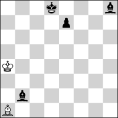 <b>h#13</b> &nbsp;·&nbsp; 2 + 4</td>
<td valign="top">
<b>No. 222</b> &nbsp;·&nbsp; <b>h#13</b>, unique solution &nbsp;·&nbsp; <a href="https://helpman.komtera.lt/?fen=3k3b/4p3/8/8/K7/8/1b6/B7&moves=13">solve ↗</a> 
2 positions of 22,724,739,072 indexed have a unique solution at h#13. The class runs to h#16.5, so the deepest sound problem is 7 plies shallower. Every position at that depth is saturated (255+ solutions). 
 <b>Solution:</b> 1.e5 Kb5 2.Ke7 Kc6 3.Kf6 Kd7 4.e4 Ke8 5.e3 Kf8 6.e2 Kg8 7.e1=N Kxh8 8.Nf3 Kg8 9.Ng5 Kf8 10.Nh7+ Ke8 11.Kg7 Ke7 12.Kh8 Kf7 13.Bg7 Bxg7# 
 <b>Themes:</b> <code>pure</code> <code>model</code> <code>ideal</code> <code>promotion</code> <code>underpromotion</code> <code>excelsior</code> <code>excelsior:black</code> <code>switchback</code> <code>self-block</code> <code>kniest</code> <code>promotions:n</code> 
 <code>3k3b/4p3/8/8/K7/8/1b6/B7 b - - 0 1</code>
</td>
</tr></table>

## KBvkqbp

<table><tr>
<td width="220" valign="top">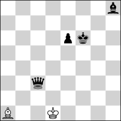 <b>h#12.5</b> &nbsp;·&nbsp; 2 + 4</td>
<td valign="top">
<b>No. 223</b> &nbsp;·&nbsp; <b>h#12.5</b>, unique solution &nbsp;·&nbsp; <a href="https://helpman.komtera.lt/?fen=7b/8/4pk2/8/8/2q5/8/B2K4&moves=12.5">solve ↗</a> 
59 positions of 22,724,739,072 indexed have a unique solution at h#12.5. The class runs to h#16.5, so the deepest sound problem is 8 plies shallower. Every position at that depth is saturated (255+ solutions). 
 <b>Solution:</b> 1...Ke2 2.Qb2+ Kf3 3.e5 Kg4 4.e4 Kh5 5.e3 Kh6 6.e2 Kh7 7.e1=N Kxh8 8.Nf3 Kg8 9.Ng5 Kf8 10.Nh7+ Ke8 11.Kg7 Ke7 12.Kh8 Kf7 13.Qg7+ Bxg7# 
 <b>Themes:</b> <code>pure</code> <code>model</code> <code>ideal</code> <code>promotion</code> <code>underpromotion</code> <code>self-block</code> <code>kniest</code> <code>promotions:n</code> 
 <code>7b/8/4pk2/8/8/2q5/8/B2K4 w - - 0 1</code>
</td>
</tr></table>

## KBvkqqp

<table><tr>
<td width="220" valign="top">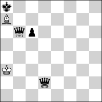 <b>h#12.5</b> &nbsp;·&nbsp; 2 + 4</td>
<td valign="top">
<b>No. 224</b> &nbsp;·&nbsp; <b>h#12.5</b>, unique solution &nbsp;·&nbsp; <a href="https://helpman.komtera.lt/?fen=k7/B7/1qp5/8/8/K7/3q4/8&moves=12.5">solve ↗</a> 
210 positions of 22,724,739,072 indexed have a unique solution at h#12.5. The class runs to h#17.5, so the deepest sound problem is 10 plies shallower. Every position at that depth is saturated (255+ solutions). 
 <b>Solution:</b> 1...Bb8 2.c5 Bd6 3.c4 Bb4 4.c3 Kb3 5.c2 Kc4 6.c1=N Bd6 7.Nd3 Kd5 8.Qda5+ Ke6 9.Nc5+ Ke7 10.Nb7 Bb4 11.Kb8 Kd7 12.Qa8 Ba5 13.Qba7 Bc7# 
 <b>Themes:</b> <code>pure</code> <code>model</code> <code>ideal</code> <code>promotion</code> <code>underpromotion</code> <code>switchback</code> <code>closed-walk</code> <code>self-block</code> <code>nocapture</code> <code>umnov</code> <code>klasinc</code> <code>promotions:n</code> 
 <code>k7/B7/1qp5/8/8/K7/3q4/8 w - - 0 1</code>
</td>
</tr></table>

## KBvkqrp

<table><tr>
<td width="220" valign="top">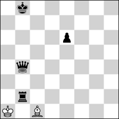 <b>h#12.5</b> &nbsp;·&nbsp; 2 + 4</td>
<td valign="top">
<b>No. 225</b> &nbsp;·&nbsp; <b>h#12.5</b>, unique solution &nbsp;·&nbsp; <a href="https://helpman.komtera.lt/?fen=1k6/8/4p3/8/1q6/8/1r6/K1B5&moves=12.5">solve ↗</a> 
495 positions of 22,724,739,072 indexed have a unique solution at h#12.5. The class runs to h#16.5, so the deepest sound problem is 8 plies shallower. Every position at that depth is saturated (255+ solutions). 
 <b>Solution:</b> 1...Be3 2.Qb7 Bb6 3.Ra2+ Kb1 4.e5 Kc1 5.e4 Kd1 6.e3 Ke1 7.e2 Kf2 8.e1=N+ Ke3 9.Nd3 Kd4 10.Nc5 Ke5 11.Qa8 Kd6 12.Nb7+ Kd7 13.Ra7 Bc7# 
 <b>Themes:</b> <code>pure</code> <code>model</code> <code>ideal</code> <code>promotion</code> <code>underpromotion</code> <code>self-block</code> <code>nocapture</code> <code>umnov</code> <code>promotions:n</code> 
 <code>1k6/8/4p3/8/1q6/8/1r6/K1B5 w - - 0 1</code>
</td>
</tr></table>

## KBvkrpp

<table><tr>
<td width="220" valign="top">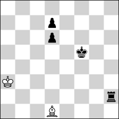 <b>h#12.5</b> &nbsp;·&nbsp; 2 + 4</td>
<td valign="top">
<b>No. 226</b> &nbsp;·&nbsp; <b>h#12.5</b>, unique solution &nbsp;·&nbsp; <a href="https://helpman.komtera.lt/?fen=8/3p4/3p4/5k2/8/K7/7r/3B4&moves=12.5">solve ↗</a> 
14 positions of 17,043,554,304 indexed have a unique solution at h#12.5. The class runs to h#16.5, so the deepest sound problem is 8 plies shallower. Every position at that depth is saturated (255+ solutions). 
 <b>Solution:</b> 1...Bc2+ 2.Kg4 Kb2 3.d5 Kc1 4.d4 Kd1 5.d3 Ke1 6.d2+ Kf1 7.d1=N Kg1 8.Ne3 Kxh2 9.Nf1+ Kg1 10.Kh3 Kf2 11.Kh2 Bf5 12.Kh1 Bh3 13.Nh2 Bg2# 
 <b>Themes:</b> <code>pure</code> <code>model</code> <code>promotion</code> <code>underpromotion</code> <code>switchback</code> <code>self-block</code> <code>promotions:n</code> 
 <code>8/3p4/3p4/5k2/8/K7/7r/3B4 w - - 0 1</code>
</td>
</tr></table>

## KBvkrrp

<table><tr>
<td width="220" valign="top">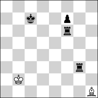 <b>h#12.5</b> &nbsp;·&nbsp; 2 + 4</td>
<td valign="top">
<b>No. 227</b> &nbsp;·&nbsp; <b>h#12.5</b>, unique solution &nbsp;·&nbsp; <a href="https://helpman.komtera.lt/?fen=8/2k2p2/5r2/8/8/6r1/1K6/7B&moves=12.5">solve ↗</a> 
79 positions of 22,724,739,072 indexed have a unique solution at h#12.5. The class runs to h#16.5, so the deepest sound problem is 8 plies shallower. Every position at that depth is saturated (255+ solutions). 
 <b>Solution:</b> 1...Be4 2.Kd6 Bd3 3.Ke5 Kc3 4.Kf4 Kd4 5.Kf3 Ke5 6.Kg2 Kxf6 7.Kh1 Ke5 8.f5 Bf1 9.f4 Bh3 10.f3 Kf4 11.f2 Kxg3 12.f1=N+ Kf2 13.Nh2 Bg2# 
 <b>Themes:</b> <code>pure</code> <code>model</code> <code>ideal</code> <code>promotion</code> <code>underpromotion</code> <code>excelsior</code> <code>excelsior:black</code> <code>switchback</code> <code>self-block</code> <code>umnov</code> <code>promotions:n</code> 
 <code>8/2k2p2/5r2/8/8/6r1/1K6/7B w - - 0 1</code>
</td>
</tr></table>

## KPvkbpp

<table><tr>
<td width="220" valign="top">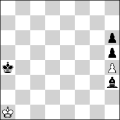 <b>h#12.5</b> &nbsp;·&nbsp; 2 + 4</td>
<td valign="top">
<b>No. 228</b> &nbsp;·&nbsp; <b>h#12.5</b>, unique solution &nbsp;·&nbsp; <a href="https://helpman.komtera.lt/?fen=8/8/7p/7p/k6P/7b/8/K7&moves=12.5">solve ↗</a> 
7 positions of 12,782,665,728 indexed have a unique solution at h#12.5. The class runs to h#15.5, so the deepest sound problem is 6 plies shallower. Every position at that depth is saturated (255+ solutions). 
 <b>Solution:</b> 1...Kb2 2.Kb5 Kc3 3.Kc6 Kd4 4.Kd7 Ke5 5.Ke8 Kf6 6.Kf8 Kg6 7.Kg8 Kxh5 8.Kh8 Kg6 9.Bf5+ Kf7 10.Kh7 h5 11.Bg6+ hxg6+ 12.Kh8 g7+ 13.Kh7 g8=Q# 
 <b>Themes:</b> <code>promotion</code> <code>switchback</code> <code>promotions:q</code> 
 <code>8/8/7p/7p/k6P/7b/8/K7 w - - 0 1</code>
</td>
</tr></table>

## KBvkrbp

<table><tr>
<td width="220" valign="top">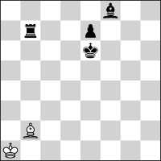 <b>h#12</b> &nbsp;·&nbsp; 2 + 4</td>
<td valign="top">
<b>No. 229</b> &nbsp;·&nbsp; <b>h#12</b>, unique solution &nbsp;·&nbsp; <a href="https://helpman.komtera.lt/?fen=5b2/1r2p3/4k3/8/8/8/1B6/K7&moves=12">solve ↗</a> 
6 positions of 22,724,739,072 indexed have a unique solution at h#12. The class runs to h#16.5, so the deepest sound problem is 9 plies shallower. Every position at that depth is saturated (255+ solutions). 
 <b>Solution:</b> 1.Kf7 Ka2 2.Kg8 Ka3 3.e5+ Ka4 4.e4 Ka5 5.e3 Ka6 6.e2 Kxb7 7.e1=N Kc6 8.Nf3 Kd5 9.Ng5 Ke5 10.Kh8 Kf6 11.Nh7+ Kf7+ 12.Bg7 Bxg7# 
 <b>Themes:</b> <code>pure</code> <code>model</code> <code>ideal</code> <code>promotion</code> <code>underpromotion</code> <code>excelsior</code> <code>excelsior:black</code> <code>self-block</code> <code>promotions:n</code> 
 <code>5b2/1r2p3/4k3/8/8/8/1B6/K7 b - - 0 1</code>
</td>
</tr></table>

## KRBvkrp

<table><tr>
<td width="220" valign="top">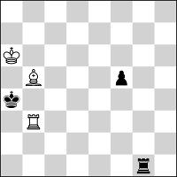 <b>h#12</b> &nbsp;·&nbsp; 3 + 3</td>
<td valign="top">
<b>No. 230</b> &nbsp;·&nbsp; <b>h#12</b>, unique solution &nbsp;·&nbsp; <a href="https://helpman.komtera.lt/?fen=8/8/K7/1B3p2/k7/1R6/8/6r1&moves=12">solve ↗</a> 
3 positions of 22,724,739,072 indexed have a unique solution at h#12. The class runs to h#17, so the deepest sound problem is 10 plies shallower. Every position at that depth is saturated (255+ solutions). 
 <b>Solution:</b> 1.Kxb3 Kb6 2.f4 Kc5 3.f3 Kd4 4.f2 Ke3 5.f1=N+ Kf2 6.Kc3 Kxg1 7.Kd4 Kf2 8.Ke4 Ke1 9.Kf3 Bd7 10.Kg2 Bh3+ 11.Kh1 Kf2 12.Nh2 Bg2# 
 <b>Themes:</b> <code>pure</code> <code>model</code> <code>ideal</code> <code>promotion</code> <code>underpromotion</code> <code>switchback</code> <code>self-block</code> <code>umnov</code> <code>promotions:n</code> 
 <b>Note:</b> the side to move is in check in the diagram; the solution begins with a capture. 
 <code>8/8/K7/1B3p2/k7/1R6/8/6r1 b - - 0 1</code>
</td>
</tr></table>

## KBvkbpp

<table><tr>
<td width="220" valign="top">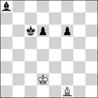 <b>h#11.5</b> &nbsp;·&nbsp; 2 + 4</td>
<td valign="top">
<b>No. 231</b> &nbsp;·&nbsp; <b>h#11.5</b>, unique solution &nbsp;·&nbsp; <a href="https://helpman.komtera.lt/?fen=b7/8/2kp1p2/8/8/8/3K4/5B2&moves=11.5">solve ↗</a> 
34 positions of 17,043,554,304 indexed have a unique solution at h#11.5. The class runs to h#16, so the deepest sound problem is 9 plies shallower. Every position at that depth is saturated (255+ solutions). 
 <b>Solution:</b> 1...Kc3 2.d5 Kb4 3.d4 Ka5 4.d3 Ka6 5.d2 Ka7 6.d1=N Kxa8 7.Nc3 Kb8 8.Nb5 Kc8 9.Na7+ Kd8 10.Kb7 Ba6+ 11.Ka8 Kc7 12.f5 Bb7# 
 <b>Themes:</b> <code>pure</code> <code>model</code> <code>promotion</code> <code>underpromotion</code> <code>self-block</code> <code>kniest</code> <code>promotions:n</code> 
 <code>b7/8/2kp1p2/8/8/8/3K4/5B2 w - - 0 1</code>
</td>
</tr></table>

## KBvkqnp

<table><tr>
<td width="220" valign="top">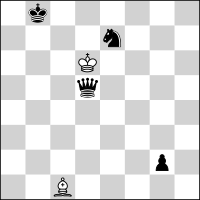 <b>h#11.5</b> &nbsp;·&nbsp; 2 + 4</td>
<td valign="top">
<b>No. 232</b> &nbsp;·&nbsp; <b>h#11.5</b>, unique solution &nbsp;·&nbsp; <a href="https://helpman.komtera.lt/?fen=1k6/4n3/3K4/3q4/8/8/6p1/2B5&moves=11.5">solve ↗</a> 
2 positions of 22,724,739,072 indexed have a unique solution at h#11.5. The class runs to h#16.5, so the deepest sound problem is 10 plies shallower. Every position at that depth is saturated (255+ solutions). 
 <b>Solution:</b> 1...Kxe7 2.Kc7 Kf6 3.Kd6 Kg6 4.Ke5 Kg5 5.Kd4+ Kf4 6.Kc3 Bd2+ 7.Kb2 Ke3 8.Ka1 Ke2 9.g1=N+ Kd1 10.Ne2 Kc2 11.Nc3 Bc1 12.Na2 Bb2# 
 <b>Themes:</b> <code>pure</code> <code>model</code> <code>promotion</code> <code>underpromotion</code> <code>switchback</code> <code>self-block</code> <code>phoenix</code> <code>umnov</code> <code>promotions:n</code> 
 <b>Note:</b> the side to move is in check in the diagram; the solution begins with a capture. 
 <code>1k6/4n3/3K4/3q4/8/8/6p1/2B5 w - - 0 1</code>
</td>
</tr></table>

## KBvkqpp

<table><tr>
<td width="220" valign="top">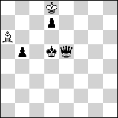 <b>h#11.5</b> &nbsp;·&nbsp; 2 + 4</td>
<td valign="top">
<b>No. 233</b> &nbsp;·&nbsp; <b>h#11.5</b>, unique solution &nbsp;·&nbsp; <a href="https://helpman.komtera.lt/?fen=3K4/3p4/B7/1p1kq3/8/8/8/8&moves=11.5">solve ↗</a> 
3 positions of 17,043,554,304 indexed have a unique solution at h#11.5. The class runs to h#16.5, so the deepest sound problem is 10 plies shallower. Every position at that depth is saturated (255+ solutions). 
 <b>Solution:</b> 1...Kc8 2.b4 Kb7 3.b3 Kb6 4.b2 Kb5 5.Ke4+ Kc4 6.Kf3 Kd3 7.Kg2 Kd2 8.Kh1 Be2 9.b1=N+ Ke1 10.Nd2 Kf2 11.Nf3 Bf1 12.Nh2 Bg2# 
 <b>Themes:</b> <code>pure</code> <code>model</code> <code>promotion</code> <code>underpromotion</code> <code>self-block</code> <code>nocapture</code> <code>umnov</code> <code>promotions:n</code> 
 <code>3K4/3p4/B7/1p1kq3/8/8/8/8 w - - 0 1</code>
</td>
</tr></table>

## KBvkrnp

<table><tr>
<td width="220" valign="top">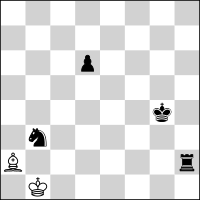 <b>h#11.5</b> &nbsp;·&nbsp; 2 + 4</td>
<td valign="top">
<b>No. 234</b> &nbsp;·&nbsp; <b>h#11.5</b>, unique solution &nbsp;·&nbsp; <a href="https://helpman.komtera.lt/?fen=8/8/3p4/8/6k1/1n6/B6r/1K6&moves=11.5">solve ↗</a> 
10 positions of 22,724,739,072 indexed have a unique solution at h#11.5. The class runs to h#16.5, so the deepest sound problem is 10 plies shallower. Every position at that depth is saturated (255+ solutions). 
 <b>Solution:</b> 1...Bxb3 2.d5 Kc1 3.d4 Kd1 4.d3 Ke1 5.d2+ Kf1 6.d1=N Kg1 7.Ne3 Kxh2 8.Nf1+ Kg1 9.Kh3 Kf2 10.Kh2 Be6 11.Kh1 Bh3 12.Nh2 Bg2# 
 <b>Themes:</b> <code>pure</code> <code>model</code> <code>ideal</code> <code>promotion</code> <code>underpromotion</code> <code>switchback</code> <code>self-block</code> <code>phoenix</code> <code>promotions:n</code> 
 <b>Note:</b> the solution begins with a capture. 
 <code>8/8/3p4/8/6k1/1n6/B6r/1K6 w - - 0 1</code>
</td>
</tr></table>

## KPvkppp

<table><tr>
<td width="220" valign="top">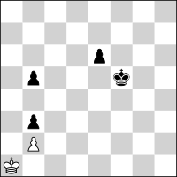 <b>h#11.5</b> &nbsp;·&nbsp; 2 + 4</td>
<td valign="top">
<b>No. 235</b> &nbsp;·&nbsp; <b>h#11.5</b>, unique solution &nbsp;·&nbsp; <a href="https://helpman.komtera.lt/?fen=8/8/4p3/1p3k2/8/1p6/1P6/K7&moves=11.5">solve ↗</a> 
4 positions of 9,586,999,296 indexed have a unique solution at h#11.5. The class runs to h#16.5, so the deepest sound problem is 10 plies shallower. Every position at that depth is saturated (255+ solutions). 
 <b>Solution:</b> 1...Kb1 2.e5 Kc1 3.e4 Kd2 4.e3+ Kc3 5.e2 Kxb3 6.e1=B Ka3 7.Ba5 b4 8.Ke4 bxa5 9.Kd3 a6 10.Kc2 a7 11.Kb1 a8=Q 12.Ka1 Qh1# 
 <b>Themes:</b> <code>pure</code> <code>model</code> <code>mirror</code> <code>promotion</code> <code>underpromotion</code> <code>excelsior</code> <code>excelsior:white</code> <code>promotions:qb</code> 
 <code>8/8/4p3/1p3k2/8/1p6/1P6/K7 w - - 0 1</code>
</td>
</tr></table>

## KBBvkrp

<table><tr>
<td width="220" valign="top">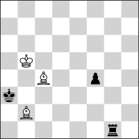 <b>h#11</b> &nbsp;·&nbsp; 3 + 3</td>
<td valign="top">
<b>No. 236</b> &nbsp;·&nbsp; <b>h#11</b>, unique solution &nbsp;·&nbsp; <a href="https://helpman.komtera.lt/?fen=8/8/8/1K6/2B2p2/k7/1B6/6r1&moves=11">solve ↗</a> 
1 position of 22,724,739,072 indexed has a unique solution at h#11. The class runs to h#17, so the deepest sound problem is 12 plies shallower. Every position at that depth is saturated (255+ solutions). 
 <b>Solution:</b> 1.Kxb2 Kc5 2.f3 Kd4 3.f2 Ke3 4.f1=N+ Kf2 5.Kc3 Kxg1 6.Kd4 Kf2 7.Ke4 Ke1 8.Kf3 Be6 9.Kg2 Bh3+ 10.Kh1 Kf2 11.Nh2 Bg2# 
 <b>Themes:</b> <code>pure</code> <code>model</code> <code>ideal</code> <code>promotion</code> <code>underpromotion</code> <code>switchback</code> <code>self-block</code> <code>umnov</code> <code>promotions:n</code> 
 <b>Note:</b> the side to move is in check in the diagram; the solution begins with a capture. 
 <code>8/8/8/1K6/2B2p2/k7/1B6/6r1 b - - 0 1</code>
</td>
</tr></table>

## KBvkppp

<table><tr>
<td width="220" valign="top">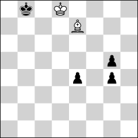 <b>h#11</b> &nbsp;·&nbsp; 2 + 4</td>
<td valign="top">
<b>No. 237</b> &nbsp;·&nbsp; <b>h#11</b>, unique solution &nbsp;·&nbsp; <a href="https://helpman.komtera.lt/?fen=1k1K4/4B3/8/6p1/4p1p1/8/8/8&moves=11">solve ↗</a> 
1 position of 12,782,665,728 indexed has a unique solution at h#11. The class runs to h#15.5, so the deepest sound problem is 9 plies shallower. Every position at that depth is saturated (255+ solutions). 
 <b>Solution:</b> 1.e3 Kd7 2.e2 Kc6 3.e1=Q Kb5 4.Kc7 Bd8+ 5.Kd6 Kc4 6.Qe8 Kd3 7.Ke5 Ke2 8.Kf4+ Kf1 9.Kg3 Bc7+ 10.Kh4 Kg2 11.Qh5 Bg3# 
 <b>Themes:</b> <code>pure</code> <code>model</code> <code>ideal</code> <code>promotion</code> <code>self-block</code> <code>nocapture</code> <code>promotions:q</code> <code>indian</code> 
 <code>1k1K4/4B3/8/6p1/4p1p1/8/8/8 b - - 0 1</code>
</td>
</tr></table>

## KBvkbnp

<table><tr>
<td width="220" valign="top">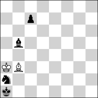 <b>h#10.5</b> &nbsp;·&nbsp; 2 + 4</td>
<td valign="top">
<b>No. 238</b> &nbsp;·&nbsp; <b>h#10.5</b>, unique solution &nbsp;·&nbsp; <a href="https://helpman.komtera.lt/?fen=8/2p5/8/1b6/8/KB6/n7/k7&moves=10.5">solve ↗</a> 
1 position of 22,724,739,072 indexed has a unique solution at h#10.5. The class runs to h#16.5, so the deepest sound problem is 12 plies shallower. Every position at that depth is saturated (255+ solutions). 
 <b>Solution:</b> 1...Ba4 2.Nb4 Kb3 3.Nc6 Kc3 4.Ka2 Bxb5 5.Ka3 Ba6 6.Ka4 Kc4 7.Ka5 Kd5 8.Kb6 Ke6 9.Ka7 Kd7 10.Ka8 Kxc7 11.Na7 Bb7# 
 <b>Themes:</b> <code>pure</code> <code>model</code> <code>ideal</code> <code>self-block</code> <code>nocheck</code> 
 <code>8/2p5/8/1b6/8/KB6/n7/k7 w - - 0 1</code>
</td>
</tr></table>

## KBvknpp

<table><tr>
<td width="220" valign="top">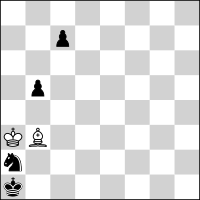 <b>h#10.5</b> &nbsp;·&nbsp; 2 + 4</td>
<td valign="top">
<b>No. 239</b> &nbsp;·&nbsp; <b>h#10.5</b>, unique solution &nbsp;·&nbsp; <a href="https://helpman.komtera.lt/?fen=8/2p5/8/1p6/8/KB6/n7/k7&moves=10.5">solve ↗</a> 
1 position of 17,043,554,304 indexed has a unique solution at h#10.5. The class runs to h#14.5, so the deepest sound problem is 8 plies shallower. Every position at that depth is saturated (255+ solutions). 
 <b>Solution:</b> 1...Ba4 2.Nb4 Kb3 3.Nc6 Kc3 4.Ka2 Bxb5 5.Ka3 Ba6 6.Ka4 Kc4 7.Ka5 Kd5 8.Kb6 Ke6 9.Ka7 Kd7 10.Ka8 Kxc7 11.Na7 Bb7# 
 <b>Themes:</b> <code>pure</code> <code>model</code> <code>ideal</code> <code>self-block</code> <code>nocheck</code> 
 <code>8/2p5/8/1p6/8/KB6/n7/k7 w - - 0 1</code>
</td>
</tr></table>

## KNvkqqp

<table><tr>
<td width="220" valign="top">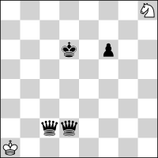 <b>h#10.5</b> &nbsp;·&nbsp; 2 + 4</td>
<td valign="top">
<b>No. 240</b> &nbsp;·&nbsp; <b>h#10.5</b>, unique solution &nbsp;·&nbsp; <a href="https://helpman.komtera.lt/?fen=7N/8/3k1p2/8/8/8/2qq4/K7&moves=10.5">solve ↗</a> 
11 positions of 22,724,739,072 indexed have a unique solution at h#10.5. The class runs to h#12.5, so the deepest sound problem is 4 plies shallower. Every position at that depth is saturated (255+ solutions). 
 <b>Solution:</b> 1...Nf7+ 2.Ke7 Ne5 3.Qd8 Nd7 4.Qb2+ Kxb2 5.f5 Kc3 6.f4 Kd4 7.f3 Ke5 8.f2 Nf6 9.f1=R Nh5 10.Ke8 Ke6 11.Rf8 Ng7# 
 <b>Themes:</b> <code>pure</code> <code>model</code> <code>ideal</code> <code>promotion</code> <code>underpromotion</code> <code>self-block</code> <code>promotions:r</code> 
 <code>7N/8/3k1p2/8/8/8/2qq4/K7 w - - 0 1</code>
</td>
</tr></table>

## KPvkbbp

<table><tr>
<td width="220" valign="top">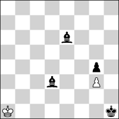 <b>h#10.5</b> &nbsp;·&nbsp; 2 + 4</td>
<td valign="top">
<b>No. 241</b> &nbsp;·&nbsp; <b>h#10.5</b>, unique solution &nbsp;·&nbsp; <a href="https://helpman.komtera.lt/?fen=8/8/4b3/8/6p1/3b2P1/8/K6k&moves=10.5">solve ↗</a> 
41 positions of 17,043,554,304 indexed have a unique solution at h#10.5. The class runs to h#15, so the deepest sound problem is 9 plies shallower. Every position at that depth is saturated (255+ solutions). 
 <b>Solution:</b> 1...Kb2 2.Kg2 Kc1 3.Kf3 Kd1 4.Ke4 Kd2 5.Kf5 Ke3 6.Kg6 Kf4 7.Bf7 Kxg4 8.Kh7 Kg5 9.Bh5 Kf6 10.Kh6 g4 11.Bh7 g5# 
 <b>Themes:</b> <code>set-play</code> <code>pure</code> <code>model</code> <code>ideal</code> <code>self-block</code> <code>nocheck</code> 
 <code>8/8/4b3/8/6p1/3b2P1/8/K6k w - - 0 1</code>
</td>
</tr></table>

## KBBvkbp

<table><tr>
<td width="220" valign="top">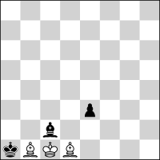 <b>h#10</b> &nbsp;·&nbsp; 3 + 3</td>
<td valign="top">
<b>No. 242</b> &nbsp;·&nbsp; <b>h#10</b>, unique solution &nbsp;·&nbsp; <a href="https://helpman.komtera.lt/?fen=8/8/8/8/8/4p3/2b5/kBKB4&moves=10">solve ↗</a> 
51 positions of 22,724,739,072 indexed have a unique solution at h#10. The class runs to h#16, so the deepest sound problem is 12 plies shallower. Every position at that depth is saturated (255+ solutions). 
 <b>Solution:</b> 1.e2 Kd2 2.Kb2 Ke1 3.Kc3 Bdxc2 4.Kd4 Bf5 5.Ke3 Bh3 6.Kf3 Bf1 7.exf1=N Bf5 8.Kg2 Bh3+ 9.Kh1 Kf2 10.Nh2 Bg2# 
 <b>Themes:</b> <code>pure</code> <code>model</code> <code>ideal</code> <code>promotion</code> <code>underpromotion</code> <code>self-block</code> <code>promotions:n</code> 
 <code>8/8/8/8/8/4p3/2b5/kBKB4 b - - 0 1</code>
</td>
</tr></table>

## KBBvkqp

<table><tr>
<td width="220" valign="top">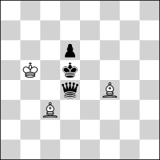 <b>h#10</b> &nbsp;·&nbsp; 3 + 3</td>
<td valign="top">
<b>No. 243</b> &nbsp;·&nbsp; <b>h#10</b>, unique solution &nbsp;·&nbsp; <a href="https://helpman.komtera.lt/?fen=8/8/3p4/1K1k4/3q1B2/2B5/8/8&moves=10">solve ↗</a> 
7 positions of 22,724,739,072 indexed have a unique solution at h#10. The class runs to h#17, so the deepest sound problem is 14 plies shallower. Every position at that depth is saturated (255+ solutions). 
 <b>Solution:</b> 1.Qa4+ Kb6 2.Kc4 Kc7 3.d5 Kd6 4.d4 Ke5 5.d3 Ke4 6.d2 Ke3 7.d1=B Kd2 8.Kb3 Kc1 9.Ka3 Kb1 10.Bb3 Bc1# 
 <b>Themes:</b> <code>promotion</code> <code>underpromotion</code> <code>self-block</code> <code>nocapture</code> <code>umnov</code> <code>promotions:b</code> 
 <code>8/8/3p4/1K1k4/3q1B2/2B5/8/8 b - - 0 1</code>
</td>
</tr></table>

## KBvkbbn

<table><tr>
<td width="220" valign="top">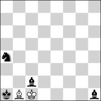 <b>h#10</b> &nbsp;·&nbsp; 2 + 4</td>
<td valign="top">
<b>No. 244</b> &nbsp;·&nbsp; <b>h#10</b>, unique solution &nbsp;·&nbsp; <a href="https://helpman.komtera.lt/?fen=8/8/8/8/n7/8/2b5/kBK4b&moves=10">solve ↗</a> 
10 positions of 7,751,073,792 indexed have a unique solution at h#10. The class runs to h#12, so the deepest sound problem is 4 plies shallower. Every position at that depth is saturated (255+ solutions). 
 <b>Solution:</b> 1.Nc5 Kxc2 2.Na6 Kd3 3.Kb2 Kc4 4.Ka3 Be4 5.Ka4 Bxh1 6.Ka5 Bb7 7.Kb6 Bc8 8.Ka7 Kb5 9.Ka8 Kb6 10.Nb8 Bb7# 
 <b>Themes:</b> <code>pure</code> <code>model</code> <code>ideal</code> <code>switchback</code> <code>self-block</code> <code>nocheck</code> 
 <code>8/8/8/8/n7/8/2b5/kBK4b b - - 0 1</code>
</td>
</tr></table>

## KBvkqnn

<table><tr>
<td width="220" valign="top"> <b>h#10</b> &nbsp;·&nbsp; 2 + 4</td>
<td valign="top">
<b>No. 245</b> &nbsp;·&nbsp; <b>h#10</b>, unique solution &nbsp;·&nbsp; <a href="https://helpman.komtera.lt/?fen=2n5/1n6/2q5/8/8/8/7B/1K5k&moves=10">solve ↗</a> 
5 positions of 7,751,073,792 indexed have a unique solution at h#10. The class runs to h#13, so the deepest sound problem is 6 plies shallower. Every position at that depth is saturated (255+ solutions). 
 <b>Solution:</b> 1.Kg2 Be5 2.Kf3 Bc3 3.Ke4 Kc2 4.Kd5 Kd3 5.Kd6 Kd4 6.Kc7 Ke5 7.Qa4 Ke6 8.Qa8 Ba5+ 9.Kb8 Kd7 10.Na7 Bc7# 
 <b>Themes:</b> <code>pure</code> <code>model</code> <code>ideal</code> <code>self-block</code> <code>nocapture</code> 
 <code>2n5/1n6/2q5/8/8/8/7B/1K5k b - - 0 1</code>
</td>
</tr></table>

## KRBvkbp

<table><tr>
<td width="220" valign="top">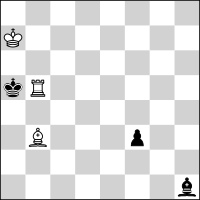 <b>h#10</b> &nbsp;·&nbsp; 3 + 3</td>
<td valign="top">
<b>No. 246</b> &nbsp;·&nbsp; <b>h#10</b>, unique solution &nbsp;·&nbsp; <a href="https://helpman.komtera.lt/?fen=8/K7/8/kR6/8/1B3p2/8/7b&moves=10">solve ↗</a> 
1 position of 22,724,739,072 indexed has a unique solution at h#10. The class runs to h#16.5, so the deepest sound problem is 13 plies shallower. Every position at that depth is saturated (255+ solutions). 
 <b>Solution:</b> 1.Kxb5 Bd5 2.f2 Bxh1 3.Kc4 Kb6 4.Kd3 Kc5 5.Ke2 Kd4 6.Kf1 Bg2+ 7.Kg1 Bh3 8.Kh1 Ke3 9.f1=N+ Kf2 10.Nh2 Bg2# 
 <b>Themes:</b> <code>pure</code> <code>model</code> <code>ideal</code> <code>promotion</code> <code>underpromotion</code> <code>switchback</code> <code>self-block</code> <code>kniest</code> <code>umnov</code> <code>promotions:n</code> 
 <b>Note:</b> the side to move is in check in the diagram; the solution begins with a capture. 
 <code>8/K7/8/kR6/8/1B3p2/8/7b b - - 0 1</code>
</td>
</tr></table>

## KRBvknp

<table><tr>
<td width="220" valign="top">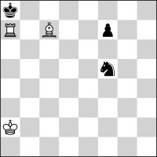 <b>h#10</b> &nbsp;·&nbsp; 3 + 3</td>
<td valign="top">
<b>No. 247</b> &nbsp;·&nbsp; <b>h#10</b>, unique solution &nbsp;·&nbsp; <a href="https://helpman.komtera.lt/?fen=k7/R1B2p2/8/5n2/8/8/K7/8&moves=10">solve ↗</a> 
1 position of 22,724,739,072 indexed has a unique solution at h#10. The class runs to h#15.5, so the deepest sound problem is 11 plies shallower. Every position at that depth is saturated (255+ solutions). 
 <b>Solution:</b> 1.Kxa7 Kb3 2.Kb7 Kc4 3.Kc8 Kd5 4.Kd7 Ke5 5.Ke8 Kf6 6.Kf8 Bd6+ 7.Kg8 Bf8 8.Kh8 Kxf7 9.Nh6+ Kg6 10.Ng8 Bg7# 
 <b>Themes:</b> <code>pure</code> <code>model</code> <code>ideal</code> <code>self-block</code> <code>umnov</code> 
 <b>Note:</b> the side to move is in check in the diagram; the solution begins with a capture. 
 <code>k7/R1B2p2/8/5n2/8/8/K7/8 b - - 0 1</code>
</td>
</tr></table>

## KRBvkqn

<table><tr>
<td width="220" valign="top">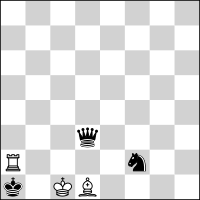 <b>h#10</b> &nbsp;·&nbsp; 3 + 3</td>
<td valign="top">
<b>No. 248</b> &nbsp;·&nbsp; <b>h#10</b>, unique solution &nbsp;·&nbsp; <a href="https://helpman.komtera.lt/?fen=8/8/8/8/8/3q4/R4n2/k1KB4&moves=10">solve ↗</a> 
4 positions of 7,751,073,792 indexed have a unique solution at h#10. The class runs to h#13, so the deepest sound problem is 6 plies shallower. Every position at that depth is saturated (255+ solutions). 
 <b>Solution:</b> 1.Kxa2 Be2 2.Kb3 Bxd3 3.Kc3 Kb1 4.Kd2 Bf1 5.Ke1 Kc2 6.Nh3 Kd3 7.Kf2 Ke4 8.Kg1 Kf3 9.Kh1 Kg3 10.Ng1 Bg2# 
 <b>Themes:</b> <code>pure</code> <code>model</code> <code>ideal</code> <code>self-block</code> <code>nocheck</code> 
 <b>Note:</b> the side to move is in check in the diagram; the solution begins with a capture. 
 <code>8/8/8/8/8/3q4/R4n2/k1KB4 b - - 0 1</code>
</td>
</tr></table>

## KRBvkqp

<table><tr>
<td width="220" valign="top">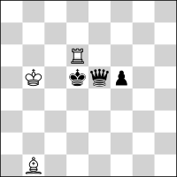 <b>h#10</b> &nbsp;·&nbsp; 3 + 3</td>
<td valign="top">
<b>No. 249</b> &nbsp;·&nbsp; <b>h#10</b>, unique solution &nbsp;·&nbsp; <a href="https://helpman.komtera.lt/?fen=8/8/3R4/1K1kqp2/8/8/8/1B6&moves=10">solve ↗</a> 
4 positions of 22,724,739,072 indexed have a unique solution at h#10. The class runs to h#17, so the deepest sound problem is 14 plies shallower. Every position at that depth is saturated (255+ solutions). 
 <b>Solution:</b> 1.Qxd6 Ka4 2.f4 Kb3 3.f3 Kc2 4.f2 Kd1 5.f1=N Ba2+ 6.Ke4+ Ke1 7.Kf3 Be6 8.Kg2 Bh3+ 9.Kh1 Kf2 10.Nh2 Bg2# 
 <b>Themes:</b> <code>pure</code> <code>model</code> <code>promotion</code> <code>underpromotion</code> <code>self-block</code> <code>promotions:n</code> 
 <b>Note:</b> the side to move is in check in the diagram; the solution begins with a capture. 
 <code>8/8/3R4/1K1kqp2/8/8/8/1B6 b - - 0 1</code>
</td>
</tr></table>

## KRBvkrn

<table><tr>
<td width="220" valign="top">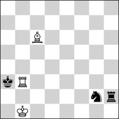 <b>h#10</b> &nbsp;·&nbsp; 3 + 3</td>
<td valign="top">
<b>No. 250</b> &nbsp;·&nbsp; <b>h#10</b>, unique solution &nbsp;·&nbsp; <a href="https://helpman.komtera.lt/?fen=8/8/2B5/8/8/kR6/6nr/1K6&moves=10">solve ↗</a> 
3 positions of 7,751,073,792 indexed have a unique solution at h#10. The class runs to h#13, so the deepest sound problem is 6 plies shallower. Every position at that depth is saturated (255+ solutions). 
 <b>Solution:</b> 1.Kxb3 Kc1 2.Kc4 Kd2 3.Nf4+ Ke3 4.Nh3 Kf3 5.Kd3 Kg3 6.Ke2 Kxh2 7.Kf1 Kg3 8.Kg1 Bb5 9.Kh1 Bf1 10.Ng1 Bg2# 
 <b>Themes:</b> <code>pure</code> <code>model</code> <code>ideal</code> <code>switchback</code> <code>self-block</code> 
 <b>Note:</b> the side to move is in check in the diagram; the solution begins with a capture. 
 <code>8/8/2B5/8/8/kR6/6nr/1K6 b - - 0 1</code>
</td>
</tr></table>

## KBBvknp

<table><tr>
<td width="220" valign="top">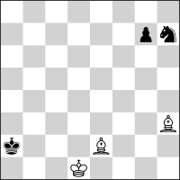 <b>h#9.5</b> &nbsp;·&nbsp; 3 + 3</td>
<td valign="top">
<b>No. 251</b> &nbsp;·&nbsp; <b>h#9.5</b>, unique solution &nbsp;·&nbsp; <a href="https://helpman.komtera.lt/?fen=8/6pn/8/8/8/7B/k3B3/3K4&moves=9.5">solve ↗</a> 
7 positions of 22,724,739,072 indexed have a unique solution at h#9.5. The class runs to h#14.5, so the deepest sound problem is 10 plies shallower. Every position at that depth is saturated (255+ solutions). 
 <b>Solution:</b> 1...Bef1 2.Kb3 Ke2 3.Kc4 Kf3+ 4.Kd5 Kg4 5.Ke6 Bd3 6.Kf7 Kf5 7.Kg8 Ke6 8.Ng5+ Ke7 9.Nf7 Bhf5 10.Nh8 Bh7# 
 <b>Themes:</b> <code>pure</code> <code>model</code> <code>ideal</code> <code>self-block</code> <code>nocapture</code> 
 <code>8/6pn/8/8/8/7B/k3B3/3K4 w - - 0 1</code>
</td>
</tr></table>

## KBBvkpp

<table><tr>
<td width="220" valign="top">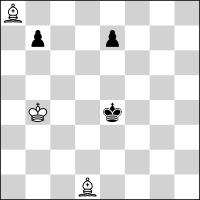 <b>h#9.5</b> &nbsp;·&nbsp; 3 + 3</td>
<td valign="top">
<b>No. 252</b> &nbsp;·&nbsp; <b>h#9.5</b>, unique solution &nbsp;·&nbsp; <a href="https://helpman.komtera.lt/?fen=B7/1p2p3/8/8/1K2k3/8/8/3B4&moves=9.5">solve ↗</a> 
4 positions of 17,043,554,304 indexed have a unique solution at h#9.5. The class runs to h#16, so the deepest sound problem is 13 plies shallower. Every position at that depth is saturated (255+ solutions). 
 <b>Solution:</b> 1...Be2 2.e5 Bf1 3.Kf3 Bxb7+ 4.e4 Bc8 5.e3 Kc3 6.e2 Kd2 7.exf1=N+ Ke1 8.Kg2 Bh3+ 9.Kh1 Kf2 10.Nh2 Bg2# 
 <b>Themes:</b> <code>pure</code> <code>model</code> <code>ideal</code> <code>promotion</code> <code>underpromotion</code> <code>excelsior</code> <code>excelsior:black</code> <code>self-block</code> <code>promotions:n</code> 
 <code>B7/1p2p3/8/8/1K2k3/8/8/3B4 w - - 0 1</code>
</td>
</tr></table>

## KBBvkqn

<table><tr>
<td width="220" valign="top">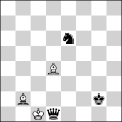 <b>h#9.5</b> &nbsp;·&nbsp; 3 + 3</td>
<td valign="top">
<b>No. 253</b> &nbsp;·&nbsp; <b>h#9.5</b>, unique solution &nbsp;·&nbsp; <a href="https://helpman.komtera.lt/?fen=8/8/4n3/8/3B4/8/1B4k1/2Kq4&moves=9.5">solve ↗</a> 
3 positions of 7,751,073,792 indexed have a unique solution at h#9.5. The class runs to h#13, so the deepest sound problem is 7 plies shallower. Every position at that depth is saturated (255+ solutions). 
 <b>Solution:</b> 1...Kxd1 2.Kf3 Bc1 3.Ke4 Ke2 4.Kxd4 Kf3 5.Ke5 Kg4 6.Kf6 Kh5 7.Kg7 Bh6+ 8.Kh8 Kg6 9.Nf8+ Kf7 10.Nh7 Bg7# 
 <b>Themes:</b> <code>pure</code> <code>model</code> <code>ideal</code> <code>self-block</code> 
 <b>Note:</b> the side to move is in check in the diagram; the solution begins with a capture. 
 <code>8/8/4n3/8/3B4/8/1B4k1/2Kq4 w - - 0 1</code>
</td>
</tr></table>

## KBvkbnn

<table><tr>
<td width="220" valign="top">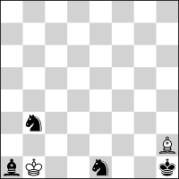 <b>h#9.5</b> &nbsp;·&nbsp; 2 + 4</td>
<td valign="top">
<b>No. 254</b> &nbsp;·&nbsp; <b>h#9.5</b>, unique solution &nbsp;·&nbsp; <a href="https://helpman.komtera.lt/?fen=8/8/8/8/8/1n6/7B/bK2n2k&moves=9.5">solve ↗</a> 
109 positions of 7,751,073,792 indexed have a unique solution at h#9.5. The class runs to h#12.5, so the deepest sound problem is 6 plies shallower. Every position at that depth is saturated (255+ solutions). 
 <b>Solution:</b> 1...Bd6 2.Nc1 Kxa1 3.Kg2 Kb2 4.Kf3 Kc3 5.Ke4 Kd2 6.Kd4 Kxe1 7.Kc3 Kd1 8.Kb2 Ba3+ 9.Ka1 Kc2 10.Na2 Bb2# 
 <b>Themes:</b> <code>pure</code> <code>model</code> <code>ideal</code> <code>self-block</code> <code>kniest</code> 
 <code>8/8/8/8/8/1n6/7B/bK2n2k w - - 0 1</code>
</td>
</tr></table>

## KBvknnn

<table><tr>
<td width="220" valign="top">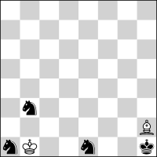 <b>h#9.5</b> &nbsp;·&nbsp; 2 + 4</td>
<td valign="top">
<b>No. 255</b> &nbsp;·&nbsp; <b>h#9.5</b>, unique solution &nbsp;·&nbsp; <a href="https://helpman.komtera.lt/?fen=8/8/8/8/8/1n6/7B/nK2n2k&moves=9.5">solve ↗</a> 
35 positions of 7,751,073,792 indexed have a unique solution at h#9.5. The class runs to h#12, so the deepest sound problem is 5 plies shallower. Every position at that depth is saturated (255+ solutions). 
 <b>Solution:</b> 1...Bd6 2.Nc1 Kxa1 3.Kg2 Kb2 4.Kf3 Kc3 5.Ke4 Kd2 6.Kd4 Kxe1 7.Kc3 Kd1 8.Kb2 Ba3+ 9.Ka1 Kc2 10.Na2 Bb2# 
 <b>Themes:</b> <code>pure</code> <code>model</code> <code>ideal</code> <code>self-block</code> <code>kniest</code> 
 <code>8/8/8/8/8/1n6/7B/nK2n2k w - - 0 1</code>
</td>
</tr></table>

## KBvknnp

<table><tr>
<td width="220" valign="top">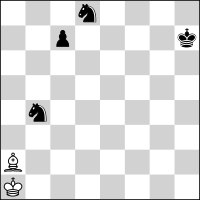 <b>h#9.5</b> &nbsp;·&nbsp; 2 + 4</td>
<td valign="top">
<b>No. 256</b> &nbsp;·&nbsp; <b>h#9.5</b>, unique solution &nbsp;·&nbsp; <a href="https://helpman.komtera.lt/?fen=3n4/2p4k/8/8/1n6/8/B7/K7&moves=9.5">solve ↗</a> 
209 positions of 22,724,739,072 indexed have a unique solution at h#9.5. The class runs to h#12.5, so the deepest sound problem is 6 plies shallower. Every position at that depth is saturated (255+ solutions). 
 <b>Solution:</b> 1...Kb2 2.Kg7 Kc3 3.Kf8 Kd4 4.Ke8 Ke5 5.Ndc6+ Ke6 6.Kd8 Bc4 7.Kc8 Ba6+ 8.Kb8 Kd7 9.Ka8 Kxc7 10.Na7 Bb7# 
 <b>Themes:</b> <code>pure</code> <code>model</code> <code>self-block</code> 
 <code>3n4/2p4k/8/8/1n6/8/B7/K7 w - - 0 1</code>
</td>
</tr></table>

## KBvkqbn

<table><tr>
<td width="220" valign="top"> <b>h#9.5</b> &nbsp;·&nbsp; 2 + 4</td>
<td valign="top">
<b>No. 257</b> &nbsp;·&nbsp; <b>h#9.5</b>, unique solution &nbsp;·&nbsp; <a href="https://helpman.komtera.lt/?fen=7n/8/2B5/3b4/8/2k5/2q5/1K6&moves=9.5">solve ↗</a> 
90 positions of 7,751,073,792 indexed have a unique solution at h#9.5. The class runs to h#12.5, so the deepest sound problem is 6 plies shallower. Every position at that depth is saturated (255+ solutions). 
 <b>Solution:</b> 1...Ka1 2.Kb4 Bb5 3.Qc5 Kb2 4.Bb3 Bc4 5.Ka4 Kc3 6.Qa3 Kd4 7.Ng6 Kd5 8.Nf4+ Kc6 9.Nd3 Kb6 10.Nb4 Bb5# 
 <b>Themes:</b> <code>pure</code> <code>model</code> <code>ideal</code> <code>switchback</code> <code>self-block</code> <code>nocapture</code> 
 <b>Note:</b> the side to move is in check in the diagram. 
 <code>7n/8/2B5/3b4/8/2k5/2q5/1K6 w - - 0 1</code>
</td>
</tr></table>

## KBvkqqn

<table><tr>
<td width="220" valign="top"> <b>h#9.5</b> &nbsp;·&nbsp; 2 + 4</td>
<td valign="top">
<b>No. 258</b> &nbsp;·&nbsp; <b>h#9.5</b>, unique solution &nbsp;·&nbsp; <a href="https://helpman.komtera.lt/?fen=8/1q6/1n6/8/8/8/q7/KBk5&moves=9.5">solve ↗</a> 
341 positions of 7,751,073,792 indexed have a unique solution at h#9.5. The class runs to h#12.5, so the deepest sound problem is 6 plies shallower. Every position at that depth is saturated (255+ solutions). 
 <b>Solution:</b> 1...Kxa2 2.Kd2 Be4 3.Kc3 Bxb7 4.Kb4 Ba6 5.Ka5 Kb3 6.Nc8 Kc4 7.Kb6 Kd5 8.Ka7 Kc6 9.Ka8 Kc7 10.Na7 Bb7# 
 <b>Themes:</b> <code>pure</code> <code>model</code> <code>ideal</code> <code>switchback</code> <code>self-block</code> <code>nocheck</code> 
 <b>Note:</b> the side to move is in check in the diagram; the solution begins with a capture. 
 <code>8/1q6/1n6/8/8/8/q7/KBk5 w - - 0 1</code>
</td>
</tr></table>

## KBvkqrn

<table><tr>
<td width="220" valign="top"> <b>h#9.5</b> &nbsp;·&nbsp; 2 + 4</td>
<td valign="top">
<b>No. 259</b> &nbsp;·&nbsp; <b>h#9.5</b>, unique solution &nbsp;·&nbsp; <a href="https://helpman.komtera.lt/?fen=n7/8/4r3/8/8/5k2/2qB4/K7&moves=9.5">solve ↗</a> 
394 positions of 7,751,073,792 indexed have a unique solution at h#9.5. The class runs to h#12.5, so the deepest sound problem is 6 plies shallower. Every position at that depth is saturated (255+ solutions). 
 <b>Solution:</b> 1...Be3 2.Qd1+ Kb2 3.Nc7 Kc3 4.Nb5+ Kc4 5.Nd4 Kd5 6.Rd6+ Ke5 7.Ke2 Kf4 8.Ke1 Kg3 9.Ne2+ Kg2 10.Rd2 Bf2# 
 <b>Themes:</b> <code>set-play</code> <code>pure</code> <code>model</code> <code>ideal</code> <code>self-block</code> <code>nocapture</code> 
 <code>n7/8/4r3/8/8/5k2/2qB4/K7 w - - 0 1</code>
</td>
</tr></table>

## KBvkrbn

<table><tr>
<td width="220" valign="top">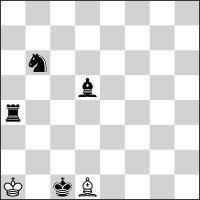 <b>h#9.5</b> &nbsp;·&nbsp; 2 + 4</td>
<td valign="top">
<b>No. 260</b> &nbsp;·&nbsp; <b>h#9.5</b>, unique solution &nbsp;·&nbsp; <a href="https://helpman.komtera.lt/?fen=8/8/1n6/3b4/r7/8/8/K1kB4&moves=9.5">solve ↗</a> 
27 positions of 7,751,073,792 indexed have a unique solution at h#9.5. The class runs to h#12.5, so the deepest sound problem is 6 plies shallower. Every position at that depth is saturated (255+ solutions). 
 <b>Solution:</b> 1...Bxa4 2.Kd2 Bb5 3.Kc3 Ba6 4.Kb4 Kb2 5.Ka5 Kc3 6.Nc8 Kd4 7.Kb6 Kxd5 8.Ka7 Kc6 9.Ka8 Kc7 10.Na7 Bb7# 
 <b>Themes:</b> <code>pure</code> <code>model</code> <code>ideal</code> <code>self-block</code> <code>nocheck</code> 
 <b>Note:</b> the side to move is in check in the diagram; the solution begins with a capture. 
 <code>8/8/1n6/3b4/r7/8/8/K1kB4 w - - 0 1</code>
</td>
</tr></table>

## KBvkrnn

<table><tr>
<td width="220" valign="top">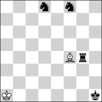 <b>h#9.5</b> &nbsp;·&nbsp; 2 + 4</td>
<td valign="top">
<b>No. 261</b> &nbsp;·&nbsp; <b>h#9.5</b>, unique solution &nbsp;·&nbsp; <a href="https://helpman.komtera.lt/?fen=3n1n2/8/8/8/5Br1/8/8/K6k&moves=9.5">solve ↗</a> 
36 positions of 7,751,073,792 indexed have a unique solution at h#9.5. The class runs to h#13, so the deepest sound problem is 7 plies shallower. Every position at that depth is saturated (255+ solutions). 
 <b>Solution:</b> 1...Kb2 2.Kg2 Kc3 3.Kh3 Kd4 4.Kh4 Ke5 5.Kh5 Bg5 6.Kg6 Bxd8 7.Kh7 Kf6 8.Kh8 Kf7 9.Nh7 Bf6+ 10.Rg7+ Bxg7# 
 <b>Themes:</b> <code>pure</code> <code>model</code> <code>ideal</code> <code>self-block</code> 
 <code>3n1n2/8/8/8/5Br1/8/8/K6k w - - 0 1</code>
</td>
</tr></table>

## KBvkrrn

<table><tr>
<td width="220" valign="top">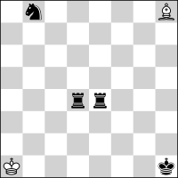 <b>h#9.5</b> &nbsp;·&nbsp; 2 + 4</td>
<td valign="top">
<b>No. 262</b> &nbsp;·&nbsp; <b>h#9.5</b>, unique solution &nbsp;·&nbsp; <a href="https://helpman.komtera.lt/?fen=1n5B/8/8/8/3rr3/8/8/K6k&moves=9.5">solve ↗</a> 
128 positions of 7,751,073,792 indexed have a unique solution at h#9.5. The class runs to h#12.5, so the deepest sound problem is 6 plies shallower. Every position at that depth is saturated (255+ solutions). 
 <b>Solution:</b> 1...Kb2 2.Rd1 Bc3 3.Nc6 Bd2 4.Nd4 Kc3 5.Ne2+ Kd3 6.Rd4+ Ke3 7.Kg1 Kf3 8.Kf1 Be3 9.Ke1 Kg2 10.R4d2 Bf2# 
 <b>Themes:</b> <code>pure</code> <code>model</code> <code>ideal</code> <code>self-block</code> <code>nocapture</code> 
 <code>1n5B/8/8/8/3rr3/8/8/K6k w - - 0 1</code>
</td>
</tr></table>

## KNvkppp

<table><tr>
<td width="220" valign="top">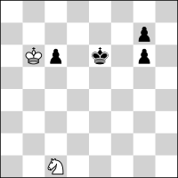 <b>h#9.5</b> &nbsp;·&nbsp; 2 + 4</td>
<td valign="top">
<b>No. 263</b> &nbsp;·&nbsp; <b>h#9.5</b>, unique solution &nbsp;·&nbsp; <a href="https://helpman.komtera.lt/?fen=8/6p1/1Kp1k1p1/8/8/8/8/2N5&moves=9.5">solve ↗</a> 
17 positions of 12,782,665,728 indexed have a unique solution at h#9.5. The class runs to h#11.5, so the deepest sound problem is 4 plies shallower. Every position at that depth is saturated (255+ solutions). 
 <b>Solution:</b> 1...Kc7 2.g5 Kd8 3.g4 Ke8 4.g3 Kf8 5.g2 Kxg7 6.g1=R+ Kh7 7.Kf7 Kh6 8.Kg8 Nd3 9.Kh8 Ne5 10.Rg8 Nf7# 
 <b>Themes:</b> <code>pure</code> <code>model</code> <code>promotion</code> <code>underpromotion</code> <code>self-block</code> <code>promotions:r</code> 
 <code>8/6p1/1Kp1k1p1/8/8/8/8/2N5 w - - 0 1</code>
</td>
</tr></table>

## KNvkqbb

<table><tr>
<td width="220" valign="top">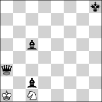 <b>h#9.5</b> &nbsp;·&nbsp; 2 + 4</td>
<td valign="top">
<b>No. 264</b> &nbsp;·&nbsp; <b>h#9.5</b>, unique solution &nbsp;·&nbsp; <a href="https://helpman.komtera.lt/?fen=7k/8/8/2b5/8/q7/2b5/K1N5&moves=9.5">solve ↗</a> 
23 positions of 7,751,073,792 indexed have a unique solution at h#9.5. The class runs to h#11.5, so the deepest sound problem is 4 plies shallower. Every position at that depth is saturated (255+ solutions). 
 <b>Solution:</b> 1...Na2 2.Qb2+ Kxb2 3.Kg7 Kc3 4.Kf6 Kc4 5.Ke5 Kb5 6.Kd4 Nc1 7.Kc3 Kxc5 8.Kb2 Kb4 9.Ka1 Ka3 10.Bb1 Nb3# 
 <b>Themes:</b> <code>pure</code> <code>model</code> <code>ideal</code> <code>switchback</code> <code>self-block</code> 
 <b>Note:</b> the side to move is in check in the diagram. 
 <code>7k/8/8/2b5/8/q7/2b5/K1N5 w - - 0 1</code>
</td>
</tr></table>

## KNvkqbn

<table><tr>
<td width="220" valign="top"> <b>h#9.5</b> &nbsp;·&nbsp; 2 + 4</td>
<td valign="top">
<b>No. 265</b> &nbsp;·&nbsp; <b>h#9.5</b>, unique solution &nbsp;·&nbsp; <a href="https://helpman.komtera.lt/?fen=7k/6N1/8/8/8/8/b2q4/nK6&moves=9.5">solve ↗</a> 
3 positions of 7,751,073,792 indexed have a unique solution at h#9.5. The class runs to h#11.5, so the deepest sound problem is 4 plies shallower. Every position at that depth is saturated (255+ solutions). 
 <b>Solution:</b> 1...Kxa1 2.Kg8 Nf5 3.Kf7 Ne3 4.Ke6 Nc2 5.Kd5 Kb2 6.Kc4 Ka3 7.Kc3 Ka4 8.Kb2 Nd4 9.Ka1 Ka3 10.Bb1 Nb3# 
 <b>Themes:</b> <code>pure</code> <code>model</code> <code>switchback</code> <code>self-block</code> <code>kniest</code> <code>nocheck</code> 
 <b>Note:</b> the side to move is in check in the diagram; the solution begins with a capture. 
 <code>7k/6N1/8/8/8/8/b2q4/nK6 w - - 0 1</code>
</td>
</tr></table>

## KNvkqbp

<table><tr>
<td width="220" valign="top">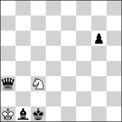 <b>h#9.5</b> &nbsp;·&nbsp; 2 + 4</td>
<td valign="top">
<b>No. 266</b> &nbsp;·&nbsp; <b>h#9.5</b>, unique solution &nbsp;·&nbsp; <a href="https://helpman.komtera.lt/?fen=8/8/6p1/8/8/q1N5/8/Kbk5&moves=9.5">solve ↗</a> 
50 positions of 22,724,739,072 indexed have a unique solution at h#9.5. The class runs to h#10.5, so the deepest sound problem is 2 plies shallower. Every position at that depth is saturated (255+ solutions). 
 <b>Solution:</b> 1...Na2+ 2.Kd2 Kxb1 3.g5 Nc3 4.Qc1+ Ka2 5.g4 Kb3 6.g3 Kc4 7.g2 Kd4 8.g1=R Ne4+ 9.Kd1 Kd3 10.Re1 Nf2# 
 <b>Themes:</b> <code>pure</code> <code>model</code> <code>ideal</code> <code>promotion</code> <code>underpromotion</code> <code>switchback</code> <code>self-block</code> <code>promotions:r</code> 
 <b>Note:</b> the side to move is in check in the diagram. 
 <code>8/8/6p1/8/8/q1N5/8/Kbk5 w - - 0 1</code>
</td>
</tr></table>

## KNvkqnp

<table><tr>
<td width="220" valign="top">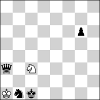 <b>h#9.5</b> &nbsp;·&nbsp; 2 + 4</td>
<td valign="top">
<b>No. 267</b> &nbsp;·&nbsp; <b>h#9.5</b>, unique solution &nbsp;·&nbsp; <a href="https://helpman.komtera.lt/?fen=8/8/6p1/8/8/q1N5/8/Knk5&moves=9.5">solve ↗</a> 
50 positions of 22,724,739,072 indexed have a unique solution at h#9.5. The class runs to h#11.5, so the deepest sound problem is 4 plies shallower. Every position at that depth is saturated (255+ solutions). 
 <b>Solution:</b> 1...Na2+ 2.Kd2 Kxb1 3.g5 Nc3 4.Qc1+ Ka2 5.g4 Kb3 6.g3 Kc4 7.g2 Kd4 8.g1=R Ne4+ 9.Kd1 Kd3 10.Re1 Nf2# 
 <b>Themes:</b> <code>pure</code> <code>model</code> <code>ideal</code> <code>promotion</code> <code>underpromotion</code> <code>switchback</code> <code>self-block</code> <code>promotions:r</code> 
 <b>Note:</b> the side to move is in check in the diagram. 
 <code>8/8/6p1/8/8/q1N5/8/Knk5 w - - 0 1</code>
</td>
</tr></table>

## KNvkqpp

<table><tr>
<td width="220" valign="top">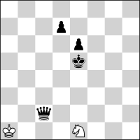 <b>h#9.5</b> &nbsp;·&nbsp; 2 + 4</td>
<td valign="top">
<b>No. 268</b> &nbsp;·&nbsp; <b>h#9.5</b>, unique solution &nbsp;·&nbsp; <a href="https://helpman.komtera.lt/?fen=8/3p4/4p3/4k3/8/8/2q5/K3N3&moves=9.5">solve ↗</a> 
993 positions of 17,043,554,304 indexed have a unique solution at h#9.5. The class runs to h#11.5, so the deepest sound problem is 4 plies shallower. Every position at that depth is saturated (255+ solutions). 
 <b>Solution:</b> 1...Nf3+ 2.Kf4 Nd2 3.Qd1+ Kb2 4.e5 Kc3 5.e4 Kd4 6.Kg3 Ke5 7.Kf2 Kf4 8.Ke1 Kg3 9.e3 Kg2 10.e2 Nf3# 
 <b>Themes:</b> <code>pure</code> <code>model</code> <code>switchback</code> <code>self-block</code> <code>nocapture</code> 
 <code>8/3p4/4p3/4k3/8/8/2q5/K3N3 w - - 0 1</code>
</td>
</tr></table>

## KNvkqqb

<table><tr>
<td width="220" valign="top">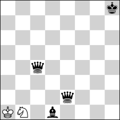 <b>h#9.5</b> &nbsp;·&nbsp; 2 + 4</td>
<td valign="top">
<b>No. 269</b> &nbsp;·&nbsp; <b>h#9.5</b>, unique solution &nbsp;·&nbsp; <a href="https://helpman.komtera.lt/?fen=7k/8/8/8/2q5/8/4q3/KN1b4&moves=9.5">solve ↗</a> 
140 positions of 7,751,073,792 indexed have a unique solution at h#9.5. The class runs to h#11.5, so the deepest sound problem is 4 plies shallower. Every position at that depth is saturated (255+ solutions). 
 <b>Solution:</b> 1...Nd2 2.Kg7 Kb2 3.Kf6 Ka3 4.Ke5 Nxc4+ 5.Kd4 Kb4 6.Bc2 Ka5 7.Kc3 Nd2 8.Kb2 Kb4 9.Ka1 Ka3 10.Bb1 Nb3# 
 <b>Themes:</b> <code>pure</code> <code>model</code> <code>switchback</code> <code>self-block</code> 
 <code>7k/8/8/8/2q5/8/4q3/KN1b4 w - - 0 1</code>
</td>
</tr></table>

## KNvkqrb

<table><tr>
<td width="220" valign="top">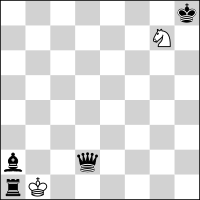 <b>h#9.5</b> &nbsp;·&nbsp; 2 + 4</td>
<td valign="top">
<b>No. 270</b> &nbsp;·&nbsp; <b>h#9.5</b>, unique solution &nbsp;·&nbsp; <a href="https://helpman.komtera.lt/?fen=7k/6N1/8/8/8/8/b2q4/rK6&moves=9.5">solve ↗</a> 
1 position of 7,751,073,792 indexed has a unique solution at h#9.5. The class runs to h#11.5, so the deepest sound problem is 4 plies shallower. Every position at that depth is saturated (255+ solutions). 
 <b>Solution:</b> 1...Kxa1 2.Kg8 Nf5 3.Kf7 Ne3 4.Ke6 Nc2 5.Kd5 Kb2 6.Kc4 Ka3 7.Kc3 Ka4 8.Kb2 Nd4 9.Ka1 Ka3 10.Bb1 Nb3# 
 <b>Themes:</b> <code>pure</code> <code>model</code> <code>switchback</code> <code>self-block</code> <code>kniest</code> <code>nocheck</code> 
 <b>Note:</b> the diagram has no legal last move, so it cannot arise in a game. 
 <code>7k/6N1/8/8/8/8/b2q4/rK6 w - - 0 1</code>
</td>
</tr></table>

## KNvkqrp

<table><tr>
<td width="220" valign="top">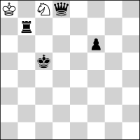 <b>h#9.5</b> &nbsp;·&nbsp; 2 + 4</td>
<td valign="top">
<b>No. 271</b> &nbsp;·&nbsp; <b>h#9.5</b>, unique solution &nbsp;·&nbsp; <a href="https://helpman.komtera.lt/?fen=K1Nq4/1r6/5p2/2k5/8/8/8/8&moves=9.5">solve ↗</a> 
351 positions of 22,724,739,072 indexed have a unique solution at h#9.5. The class runs to h#11.5, so the deepest sound problem is 4 plies shallower. Every position at that depth is saturated (255+ solutions). 
 <b>Solution:</b> 1...Kxb7 2.f5 Nb6 3.Kd6 Nd7 4.Ke7 Kc6 5.f4 Kd5 6.f3 Ke5 7.f2 Nf6 8.f1=R Nh5 9.Ke8 Ke6 10.Rf8 Ng7# 
 <b>Themes:</b> <code>pure</code> <code>model</code> <code>ideal</code> <code>promotion</code> <code>underpromotion</code> <code>self-block</code> <code>phoenix</code> <code>nocheck</code> <code>promotions:r</code> 
 <b>Note:</b> the solution begins with a capture. 
 <code>K1Nq4/1r6/5p2/2k5/8/8/8/8 w - - 0 1</code>
</td>
</tr></table>

## KNvkrpp

<table><tr>
<td width="220" valign="top">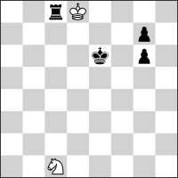 <b>h#9.5</b> &nbsp;·&nbsp; 2 + 4</td>
<td valign="top">
<b>No. 272</b> &nbsp;·&nbsp; <b>h#9.5</b>, unique solution &nbsp;·&nbsp; <a href="https://helpman.komtera.lt/?fen=2rK4/6p1/4k1p1/8/8/8/8/2N5&moves=9.5">solve ↗</a> 
1 position of 17,043,554,304 indexed has a unique solution at h#9.5. The class runs to h#11.5, so the deepest sound problem is 4 plies shallower. Every position at that depth is saturated (255+ solutions). 
 <b>Solution:</b> 1...Kxc8 2.g5 Kd8 3.g4 Ke8 4.g3 Kf8 5.g2 Kxg7 6.g1=R+ Kh7 7.Kf7 Kh6 8.Kg8 Nd3 9.Kh8 Ne5 10.Rg8 Nf7# 
 <b>Themes:</b> <code>pure</code> <code>model</code> <code>ideal</code> <code>promotion</code> <code>underpromotion</code> <code>switchback</code> <code>self-block</code> <code>phoenix</code> <code>promotions:r</code> 
 <b>Note:</b> the side to move is in check in the diagram; the solution begins with a capture. 
 <code>2rK4/6p1/4k1p1/8/8/8/8/2N5 w - - 0 1</code>
</td>
</tr></table>

## KPvkbnp

<table><tr>
<td width="220" valign="top">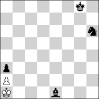 <b>h#9.5</b> &nbsp;·&nbsp; 2 + 4</td>
<td valign="top">
<b>No. 273</b> &nbsp;·&nbsp; <b>h#9.5</b>, unique solution &nbsp;·&nbsp; <a href="https://helpman.komtera.lt/?fen=6k1/8/7n/8/8/p7/P7/K3b3&moves=9.5">solve ↗</a> 
14 positions of 17,043,554,304 indexed have a unique solution at h#9.5. The class runs to h#14.5, so the deepest sound problem is 10 plies shallower. Every position at that depth is saturated (255+ solutions). 
 <b>Solution:</b> 1...Kb1 2.Nf5 Kc2 3.Nd4+ Kc1 4.Nb3+ axb3 5.Kf7 b4 6.Ke6 b5 7.Kd5 b6 8.Kc4 b7 9.Kb3 b8=Q+ 10.Ka2 Qb1# 
 <b>Themes:</b> <code>set-play</code> <code>promotion</code> <code>excelsior</code> <code>excelsior:white</code> <code>promotions:q</code> 
 <code>6k1/8/7n/8/8/p7/P7/K3b3 w - - 0 1</code>
</td>
</tr></table>

## KPvknnp

<table><tr>
<td width="220" valign="top">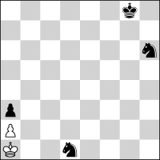 <b>h#9.5</b> &nbsp;·&nbsp; 2 + 4</td>
<td valign="top">
<b>No. 274</b> &nbsp;·&nbsp; <b>h#9.5</b>, unique solution &nbsp;·&nbsp; <a href="https://helpman.komtera.lt/?fen=6k1/8/7n/8/8/p7/P7/K2n4&moves=9.5">solve ↗</a> 
1 position of 17,043,554,304 indexed has a unique solution at h#9.5. The class runs to h#11.5, so the deepest sound problem is 4 plies shallower. Every position at that depth is saturated (255+ solutions). 
 <b>Solution:</b> 1...Kb1 2.Nf5 Kc2 3.Nd4+ Kc1 4.Nb3+ axb3 5.Kf7 b4 6.Ke6 b5 7.Kd5 b6 8.Kc4 b7 9.Kb3 b8=Q+ 10.Ka2 Qb1# 
 <b>Themes:</b> <code>set-play</code> <code>promotion</code> <code>excelsior</code> <code>excelsior:white</code> <code>promotions:q</code> 
 <code>6k1/8/7n/8/8/p7/P7/K2n4 w - - 0 1</code>
</td>
</tr></table>

## KPvknpp

<table><tr>
<td width="220" valign="top">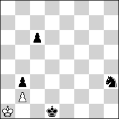 <b>h#9.5</b> &nbsp;·&nbsp; 2 + 4</td>
<td valign="top">
<b>No. 275</b> &nbsp;·&nbsp; <b>h#9.5</b>, unique solution &nbsp;·&nbsp; <a href="https://helpman.komtera.lt/?fen=8/8/2p5/8/8/1p5n/1P6/K2k4&moves=9.5">solve ↗</a> 
112 positions of 12,782,665,728 indexed have a unique solution at h#9.5. The class runs to h#15.5, so the deepest sound problem is 12 plies shallower. Every position at that depth is saturated (255+ solutions). 
 <b>Solution:</b> 1...Kb1 2.c5 Ka1 3.c4 Kb1 4.c3 bxc3 5.Nf4 c4 6.Nd5 cxd5 7.Kd2 d6 8.Kc3 d7 9.Kb4 d8=Q 10.Ka3 Qa5# 
 <b>Themes:</b> <code>set-play</code> <code>promotion</code> <code>excelsior</code> <code>excelsior:white</code> <code>switchback</code> <code>pendulum</code> <code>nocheck</code> <code>promotions:q</code> 
 <code>8/8/2p5/8/8/1p5n/1P6/K2k4 w - - 0 1</code>
</td>
</tr></table>

## KPvkqbp

<table><tr>
<td width="220" valign="top">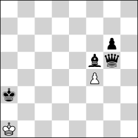 <b>h#9.5</b> &nbsp;·&nbsp; 2 + 4</td>
<td valign="top">
<b>No. 276</b> &nbsp;·&nbsp; <b>h#9.5</b>, unique solution &nbsp;·&nbsp; <a href="https://helpman.komtera.lt/?fen=8/8/6p1/5bq1/5P2/k7/8/K7&moves=9.5">solve ↗</a> 
9 positions of 17,043,554,304 indexed have a unique solution at h#9.5. The class runs to h#14.5, so the deepest sound problem is 10 plies shallower. Every position at that depth is saturated (255+ solutions). 
 <b>Solution:</b> 1...fxg5 2.Kb4 Kb2 3.Kc5 Kc3 4.Kd6 Kd4 5.Ke7 Ke5 6.Kf8 Kf6 7.Be6 Kxg6 8.Kg8 Kh6 9.Kh8 g6 10.Bg8 g7# 
 <b>Themes:</b> <code>pure</code> <code>model</code> <code>ideal</code> <code>self-block</code> <code>nocheck</code> 
 <b>Note:</b> the solution begins with a capture. 
 <code>8/8/6p1/5bq1/5P2/k7/8/K7 w - - 0 1</code>
</td>
</tr></table>

## KPvkqnp

<table><tr>
<td width="220" valign="top"> <b>h#9.5</b> &nbsp;·&nbsp; 2 + 4</td>
<td valign="top">
<b>No. 277</b> &nbsp;·&nbsp; <b>h#9.5</b>, unique solution &nbsp;·&nbsp; <a href="https://helpman.komtera.lt/?fen=8/7k/n7/8/7p/8/q6P/K7&moves=9.5">solve ↗</a> 
6 positions of 17,043,554,304 indexed have a unique solution at h#9.5. The class runs to h#11.5, so the deepest sound problem is 4 plies shallower. Every position at that depth is saturated (255+ solutions). 
 <b>Solution:</b> 1...Kxa2 2.Nc5 Kb2 3.Ne4 Ka3 4.Ng3 hxg3 5.Kg6 gxh4 6.Kf5 h5 7.Ke4 h6 8.Kd3 h7 9.Kc2 h8=Q 10.Kb1 Qb2# 
 <b>Themes:</b> <code>promotion</code> <code>excelsior</code> <code>excelsior:white</code> <code>nocheck</code> <code>promotions:q</code> 
 <b>Note:</b> the side to move is in check in the diagram; the solution begins with a capture. 
 <code>8/7k/n7/8/7p/8/q6P/K7 w - - 0 1</code>
</td>
</tr></table>

## KPvkqpp

<table><tr>
<td width="220" valign="top"> <b>h#9.5</b> &nbsp;·&nbsp; 2 + 4</td>
<td valign="top">
<b>No. 278</b> &nbsp;·&nbsp; <b>h#9.5</b>, unique solution &nbsp;·&nbsp; <a href="https://helpman.komtera.lt/?fen=6k1/8/1p6/8/8/p5q1/P7/K7&moves=9.5">solve ↗</a> 
236 positions of 12,782,665,728 indexed have a unique solution at h#9.5. The class runs to h#15.5, so the deepest sound problem is 12 plies shallower. Every position at that depth is saturated (255+ solutions). 
 <b>Solution:</b> 1...Kb1 2.b5 Kc2 3.b4 Kc1 4.b3 axb3 5.Kf7 b4 6.Ke6 b5 7.Kd5 b6 8.Kc4 b7 9.Kb3 b8=Q+ 10.Ka2 Qb1# 
 <b>Themes:</b> <code>set-play</code> <code>promotion</code> <code>excelsior</code> <code>excelsior:white</code> <code>promotions:q</code> 
 <code>6k1/8/1p6/8/8/p5q1/P7/K7 w - - 0 1</code>
</td>
</tr></table>

## KPvkrbp

<table><tr>
<td width="220" valign="top"> <b>h#9.5</b> &nbsp;·&nbsp; 2 + 4</td>
<td valign="top">
<b>No. 279</b> &nbsp;·&nbsp; <b>h#9.5</b>, unique solution &nbsp;·&nbsp; <a href="https://helpman.komtera.lt/?fen=8/8/6p1/8/6P1/k7/1rb5/K7&moves=9.5">solve ↗</a> 
11 positions of 17,043,554,304 indexed have a unique solution at h#9.5. The class runs to h#15, so the deepest sound problem is 11 plies shallower. Every position at that depth is saturated (255+ solutions). 
 <b>Solution:</b> 1...g5 2.Kb4 Kxb2 3.Kc5 Kc3 4.Kd6 Kd4 5.Ke7 Ke5 6.Kf8 Kf6 7.Bb3 Kxg6 8.Kg8 Kh6 9.Kh8 g6 10.Bg8 g7# 
 <b>Themes:</b> <code>pure</code> <code>model</code> <code>ideal</code> <code>self-block</code> <code>nocheck</code> 
 <code>8/8/6p1/8/6P1/k7/1rb5/K7 w - - 0 1</code>
</td>
</tr></table>

## KPvkrpp

<table><tr>
<td width="220" valign="top"> <b>h#9.5</b> &nbsp;·&nbsp; 2 + 4</td>
<td valign="top">
<b>No. 280</b> &nbsp;·&nbsp; <b>h#9.5</b>, unique solution &nbsp;·&nbsp; <a href="https://helpman.komtera.lt/?fen=6k1/8/1p6/8/8/p7/P1r5/K7&moves=9.5">solve ↗</a> 
105 positions of 12,782,665,728 indexed have a unique solution at h#9.5. The class runs to h#15.5, so the deepest sound problem is 12 plies shallower. Every position at that depth is saturated (255+ solutions). 
 <b>Solution:</b> 1...Kb1 2.b5 Kxc2 3.b4 Kc1 4.b3 axb3 5.Kf7 b4 6.Ke6 b5 7.Kd5 b6 8.Kc4 b7 9.Kb3 b8=Q+ 10.Ka2 Qb1# 
 <b>Themes:</b> <code>promotion</code> <code>excelsior</code> <code>excelsior:white</code> <code>promotions:q</code> 
 <code>6k1/8/1p6/8/8/p7/P1r5/K7 w - - 0 1</code>
</td>
</tr></table>

## KBBvkbn

<table><tr>
<td width="220" valign="top"> <b>h#9</b> &nbsp;·&nbsp; 3 + 3</td>
<td valign="top">
<b>No. 281</b> &nbsp;·&nbsp; <b>h#9</b>, unique solution &nbsp;·&nbsp; <a href="https://helpman.komtera.lt/?fen=8/8/1n6/3b4/8/8/2B5/KBk5&moves=9">solve ↗</a> 
244 positions of 7,751,073,792 indexed have a unique solution at h#9. The class runs to h#12, so the deepest sound problem is 6 plies shallower. Every position at that depth is saturated (255+ solutions). 
 <b>Solution:</b> 1.Kd2 Bd3 2.Kc3 Ba6 3.Kb4 Kb2 4.Ka5 Kc3 5.Nc8 Kd4 6.Kb6 Kxd5 7.Ka7 Kc6 8.Ka8 Kc7 9.Na7 Bb7# 
 <b>Themes:</b> <code>pure</code> <code>self-block</code> <code>nocheck</code> 
 <code>8/8/1n6/3b4/8/8/2B5/KBk5 b - - 0 1</code>
</td>
</tr></table>

## KBBvkrn

<table><tr>
<td width="220" valign="top"> <b>h#9</b> &nbsp;·&nbsp; 3 + 3</td>
<td valign="top">
<b>No. 282</b> &nbsp;·&nbsp; <b>h#9</b>, unique solution &nbsp;·&nbsp; <a href="https://helpman.komtera.lt/?fen=8/8/1n6/8/8/1B6/3B4/K1k3r1&moves=9">solve ↗</a> 
8 positions of 7,751,073,792 indexed have a unique solution at h#9. The class runs to h#13, so the deepest sound problem is 8 plies shallower. Every position at that depth is saturated (255+ solutions). 
 <b>Solution:</b> 1.Kxd2+ Ka2 2.Kc3 Bc4 3.Kb4 Ba6 4.Ka5 Kb3 5.Nc8 Kc4 6.Kb6 Kd5 7.Ka7 Kc6 8.Ka8 Kc7 9.Na7 Bb7# 
 <b>Themes:</b> <code>pure</code> <code>model</code> <code>self-block</code> 
 <b>Note:</b> the side to move is in check in the diagram; the solution begins with a capture. 
 <code>8/8/1n6/8/8/1B6/3B4/K1k3r1 b - - 0 1</code>
</td>
</tr></table>

## KNvkbpp

<table><tr>
<td width="220" valign="top"> <b>h#9</b> &nbsp;·&nbsp; 2 + 4</td>
<td valign="top">
<b>No. 283</b> &nbsp;·&nbsp; <b>h#9</b>, unique solution &nbsp;·&nbsp; <a href="https://helpman.komtera.lt/?fen=N7/2p5/2p5/8/8/K1b5/8/7k&moves=9">solve ↗</a> 
2 positions of 17,043,554,304 indexed have a unique solution at h#9. The class runs to h#10.5, so the deepest sound problem is 3 plies shallower. Every position at that depth is saturated (255+ solutions). 
 <b>Solution:</b> 1.Be5 Kb4 2.Kg2 Kc5 3.Kf3 Kxc6 4.Ke4 Kb5 5.Kd5 Ka5 6.Kc6 Nxc7 7.Kb7 Nd5 8.Ka8 Ka6 9.Bb8 Nb6# 
 <b>Themes:</b> <code>pure</code> <code>model</code> <code>ideal</code> <code>self-block</code> <code>nocheck</code> 
 <code>N7/2p5/2p5/8/8/K1b5/8/7k b - - 0 1</code>
</td>
</tr></table>

## KNvknpp

<table><tr>
<td width="220" valign="top"> <b>h#9</b> &nbsp;·&nbsp; 2 + 4</td>
<td valign="top">
<b>No. 284</b> &nbsp;·&nbsp; <b>h#9</b>, unique solution &nbsp;·&nbsp; <a href="https://helpman.komtera.lt/?fen=K7/2p5/p7/2n5/8/7k/8/N7&moves=9">solve ↗</a> 
2 positions of 17,043,554,304 indexed have a unique solution at h#9. The class runs to h#10.5, so the deepest sound problem is 3 plies shallower. Every position at that depth is saturated (255+ solutions). 
 <b>Solution:</b> 1.Kg4 Kb8 2.Kf5 Kxc7 3.Ke6 Kb6 4.Kd7 Nc2 5.Kc8 Nb4 6.Kb8 Nxa6+ 7.Ka8 Nb4 8.Na6 Nd5 9.Nb8 Nc7# 
 <b>Themes:</b> <code>pure</code> <code>model</code> <code>ideal</code> <code>switchback</code> <code>self-block</code> <code>umnov</code> 
 <code>K7/2p5/p7/2n5/8/7k/8/N7 b - - 0 1</code>
</td>
</tr></table>

## KRBvkbn

<table><tr>
<td width="220" valign="top"> <b>h#9</b> &nbsp;·&nbsp; 3 + 3</td>
<td valign="top">
<b>No. 285</b> &nbsp;·&nbsp; <b>h#9</b>, unique solution &nbsp;·&nbsp; <a href="https://helpman.komtera.lt/?fen=8/8/1n6/7B/8/1b6/2R5/K1k5&moves=9">solve ↗</a> 
37 positions of 7,751,073,792 indexed have a unique solution at h#9. The class runs to h#12, so the deepest sound problem is 6 plies shallower. Every position at that depth is saturated (255+ solutions). 
 <b>Solution:</b> 1.Kxc2 Be2 2.Kc3 Ba6 3.Kb4 Kb2 4.Ka5 Kxb3 5.Nc8 Kc4 6.Kb6 Kd5 7.Ka7 Kc6 8.Ka8 Kc7 9.Na7 Bb7# 
 <b>Themes:</b> <code>pure</code> <code>model</code> <code>ideal</code> <code>self-block</code> <code>nocheck</code> 
 <b>Note:</b> the side to move is in check in the diagram; the solution begins with a capture. 
 <code>8/8/1n6/7B/8/1b6/2R5/K1k5 b - - 0 1</code>
</td>
</tr></table>

## KRBvknn

<table><tr>
<td width="220" valign="top"> <b>h#9</b> &nbsp;·&nbsp; 3 + 3</td>
<td valign="top">
<b>No. 286</b> &nbsp;·&nbsp; <b>h#9</b>, unique solution &nbsp;·&nbsp; <a href="https://helpman.komtera.lt/?fen=8/8/8/8/8/n2nB3/7R/K6k&moves=9">solve ↗</a> 
35 positions of 7,751,073,792 indexed have a unique solution at h#9. The class runs to h#12, so the deepest sound problem is 6 plies shallower. Every position at that depth is saturated (255+ solutions). 
 <b>Solution:</b> 1.Kxh2 Ka2 2.Kg2 Kb3 3.Kf1 Kc3 4.Ke1 Kxd3 5.Kd1 Kd4 6.Kc2 Bc1 7.Kb1 Kc3 8.Ka1 Kb3 9.Nb1 Bb2# 
 <b>Themes:</b> <code>pure</code> <code>model</code> <code>ideal</code> <code>closed-walk</code> <code>self-block</code> <code>nocheck</code> 
 <b>Note:</b> the side to move is in check in the diagram; the solution begins with a capture. 
 <code>8/8/8/8/8/n2nB3/7R/K6k b - - 0 1</code>
</td>
</tr></table>

## KRBvkpp

<table><tr>
<td width="220" valign="top"> <b>h#9</b> &nbsp;·&nbsp; 3 + 3</td>
<td valign="top">
<b>No. 287</b> &nbsp;·&nbsp; <b>h#9</b>, unique solution &nbsp;·&nbsp; <a href="https://helpman.komtera.lt/?fen=8/8/p7/8/8/8/1B5p/2K3Rk&moves=9">solve ↗</a> 
4 positions of 17,043,554,304 indexed have a unique solution at h#9. The class runs to h#16, so the deepest sound problem is 14 plies shallower. Every position at that depth is saturated (255+ solutions). 
 <b>Solution:</b> 1.Kxg1 Kd2 2.h1=B Ke3 3.Ba8 Kf4 4.Kf2 Kf5 5.Ke3 Bc1+ 6.Kd4 Ke6 7.Kc5 Kd7 8.Kb6 Kc8 9.Ka7 Be3# 
 <b>Themes:</b> <code>pure</code> <code>model</code> <code>ideal</code> <code>promotion</code> <code>underpromotion</code> <code>self-block</code> <code>promotions:b</code> 
 <b>Note:</b> the side to move is in check in the diagram; the solution begins with a capture. 
 <code>8/8/p7/8/8/8/1B5p/2K3Rk b - - 0 1</code>
</td>
</tr></table>

## KRNvkqb

<table><tr>
<td width="220" valign="top"> <b>h#9</b> &nbsp;·&nbsp; 3 + 3</td>
<td valign="top">
<b>No. 288</b> &nbsp;·&nbsp; <b>h#9</b>, unique solution &nbsp;·&nbsp; <a href="https://helpman.komtera.lt/?fen=7k/4N2R/8/8/8/1q6/8/Kb6&moves=9">solve ↗</a> 
18 positions of 7,751,073,792 indexed have a unique solution at h#9. The class runs to h#11, so the deepest sound problem is 4 plies shallower. Every position at that depth is saturated (255+ solutions). 
 <b>Solution:</b> 1.Kxh7 Nc6 2.Kg6 Na5 3.Kf5 Nxb3 4.Ke4 Kb2 5.Kd3 Kc1 6.Kc3 Kd1 7.Kb2 Nd4 8.Ka1 Kc1 9.Ba2 Nc2# 
 <b>Themes:</b> <code>pure</code> <code>model</code> <code>ideal</code> <code>switchback</code> <code>self-block</code> <code>nocheck</code> 
 <b>Note:</b> the side to move is in check in the diagram; the solution begins with a capture. 
 <code>7k/4N2R/8/8/8/1q6/8/Kb6 b - - 0 1</code>
</td>
</tr></table>

## KRNvkqp

<table><tr>
<td width="220" valign="top"> <b>h#9</b> &nbsp;·&nbsp; 3 + 3</td>
<td valign="top">
<b>No. 289</b> &nbsp;·&nbsp; <b>h#9</b>, unique solution &nbsp;·&nbsp; <a href="https://helpman.komtera.lt/?fen=8/8/1p6/8/5NRk/8/2q5/K7&moves=9">solve ↗</a> 
81 positions of 22,724,739,072 indexed have a unique solution at h#9. The class runs to h#12, so the deepest sound problem is 6 plies shallower. Every position at that depth is saturated (255+ solutions). 
 <b>Solution:</b> 1.Kxg4 Nd5 2.Qa4+ Kb2 3.Kf3 Kc3 4.Qa5+ Kd4 5.Ke2 Ke5 6.Kd3 Kd6 7.Kc4 Kc7 8.Kb5 Kb8 9.Ka6 Nc7# 
 <b>Themes:</b> <code>pure</code> <code>model</code> <code>ideal</code> <code>self-block</code> 
 <b>Note:</b> the side to move is in check in the diagram; the solution begins with a capture. 
 <code>8/8/1p6/8/5NRk/8/2q5/K7 b - - 0 1</code>
</td>
</tr></table>

## KBBvknn

<table><tr>
<td width="220" valign="top"> <b>h#8.5</b> &nbsp;·&nbsp; 3 + 3</td>
<td valign="top">
<b>No. 290</b> &nbsp;·&nbsp; <b>h#8.5</b>, unique solution &nbsp;·&nbsp; <a href="https://helpman.komtera.lt/?fen=n7/8/5B2/8/7B/7k/2n5/1K6&moves=8.5">solve ↗</a> 
17 positions of 7,751,073,792 indexed have a unique solution at h#8.5. The class runs to h#13, so the deepest sound problem is 9 plies shallower. Every position at that depth is saturated (255+ solutions). 
 <b>Solution:</b> 1...Bg3 2.Ne3 Bb8 3.Ng4 Kc2 4.Nc7 Kd3 5.Kg3 Be5+ 6.Kh4 Ke4 7.Ne6 Kf5 8.Ng5 Kg6 9.Nh3 Bg3# 
 <b>Themes:</b> <code>pure</code> <code>model</code> <code>ideal</code> <code>self-block</code> <code>nocapture</code> 
 <code>n7/8/5B2/8/7B/7k/2n5/1K6 w - - 0 1</code>
</td>
</tr></table>

## KBvkbbb

<table><tr>
<td width="220" valign="top"> <b>h#8.5</b> &nbsp;·&nbsp; 2 + 4</td>
<td valign="top">
<b>No. 291</b> &nbsp;·&nbsp; <b>h#8.5</b>, unique solution &nbsp;·&nbsp; <a href="https://helpman.komtera.lt/?fen=8/8/8/8/b7/8/5b2/kBK4b&moves=8.5">solve ↗</a> 
446 positions of 7,751,073,792 indexed have a unique solution at h#8.5. The class runs to h#10, so the deepest sound problem is 3 plies shallower. Every position at that depth is saturated (255+ solutions). 
 <b>Solution:</b> 1...Kd2 2.Kb2 Kd3 3.Kc1 Ba2 4.Kd1 Bd5 5.Ke1 Bxh1 6.Kf1 Bd5 7.Kg1 Ke4 8.Kh1 Kf3 9.Bg1 Kg3# 
 <b>Themes:</b> <code>switchback</code> <code>self-block</code> <code>kniest</code> <code>nocheck</code> <code>indian</code> 
 <code>8/8/8/8/b7/8/5b2/kBK4b w - - 0 1</code>
</td>
</tr></table>

## KBvkqbb

<table><tr>
<td width="220" valign="top"> <b>h#8.5</b> &nbsp;·&nbsp; 2 + 4</td>
<td valign="top">
<b>No. 292</b> &nbsp;·&nbsp; <b>h#8.5</b>, unique solution &nbsp;·&nbsp; <a href="https://helpman.komtera.lt/?fen=5b2/8/8/8/7B/7b/7k/Kq6&moves=8.5">solve ↗</a> 
25 positions of 7,751,073,792 indexed have a unique solution at h#8.5. The class runs to h#10.5, so the deepest sound problem is 4 plies shallower. Every position at that depth is saturated (255+ solutions). 
 <b>Solution:</b> 1...Kxb1 2.Bf5+ Kb2 3.Kh3 Kc3 4.Kg4 Kd4 5.Kh5 Ke5 6.Kh6 Kf6 7.Kh7 Kf7 8.Kh8 Kxf8 9.Bh7 Bf6# 
 <b>Themes:</b> <code>self-block</code> 
 <b>Note:</b> the side to move is in check in the diagram; the solution begins with a capture. 
 <code>5b2/8/8/8/7B/7b/7k/Kq6 w - - 0 1</code>
</td>
</tr></table>

## KBvkrbb

<table><tr>
<td width="220" valign="top"> <b>h#8.5</b> &nbsp;·&nbsp; 2 + 4</td>
<td valign="top">
<b>No. 293</b> &nbsp;·&nbsp; <b>h#8.5</b>, unique solution &nbsp;·&nbsp; <a href="https://helpman.komtera.lt/?fen=b7/8/8/8/8/8/2B2b2/k1Kr4&moves=8.5">solve ↗</a> 
2 positions of 7,751,073,792 indexed have a unique solution at h#8.5. The class runs to h#9.5, so the deepest sound problem is 2 plies shallower. Every position at that depth is saturated (255+ solutions). 
 <b>Solution:</b> 1...Kxd1 2.Kb2 Be4 3.Kc3 Bxa8 4.Kd3 Kc1 5.Ke2 Kc2 6.Kf1 Kd3 7.Kg1 Ke4 8.Kh1 Kf3 9.Bg1 Kg3# 
 <b>Themes:</b> <code>switchback</code> <code>self-block</code> <code>nocheck</code> 
 <b>Note:</b> the side to move is in check in the diagram; the solution begins with a capture. 
 <code>b7/8/8/8/8/8/2B2b2/k1Kr4 w - - 0 1</code>
</td>
</tr></table>

## KNvkbbb

<table><tr>
<td width="220" valign="top"> <b>h#8.5</b> &nbsp;·&nbsp; 2 + 4</td>
<td valign="top">
<b>No. 294</b> &nbsp;·&nbsp; <b>h#8.5</b>, unique solution &nbsp;·&nbsp; <a href="https://helpman.komtera.lt/?fen=8/8/8/8/b1b4k/8/4b3/K4N2&moves=8.5">solve ↗</a> 
1,145 positions of 7,751,073,792 indexed have a unique solution at h#8.5. The class runs to h#10.5, so the deepest sound problem is 4 plies shallower. Every position at that depth is saturated (255+ solutions). 
 <b>Solution:</b> 1...Ne3 2.Kg3 Kb2 3.Kf2 Ka3 4.Ke1 Kxa4 5.Kd2 Kb4 6.Kc1 Kc3 7.Kb1 Kd2 8.Ka1 Kc1 9.Ba2 Nc2# 
 <b>Themes:</b> <code>pure</code> <code>model</code> <code>self-block</code> <code>nocheck</code> 
 <code>8/8/8/8/b1b4k/8/4b3/K4N2 w - - 0 1</code>
</td>
</tr></table>

## KNvkbbn

<table><tr>
<td width="220" valign="top"> <b>h#8.5</b> &nbsp;·&nbsp; 2 + 4</td>
<td valign="top">
<b>No. 295</b> &nbsp;·&nbsp; <b>h#8.5</b>, unique solution &nbsp;·&nbsp; <a href="https://helpman.komtera.lt/?fen=6k1/8/8/8/8/2bb4/n1N5/1K6&moves=8.5">solve ↗</a> 
18 positions of 7,751,073,792 indexed have a unique solution at h#8.5. The class runs to h#10.5, so the deepest sound problem is 4 plies shallower. Every position at that depth is saturated (255+ solutions). 
 <b>Solution:</b> 1...Kxa2 2.Kf7 Kb3 3.Ke6 Kxc3 4.Kd5 Kb2 5.Kc4 Ka3 6.Kc3 Ka4 7.Kb2 Nd4 8.Ka1 Ka3 9.Bb1 Nb3# 
 <b>Themes:</b> <code>pure</code> <code>model</code> <code>ideal</code> <code>switchback</code> <code>self-block</code> <code>nocheck</code> 
 <b>Note:</b> the solution begins with a capture. 
 <code>6k1/8/8/8/8/2bb4/n1N5/1K6 w - - 0 1</code>
</td>
</tr></table>

## KNvkbbp

<table><tr>
<td width="220" valign="top"> <b>h#8.5</b> &nbsp;·&nbsp; 2 + 4</td>
<td valign="top">
<b>No. 296</b> &nbsp;·&nbsp; <b>h#8.5</b>, unique solution &nbsp;·&nbsp; <a href="https://helpman.komtera.lt/?fen=N7/2p5/3b4/8/8/8/8/K2b3k&moves=8.5">solve ↗</a> 
1,621 positions of 22,724,739,072 indexed have a unique solution at h#8.5. The class runs to h#10.5, so the deepest sound problem is 4 plies shallower. Every position at that depth is saturated (255+ solutions). 
 <b>Solution:</b> 1...Kb2 2.Kg2 Kc3 3.Kf3 Kc4 4.Ke4 Kb5 5.Kd5 Ka5 6.Kc6 Nxc7 7.Kb7 Nd5 8.Ka8 Ka6 9.Bb8 Nb6# 
 <b>Themes:</b> <code>pure</code> <code>model</code> <code>self-block</code> <code>nocheck</code> 
 <code>N7/2p5/3b4/8/8/8/8/K2b3k w - - 0 1</code>
</td>
</tr></table>

## KNvkbnn

<table><tr>
<td width="220" valign="top"> <b>h#8.5</b> &nbsp;·&nbsp; 2 + 4</td>
<td valign="top">
<b>No. 297</b> &nbsp;·&nbsp; <b>h#8.5</b>, unique solution &nbsp;·&nbsp; <a href="https://helpman.komtera.lt/?fen=7k/8/8/8/8/7b/8/KNn1n3&moves=8.5">solve ↗</a> 
9 positions of 7,751,073,792 indexed have a unique solution at h#8.5. The class runs to h#9.5, so the deepest sound problem is 2 plies shallower. Every position at that depth is saturated (255+ solutions). 
 <b>Solution:</b> 1...Kb2 2.Kg7 Kc3 3.Kf6 Kd2 4.Ke5 Kd1 5.Kd4 Nd2 6.Kc3 Kxe1 7.Kb2 Kd1 8.Ka1 Kc2 9.Na2 Nb3# 
 <b>Themes:</b> <code>pure</code> <code>model</code> <code>switchback</code> <code>self-block</code> <code>nocheck</code> 
 <code>7k/8/8/8/8/7b/8/KNn1n3 w - - 0 1</code>
</td>
</tr></table>

## KNvkbnp

<table><tr>
<td width="220" valign="top"> <b>h#8.5</b> &nbsp;·&nbsp; 2 + 4</td>
<td valign="top">
<b>No. 298</b> &nbsp;·&nbsp; <b>h#8.5</b>, unique solution &nbsp;·&nbsp; <a href="https://helpman.komtera.lt/?fen=8/7k/7n/4p3/4b3/8/N7/K7&moves=8.5">solve ↗</a> 
2 positions of 22,724,739,072 indexed have a unique solution at h#8.5. The class runs to h#10, so the deepest sound problem is 3 plies shallower. Every position at that depth is saturated (255+ solutions). 
 <b>Solution:</b> 1...Kb2 2.Bd5 Kc2 3.e4 Kc3 4.e3 Kd4 5.e2 Ke5 6.e1=R+ Kf6 7.Re8 Nc3 8.Rh8 Ne4 9.Bg8 Ng5# 
 <b>Themes:</b> <code>set-play</code> <code>pure</code> <code>model</code> <code>ideal</code> <code>promotion</code> <code>underpromotion</code> <code>self-block</code> <code>nocapture</code> <code>promotions:r</code> 
 <code>8/7k/7n/4p3/4b3/8/N7/K7 w - - 0 1</code>
</td>
</tr></table>

## KNvknnn

<table><tr>
<td width="220" valign="top"> <b>h#8.5</b> &nbsp;·&nbsp; 2 + 4</td>
<td valign="top">
<b>No. 299</b> &nbsp;·&nbsp; <b>h#8.5</b>, unique solution &nbsp;·&nbsp; <a href="https://helpman.komtera.lt/?fen=7k/8/1n6/8/8/8/8/KNn1n3&moves=8.5">solve ↗</a> 
4 positions of 7,751,073,792 indexed have a unique solution at h#8.5. The class runs to h#9.5, so the deepest sound problem is 2 plies shallower. Every position at that depth is saturated (255+ solutions). 
 <b>Solution:</b> 1...Kb2 2.Kg7 Kc3 3.Kf6 Kd2 4.Ke5 Kd1 5.Kd4 Nd2 6.Kc3 Kxe1 7.Kb2 Kd1 8.Ka1 Kc2 9.Na2 Nb3# 
 <b>Themes:</b> <code>pure</code> <code>model</code> <code>switchback</code> <code>self-block</code> <code>nocheck</code> 
 <code>7k/8/1n6/8/8/8/8/KNn1n3 w - - 0 1</code>
</td>
</tr></table>

## KNvknnp

<table><tr>
<td width="220" valign="top"> <b>h#8.5</b> &nbsp;·&nbsp; 2 + 4</td>
<td valign="top">
<b>No. 300</b> &nbsp;·&nbsp; <b>h#8.5</b>, unique solution &nbsp;·&nbsp; <a href="https://helpman.komtera.lt/?fen=7k/8/8/8/8/5p2/8/KNn1n3&moves=8.5">solve ↗</a> 
211 positions of 22,724,739,072 indexed have a unique solution at h#8.5. The class runs to h#10, so the deepest sound problem is 3 plies shallower. Every position at that depth is saturated (255+ solutions). 
 <b>Solution:</b> 1...Kb2 2.Kg7 Kc3 3.Kf6 Kd2 4.Ke5 Kd1 5.Kd4 Nd2 6.Kc3 Kxe1 7.Kb2 Kd1 8.Ka1 Kc2 9.Na2 Nb3# 
 <b>Themes:</b> <code>pure</code> <code>model</code> <code>switchback</code> <code>self-block</code> <code>nocheck</code> 
 <code>7k/8/8/8/8/5p2/8/KNn1n3 w - - 0 1</code>
</td>
</tr></table>

## KNvkqnn

<table><tr>
<td width="220" valign="top"> <b>h#8.5</b> &nbsp;·&nbsp; 2 + 4</td>
<td valign="top">
<b>No. 301</b> &nbsp;·&nbsp; <b>h#8.5</b>, unique solution &nbsp;·&nbsp; <a href="https://helpman.komtera.lt/?fen=6k1/8/8/8/8/nq6/1n6/1KN5&moves=8.5">solve ↗</a> 
7 positions of 7,751,073,792 indexed have a unique solution at h#8.5. The class runs to h#9.5, so the deepest sound problem is 2 plies shallower. Every position at that depth is saturated (255+ solutions). 
 <b>Solution:</b> 1...Ka1 2.Qd1 Ka2 3.Kf7 Kxa3 4.Ke6 Kb4 5.Kd5 Ka5 6.Kc4 Ne2 7.Kb3 Kb5 8.Ka2 Kb4 9.Qa1 Nc3# 
 <b>Themes:</b> <code>pure</code> <code>model</code> <code>ideal</code> <code>closed-walk</code> <code>self-block</code> <code>nocheck</code> 
 <b>Note:</b> the side to move is in check in the diagram. 
 <code>6k1/8/8/8/8/nq6/1n6/1KN5 w - - 0 1</code>
</td>
</tr></table>

## KNvkqqn

<table><tr>
<td width="220" valign="top"> <b>h#8.5</b> &nbsp;·&nbsp; 2 + 4</td>
<td valign="top">
<b>No. 302</b> &nbsp;·&nbsp; <b>h#8.5</b>, unique solution &nbsp;·&nbsp; <a href="https://helpman.komtera.lt/?fen=6k1/8/8/8/8/3n4/5q2/1KNq4&moves=8.5">solve ↗</a> 
34 positions of 7,751,073,792 indexed have a unique solution at h#8.5. The class runs to h#9.5, so the deepest sound problem is 2 plies shallower. Every position at that depth is saturated (255+ solutions). 
 <b>Solution:</b> 1...Ka1 2.Nb2 Ka2 3.Kf7 Ka3 4.Ke6 Kb4 5.Kd5 Ka5 6.Kc4 Ne2 7.Kb3 Kb5 8.Ka2 Kb4 9.Qa1 Nc3# 
 <b>Themes:</b> <code>set-play</code> <code>pure</code> <code>model</code> <code>closed-walk</code> <code>self-block</code> <code>nocapture</code> <code>nocheck</code> 
 <code>6k1/8/8/8/8/3n4/5q2/1KNq4 w - - 0 1</code>
</td>
</tr></table>

## KNvkqqr

<table><tr>
<td width="220" valign="top"> <b>h#8.5</b> &nbsp;·&nbsp; 2 + 4</td>
<td valign="top">
<b>No. 303</b> &nbsp;·&nbsp; <b>h#8.5</b>, unique solution &nbsp;·&nbsp; <a href="https://helpman.komtera.lt/?fen=7k/6N1/8/8/8/8/1r1q3q/1K6&moves=8.5">solve ↗</a> 
2 positions of 7,751,073,792 indexed have a unique solution at h#8.5. The class runs to h#9.5, so the deepest sound problem is 2 plies shallower. Every position at that depth is saturated (255+ solutions). 
 <b>Solution:</b> 1...Ka1 2.Rb6 Ne8 3.Rh6 Kb1 4.Qc1+ Kxc1 5.Qh1+ Kd2 6.Kh7 Ke3 7.Kg6 Kf4 8.Kh5 Kf5 9.Qh4 Ng7# 
 <b>Themes:</b> <code>pure</code> <code>model</code> <code>ideal</code> <code>switchback</code> <code>self-block</code> 
 <b>Note:</b> the side to move is in check in the diagram. 
 <code>7k/6N1/8/8/8/8/1r1q3q/1K6 w - - 0 1</code>
</td>
</tr></table>

## KNvkqrn

<table><tr>
<td width="220" valign="top"> <b>h#8.5</b> &nbsp;·&nbsp; 2 + 4</td>
<td valign="top">
<b>No. 304</b> &nbsp;·&nbsp; <b>h#8.5</b>, unique solution &nbsp;·&nbsp; <a href="https://helpman.komtera.lt/?fen=8/7k/8/8/8/r7/1nq5/KN6&moves=8.5">solve ↗</a> 
13 positions of 7,751,073,792 indexed have a unique solution at h#8.5. The class runs to h#9.5, so the deepest sound problem is 2 plies shallower. Every position at that depth is saturated (255+ solutions). 
 <b>Solution:</b> 1...Nxa3 2.Qa4 Kb1 3.Kg6 Kc1 4.Kf5 Kd2 5.Ke4 Ke1 6.Kd3 Nb5 7.Kc2 Ke2 8.Kb1 Kd2 9.Qa1 Nc3# 
 <b>Themes:</b> <code>pure</code> <code>model</code> <code>ideal</code> <code>closed-walk</code> <code>self-block</code> <code>nocheck</code> 
 <b>Note:</b> the side to move is in check in the diagram; the solution begins with a capture. 
 <code>8/7k/8/8/8/r7/1nq5/KN6 w - - 0 1</code>
</td>
</tr></table>

## KNvkrbb

<table><tr>
<td width="220" valign="top"> <b>h#8.5</b> &nbsp;·&nbsp; 2 + 4</td>
<td valign="top">
<b>No. 305</b> &nbsp;·&nbsp; <b>h#8.5</b>, unique solution &nbsp;·&nbsp; <a href="https://helpman.komtera.lt/?fen=8/8/8/8/8/1b6/8/KrN2b1k&moves=8.5">solve ↗</a> 
130 positions of 7,751,073,792 indexed have a unique solution at h#8.5. The class runs to h#10.5, so the deepest sound problem is 4 plies shallower. Every position at that depth is saturated (255+ solutions). 
 <b>Solution:</b> 1...Kxb1 2.Kg2 Nd3 3.Kf3 Kc1 4.Ke4 Kd2 5.Kd4 Ke1 6.Kc3 Nb4 7.Kb2 Kd2 8.Ka1 Kc1 9.Ba2 Nc2# 
 <b>Themes:</b> <code>pure</code> <code>model</code> <code>switchback</code> <code>self-block</code> <code>nocheck</code> 
 <b>Note:</b> the side to move is in check in the diagram; the solution begins with a capture. 
 <code>8/8/8/8/8/1b6/8/KrN2b1k w - - 0 1</code>
</td>
</tr></table>

## KNvkrbn

<table><tr>
<td width="220" valign="top"> <b>h#8.5</b> &nbsp;·&nbsp; 2 + 4</td>
<td valign="top">
<b>No. 306</b> &nbsp;·&nbsp; <b>h#8.5</b>, unique solution &nbsp;·&nbsp; <a href="https://helpman.komtera.lt/?fen=7k/8/8/8/n7/1b6/2N5/K3r3&moves=8.5">solve ↗</a> 
5 positions of 7,751,073,792 indexed have a unique solution at h#8.5. The class runs to h#9.5, so the deepest sound problem is 2 plies shallower. Every position at that depth is saturated (255+ solutions). 
 <b>Solution:</b> 1...Nxe1 2.Kg7 Kb1 3.Kf6 Kc1 4.Ke5 Kd2 5.Kd4 Ke2 6.Kc3 Ke3 7.Kb2 Kd2 8.Ka1 Kc1 9.Ba2 Nc2# 
 <b>Themes:</b> <code>pure</code> <code>model</code> <code>switchback</code> <code>closed-walk</code> <code>self-block</code> <code>nocheck</code> 
 <b>Note:</b> the side to move is in check in the diagram; the solution begins with a capture. 
 <code>7k/8/8/8/n7/1b6/2N5/K3r3 w - - 0 1</code>
</td>
</tr></table>

## KNvkrbp

<table><tr>
<td width="220" valign="top"> <b>h#8.5</b> &nbsp;·&nbsp; 2 + 4</td>
<td valign="top">
<b>No. 307</b> &nbsp;·&nbsp; <b>h#8.5</b>, unique solution &nbsp;·&nbsp; <a href="https://helpman.komtera.lt/?fen=8/7k/8/8/3p4/1b6/N7/Kr6&moves=8.5">solve ↗</a> 
98 positions of 22,724,739,072 indexed have a unique solution at h#8.5. The class runs to h#10.5, so the deepest sound problem is 4 plies shallower. Every position at that depth is saturated (255+ solutions). 
 <b>Solution:</b> 1...Kxb1 2.Kg6 Kc1 3.Kf5 Kd2 4.Ke4 Ke1 5.Kd3 Nb4+ 6.Kc3 Ke2 7.Kb2 Kd2 8.Ka1 Kc1 9.Ba2 Nc2# 
 <b>Themes:</b> <code>pure</code> <code>model</code> <code>closed-walk</code> <code>self-block</code> 
 <b>Note:</b> the side to move is in check in the diagram; the solution begins with a capture. 
 <code>8/7k/8/8/3p4/1b6/N7/Kr6 w - - 0 1</code>
</td>
</tr></table>

## KNvkrnn

<table><tr>
<td width="220" valign="top"> <b>h#8.5</b> &nbsp;·&nbsp; 2 + 4</td>
<td valign="top">
<b>No. 308</b> &nbsp;·&nbsp; <b>h#8.5</b>, unique solution &nbsp;·&nbsp; <a href="https://helpman.komtera.lt/?fen=6k1/8/8/8/8/n7/4r3/nKN5&moves=8.5">solve ↗</a> 
1 position of 7,751,073,792 indexed has a unique solution at h#8.5. The class runs to h#9.5, so the deepest sound problem is 2 plies shallower. Every position at that depth is saturated (255+ solutions). 
 <b>Solution:</b> 1...Kxa1 2.Kf7 Nxe2 3.Ke6 Kb2 4.Kd5 Kc1 5.Kc4 Kd2 6.Kb3 Nd4+ 7.Ka2 Kc3 8.Ka1 Kb3 9.Nb1 Nc2# 
 <b>Themes:</b> <code>pure</code> <code>model</code> <code>ideal</code> <code>self-block</code> <code>kniest</code> 
 <b>Note:</b> the side to move is in check in the diagram; the solution begins with a capture. 
 <code>6k1/8/8/8/8/n7/4r3/nKN5 w - - 0 1</code>
</td>
</tr></table>

## KNvkrnp

<table><tr>
<td width="220" valign="top"> <b>h#8.5</b> &nbsp;·&nbsp; 2 + 4</td>
<td valign="top">
<b>No. 309</b> &nbsp;·&nbsp; <b>h#8.5</b>, unique solution &nbsp;·&nbsp; <a href="https://helpman.komtera.lt/?fen=6k1/8/8/2p5/8/n7/4r3/1KN5&moves=8.5">solve ↗</a> 
54 positions of 22,724,739,072 indexed have a unique solution at h#8.5. The class runs to h#10.5, so the deepest sound problem is 4 plies shallower. Every position at that depth is saturated (255+ solutions). 
 <b>Solution:</b> 1...Ka1 2.Kf7 Nxe2 3.Ke6 Kb2 4.Kd5 Kc1 5.Kc4 Kd2 6.Kb3 Nd4+ 7.Ka2 Kc3 8.Ka1 Kb3 9.Nb1 Nc2# 
 <b>Themes:</b> <code>pure</code> <code>model</code> <code>self-block</code> 
 <b>Note:</b> the side to move is in check in the diagram. 
 <code>6k1/8/8/2p5/8/n7/4r3/1KN5 w - - 0 1</code>
</td>
</tr></table>

## KNvkrrn

<table><tr>
<td width="220" valign="top"> <b>h#8.5</b> &nbsp;·&nbsp; 2 + 4</td>
<td valign="top">
<b>No. 310</b> &nbsp;·&nbsp; <b>h#8.5</b>, unique solution &nbsp;·&nbsp; <a href="https://helpman.komtera.lt/?fen=8/7k/8/1r6/8/r7/8/KNn5&moves=8.5">solve ↗</a> 
7 positions of 7,751,073,792 indexed have a unique solution at h#8.5. The class runs to h#9.5, so the deepest sound problem is 2 plies shallower. Every position at that depth is saturated (255+ solutions). 
 <b>Solution:</b> 1...Nxa3 2.Kg6 Nxb5 3.Kf5 Kb2 4.Ke4 Ka3 5.Kd3 Kb4 6.Kc2 Nd4+ 7.Kb1 Kc3 8.Ka1 Kc2 9.Na2 Nb3# 
 <b>Themes:</b> <code>pure</code> <code>model</code> <code>ideal</code> <code>self-block</code> 
 <b>Note:</b> the side to move is in check in the diagram; the solution begins with a capture. 
 <code>8/7k/8/1r6/8/r7/8/KNn5 w - - 0 1</code>
</td>
</tr></table>

## KNvkrrp

<table><tr>
<td width="220" valign="top"> <b>h#8.5</b> &nbsp;·&nbsp; 2 + 4</td>
<td valign="top">
<b>No. 311</b> &nbsp;·&nbsp; <b>h#8.5</b>, unique solution &nbsp;·&nbsp; <a href="https://helpman.komtera.lt/?fen=8/7k/N7/2p5/8/8/4r3/Kr6&moves=8.5">solve ↗</a> 
167 positions of 22,724,739,072 indexed have a unique solution at h#8.5. The class runs to h#9.5, so the deepest sound problem is 2 plies shallower. 
 <b>Solution:</b> 1...Kxb1 2.Kg6 Nb4 3.Kf5 Nc2 4.Ke4 Kb2 5.Kd3 Kc1 6.Kc3 Kd1 7.Kb2 Nd4 8.Ka1 Kc1 9.Ra2 Nb3# 
 <b>Themes:</b> <code>pure</code> <code>model</code> <code>switchback</code> <code>self-block</code> <code>nocheck</code> 
 <b>Note:</b> the side to move is in check in the diagram; the solution begins with a capture. 
 <code>8/7k/N7/2p5/8/8/4r3/Kr6 w - - 0 1</code>
</td>
</tr></table>

## KPvkbbn

<table><tr>
<td width="220" valign="top"> <b>h#8.5</b> &nbsp;·&nbsp; 2 + 4</td>
<td valign="top">
<b>No. 312</b> &nbsp;·&nbsp; <b>h#8.5</b>, unique solution &nbsp;·&nbsp; <a href="https://helpman.komtera.lt/?fen=K7/8/b7/n7/8/8/P7/6bk&moves=8.5">solve ↗</a> 
11 positions of 22,724,739,072 indexed have a unique solution at h#8.5. The class runs to h#9.5, so the deepest sound problem is 2 plies shallower. Every position at that depth is saturated (255+ solutions). 
 <b>Solution:</b> 1...a4 2.Bb5 axb5 3.Kg2 b6 4.Kf3 b7 5.Ke4 b8=Q 6.Kd5 Qe5+ 7.Kc6 Kb8 8.Kb6 Kc8 9.Ka7 Qxa5# 
 <b>Themes:</b> <code>pure</code> <code>model</code> <code>mirror</code> <code>promotion</code> <code>excelsior</code> <code>excelsior:white</code> <code>promotions:q</code> 
 <code>K7/8/b7/n7/8/8/P7/6bk w - - 0 1</code>
</td>
</tr></table>

## KPvkbnn

<table><tr>
<td width="220" valign="top"> <b>h#8.5</b> &nbsp;·&nbsp; 2 + 4</td>
<td valign="top">
<b>No. 313</b> &nbsp;·&nbsp; <b>h#8.5</b>, unique solution &nbsp;·&nbsp; <a href="https://helpman.komtera.lt/?fen=8/K7/8/2n5/2n5/8/2P3b1/7k&moves=8.5">solve ↗</a> 
20 positions of 22,724,739,072 indexed have a unique solution at h#8.5. The class runs to h#9.5, so the deepest sound problem is 2 plies shallower. Every position at that depth is saturated (255+ solutions). 
 <b>Solution:</b> 1...Kb8 2.Nd3 cxd3 3.Kh2 d4 4.Kg3 d5 5.Kf4 d6 6.Ke5 d7 7.Kd6 Ka7 8.Kc7 Ka6 9.Kb8 d8=Q# 
 <b>Themes:</b> <code>pure</code> <code>model</code> <code>mirror</code> <code>promotion</code> <code>excelsior</code> <code>excelsior:white</code> <code>switchback</code> <code>nocheck</code> <code>umnov</code> <code>promotions:q</code> 
 <code>8/K7/8/2n5/2n5/8/2P3b1/7k w - - 0 1</code>
</td>
</tr></table>

## KPvknnn

<table><tr>
<td width="220" valign="top"> <b>h#8.5</b> &nbsp;·&nbsp; 2 + 4</td>
<td valign="top">
<b>No. 314</b> &nbsp;·&nbsp; <b>h#8.5</b>, unique solution &nbsp;·&nbsp; <a href="https://helpman.komtera.lt/?fen=K7/8/3nn3/n7/8/8/P7/7k&moves=8.5">solve ↗</a> 
8 positions of 22,724,739,072 indexed have a unique solution at h#8.5. The class runs to h#9.5, so the deepest sound problem is 2 plies shallower. Every position at that depth is saturated (255+ solutions). 
 <b>Solution:</b> 1...a4 2.Nb5 axb5 3.Kg2 b6 4.Kf3 b7 5.Ke4 b8=Q 6.Kd5 Qe5+ 7.Kc6 Kb8 8.Kb6 Kc8 9.Ka7 Qxa5# 
 <b>Themes:</b> <code>pure</code> <code>model</code> <code>mirror</code> <code>promotion</code> <code>excelsior</code> <code>excelsior:white</code> <code>promotions:q</code> 
 <code>K7/8/3nn3/n7/8/8/P7/7k w - - 0 1</code>
</td>
</tr></table>

## KPvkqbn

<table><tr>
<td width="220" valign="top"> <b>h#8.5</b> &nbsp;·&nbsp; 2 + 4</td>
<td valign="top">
<b>No. 315</b> &nbsp;·&nbsp; <b>h#8.5</b>, unique solution &nbsp;·&nbsp; <a href="https://helpman.komtera.lt/?fen=7k/8/8/8/7n/b6P/4q3/1K6&moves=8.5">solve ↗</a> 
2 positions of 22,724,739,072 indexed have a unique solution at h#8.5. The class runs to h#11.5, so the deepest sound problem is 6 plies shallower. Every position at that depth is saturated (255+ solutions). 
 <b>Solution:</b> 1...Ka1 2.Ng6 h4 3.Kg7 h5 4.Kf6 hxg6 5.Ke5 g7 6.Kd4 g8=Q 7.Qe5 Ka2 8.Bc1 Kb3 9.Be3 Qc4# 
 <b>Themes:</b> <code>set-play</code> <code>promotion</code> <code>self-block</code> <code>nocheck</code> <code>umnov</code> <code>promotions:q</code> 
 <code>7k/8/8/8/7n/b6P/4q3/1K6 w - - 0 1</code>
</td>
</tr></table>

## KPvkqnn

<table><tr>
<td width="220" valign="top"> <b>h#8.5</b> &nbsp;·&nbsp; 2 + 4</td>
<td valign="top">
<b>No. 316</b> &nbsp;·&nbsp; <b>h#8.5</b>, unique solution &nbsp;·&nbsp; <a href="https://helpman.komtera.lt/?fen=8/3nn3/K7/8/1q6/1P6/8/7k&moves=8.5">solve ↗</a> 
40 positions of 22,724,739,072 indexed have a unique solution at h#8.5. The class runs to h#10.5, so the deepest sound problem is 4 plies shallower. Every position at that depth is saturated (255+ solutions). 
 <b>Solution:</b> 1...Ka7 2.Qc4 bxc4 3.Kg2 c5 4.Kf3 c6 5.Ke4 cxd7 6.Kd5 d8=Q+ 7.Kc6 Qd5+ 8.Kc7 Ka6 9.Kb8 Qb7# 
 <b>Themes:</b> <code>set-play</code> <code>promotion</code> <code>switchback</code> <code>umnov</code> <code>promotions:q</code> 
 <code>8/3nn3/K7/8/1q6/1P6/8/7k w - - 0 1</code>
</td>
</tr></table>

## KPvkqqn

<table><tr>
<td width="220" valign="top"> <b>h#8.5</b> &nbsp;·&nbsp; 2 + 4</td>
<td valign="top">
<b>No. 317</b> &nbsp;·&nbsp; <b>h#8.5</b>, unique solution &nbsp;·&nbsp; <a href="https://helpman.komtera.lt/?fen=8/q7/K7/8/8/2n5/2P5/2q4k&moves=8.5">solve ↗</a> 
7 positions of 22,724,739,072 indexed have a unique solution at h#8.5. The class runs to h#9.5, so the deepest sound problem is 2 plies shallower. Every position at that depth is saturated (255+ solutions). 
 <b>Solution:</b> 1...Kxa7 2.Nd5 c4 3.Kg2 cxd5 4.Kf3 d6 5.Ke4 d7 6.Kd5 d8=Q+ 7.Kc6 Qd5+ 8.Kc7 Ka6 9.Kb8 Qb7# 
 <b>Themes:</b> <code>promotion</code> <code>excelsior</code> <code>excelsior:white</code> <code>switchback</code> <code>closed-walk</code> <code>umnov</code> <code>promotions:q</code> 
 <b>Note:</b> the side to move is in check in the diagram; the solution begins with a capture. 
 <code>8/q7/K7/8/8/2n5/2P5/2q4k w - - 0 1</code>
</td>
</tr></table>

## KPvkqqp

<table><tr>
<td width="220" valign="top"> <b>h#8.5</b> &nbsp;·&nbsp; 2 + 4</td>
<td valign="top">
<b>No. 318</b> &nbsp;·&nbsp; <b>h#8.5</b>, unique solution &nbsp;·&nbsp; <a href="https://helpman.komtera.lt/?fen=8/7k/8/5p2/1q6/5P2/2q5/K7&moves=8.5">solve ↗</a> 
61 positions of 17,043,554,304 indexed have a unique solution at h#8.5. The class runs to h#10.5, so the deepest sound problem is 4 plies shallower. Every position at that depth is saturated (255+ solutions). 
 <b>Solution:</b> 1...f4 2.Qc6 Ka2 3.Qe7 Kb3 4.Qg5 fxg5 5.Kg7 g6 6.Kf6 g7 7.Ke5 g8=Q 8.Qf6 Kc4 9.f4 Qd5# 
 <b>Themes:</b> <code>set-play</code> <code>promotion</code> <code>self-block</code> <code>nocheck</code> <code>umnov</code> <code>promotions:q</code> 
 <code>8/7k/8/5p2/1q6/5P2/2q5/K7 w - - 0 1</code>
</td>
</tr></table>

## KPvkqrn

<table><tr>
<td width="220" valign="top"> <b>h#8.5</b> &nbsp;·&nbsp; 2 + 4</td>
<td valign="top">
<b>No. 319</b> &nbsp;·&nbsp; <b>h#8.5</b>, unique solution &nbsp;·&nbsp; <a href="https://helpman.komtera.lt/?fen=8/r7/K4q2/8/8/2n5/2P5/7k&moves=8.5">solve ↗</a> 
1 position of 22,724,739,072 indexed has a unique solution at h#8.5. The class runs to h#9.5, so the deepest sound problem is 2 plies shallower. Every position at that depth is saturated (255+ solutions). 
 <b>Solution:</b> 1...Kxa7 2.Nd5 c4 3.Kg2 cxd5 4.Kf3 d6 5.Ke4 d7 6.Kd5 d8=Q+ 7.Kc6 Qxf6+ 8.Kc7 Ka6 9.Kb8 Qd8# 
 <b>Themes:</b> <code>pure</code> <code>model</code> <code>ideal</code> <code>mirror</code> <code>promotion</code> <code>excelsior</code> <code>excelsior:white</code> <code>switchback</code> <code>promotions:q</code> 
 <b>Note:</b> the diagram has no legal last move, so it cannot arise in a game. 
 <code>8/r7/K4q2/8/8/2n5/2P5/7k w - - 0 1</code>
</td>
</tr></table>

## KPvkqrp

<table><tr>
<td width="220" valign="top"> <b>h#8.5</b> &nbsp;·&nbsp; 2 + 4</td>
<td valign="top">
<b>No. 320</b> &nbsp;·&nbsp; <b>h#8.5</b>, unique solution &nbsp;·&nbsp; <a href="https://helpman.komtera.lt/?fen=8/7k/8/8/8/p7/P2qr3/K7&moves=8.5">solve ↗</a> 
644 positions of 17,043,554,304 indexed have a unique solution at h#8.5. The class runs to h#12.5, so the deepest sound problem is 8 plies shallower. Every position at that depth is saturated (255+ solutions). 
 <b>Solution:</b> 1...Kb1 2.Re3 Ka1 3.Rb3 axb3 4.Kg6 b4 5.Kf5 b5 6.Ke4 b6 7.Kd3 b7 8.Kc2 b8=Q 9.Kc1 Qb1# 
 <b>Themes:</b> <code>promotion</code> <code>excelsior</code> <code>excelsior:white</code> <code>switchback</code> <code>nocheck</code> <code>promotions:q</code> 
 <code>8/7k/8/8/8/p7/P2qr3/K7 w - - 0 1</code>
</td>
</tr></table>

## KPvkrnp

<table><tr>
<td width="220" valign="top"> <b>h#8.5</b> &nbsp;·&nbsp; 2 + 4</td>
<td valign="top">
<b>No. 321</b> &nbsp;·&nbsp; <b>h#8.5</b>, unique solution &nbsp;·&nbsp; <a href="https://helpman.komtera.lt/?fen=8/8/8/8/8/1p5n/1P5r/K3k3&moves=8.5">solve ↗</a> 
2,170 positions of 17,043,554,304 indexed have a unique solution at h#8.5. The class runs to h#12.5, so the deepest sound problem is 8 plies shallower. Every position at that depth is saturated (255+ solutions). 
 <b>Solution:</b> 1...Kb1 2.Rc2 Ka1 3.Rc3 bxc3 4.Nf4 c4 5.Nd5 cxd5 6.Kd2 d6 7.Kc3 d7 8.Kb4 d8=Q 9.Ka3 Qa5# 
 <b>Themes:</b> <code>set-play</code> <code>promotion</code> <code>excelsior</code> <code>excelsior:white</code> <code>switchback</code> <code>nocheck</code> <code>promotions:q</code> 
 <code>8/8/8/8/8/1p5n/1P5r/K3k3 w - - 0 1</code>
</td>
</tr></table>

## KPvkrrp

<table><tr>
<td width="220" valign="top"> <b>h#8.5</b> &nbsp;·&nbsp; 2 + 4</td>
<td valign="top">
<b>No. 322</b> &nbsp;·&nbsp; <b>h#8.5</b>, unique solution &nbsp;·&nbsp; <a href="https://helpman.komtera.lt/?fen=1r6/8/8/1r6/6k1/1p6/1P6/K7&moves=8.5">solve ↗</a> 
369 positions of 17,043,554,304 indexed have a unique solution at h#8.5. The class runs to h#10.5, so the deepest sound problem is 4 plies shallower. Every position at that depth is saturated (255+ solutions). 
 <b>Solution:</b> 1...Kb1 2.Rc5 Ka1 3.Rc3 bxc3 4.Kf5 c4 5.Ke6 c5 6.Kd7 c6+ 7.Kc8 c7 8.Kb7 c8=Q+ 9.Ka8 Qa6# 
 <b>Themes:</b> <code>set-play</code> <code>pure</code> <code>model</code> <code>promotion</code> <code>excelsior</code> <code>excelsior:white</code> <code>switchback</code> <code>umnov</code> <code>promotions:q</code> 
 <code>1r6/8/8/1r6/6k1/1p6/1P6/K7 w - - 0 1</code>
</td>
</tr></table>

## KBBvkbb

<table><tr>
<td width="220" valign="top"> <b>h#8</b> &nbsp;·&nbsp; 3 + 3</td>
<td valign="top">
<b>No. 323</b> &nbsp;·&nbsp; <b>h#8</b>, unique solution &nbsp;·&nbsp; <a href="https://helpman.komtera.lt/?fen=5b2/8/8/6B1/8/7b/7k/K3B3&moves=8">solve ↗</a> 
129 positions of 7,751,073,792 indexed have a unique solution at h#8. The class runs to h#10, so the deepest sound problem is 4 plies shallower. Every position at that depth is saturated (255+ solutions). 
 <b>Solution:</b> 1.Bf5 Kb2 2.Kh3 Kc3 3.Kg4 Kd4 4.Kxg5 Ke5 5.Kh6 Kf6 6.Kh7 Kf7 7.Kh8 Kxf8 8.Bh7 Bc3# 
 <b>Themes:</b> <code>self-block</code> <code>nocheck</code> 
 <code>5b2/8/8/6B1/8/7b/7k/K3B3 b - - 0 1</code>
</td>
</tr></table>

## KNvkqrr

<table><tr>
<td width="220" valign="top"> <b>h#8</b> &nbsp;·&nbsp; 2 + 4</td>
<td valign="top">
<b>No. 324</b> &nbsp;·&nbsp; <b>h#8</b>, unique solution &nbsp;·&nbsp; <a href="https://helpman.komtera.lt/?fen=7k/8/6N1/1rr5/8/1q6/8/K7&moves=8">solve ↗</a> 
1 position of 7,751,073,792 indexed has a unique solution at h#8. The class runs to h#9.5, so the deepest sound problem is 3 plies shallower. Every position at that depth is saturated (255+ solutions). 
 <b>Solution:</b> 1.Kg7 Ne7 2.Qd1+ Ka2 3.Rb2+ Kxb2 4.Rh5 Kc3 5.Qh1 Kd4 6.Rh7 Ke5 7.Kh6 Kf6 8.Qh5 Ng8# 
 <b>Themes:</b> <code>pure</code> <code>model</code> <code>ideal</code> <code>self-block</code> 
 <b>Note:</b> the side to move is in check in the diagram. 
 <code>7k/8/6N1/1rr5/8/1q6/8/K7 b - - 0 1</code>
</td>
</tr></table>

## KPvkqbb

<table><tr>
<td width="220" valign="top"> <b>h#8</b> &nbsp;·&nbsp; 2 + 4</td>
<td valign="top">
<b>No. 325</b> &nbsp;·&nbsp; <b>h#8</b>, unique solution &nbsp;·&nbsp; <a href="https://helpman.komtera.lt/?fen=K7/8/8/8/6b1/1q2b2k/6P1/8&moves=8">solve ↗</a> 
3 positions of 22,724,739,072 indexed have a unique solution at h#8. The class runs to h#11.5, so the deepest sound problem is 7 plies shallower. Every position at that depth is saturated (255+ solutions). 
 <b>Solution:</b> 1.Kh2 g3 2.Bd7 g4 3.Kg3 g5 4.Kf4 g6 5.Ke5 g7 6.Kd6 g8=Q 7.Kc7 Qxb3 8.Kc8 Qb8# 
 <b>Themes:</b> <code>promotion</code> <code>excelsior</code> <code>excelsior:white</code> <code>self-block</code> <code>single-piece</code> <code>single-piece:white</code> <code>nocheck</code> <code>umnov</code> <code>promotions:q</code> 
 <b>Note:</b> the diagram has no legal last move, so it cannot arise in a game. 
 <code>K7/8/8/8/6b1/1q2b2k/6P1/8 b - - 0 1</code>
</td>
</tr></table>

## KPvkqqb

<table><tr>
<td width="220" valign="top"> <b>h#8</b> &nbsp;·&nbsp; 2 + 4</td>
<td valign="top">
<b>No. 326</b> &nbsp;·&nbsp; <b>h#8</b>, unique solution &nbsp;·&nbsp; <a href="https://helpman.komtera.lt/?fen=K7/8/8/8/6b1/1q5k/6P1/6q1&moves=8">solve ↗</a> 
15 positions of 22,724,739,072 indexed have a unique solution at h#8. The class runs to h#11.5, so the deepest sound problem is 7 plies shallower. Every position at that depth is saturated (255+ solutions). 
 <b>Solution:</b> 1.Kh2 g3 2.Bd7 g4 3.Kg3 g5 4.Kf4 g6 5.Ke5 g7 6.Kd6 g8=Q 7.Kc7 Qxb3 8.Kc8 Qb8# 
 <b>Themes:</b> <code>promotion</code> <code>excelsior</code> <code>excelsior:white</code> <code>self-block</code> <code>single-piece</code> <code>single-piece:white</code> <code>nocheck</code> <code>umnov</code> <code>promotions:q</code> 
 <b>Note:</b> the diagram has no legal last move, so it cannot arise in a game. 
 <code>K7/8/8/8/6b1/1q5k/6P1/6q1 b - - 0 1</code>
</td>
</tr></table>

## KPvkqqq

<table><tr>
<td width="220" valign="top"> <b>h#8</b> &nbsp;·&nbsp; 2 + 4</td>
<td valign="top">
<b>No. 327</b> &nbsp;·&nbsp; <b>h#8</b>, unique solution &nbsp;·&nbsp; <a href="https://helpman.komtera.lt/?fen=K7/7q/8/8/8/1q6/P7/1q5k&moves=8">solve ↗</a> 
11 positions of 22,724,739,072 indexed have a unique solution at h#8. The class runs to h#9.5, so the deepest sound problem is 3 plies shallower. Every position at that depth is saturated (255+ solutions). 
 <b>Solution:</b> 1.Kg2 a4 2.Kf3 a5 3.Ke4 a6 4.Qhb7+ axb7 5.Kd5 Kb8 6.Kc6 Kc8 7.Qd5 b8=Q 8.Qbb5 Qc7# 
 <b>Themes:</b> <code>promotion</code> <code>excelsior</code> <code>excelsior:white</code> <code>self-block</code> <code>promotions:q</code> 
 <code>K7/7q/8/8/8/1q6/P7/1q5k b - - 0 1</code>
</td>
</tr></table>

## KRBvkbb

<table><tr>
<td width="220" valign="top"> <b>h#8</b> &nbsp;·&nbsp; 3 + 3</td>
<td valign="top">
<b>No. 328</b> &nbsp;·&nbsp; <b>h#8</b>, unique solution &nbsp;·&nbsp; <a href="https://helpman.komtera.lt/?fen=8/8/8/4b3/4b2B/8/8/3K1kR1&moves=8">solve ↗</a> 
5 positions of 7,751,073,792 indexed have a unique solution at h#8. The class runs to h#10, so the deepest sound problem is 4 plies shallower. Every position at that depth is saturated (255+ solutions). 
 <b>Solution:</b> 1.Kxg1 Bf6 2.Kf2 Bxe5 3.Ke3 Ke1 4.Kd3 Kf2 5.Kc2 Ke3 6.Kb1 Kd4 7.Ka1 Kc3 8.Bb1 Kb3# 
 <b>Themes:</b> <code>self-block</code> <code>nocheck</code> 
 <b>Note:</b> the side to move is in check in the diagram; the solution begins with a capture. 
 <code>8/8/8/4b3/4b2B/8/8/3K1kR1 b - - 0 1</code>
</td>
</tr></table>

## KRNvkbb

<table><tr>
<td width="220" valign="top"> <b>h#8</b> &nbsp;·&nbsp; 3 + 3</td>
<td valign="top">
<b>No. 329</b> &nbsp;·&nbsp; <b>h#8</b>, unique solution &nbsp;·&nbsp; <a href="https://helpman.komtera.lt/?fen=8/8/Nb6/8/8/2b5/R7/k1K5&moves=8">solve ↗</a> 
20 positions of 7,751,073,792 indexed have a unique solution at h#8. The class runs to h#10, so the deepest sound problem is 4 plies shallower. Every position at that depth is saturated (255+ solutions). 
 <b>Solution:</b> 1.Kxa2 Kc2 2.Ka3 Kd3 3.Ka4 Ke4 4.Kb5 Kf5 5.Kc6 Ke6 6.Kb7 Kd7 7.Ka8 Kc8 8.Ba7 Nc7# 
 <b>Themes:</b> <code>pure</code> <code>model</code> <code>self-block</code> <code>nocheck</code> 
 <b>Note:</b> the side to move is in check in the diagram; the solution begins with a capture. 
 <code>8/8/Nb6/8/8/2b5/R7/k1K5 b - - 0 1</code>
</td>
</tr></table>

## KRNvkbp

<table><tr>
<td width="220" valign="top"> <b>h#8</b> &nbsp;·&nbsp; 3 + 3</td>
<td valign="top">
<b>No. 330</b> &nbsp;·&nbsp; <b>h#8</b>, unique solution &nbsp;·&nbsp; <a href="https://helpman.komtera.lt/?fen=7R/6pk/8/8/7N/b7/8/K7&moves=8">solve ↗</a> 
36 positions of 22,724,739,072 indexed have a unique solution at h#8. The class runs to h#10, so the deepest sound problem is 4 plies shallower. Every position at that depth is saturated (255+ solutions). 
 <b>Solution:</b> 1.Kxh8 Ka2 2.g5 Kxa3 3.g4 Kb4 4.g3 Kc5 5.g2 Kd6 6.g1=R Ke7 7.Rg7+ Kf8 8.Rh7 Ng6# 
 <b>Themes:</b> <code>pure</code> <code>model</code> <code>ideal</code> <code>promotion</code> <code>underpromotion</code> <code>excelsior</code> <code>excelsior:black</code> <code>closed-walk</code> <code>self-block</code> <code>kniest</code> <code>promotions:r</code> 
 <b>Note:</b> the side to move is in check in the diagram; the solution begins with a capture. 
 <code>7R/6pk/8/8/7N/b7/8/K7 b - - 0 1</code>
</td>
</tr></table>

## KRNvknp

<table><tr>
<td width="220" valign="top"> <b>h#8</b> &nbsp;·&nbsp; 3 + 3</td>
<td valign="top">
<b>No. 331</b> &nbsp;·&nbsp; <b>h#8</b>, unique solution &nbsp;·&nbsp; <a href="https://helpman.komtera.lt/?fen=8/8/5NRk/8/8/2p5/n7/K7&moves=8">solve ↗</a> 
55 positions of 22,724,739,072 indexed have a unique solution at h#8. The class runs to h#10.5, so the deepest sound problem is 5 plies shallower. Every position at that depth is saturated (255+ solutions). 
 <b>Solution:</b> 1.Kxg6 Nd5 2.c2 Kb2 3.c1=B+ Kc2 4.Nc3 Kd3 5.Ne4 Ke2 6.Bh6 Kf3 7.Ng5+ Kg3 8.Kh5 Nf4# 
 <b>Themes:</b> <code>pure</code> <code>model</code> <code>ideal</code> <code>promotion</code> <code>underpromotion</code> <code>self-block</code> <code>umnov</code> <code>promotions:b</code> 
 <b>Note:</b> the side to move is in check in the diagram; the solution begins with a capture. 
 <code>8/8/5NRk/8/8/2p5/n7/K7 b - - 0 1</code>
</td>
</tr></table>

## KRNvkpp

<table><tr>
<td width="220" valign="top"> <b>h#8</b> &nbsp;·&nbsp; 3 + 3</td>
<td valign="top">
<b>No. 332</b> &nbsp;·&nbsp; <b>h#8</b>, unique solution &nbsp;·&nbsp; <a href="https://helpman.komtera.lt/?fen=7k/6R1/8/8/6N1/p7/p7/K7&moves=8">solve ↗</a> 
15 positions of 17,043,554,304 indexed have a unique solution at h#8. The class runs to h#11.5, so the deepest sound problem is 7 plies shallower. Every position at that depth is saturated (255+ solutions). 
 <b>Solution:</b> 1.Kxg7 Ne3 2.Kf6 Kxa2 3.Ke5 Kb1 4.Kd4 Kc1 5.Kc3 Kd1 6.Kb2 Kd2 7.Ka1 Kc1 8.a2 Nc2# 
 <b>Themes:</b> <code>pure</code> <code>model</code> <code>ideal</code> <code>closed-walk</code> <code>self-block</code> <code>nocheck</code> 
 <b>Note:</b> the solution begins with a capture. 
 <code>7k/6R1/8/8/6N1/p7/p7/K7 b - - 0 1</code>
</td>
</tr></table>

## KRNvkrp

<table><tr>
<td width="220" valign="top"> <b>h#8</b> &nbsp;·&nbsp; 3 + 3</td>
<td valign="top">
<b>No. 333</b> &nbsp;·&nbsp; <b>h#8</b>, unique solution &nbsp;·&nbsp; <a href="https://helpman.komtera.lt/?fen=8/7R/4N1pk/8/1r6/8/8/K7&moves=8">solve ↗</a> 
39 positions of 22,724,739,072 indexed have a unique solution at h#8. The class runs to h#11.5, so the deepest sound problem is 7 plies shallower. Every position at that depth is saturated (255+ solutions). 
 <b>Solution:</b> 1.Kxh7 Ng7 2.Rh4 Kb2 3.Kh6 Kc3 4.Rh3+ Kd4 5.Kg5 Ke5 6.Kh4 Kf6 7.g5 Kg6 8.g4 Nf5# 
 <b>Themes:</b> <code>pure</code> <code>model</code> <code>ideal</code> <code>switchback</code> <code>self-block</code> <code>umnov</code> 
 <b>Note:</b> the side to move is in check in the diagram; the solution begins with a capture. 
 <code>8/7R/4N1pk/8/1r6/8/8/K7 b - - 0 1</code>
</td>
</tr></table>

## KBBvkqb

<table><tr>
<td width="220" valign="top"> <b>h#7.5</b> &nbsp;·&nbsp; 3 + 3</td>
<td valign="top">
<b>No. 334</b> &nbsp;·&nbsp; <b>h#7.5</b>, unique solution &nbsp;·&nbsp; <a href="https://helpman.komtera.lt/?fen=8/8/8/8/2Bb4/7B/8/1k1Kq3&moves=7.5">solve ↗</a> 
48 positions of 7,751,073,792 indexed have a unique solution at h#7.5. The class runs to h#10.5, so the deepest sound problem is 6 plies shallower. Every position at that depth is saturated (255+ solutions). 
 <b>Solution:</b> 1...Kxe1 2.Kc2 Bd5 3.Kd3 Kd1 4.Ke3 Kc2 5.Kf2 Kd3 6.Kg1 Ke4 7.Kh1 Kf3 8.Bg1 Kg3# 
 <b>Themes:</b> <code>switchback</code> <code>self-block</code> <code>nocheck</code> 
 <b>Note:</b> the side to move is in check in the diagram; the solution begins with a capture. 
 <code>8/8/8/8/2Bb4/7B/8/1k1Kq3 w - - 0 1</code>
</td>
</tr></table>

## KBvkqqb

<table><tr>
<td width="220" valign="top"> <b>h#7.5</b> &nbsp;·&nbsp; 2 + 4</td>
<td valign="top">
<b>No. 335</b> &nbsp;·&nbsp; <b>h#7.5</b>, unique solution &nbsp;·&nbsp; <a href="https://helpman.komtera.lt/?fen=7b/8/8/4k3/8/8/B1q3q1/1K6&moves=7.5">solve ↗</a> 
8 positions of 7,751,073,792 indexed have a unique solution at h#7.5. The class runs to h#8.5, so the deepest sound problem is 2 plies shallower. Every position at that depth is saturated (255+ solutions). 
 <b>Solution:</b> 1...Ka1 2.Kd4 Bd5 3.Kc3 Bxg2 4.Qc1+ Ka2 5.Kd2 Kb3 6.Bc3 Kc4 7.Kd1 Kd3 8.Be1 Bf3# 
 <b>Themes:</b> <code>self-block</code> 
 <b>Note:</b> the side to move is in check in the diagram. 
 <code>7b/8/8/4k3/8/8/B1q3q1/1K6 w - - 0 1</code>
</td>
</tr></table>

## KBvkqrb

<table><tr>
<td width="220" valign="top"> <b>h#7.5</b> &nbsp;·&nbsp; 2 + 4</td>
<td valign="top">
<b>No. 336</b> &nbsp;·&nbsp; <b>h#7.5</b>, unique solution &nbsp;·&nbsp; <a href="https://helpman.komtera.lt/?fen=8/7k/7b/8/8/8/B2r4/K1q5&moves=7.5">solve ↗</a> 
2 positions of 7,751,073,792 indexed have a unique solution at h#7.5. The class runs to h#8.5, so the deepest sound problem is 2 plies shallower. 
 <b>Solution:</b> 1...Bb1+ 2.Qc2 Ba2 3.Qb1+ Kxb1 4.Rd1+ Kc2 5.Rh1 Kd3 6.Kg6 Ke4 7.Kh5 Kf5 8.Rh4 Bf7# 
 <b>Themes:</b> <code>switchback</code> <code>self-block</code> <code>umnov</code> 
 <b>Note:</b> the side to move is in check in the diagram. 
 <code>8/7k/7b/8/8/8/B2r4/K1q5 w - - 0 1</code>
</td>
</tr></table>

## KBvkrrb

<table><tr>
<td width="220" valign="top"> <b>h#7.5</b> &nbsp;·&nbsp; 2 + 4</td>
<td valign="top">
<b>No. 337</b> &nbsp;·&nbsp; <b>h#7.5</b>, unique solution &nbsp;·&nbsp; <a href="https://helpman.komtera.lt/?fen=8/8/6k1/4b3/8/8/Br6/K1r5&moves=7.5">solve ↗</a> 
1 position of 7,751,073,792 indexed has a unique solution at h#7.5. The class runs to h#8.5, so the deepest sound problem is 2 plies shallower. Every position at that depth is saturated (255+ solutions). 
 <b>Solution:</b> 1...Bb1+ 2.Rcc2 Ba2 3.Rc3 Kxb2 4.Rh3+ Kc2 5.Rh4 Kd3 6.Bf4 Ke4 7.Kh5 Kf5 8.Bh6 Bf7# 
 <b>Themes:</b> <code>switchback</code> <code>self-block</code> 
 <b>Note:</b> the side to move is in check in the diagram. 
 <code>8/8/6k1/4b3/8/8/Br6/K1r5 w - - 0 1</code>
</td>
</tr></table>

## KNvkrrb

<table><tr>
<td width="220" valign="top"> <b>h#7.5</b> &nbsp;·&nbsp; 2 + 4</td>
<td valign="top">
<b>No. 338</b> &nbsp;·&nbsp; <b>h#7.5</b>, unique solution &nbsp;·&nbsp; <a href="https://helpman.komtera.lt/?fen=8/1r5k/8/8/8/8/Nr2b3/K7&moves=7.5">solve ↗</a> 
215 positions of 7,751,073,792 indexed have a unique solution at h#7.5. The class runs to h#8.5, so the deepest sound problem is 2 plies shallower. 
 <b>Solution:</b> 1...Nc3 2.R2b6 Ne4 3.Bb5 Kb2 4.Kg6 Kc3 5.Rh7 Kd4 6.Rh4 Ke5 7.Kh5 Kf5 8.Rh6 Ng3# 
 <b>Themes:</b> <code>pure</code> <code>model</code> <code>self-block</code> <code>nocapture</code> <code>nocheck</code> 
 <code>8/1r5k/8/8/8/8/Nr2b3/K7 w - - 0 1</code>
</td>
</tr></table>

## KNvkrrr

<table><tr>
<td width="220" valign="top"> <b>h#7.5</b> &nbsp;·&nbsp; 2 + 4</td>
<td valign="top">
<b>No. 339</b> &nbsp;·&nbsp; <b>h#7.5</b>, unique solution &nbsp;·&nbsp; <a href="https://helpman.komtera.lt/?fen=8/rr6/1r6/6k1/N7/8/8/K7&moves=7.5">solve ↗</a> 
651 positions of 7,751,073,792 indexed have a unique solution at h#7.5. The class runs to h#9, so the deepest sound problem is 3 plies shallower. Every position at that depth is saturated (255+ solutions). 
 <b>Solution:</b> 1...Ka2 2.Rb8 Ka3 3.Rd7 Nxb6 4.Kf6 Kb4 5.Ke7 Kc5 6.Kd8 Nd5 7.Kc8 Kc6 8.Rd8 Ne7# 
 <b>Themes:</b> <code>pure</code> <code>model</code> <code>ideal</code> <code>self-block</code> <code>nocheck</code> 
 <code>8/rr6/1r6/6k1/N7/8/8/K7 w - - 0 1</code>
</td>
</tr></table>

## KPvkbbb

<table><tr>
<td width="220" valign="top"> <b>h#7.5</b> &nbsp;·&nbsp; 2 + 4</td>
<td valign="top">
<b>No. 340</b> &nbsp;·&nbsp; <b>h#7.5</b>, unique solution &nbsp;·&nbsp; <a href="https://helpman.komtera.lt/?fen=8/8/7k/8/8/3b4/3P4/K1b3b1&moves=7.5">solve ↗</a> 
907 positions of 22,724,739,072 indexed have a unique solution at h#7.5. The class runs to h#9.5, so the deepest sound problem is 4 plies shallower. Every position at that depth is saturated (255+ solutions). 
 <b>Solution:</b> 1...Ka2 2.Be2 Kb1 3.Bc5 d4 4.Kg5 dxc5 5.Kf4 c6 6.Ke3 c7 7.Kd2 c8=Q 8.Kd1 Qxc1# 
 <b>Themes:</b> <code>set-play</code> <code>promotion</code> <code>excelsior</code> <code>excelsior:white</code> <code>self-block</code> <code>nocheck</code> <code>promotions:q</code> 
 <code>8/8/7k/8/8/3b4/3P4/K1b3b1 w - - 0 1</code>
</td>
</tr></table>

## KPvkqqr

<table><tr>
<td width="220" valign="top"> <b>h#7.5</b> &nbsp;·&nbsp; 2 + 4</td>
<td valign="top">
<b>No. 341</b> &nbsp;·&nbsp; <b>h#7.5</b>, unique solution &nbsp;·&nbsp; <a href="https://helpman.komtera.lt/?fen=3q4/q7/8/1K6/2rk4/8/2P5/8&moves=7.5">solve ↗</a> 
768 positions of 22,724,739,072 indexed have a unique solution at h#7.5. The class runs to h#9.5, so the deepest sound problem is 4 plies shallower. Every position at that depth is saturated (255+ solutions). 
 <b>Solution:</b> 1...c3+ 2.Ke5 Kxc4 3.Qad4+ cxd4+ 4.Kd6 d5 5.Kc7 d6+ 6.Kb6 d7 7.Qe8 dxe8=Q 8.Ka5 Qb5# 
 <b>Themes:</b> <code>promotion</code> <code>excelsior</code> <code>excelsior:white</code> <code>umnov</code> <code>promotions:q</code> 
 <code>3q4/q7/8/1K6/2rk4/8/2P5/8 w - - 0 1</code>
</td>
</tr></table>

## KPvkqrb

<table><tr>
<td width="220" valign="top"> <b>h#7.5</b> &nbsp;·&nbsp; 2 + 4</td>
<td valign="top">
<b>No. 342</b> &nbsp;·&nbsp; <b>h#7.5</b>, unique solution &nbsp;·&nbsp; <a href="https://helpman.komtera.lt/?fen=7b/8/8/8/4rk2/8/3qP3/1K6&moves=7.5">solve ↗</a> 
854 positions of 22,724,739,072 indexed have a unique solution at h#7.5. The class runs to h#11.5, so the deepest sound problem is 8 plies shallower. Every position at that depth is saturated (255+ solutions). 
 <b>Solution:</b> 1...e3+ 2.Ke5 Ka1 3.Rg4 e4 4.Kf6 e5+ 5.Kg7 e6 6.Rg6 e7 7.Qg5 e8=Q 8.Kh6+ Qxh8# 
 <b>Themes:</b> <code>pure</code> <code>model</code> <code>promotion</code> <code>excelsior</code> <code>excelsior:white</code> <code>self-block</code> <code>umnov</code> <code>promotions:q</code> 
 <code>7b/8/8/8/4rk2/8/3qP3/1K6 w - - 0 1</code>
</td>
</tr></table>

## KPvkqrr

<table><tr>
<td width="220" valign="top"> <b>h#7.5</b> &nbsp;·&nbsp; 2 + 4</td>
<td valign="top">
<b>No. 343</b> &nbsp;·&nbsp; <b>h#7.5</b>, unique solution &nbsp;·&nbsp; <a href="https://helpman.komtera.lt/?fen=8/8/2r5/K7/1rk5/8/1P6/6q1&moves=7.5">solve ↗</a> 
22 positions of 22,724,739,072 indexed have a unique solution at h#7.5. The class runs to h#8.5, so the deepest sound problem is 2 plies shallower. Every position at that depth is saturated (255+ solutions). 
 <b>Solution:</b> 1...b3+ 2.Kd5 Kxb4 3.Ra6 Kc3 4.Kc6 b4 5.Qc5+ bxc5 6.Kb7 c6+ 7.Ka8 c7 8.Ra7 c8=Q# 
 <b>Themes:</b> <code>pure</code> <code>model</code> <code>promotion</code> <code>excelsior</code> <code>excelsior:white</code> <code>self-block</code> <code>umnov</code> <code>promotions:q</code> 
 <code>8/8/2r5/K7/1rk5/8/1P6/6q1 w - - 0 1</code>
</td>
</tr></table>

## KPvkrbb

<table><tr>
<td width="220" valign="top"> <b>h#7.5</b> &nbsp;·&nbsp; 2 + 4</td>
<td valign="top">
<b>No. 344</b> &nbsp;·&nbsp; <b>h#7.5</b>, unique solution &nbsp;·&nbsp; <a href="https://helpman.komtera.lt/?fen=6k1/8/8/8/b4b2/5P2/1r6/K7&moves=7.5">solve ↗</a> 
323 positions of 22,724,739,072 indexed have a unique solution at h#7.5. The class runs to h#9.5, so the deepest sound problem is 4 plies shallower. Every position at that depth is saturated (255+ solutions). 
 <b>Solution:</b> 1...Kxb2 2.Be5+ Kc1 3.Kf7 f4 4.Ke6 fxe5 5.Kd5 e6 6.Kc4 e7 7.Kb3 e8=Q 8.Ka2 Qxa4# 
 <b>Themes:</b> <code>pure</code> <code>model</code> <code>ideal</code> <code>mirror</code> <code>promotion</code> <code>umnov</code> <code>promotions:q</code> 
 <b>Note:</b> the solution begins with a capture. 
 <code>6k1/8/8/8/b4b2/5P2/1r6/K7 w - - 0 1</code>
</td>
</tr></table>

## KPvkrbn

<table><tr>
<td width="220" valign="top"> <b>h#7.5</b> &nbsp;·&nbsp; 2 + 4</td>
<td valign="top">
<b>No. 345</b> &nbsp;·&nbsp; <b>h#7.5</b>, unique solution &nbsp;·&nbsp; <a href="https://helpman.komtera.lt/?fen=8/n6k/8/8/b7/r7/P7/2K5&moves=7.5">solve ↗</a> 
744 positions of 22,724,739,072 indexed have a unique solution at h#7.5. The class runs to h#9.5, so the deepest sound problem is 4 plies shallower. Every position at that depth is saturated (255+ solutions). 
 <b>Solution:</b> 1...Kd2 2.Bb3 Ke3 3.Ra6 a4 4.Nb5 axb5 5.Kg6 b6 6.Kf5 b7 7.Rg6 b8=Q 8.Be6 Qf4# 
 <b>Themes:</b> <code>promotion</code> <code>excelsior</code> <code>excelsior:white</code> <code>self-block</code> <code>nocheck</code> <code>promotions:q</code> 
 <code>8/n6k/8/8/b7/r7/P7/2K5 w - - 0 1</code>
</td>
</tr></table>

## KPvkrnn

<table><tr>
<td width="220" valign="top"> <b>h#7.5</b> &nbsp;·&nbsp; 2 + 4</td>
<td valign="top">
<b>No. 346</b> &nbsp;·&nbsp; <b>h#7.5</b>, unique solution &nbsp;·&nbsp; <a href="https://helpman.komtera.lt/?fen=8/8/6k1/1r6/n6n/8/7P/K7&moves=7.5">solve ↗</a> 
680 positions of 22,724,739,072 indexed have a unique solution at h#7.5. The class runs to h#9.5, so the deepest sound problem is 4 plies shallower. Every position at that depth is saturated (255+ solutions). 
 <b>Solution:</b> 1...Ka2 2.Kf5 Ka3 3.Ng6 h4 4.Ke4 h5 5.Kd3 hxg6 6.Kc2 g7 7.Kb1 g8=Q 8.Ka1 Qa2# 
 <b>Themes:</b> <code>promotion</code> <code>excelsior</code> <code>excelsior:white</code> <code>nocheck</code> <code>umnov</code> <code>promotions:q</code> 
 <code>8/8/6k1/1r6/n6n/8/7P/K7 w - - 0 1</code>
</td>
</tr></table>

## KPvkrrb

<table><tr>
<td width="220" valign="top"> <b>h#7.5</b> &nbsp;·&nbsp; 2 + 4</td>
<td valign="top">
<b>No. 347</b> &nbsp;·&nbsp; <b>h#7.5</b>, unique solution &nbsp;·&nbsp; <a href="https://helpman.komtera.lt/?fen=8/7k/8/1r6/K7/b7/Pr6/8&moves=7.5">solve ↗</a> 
21 positions of 22,724,739,072 indexed have a unique solution at h#7.5. The class runs to h#8.5, so the deepest sound problem is 2 plies shallower. Every position at that depth is saturated (255+ solutions). 
 <b>Solution:</b> 1...Kxa3 2.R5b3+ axb3 3.Kg6 b4 4.Kf5 b5 5.Ke4 b6 6.Kd3 b7 7.Kc2 b8=Q 8.Kb1 Qxb2# 
 <b>Themes:</b> <code>set-play</code> <code>promotion</code> <code>excelsior</code> <code>excelsior:white</code> <code>promotions:q</code> 
 <b>Note:</b> the solution begins with a capture. 
 <code>8/7k/8/1r6/K7/b7/Pr6/8 w - - 0 1</code>
</td>
</tr></table>

## KPvkrrn

<table><tr>
<td width="220" valign="top"> <b>h#7.5</b> &nbsp;·&nbsp; 2 + 4</td>
<td valign="top">
<b>No. 348</b> &nbsp;·&nbsp; <b>h#7.5</b>, unique solution &nbsp;·&nbsp; <a href="https://helpman.komtera.lt/?fen=8/8/2r5/K7/1rk1n3/8/1P6/8&moves=7.5">solve ↗</a> 
60 positions of 22,724,739,072 indexed have a unique solution at h#7.5. The class runs to h#9.5, so the deepest sound problem is 4 plies shallower. Every position at that depth is saturated (255+ solutions). 
 <b>Solution:</b> 1...b3+ 2.Kd5 Kxb4 3.Nc5 Kc3 4.Ra6 b4 5.Kc6 bxc5 6.Kb7 c6+ 7.Ka8 c7 8.Ra7 c8=Q# 
 <b>Themes:</b> <code>pure</code> <code>model</code> <code>promotion</code> <code>excelsior</code> <code>excelsior:white</code> <code>self-block</code> <code>umnov</code> <code>promotions:q</code> 
 <code>8/8/2r5/K7/1rk1n3/8/1P6/8 w - - 0 1</code>
</td>
</tr></table>

## KPvkrrr

<table><tr>
<td width="220" valign="top"> <b>h#7.5</b> &nbsp;·&nbsp; 2 + 4</td>
<td valign="top">
<b>No. 349</b> &nbsp;·&nbsp; <b>h#7.5</b>, unique solution &nbsp;·&nbsp; <a href="https://helpman.komtera.lt/?fen=8/7k/8/1r6/K7/r7/Pr6/8&moves=7.5">solve ↗</a> 
6 positions of 22,724,739,072 indexed have a unique solution at h#7.5. The class runs to h#8.5, so the deepest sound problem is 2 plies shallower. Every position at that depth is saturated (255+ solutions). 
 <b>Solution:</b> 1...Kxa3 2.R5b3+ axb3 3.Kg6 b4 4.Kf5 b5 5.Ke4 b6 6.Kd3 b7 7.Kc2 b8=Q 8.Kb1 Qxb2# 
 <b>Themes:</b> <code>promotion</code> <code>excelsior</code> <code>excelsior:white</code> <code>promotions:q</code> 
 <b>Note:</b> the side to move is in check in the diagram; the solution begins with a capture. 
 <code>8/7k/8/1r6/K7/r7/Pr6/8 w - - 0 1</code>
</td>
</tr></table>

## KBBvkrb

<table><tr>
<td width="220" valign="top"> <b>h#7</b> &nbsp;·&nbsp; 3 + 3</td>
<td valign="top">
<b>No. 350</b> &nbsp;·&nbsp; <b>h#7</b>, unique solution &nbsp;·&nbsp; <a href="https://helpman.komtera.lt/?fen=7k/5bB1/7B/8/8/8/1r6/K7&moves=7">solve ↗</a> 
3 positions of 7,751,073,792 indexed have a unique solution at h#7. The class runs to h#10.5, so the deepest sound problem is 7 plies shallower. Every position at that depth is saturated (255+ solutions). 
 <b>Solution:</b> 1.Kh7 Be3 2.Rh2 Kb1 3.Rh3 Kc2 4.Kg6 Kd3 5.Kh5 Ke4 6.Kh4 Kf4 7.Bh5 Bf6# 
 <b>Themes:</b> <code>self-block</code> <code>nocapture</code> <code>nocheck</code> 
 <b>Note:</b> the side to move is in check in the diagram. 
 <code>7k/5bB1/7B/8/8/8/1r6/K7 b - - 0 1</code>
</td>
</tr></table>

## KRBvkrb

<table><tr>
<td width="220" valign="top"> <b>h#7</b> &nbsp;·&nbsp; 3 + 3</td>
<td valign="top">
<b>No. 351</b> &nbsp;·&nbsp; <b>h#7</b>, unique solution &nbsp;·&nbsp; <a href="https://helpman.komtera.lt/?fen=6kR/6b1/8/8/8/8/B4r2/1K6&moves=7">solve ↗</a> 
1 position of 7,751,073,792 indexed has a unique solution at h#7. The class runs to h#8.5, so the deepest sound problem is 3 plies shallower. Every position at that depth is saturated (255+ solutions). 
 <b>Solution:</b> 1.Kxh8 Bb3 2.Rf8 Kc2 3.Bf6 Kd3 4.Kg7 Kc4 5.Kf7 Kd5 6.Ke8 Ke6 7.Bd8 Ba4# 
 <b>Themes:</b> <code>self-block</code> <code>nocheck</code> 
 <b>Note:</b> the diagram has no legal last move, so it cannot arise in a game. 
 <code>6kR/6b1/8/8/8/8/B4r2/1K6 b - - 0 1</code>
</td>
</tr></table>

## KRNvkbn

<table><tr>
<td width="220" valign="top"> <b>h#7</b> &nbsp;·&nbsp; 3 + 3</td>
<td valign="top">
<b>No. 352</b> &nbsp;·&nbsp; <b>h#7</b>, unique solution &nbsp;·&nbsp; <a href="https://helpman.komtera.lt/?fen=8/8/8/8/5NRk/8/n7/Kb6&moves=7">solve ↗</a> 
39 positions of 7,751,073,792 indexed have a unique solution at h#7. The class runs to h#9.5, so the deepest sound problem is 5 plies shallower. Every position at that depth is saturated (255+ solutions). 
 <b>Solution:</b> 1.Kxg4 Kb2 2.Kf3 Kb3 3.Ke3 Kc4 4.Kd2 Kd4 5.Kc1 Ke3 6.Nb4 Ke2 7.Nc2 Nd3# 
 <b>Themes:</b> <code>pure</code> <code>model</code> <code>ideal</code> <code>self-block</code> <code>nocheck</code> 
 <b>Note:</b> the side to move is in check in the diagram; the solution begins with a capture. 
 <code>8/8/8/8/5NRk/8/n7/Kb6 b - - 0 1</code>
</td>
</tr></table>

## KRNvknn

<table><tr>
<td width="220" valign="top"> <b>h#7</b> &nbsp;·&nbsp; 3 + 3</td>
<td valign="top">
<b>No. 353</b> &nbsp;·&nbsp; <b>h#7</b>, unique solution &nbsp;·&nbsp; <a href="https://helpman.komtera.lt/?fen=8/8/7R/3n3k/4N1n1/8/8/K7&moves=7">solve ↗</a> 
13 positions of 7,751,073,792 indexed have a unique solution at h#7. The class runs to h#9, so the deepest sound problem is 4 plies shallower. Every position at that depth is saturated (255+ solutions). 
 <b>Solution:</b> 1.Nxh6 Kb2 2.Ne7 Kc3 3.Kg6 Kd4 4.Kf7 Ke5 5.Ke8 Kf6 6.Nf7 Kg7 7.Nd8 Nf6# 
 <b>Themes:</b> <code>pure</code> <code>model</code> <code>ideal</code> <code>self-block</code> <code>nocheck</code> 
 <b>Note:</b> the side to move is in check in the diagram; the solution begins with a capture. 
 <code>8/8/7R/3n3k/4N1n1/8/8/K7 b - - 0 1</code>
</td>
</tr></table>

## KRNvkqn

<table><tr>
<td width="220" valign="top"> <b>h#7</b> &nbsp;·&nbsp; 3 + 3</td>
<td valign="top">
<b>No. 354</b> &nbsp;·&nbsp; <b>h#7</b>, unique solution &nbsp;·&nbsp; <a href="https://helpman.komtera.lt/?fen=1n6/8/8/8/5NRk/8/4q3/K7&moves=7">solve ↗</a> 
63 positions of 7,751,073,792 indexed have a unique solution at h#7. The class runs to h#9, so the deepest sound problem is 4 plies shallower. Every position at that depth is saturated (255+ solutions). 
 <b>Solution:</b> 1.Qxg4 Kb2 2.Kg5 Kc3 3.Kf6 Kd4 4.Ke7 Ke5 5.Kd8 Kf6 6.Qc8 Kf7 7.Nd7 Ne6# 
 <b>Themes:</b> <code>pure</code> <code>model</code> <code>ideal</code> <code>self-block</code> <code>nocheck</code> 
 <b>Note:</b> the side to move is in check in the diagram; the solution begins with a capture. 
 <code>1n6/8/8/8/5NRk/8/4q3/K7 b - - 0 1</code>
</td>
</tr></table>

## KRNvkqr

<table><tr>
<td width="220" valign="top"> <b>h#7</b> &nbsp;·&nbsp; 3 + 3</td>
<td valign="top">
<b>No. 355</b> &nbsp;·&nbsp; <b>h#7</b>, unique solution &nbsp;·&nbsp; <a href="https://helpman.komtera.lt/?fen=8/7q/8/5NRk/8/8/1r6/K7&moves=7">solve ↗</a> 
97 positions of 7,751,073,792 indexed have a unique solution at h#7. The class runs to h#9.5, so the deepest sound problem is 5 plies shallower. Every position at that depth is saturated (255+ solutions). 
 <b>Solution:</b> 1.Kxg5 Ne7 2.Rc2 Kb1 3.Rh2+ Kc1 4.Rh5 Kd2 5.Kh4 Ke3 6.Qd3+ Kf4 7.Qh3 Ng6# 
 <b>Themes:</b> <code>pure</code> <code>model</code> <code>ideal</code> <code>self-block</code> 
 <b>Note:</b> the side to move is in check in the diagram; the solution begins with a capture. 
 <code>8/7q/8/5NRk/8/8/1r6/K7 b - - 0 1</code>
</td>
</tr></table>

## KRNvkrb

<table><tr>
<td width="220" valign="top"> <b>h#7</b> &nbsp;·&nbsp; 3 + 3</td>
<td valign="top">
<b>No. 356</b> &nbsp;·&nbsp; <b>h#7</b>, unique solution &nbsp;·&nbsp; <a href="https://helpman.komtera.lt/?fen=8/6b1/7k/4N2R/8/1r6/8/K7&moves=7">solve ↗</a> 
4 positions of 7,751,073,792 indexed have a unique solution at h#7. The class runs to h#10, so the deepest sound problem is 6 plies shallower. Every position at that depth is saturated (255+ solutions). 
 <b>Solution:</b> 1.Kxh5 Ka2 2.Rb8 Nd7 3.Rd8 Kb3 4.Kg6 Kc4 5.Kf7 Kd5 6.Ke8 Ke6 7.Bf8 Nf6# 
 <b>Themes:</b> <code>self-block</code> <code>nocheck</code> 
 <b>Note:</b> the side to move is in check in the diagram; the solution begins with a capture. 
 <code>8/6b1/7k/4N2R/8/1r6/8/K7 b - - 0 1</code>
</td>
</tr></table>

## KRNvkrn

<table><tr>
<td width="220" valign="top"> <b>h#7</b> &nbsp;·&nbsp; 3 + 3</td>
<td valign="top">
<b>No. 357</b> &nbsp;·&nbsp; <b>h#7</b>, unique solution &nbsp;·&nbsp; <a href="https://helpman.komtera.lt/?fen=n7/7N/8/8/6rk/7R/8/K7&moves=7">solve ↗</a> 
20 positions of 7,751,073,792 indexed have a unique solution at h#7. The class runs to h#9, so the deepest sound problem is 4 plies shallower. Every position at that depth is saturated (255+ solutions). 
 <b>Solution:</b> 1.Kxh3 Kb2 2.Rh4 Kc3 3.Kg4 Kd4 4.Nc7 Ke5 5.Ne6 Kf6 6.Ng5 Kg7 7.Kh5 Nf6# 
 <b>Themes:</b> <code>pure</code> <code>model</code> <code>ideal</code> <code>self-block</code> <code>nocheck</code> 
 <b>Note:</b> the side to move is in check in the diagram; the solution begins with a capture. 
 <code>n7/7N/8/8/6rk/7R/8/K7 b - - 0 1</code>
</td>
</tr></table>

## KRNvkrr

<table><tr>
<td width="220" valign="top"> <b>h#7</b> &nbsp;·&nbsp; 3 + 3</td>
<td valign="top">
<b>No. 358</b> &nbsp;·&nbsp; <b>h#7</b>, unique solution &nbsp;·&nbsp; <a href="https://helpman.komtera.lt/?fen=8/8/8/5NRk/8/1r6/2r5/K7&moves=7">solve ↗</a> 
102 positions of 7,751,073,792 indexed have a unique solution at h#7. The class runs to h#9.5, so the deepest sound problem is 5 plies shallower. Every position at that depth is saturated (255+ solutions). 
 <b>Solution:</b> 1.Kxg5 Ne7 2.Rh3 Kb1 3.Rch2 Kc1 4.Rh1+ Kd2 5.Rh5 Ke3 6.Kh4 Kf4 7.Rh3 Ng6# 
 <b>Themes:</b> <code>pure</code> <code>model</code> <code>ideal</code> <code>self-block</code> 
 <b>Note:</b> the side to move is in check in the diagram; the solution begins with a capture. 
 <code>8/8/8/5NRk/8/1r6/2r5/K7 b - - 0 1</code>
</td>
</tr></table>

## KRvkqbn

<table><tr>
<td width="220" valign="top"> <b>h#7</b> &nbsp;·&nbsp; 2 + 4</td>
<td valign="top">
<b>No. 359</b> &nbsp;·&nbsp; <b>h#7</b>, unique solution &nbsp;·&nbsp; <a href="https://helpman.komtera.lt/?fen=8/6Rk/8/8/8/b1n5/2q5/K7&moves=7">solve ↗</a> 
1 position of 7,751,073,792 indexed has a unique solution at h#7. The class runs to h#8, so the deepest sound problem is 2 plies shallower. Every position at that depth is saturated (255+ solutions). 
 <b>Solution:</b> 1.Kh6 Rg2 2.Kh5 Rxc2 3.Kg4 Ra2 4.Kf3 Rxa3 5.Ke2 Kb2 6.Kd1 Kxc3 7.Kc1 Ra1# 
 <b>Themes:</b> <code>pure</code> <code>model</code> <code>ideal</code> <code>mirror</code> <code>single-piece</code> <code>single-piece:black</code> <code>nocheck</code> 
 <b>Note:</b> the side to move is in check in the diagram. 
 <code>8/6Rk/8/8/8/b1n5/2q5/K7 b - - 0 1</code>
</td>
</tr></table>

## KRvkqnn

<table><tr>
<td width="220" valign="top"> <b>h#7</b> &nbsp;·&nbsp; 2 + 4</td>
<td valign="top">
<b>No. 360</b> &nbsp;·&nbsp; <b>h#7</b>, unique solution &nbsp;·&nbsp; <a href="https://helpman.komtera.lt/?fen=8/6Rk/8/8/n7/2n5/2q5/K7&moves=7">solve ↗</a> 
1 position of 7,751,073,792 indexed has a unique solution at h#7. The class runs to h#8, so the deepest sound problem is 2 plies shallower. Every position at that depth is saturated (255+ solutions). 
 <b>Solution:</b> 1.Kh6 Rg2 2.Kh5 Rxc2 3.Kg4 Ra2 4.Kf3 Rxa4 5.Ke2 Kb2 6.Kd1 Kxc3 7.Kc1 Ra1# 
 <b>Themes:</b> <code>pure</code> <code>model</code> <code>ideal</code> <code>mirror</code> <code>single-piece</code> <code>single-piece:black</code> <code>nocheck</code> 
 <b>Note:</b> the side to move is in check in the diagram. 
 <code>8/6Rk/8/8/n7/2n5/2q5/K7 b - - 0 1</code>
</td>
</tr></table>

## KRvkqnp

<table><tr>
<td width="220" valign="top"> <b>h#7</b> &nbsp;·&nbsp; 2 + 4</td>
<td valign="top">
<b>No. 361</b> &nbsp;·&nbsp; <b>h#7</b>, unique solution &nbsp;·&nbsp; <a href="https://helpman.komtera.lt/?fen=8/6Rk/8/8/8/p1n5/2q5/K7&moves=7">solve ↗</a> 
1 position of 22,724,739,072 indexed has a unique solution at h#7. The class runs to h#8, so the deepest sound problem is 2 plies shallower. Every position at that depth is saturated (255+ solutions). 
 <b>Solution:</b> 1.Kh6 Rg2 2.Kh5 Rxc2 3.Kg4 Ra2 4.Kf3 Rxa3 5.Ke2 Kb2 6.Kd1 Kxc3 7.Kc1 Ra1# 
 <b>Themes:</b> <code>pure</code> <code>model</code> <code>ideal</code> <code>mirror</code> <code>single-piece</code> <code>single-piece:black</code> <code>nocheck</code> 
 <b>Note:</b> the side to move is in check in the diagram. 
 <code>8/6Rk/8/8/8/p1n5/2q5/K7 b - - 0 1</code>
</td>
</tr></table>

## KRvkqqb

<table><tr>
<td width="220" valign="top"> <b>h#7</b> &nbsp;·&nbsp; 2 + 4</td>
<td valign="top">
<b>No. 362</b> &nbsp;·&nbsp; <b>h#7</b>, unique solution &nbsp;·&nbsp; <a href="https://helpman.komtera.lt/?fen=8/6Rk/8/8/2b5/1q6/2q5/K7&moves=7">solve ↗</a> 
4 positions of 7,751,073,792 indexed have a unique solution at h#7. The class runs to h#9, so the deepest sound problem is 4 plies shallower. Every position at that depth is saturated (255+ solutions). 
 <b>Solution:</b> 1.Kh6 Rg2 2.Kh5 Rxc2 3.Kg4 Rb2 4.Kf3 Rxb3+ 5.Ke2 Kb2 6.Kd1 Kc3 7.Be2 Rb1# 
 <b>Themes:</b> <code>pure</code> <code>model</code> <code>ideal</code> <code>self-block</code> 
 <b>Note:</b> the side to move is in check in the diagram. 
 <code>8/6Rk/8/8/2b5/1q6/2q5/K7 b - - 0 1</code>
</td>
</tr></table>

## KRvkqqn

<table><tr>
<td width="220" valign="top"> <b>h#7</b> &nbsp;·&nbsp; 2 + 4</td>
<td valign="top">
<b>No. 363</b> &nbsp;·&nbsp; <b>h#7</b>, unique solution &nbsp;·&nbsp; <a href="https://helpman.komtera.lt/?fen=8/7k/7R/8/7n/8/2q1q3/K7&moves=7">solve ↗</a> 
5 positions of 7,751,073,792 indexed have a unique solution at h#7. The class runs to h#8, so the deepest sound problem is 2 plies shallower. Every position at that depth is saturated (255+ solutions). 
 <b>Solution:</b> 1.Kg7 Rh8 2.Qb1+ Kxb1 3.Qh5 Kc2 4.Ng6 Kd3 5.Qh7 Ke4 6.Kh6 Kf5 7.Kh5 Rxh7# 
 <b>Themes:</b> <code>maslar</code> 
 <b>Note:</b> the side to move is in check in the diagram. 
 <code>8/7k/7R/8/7n/8/2q1q3/K7 b - - 0 1</code>
</td>
</tr></table>

## KRvkqqp

<table><tr>
<td width="220" valign="top"> <b>h#7</b> &nbsp;·&nbsp; 2 + 4</td>
<td valign="top">
<b>No. 364</b> &nbsp;·&nbsp; <b>h#7</b>, unique solution &nbsp;·&nbsp; <a href="https://helpman.komtera.lt/?fen=7k/7R/8/3p4/8/1q6/6q1/K7&moves=7">solve ↗</a> 
6 positions of 22,724,739,072 indexed have a unique solution at h#7. The class runs to h#8, so the deepest sound problem is 2 plies shallower. Every position at that depth is saturated (255+ solutions). 
 <b>Solution:</b> 1.Kg8 Rh1 2.Qbh3 Kb1 3.Qg7 Kc2 4.Qh2+ Kd3 5.d4 Ke4 6.Kh7 Kf5 7.Kh6 Rxh2# 
 <b>Themes:</b> <code>pure</code> <code>model</code> <code>self-block</code> <code>maslar</code> 
 <b>Note:</b> the side to move is in check in the diagram. 
 <code>7k/7R/8/3p4/8/1q6/6q1/K7 b - - 0 1</code>
</td>
</tr></table>

## KRvkqqq

<table><tr>
<td width="220" valign="top"> <b>h#7</b> &nbsp;·&nbsp; 2 + 4</td>
<td valign="top">
<b>No. 365</b> &nbsp;·&nbsp; <b>h#7</b>, unique solution &nbsp;·&nbsp; <a href="https://helpman.komtera.lt/?fen=8/8/6k1/6R1/1qq5/1q6/8/K7&moves=7">solve ↗</a> 
22 positions of 7,751,073,792 indexed have a unique solution at h#7. The class runs to h#8.5, so the deepest sound problem is 3 plies shallower. Every position at that depth is saturated (255+ solutions). 
 <b>Solution:</b> 1.Kf6 Rg3 2.Ke5 Rxb3 3.Kd4 Rxb4 4.Kc3 Rxc4+ 5.Kb3 Kb1 6.Ka3 Kc2 7.Ka2 Ra4# 
 <b>Themes:</b> <code>pure</code> <code>model</code> <code>ideal</code> <code>mirror</code> <code>single-piece</code> <code>single-piece:black</code> 
 <b>Note:</b> the side to move is in check in the diagram. 
 <code>8/8/6k1/6R1/1qq5/1q6/8/K7 b - - 0 1</code>
</td>
</tr></table>

## KRvkqqr

<table><tr>
<td width="220" valign="top"> <b>h#7</b> &nbsp;·&nbsp; 2 + 4</td>
<td valign="top">
<b>No. 366</b> &nbsp;·&nbsp; <b>h#7</b>, unique solution &nbsp;·&nbsp; <a href="https://helpman.komtera.lt/?fen=8/8/7k/7R/1r6/1q6/3q4/K7&moves=7">solve ↗</a> 
49 positions of 7,751,073,792 indexed have a unique solution at h#7. The class runs to h#8.5, so the deepest sound problem is 3 plies shallower. Every position at that depth is saturated (255+ solutions). 
 <b>Solution:</b> 1.Kg6 Rh3 2.Kf5 Rxb3 3.Ke4 Rxb4+ 4.Kd3 Ra4 5.Kc2 Ka2 6.Kd1+ Kb3 7.Kc1 Ra1# 
 <b>Themes:</b> <code>pure</code> <code>model</code> <code>ideal</code> <code>single-piece</code> <code>single-piece:black</code> 
 <b>Note:</b> the side to move is in check in the diagram. 
 <code>8/8/7k/7R/1r6/1q6/3q4/K7 b - - 0 1</code>
</td>
</tr></table>

## KRvkqrb

<table><tr>
<td width="220" valign="top"> <b>h#7</b> &nbsp;·&nbsp; 2 + 4</td>
<td valign="top">
<b>No. 367</b> &nbsp;·&nbsp; <b>h#7</b>, unique solution &nbsp;·&nbsp; <a href="https://helpman.komtera.lt/?fen=8/6Rk/8/4b3/8/8/1rq5/K7&moves=7">solve ↗</a> 
5 positions of 7,751,073,792 indexed have a unique solution at h#7. The class runs to h#8, so the deepest sound problem is 2 plies shallower. Every position at that depth is saturated (255+ solutions). 
 <b>Solution:</b> 1.Kh6 Rc7 2.Kg5 Rxc2 3.Kf4 Rc5 4.Ke3 Rxe5+ 5.Kd2 Kxb2 6.Kd1 Kc3 7.Kc1 Re1# 
 <b>Themes:</b> <code>pure</code> <code>model</code> <code>ideal</code> <code>mirror</code> <code>single-piece</code> <code>single-piece:black</code> 
 <b>Note:</b> the side to move is in check in the diagram. 
 <code>8/6Rk/8/4b3/8/8/1rq5/K7 b - - 0 1</code>
</td>
</tr></table>

## KRvkqrp

<table><tr>
<td width="220" valign="top"> <b>h#7</b> &nbsp;·&nbsp; 2 + 4</td>
<td valign="top">
<b>No. 368</b> &nbsp;·&nbsp; <b>h#7</b>, unique solution &nbsp;·&nbsp; <a href="https://helpman.komtera.lt/?fen=8/7k/7R/8/3p4/8/2qr4/K7&moves=7">solve ↗</a> 
9 positions of 22,724,739,072 indexed have a unique solution at h#7. The class runs to h#8, so the deepest sound problem is 2 plies shallower. Every position at that depth is saturated (255+ solutions). 
 <b>Solution:</b> 1.Kg7 Rh8 2.Qb1+ Kxb1 3.Rd1+ Kc2 4.Rh1 Kd3 5.Rh7 Ke4 6.Kh6 Kf5 7.Kh5 Rxh7# 
 <b>Themes:</b> <code>pure</code> <code>model</code> <code>mirror</code> <code>maslar</code> 
 <b>Note:</b> the side to move is in check in the diagram. 
 <code>8/7k/7R/8/3p4/8/2qr4/K7 b - - 0 1</code>
</td>
</tr></table>

## KRvkqrr

<table><tr>
<td width="220" valign="top"> <b>h#7</b> &nbsp;·&nbsp; 2 + 4</td>
<td valign="top">
<b>No. 369</b> &nbsp;·&nbsp; <b>h#7</b>, unique solution &nbsp;·&nbsp; <a href="https://helpman.komtera.lt/?fen=8/8/7k/7R/1r6/1q6/3r4/K7&moves=7">solve ↗</a> 
22 positions of 7,751,073,792 indexed have a unique solution at h#7. The class runs to h#8, so the deepest sound problem is 2 plies shallower. Every position at that depth is saturated (255+ solutions). 
 <b>Solution:</b> 1.Kg6 Rh3 2.Kf5 Rxb3 3.Ke4 Rxb4+ 4.Kd3 Ra4 5.Kc2 Ka2 6.Kd1+ Kb3 7.Kc1 Ra1# 
 <b>Themes:</b> <code>pure</code> <code>model</code> <code>ideal</code> <code>single-piece</code> <code>single-piece:black</code> 
 <b>Note:</b> the side to move is in check in the diagram. 
 <code>8/8/7k/7R/1r6/1q6/3r4/K7 b - - 0 1</code>
</td>
</tr></table>

## KRvkrpp

<table><tr>
<td width="220" valign="top"> <b>h#7</b> &nbsp;·&nbsp; 2 + 4</td>
<td valign="top">
<b>No. 370</b> &nbsp;·&nbsp; <b>h#7</b>, unique solution &nbsp;·&nbsp; <a href="https://helpman.komtera.lt/?fen=6Rk/8/8/8/8/2p5/p1r5/K7&moves=7">solve ↗</a> 
1 position of 17,043,554,304 indexed has a unique solution at h#7. The class runs to h#7.5, so the deepest sound problem is 1 ply shallower. Every position at that depth is saturated (255+ solutions). 
 <b>Solution:</b> 1.Kh7 Ra8 2.Rc1+ Kxa2 3.Kg7 Kb3 4.Rb1+ Kc4 5.Rb8 Kd5 6.Kf8 Ke6 7.Ke8 Rxb8# 
 <b>Themes:</b> <code>pure</code> <code>model</code> <code>mirror</code> <code>maslar</code> 
 <b>Note:</b> the side to move is in check in the diagram. 
 <code>6Rk/8/8/8/8/2p5/p1r5/K7 b - - 0 1</code>
</td>
</tr></table>

## KRvkrrp

<table><tr>
<td width="220" valign="top"> <b>h#7</b> &nbsp;·&nbsp; 2 + 4</td>
<td valign="top">
<b>No. 371</b> &nbsp;·&nbsp; <b>h#7</b>, unique solution &nbsp;·&nbsp; <a href="https://helpman.komtera.lt/?fen=7k/7R/8/8/8/7p/3r3r/K7&moves=7">solve ↗</a> 
3 positions of 22,724,739,072 indexed have a unique solution at h#7. The class runs to h#8, so the deepest sound problem is 2 plies shallower. Every position at that depth is saturated (255+ solutions). 
 <b>Solution:</b> 1.Kg8 Kb1 2.Rhg2 Kc1 3.Rg7 Kxd2 4.Kf7 Ke3 5.Kg6 Rxg7+ 6.Kh5 Kf4 7.Kh4 Rh7# 
 <b>Themes:</b> <code>switchback</code> 
 <b>Note:</b> the side to move is in check in the diagram. 
 <code>7k/7R/8/8/8/7p/3r3r/K7 b - - 0 1</code>
</td>
</tr></table>

## KBBvkqq

<table><tr>
<td width="220" valign="top"> <b>h#6.5</b> &nbsp;·&nbsp; 3 + 3</td>
<td valign="top">
<b>No. 372</b> &nbsp;·&nbsp; <b>h#6.5</b>, unique solution &nbsp;·&nbsp; <a href="https://helpman.komtera.lt/?fen=7k/8/7B/8/1q6/8/3q4/KB6&moves=6.5">solve ↗</a> 
273 positions of 7,751,073,792 indexed have a unique solution at h#6.5. The class runs to h#7.5, so the deepest sound problem is 2 plies shallower. Every position at that depth is saturated (255+ solutions). 
 <b>Solution:</b> 1...Bf5 2.Qg5 Ka2 3.Qb3+ Kxb3 4.Kg8 Kc4 5.Kf7 Kd5 6.Ke8 Ke6 7.Qd8 Bg6# 
 <b>Themes:</b> <code>self-block</code> 
 <code>7k/8/7B/8/1q6/8/3q4/KB6 w - - 0 1</code>
</td>
</tr></table>

## KBBvkqr

<table><tr>
<td width="220" valign="top"> <b>h#6.5</b> &nbsp;·&nbsp; 3 + 3</td>
<td valign="top">
<b>No. 373</b> &nbsp;·&nbsp; <b>h#6.5</b>, unique solution &nbsp;·&nbsp; <a href="https://helpman.komtera.lt/?fen=7k/1r6/7B/8/8/8/3q4/KB6&moves=6.5">solve ↗</a> 
214 positions of 7,751,073,792 indexed have a unique solution at h#6.5. The class runs to h#7.5, so the deepest sound problem is 2 plies shallower. Every position at that depth is saturated (255+ solutions). 
 <b>Solution:</b> 1...Bf5 2.Qg5 Ka2 3.Rb3 Kxb3 4.Kg8 Kc4 5.Kf7 Kd5 6.Ke8 Ke6 7.Qd8 Bg6# 
 <b>Themes:</b> <code>self-block</code> <code>nocheck</code> 
 <code>7k/1r6/7B/8/8/8/3q4/KB6 w - - 0 1</code>
</td>
</tr></table>

## KBBvkrr

<table><tr>
<td width="220" valign="top"> <b>h#6.5</b> &nbsp;·&nbsp; 3 + 3</td>
<td valign="top">
<b>No. 374</b> &nbsp;·&nbsp; <b>h#6.5</b>, unique solution &nbsp;·&nbsp; <a href="https://helpman.komtera.lt/?fen=7k/8/7B/8/8/8/6r1/KB4r1&moves=6.5">solve ↗</a> 
52 positions of 7,751,073,792 indexed have a unique solution at h#6.5. The class runs to h#7.5, so the deepest sound problem is 2 plies shallower. Every position at that depth is saturated (255+ solutions). 
 <b>Solution:</b> 1...Bf8 2.Rg7 Kb2 3.R1g6 Kc3 4.Kh7 Kd4 5.Kh6 Ke5 6.Rg5+ Kf6 7.Rh5 Bxg7# 
 <b>Themes:</b> <code>set-play</code> <code>self-block</code> <code>maslar</code> 
 <code>7k/8/7B/8/8/8/6r1/KB4r1 w - - 0 1</code>
</td>
</tr></table>

## KNNvknn

<table><tr>
<td width="220" valign="top"> <b>h#6.5</b> &nbsp;·&nbsp; 3 + 3</td>
<td valign="top">
<b>No. 375</b> &nbsp;·&nbsp; <b>h#6.5</b>, unique solution &nbsp;·&nbsp; <a href="https://helpman.komtera.lt/?fen=1k5n/8/8/8/8/6Nn/8/3K3N&moves=6.5">solve ↗</a> 
31 positions of 7,751,073,792 indexed have a unique solution at h#6.5. The class runs to h#8, so the deepest sound problem is 3 plies shallower. Every position at that depth is saturated (255+ solutions). 
 <b>Solution:</b> 1...Ke2 2.Kc7 Kf3 3.Kd6 Kg4 4.Ke5 Kh5 5.Kf4 Kh6 6.Kg4 Nf2+ 7.Kh4 Nf5# 
 <b>Themes:</b> <code>single-piece</code> <code>single-piece:black</code> <code>nocapture</code> 
 <code>1k5n/8/8/8/8/6Nn/8/3K3N w - - 0 1</code>
</td>
</tr></table>

## KQvkqnn

<table><tr>
<td width="220" valign="top"> <b>h#6.5</b> &nbsp;·&nbsp; 2 + 4</td>
<td valign="top">
<b>No. 376</b> &nbsp;·&nbsp; <b>h#6.5</b>, unique solution &nbsp;·&nbsp; <a href="https://helpman.komtera.lt/?fen=6k1/8/8/8/8/2n5/3q3Q/1K1n4&moves=6.5">solve ↗</a> 
17 positions of 7,751,073,792 indexed have a unique solution at h#6.5. The class runs to h#8, so the deepest sound problem is 3 plies shallower. Every position at that depth is saturated (255+ solutions). 
 <b>Solution:</b> 1...Ka1 2.Kf7 Qxd2 3.Ke6 Qxc3 4.Kd5 Qe5+ 5.Kc4 Kb1 6.Kb4 Kc2 7.Ka3 Qa5# 
 <b>Themes:</b> <code>pure</code> <code>model</code> <code>mirror</code> <code>switchback</code> <code>single-piece</code> <code>single-piece:black</code> 
 <b>Note:</b> the side to move is in check in the diagram. 
 <code>6k1/8/8/8/8/2n5/3q3Q/1K1n4 w - - 0 1</code>
</td>
</tr></table>

## KRvkbbp

<table><tr>
<td width="220" valign="top"> <b>h#6.5</b> &nbsp;·&nbsp; 2 + 4</td>
<td valign="top">
<b>No. 377</b> &nbsp;·&nbsp; <b>h#6.5</b>, unique solution &nbsp;·&nbsp; <a href="https://helpman.komtera.lt/?fen=7k/8/6R1/8/8/bp6/2b5/1K6&moves=6.5">solve ↗</a> 
3 positions of 22,724,739,072 indexed have a unique solution at h#6.5. The class runs to h#7.5, so the deepest sound problem is 2 plies shallower. Every position at that depth is saturated (255+ solutions). 
 <b>Solution:</b> 1...Ka1 2.Bb2+ Kxb2 3.Bd1 Kc3 4.b2 Kd4 5.b1=R Ke5 6.Rb8 Kf6 7.Rg8 Rh6# 
 <b>Themes:</b> <code>pure</code> <code>model</code> <code>promotion</code> <code>underpromotion</code> <code>self-block</code> <code>umnov</code> <code>promotions:r</code> 
 <b>Note:</b> the side to move is in check in the diagram. 
 <code>7k/8/6R1/8/8/bp6/2b5/1K6 w - - 0 1</code>
</td>
</tr></table>

## KRvkbnp

<table><tr>
<td width="220" valign="top"> <b>h#6.5</b> &nbsp;·&nbsp; 2 + 4</td>
<td valign="top">
<b>No. 378</b> &nbsp;·&nbsp; <b>h#6.5</b>, unique solution &nbsp;·&nbsp; <a href="https://helpman.komtera.lt/?fen=8/7k/6R1/8/8/bp6/3n4/1K6&moves=6.5">solve ↗</a> 
10 positions of 22,724,739,072 indexed have a unique solution at h#6.5. The class runs to h#7.5, so the deepest sound problem is 2 plies shallower. Every position at that depth is saturated (255+ solutions). 
 <b>Solution:</b> 1...Ka1 2.Bb2+ Kxb2 3.Kh8 Kc3 4.b2 Kd4 5.b1=R Ke5 6.Rb8 Kf6 7.Rg8 Rh6# 
 <b>Themes:</b> <code>pure</code> <code>model</code> <code>promotion</code> <code>underpromotion</code> <code>self-block</code> <code>umnov</code> <code>promotions:r</code> 
 <b>Note:</b> the side to move is in check in the diagram. 
 <code>8/7k/6R1/8/8/bp6/3n4/1K6 w - - 0 1</code>
</td>
</tr></table>

## KRvkbpp

<table><tr>
<td width="220" valign="top"> <b>h#6.5</b> &nbsp;·&nbsp; 2 + 4</td>
<td valign="top">
<b>No. 379</b> &nbsp;·&nbsp; <b>h#6.5</b>, unique solution &nbsp;·&nbsp; <a href="https://helpman.komtera.lt/?fen=4R1bk/8/8/8/8/p7/p7/K7&moves=6.5">solve ↗</a> 
11 positions of 17,043,554,304 indexed have a unique solution at h#6.5. The class runs to h#8, so the deepest sound problem is 3 plies shallower. Every position at that depth is saturated (255+ solutions). 
 <b>Solution:</b> 1...Re7 2.Bh7 Kxa2 3.Kg8 Kb3 4.a2 Kc4 5.a1=R Kd5 6.Rg1 Ke6 7.Rg7 Re8# 
 <b>Themes:</b> <code>pure</code> <code>model</code> <code>ideal</code> <code>promotion</code> <code>underpromotion</code> <code>switchback</code> <code>self-block</code> <code>nocheck</code> <code>umnov</code> <code>promotions:r</code> 
 <code>4R1bk/8/8/8/8/p7/p7/K7 w - - 0 1</code>
</td>
</tr></table>

## KRvknnn

<table><tr>
<td width="220" valign="top"> <b>h#6.5</b> &nbsp;·&nbsp; 2 + 4</td>
<td valign="top">
<b>No. 380</b> &nbsp;·&nbsp; <b>h#6.5</b>, unique solution &nbsp;·&nbsp; <a href="https://helpman.komtera.lt/?fen=7k/5R2/8/8/3n4/2nn4/8/1K6&moves=6.5">solve ↗</a> 
1 position of 7,751,073,792 indexed has a unique solution at h#6.5. The class runs to h#7.5, so the deepest sound problem is 2 plies shallower. Every position at that depth is saturated (255+ solutions). 
 <b>Solution:</b> 1...Ka1 2.Nf4 Kb2 3.Nde6 Kxc3 4.Nf8 Kd4 5.Kg8 Ke5 6.N4g6+ Kf6 7.Nh8 Rg7# 
 <b>Themes:</b> <code>self-block</code> 
 <b>Note:</b> the side to move is in check in the diagram. 
 <code>7k/5R2/8/8/3n4/2nn4/8/1K6 w - - 0 1</code>
</td>
</tr></table>

## KRvknpp

<table><tr>
<td width="220" valign="top"> <b>h#6.5</b> &nbsp;·&nbsp; 2 + 4</td>
<td valign="top">
<b>No. 381</b> &nbsp;·&nbsp; <b>h#6.5</b>, unique solution &nbsp;·&nbsp; <a href="https://helpman.komtera.lt/?fen=8/4R3/7k/8/8/2p5/2p5/K1n5&moves=6.5">solve ↗</a> 
2 positions of 17,043,554,304 indexed have a unique solution at h#6.5. The class runs to h#7.5, so the deepest sound problem is 2 plies shallower. Every position at that depth is saturated (255+ solutions). 
 <b>Solution:</b> 1...Rc7 2.Nd3 Ka2 3.Ne5 Kb3 4.Nd7 Kc4 5.Kg7 Kd5 6.Kf8 Ke6 7.Ke8 Rc8# 
 <b>Themes:</b> <code>nocapture</code> <code>nocheck</code> 
 <code>8/4R3/7k/8/8/2p5/2p5/K1n5 w - - 0 1</code>
</td>
</tr></table>

## KRvkqbb

<table><tr>
<td width="220" valign="top"> <b>h#6.5</b> &nbsp;·&nbsp; 2 + 4</td>
<td valign="top">
<b>No. 382</b> &nbsp;·&nbsp; <b>h#6.5</b>, unique solution &nbsp;·&nbsp; <a href="https://helpman.komtera.lt/?fen=4R3/8/7k/8/4b3/1q6/8/K1b5&moves=6.5">solve ↗</a> 
160 positions of 7,751,073,792 indexed have a unique solution at h#6.5. The class runs to h#8, so the deepest sound problem is 3 plies shallower. Every position at that depth is saturated (255+ solutions). 
 <b>Solution:</b> 1...Ra8 2.Qb8 Ka2 3.Bb7 Kb3 4.Kg7 Kc4 5.Bd5+ Kxd5 6.Kf8 Ke6 7.Ke8 Rxb8# 
 <b>Themes:</b> <code>pure</code> <code>model</code> <code>mirror</code> <code>maslar</code> 
 <code>4R3/8/7k/8/4b3/1q6/8/K1b5 w - - 0 1</code>
</td>
</tr></table>

## KRvkqbp

<table><tr>
<td width="220" valign="top"> <b>h#6.5</b> &nbsp;·&nbsp; 2 + 4</td>
<td valign="top">
<b>No. 383</b> &nbsp;·&nbsp; <b>h#6.5</b>, unique solution &nbsp;·&nbsp; <a href="https://helpman.komtera.lt/?fen=5k2/8/8/3b3R/8/p7/2q5/K7&moves=6.5">solve ↗</a> 
855 positions of 22,724,739,072 indexed have a unique solution at h#6.5. The class runs to h#8, so the deepest sound problem is 3 plies shallower. Every position at that depth is saturated (255+ solutions). 
 <b>Solution:</b> 1...Rh1 2.Qh2 Kb1 3.Bg2 Kc2 4.Kg7 Kd3 5.Be4+ Kxe4 6.Kh6 Kf5 7.Kh5 Rxh2# 
 <b>Themes:</b> <code>pure</code> <code>model</code> <code>mirror</code> <code>maslar</code> 
 <code>5k2/8/8/3b3R/8/p7/2q5/K7 w - - 0 1</code>
</td>
</tr></table>

## KRvkqpp

<table><tr>
<td width="220" valign="top"> <b>h#6.5</b> &nbsp;·&nbsp; 2 + 4</td>
<td valign="top">
<b>No. 384</b> &nbsp;·&nbsp; <b>h#6.5</b>, unique solution &nbsp;·&nbsp; <a href="https://helpman.komtera.lt/?fen=6k1/5R2/8/8/8/1p6/1p4q1/K7&moves=6.5">solve ↗</a> 
346 positions of 17,043,554,304 indexed have a unique solution at h#6.5. The class runs to h#7.5, so the deepest sound problem is 2 plies shallower. Every position at that depth is saturated (255+ solutions). 
 <b>Solution:</b> 1...Kb1 2.Qb7 Kxb2 3.Kh8 Kc3 4.b2 Kd4 5.b1=R Ke5 6.Rh1 Kf6 7.Rh7 Rf8# 
 <b>Themes:</b> <code>pure</code> <code>model</code> <code>promotion</code> <code>underpromotion</code> <code>self-block</code> <code>nocheck</code> <code>umnov</code> <code>promotions:r</code> 
 <b>Note:</b> the side to move is in check in the diagram. 
 <code>6k1/5R2/8/8/8/1p6/1p4q1/K7 w - - 0 1</code>
</td>
</tr></table>

## KRvkqrn

<table><tr>
<td width="220" valign="top"> <b>h#6.5</b> &nbsp;·&nbsp; 2 + 4</td>
<td valign="top">
<b>No. 385</b> &nbsp;·&nbsp; <b>h#6.5</b>, unique solution &nbsp;·&nbsp; <a href="https://helpman.komtera.lt/?fen=8/8/7k/6R1/n7/8/1rq5/K7&moves=6.5">solve ↗</a> 
188 positions of 7,751,073,792 indexed have a unique solution at h#6.5. The class runs to h#8, so the deepest sound problem is 3 plies shallower. Every position at that depth is saturated (255+ solutions). 
 <b>Solution:</b> 1...Rg2 2.Kh5 Rxc2 3.Kg4 Rc4+ 4.Kf3 Rxa4 5.Ke2 Kxb2 6.Kd1 Kc3 7.Kc1 Ra1# 
 <b>Themes:</b> <code>pure</code> <code>model</code> <code>ideal</code> <code>mirror</code> <code>single-piece</code> <code>single-piece:black</code> 
 <code>8/8/7k/6R1/n7/8/1rq5/K7 w - - 0 1</code>
</td>
</tr></table>

## KRvkrbb

<table><tr>
<td width="220" valign="top"> <b>h#6.5</b> &nbsp;·&nbsp; 2 + 4</td>
<td valign="top">
<b>No. 386</b> &nbsp;·&nbsp; <b>h#6.5</b>, unique solution &nbsp;·&nbsp; <a href="https://helpman.komtera.lt/?fen=8/8/6k1/5b2/4R3/b7/6r1/1K6&moves=6.5">solve ↗</a> 
19 positions of 7,751,073,792 indexed have a unique solution at h#6.5. The class runs to h#7.5, so the deepest sound problem is 2 plies shallower. Every position at that depth is saturated (255+ solutions). 
 <b>Solution:</b> 1...Ka1 2.Kg5 Re5 3.Kf4 Rxf5+ 4.Ke3 Kb1 5.Ke2 Kc2 6.Ke1+ Kd3 7.Kd1 Rf1# 
 <b>Themes:</b> <code>set-play</code> <code>pure</code> <code>model</code> <code>mirror</code> <code>switchback</code> <code>single-piece</code> <code>single-piece:black</code> 
 <code>8/8/6k1/5b2/4R3/b7/6r1/1K6 w - - 0 1</code>
</td>
</tr></table>

## KRvkrbn

<table><tr>
<td width="220" valign="top"> <b>h#6.5</b> &nbsp;·&nbsp; 2 + 4</td>
<td valign="top">
<b>No. 387</b> &nbsp;·&nbsp; <b>h#6.5</b>, unique solution &nbsp;·&nbsp; <a href="https://helpman.komtera.lt/?fen=8/8/5b2/8/4k3/n7/2r5/K2R4&moves=6.5">solve ↗</a> 
14 positions of 7,751,073,792 indexed have a unique solution at h#6.5. The class runs to h#8, so the deepest sound problem is 3 plies shallower. Every position at that depth is saturated (255+ solutions). 
 <b>Solution:</b> 1...Rd4+ 2.Ke5 Rc4 3.Nb5 Kb1 4.Ra2 Kc1 5.Ra6 Kd2 6.Re6 Ke3 7.Nd6 Rc5# 
 <b>Themes:</b> <code>pure</code> <code>model</code> <code>ideal</code> <code>self-block</code> <code>nocapture</code> 
 <b>Note:</b> the side to move is in check in the diagram. 
 <code>8/8/5b2/8/4k3/n7/2r5/K2R4 w - - 0 1</code>
</td>
</tr></table>

## KRvkrbp

<table><tr>
<td width="220" valign="top"> <b>h#6.5</b> &nbsp;·&nbsp; 2 + 4</td>
<td valign="top">
<b>No. 388</b> &nbsp;·&nbsp; <b>h#6.5</b>, unique solution &nbsp;·&nbsp; <a href="https://helpman.komtera.lt/?fen=8/3R4/5b2/8/4k3/8/p2r4/K7&moves=6.5">solve ↗</a> 
37 positions of 22,724,739,072 indexed have a unique solution at h#6.5. The class runs to h#7.5, so the deepest sound problem is 2 plies shallower. Every position at that depth is saturated (255+ solutions). 
 <b>Solution:</b> 1...Rd4+ 2.Ke5 Rd6 3.Ke4+ Rxf6 4.Kd3 Ra6 5.Kc2 Kxa2 6.Kd1+ Kb3 7.Kc1 Ra1# 
 <b>Themes:</b> <code>pure</code> <code>model</code> <code>ideal</code> <code>switchback</code> <code>single-piece</code> <code>single-piece:black</code> 
 <b>Note:</b> the side to move is in check in the diagram. 
 <code>8/3R4/5b2/8/4k3/8/p2r4/K7 w - - 0 1</code>
</td>
</tr></table>

## KRvkrnp

<table><tr>
<td width="220" valign="top"> <b>h#6.5</b> &nbsp;·&nbsp; 2 + 4</td>
<td valign="top">
<b>No. 389</b> &nbsp;·&nbsp; <b>h#6.5</b>, unique solution &nbsp;·&nbsp; <a href="https://helpman.komtera.lt/?fen=8/7k/5R2/7p/8/n7/2r5/1K6&moves=6.5">solve ↗</a> 
5 positions of 22,724,739,072 indexed have a unique solution at h#6.5. The class runs to h#8, so the deepest sound problem is 3 plies shallower. Every position at that depth is saturated (255+ solutions). 
 <b>Solution:</b> 1...Ka1 2.Rc7 Kb2 3.Nc4+ Kc3 4.Ne5+ Kd4 5.Ng6 Ke4 6.Kh6 Kf5 7.Rh7 Rxg6# 
 <b>Themes:</b> <code>self-block</code> <code>indian</code> 
 <b>Note:</b> the side to move is in check in the diagram. 
 <code>8/7k/5R2/7p/8/n7/2r5/1K6 w - - 0 1</code>
</td>
</tr></table>

## KRvkrrb

<table><tr>
<td width="220" valign="top"> <b>h#6.5</b> &nbsp;·&nbsp; 2 + 4</td>
<td valign="top">
<b>No. 390</b> &nbsp;·&nbsp; <b>h#6.5</b>, unique solution &nbsp;·&nbsp; <a href="https://helpman.komtera.lt/?fen=3b1R2/1r5k/1r6/8/8/8/8/K7&moves=6.5">solve ↗</a> 
84 positions of 7,751,073,792 indexed have a unique solution at h#6.5. The class runs to h#8, so the deepest sound problem is 3 plies shallower. Every position at that depth is saturated (255+ solutions). 
 <b>Solution:</b> 1...Ka2 2.Be7 Ra8 3.Bb4 Kb3 4.Rg7 Kc4 5.Rb8 Kd5 6.Kg8 Ke6 7.Kf8 Rxb8# 
 <b>Themes:</b> <code>pure</code> <code>model</code> <code>self-block</code> <code>nocheck</code> <code>maslar</code> 
 <code>3b1R2/1r5k/1r6/8/8/8/8/K7 w - - 0 1</code>
</td>
</tr></table>

## KRvkrrn

<table><tr>
<td width="220" valign="top"> <b>h#6.5</b> &nbsp;·&nbsp; 2 + 4</td>
<td valign="top">
<b>No. 391</b> &nbsp;·&nbsp; <b>h#6.5</b>, unique solution &nbsp;·&nbsp; <a href="https://helpman.komtera.lt/?fen=8/6R1/7k/8/8/1r6/1r6/K2n4&moves=6.5">solve ↗</a> 
9 positions of 7,751,073,792 indexed have a unique solution at h#6.5. The class runs to h#8, so the deepest sound problem is 3 plies shallower. Every position at that depth is saturated (255+ solutions). 
 <b>Solution:</b> 1...Ra7 2.Ra2+ Kxa2 3.Rb7 Ka3 4.Rf7 Kb4 5.Kg7 Kc5 6.Kf8 Kd6 7.Ke8 Ra8# 
 <b>Themes:</b> <code>pure</code> <code>model</code> <code>self-block</code> 
 <code>8/6R1/7k/8/8/1r6/1r6/K2n4 w - - 0 1</code>
</td>
</tr></table>

## KRvkrrr

<table><tr>
<td width="220" valign="top"> <b>h#6.5</b> &nbsp;·&nbsp; 2 + 4</td>
<td valign="top">
<b>No. 392</b> &nbsp;·&nbsp; <b>h#6.5</b>, unique solution &nbsp;·&nbsp; <a href="https://helpman.komtera.lt/?fen=5R2/8/1r4k1/1r6/8/8/3r4/K7&moves=6.5">solve ↗</a> 
152 positions of 7,751,073,792 indexed have a unique solution at h#6.5. The class runs to h#8, so the deepest sound problem is 3 plies shallower. Every position at that depth is saturated (255+ solutions). 
 <b>Solution:</b> 1...Rb8 2.Kf5 Rxb6 3.Ke4 Rxb5 4.Kd3 Ra5 5.Kc2 Ka2 6.Kd1+ Kb3 7.Kc1 Ra1# 
 <b>Themes:</b> <code>pure</code> <code>model</code> <code>ideal</code> <code>single-piece</code> <code>single-piece:black</code> 
 <code>5R2/8/1r4k1/1r6/8/8/3r4/K7 w - - 0 1</code>
</td>
</tr></table>

## KQvkbbn

<table><tr>
<td width="220" valign="top"> <b>h#6</b> &nbsp;·&nbsp; 2 + 4</td>
<td valign="top">
<b>No. 393</b> &nbsp;·&nbsp; <b>h#6</b>, unique solution &nbsp;·&nbsp; <a href="https://helpman.komtera.lt/?fen=8/8/8/7k/1n4Q1/b7/2b5/K7&moves=6">solve ↗</a> 
352 positions of 7,751,073,792 indexed have a unique solution at h#6. The class runs to h#7.5, so the deepest sound problem is 3 plies shallower. Every position at that depth is saturated (255+ solutions). 
 <b>Solution:</b> 1.Kh6 Qxb4 2.Kg5 Qxa3 3.Kf4 Qf8+ 4.Ke3 Kb2 5.Ke2 Kc3 6.Kd1 Qf1# 
 <b>Themes:</b> <code>single-piece</code> <code>single-piece:black</code> 
 <b>Note:</b> the side to move is in check in the diagram. 
 <code>8/8/8/7k/1n4Q1/b7/2b5/K7 b - - 0 1</code>
</td>
</tr></table>

## KQvkbbp

<table><tr>
<td width="220" valign="top"> <b>h#6</b> &nbsp;·&nbsp; 2 + 4</td>
<td valign="top">
<b>No. 394</b> &nbsp;·&nbsp; <b>h#6</b>, unique solution &nbsp;·&nbsp; <a href="https://helpman.komtera.lt/?fen=8/8/7k/6Q1/p7/8/b7/K1b5&moves=6">solve ↗</a> 
131 positions of 22,724,739,072 indexed have a unique solution at h#6. The class runs to h#7, so the deepest sound problem is 2 plies shallower. Every position at that depth is saturated (255+ solutions). 
 <b>Solution:</b> 1.Kh7 Kxa2 2.a3 Kb3 3.Bb2 Kc4 4.Bg7 Kd5 5.Kg8 Ke6 6.Kf8 Qd8# 
 <b>Themes:</b> <code>self-block</code> <code>nocheck</code> 
 <b>Note:</b> the side to move is in check in the diagram. 
 <code>8/8/7k/6Q1/p7/8/b7/K1b5 b - - 0 1</code>
</td>
</tr></table>

## KQvkbnn

<table><tr>
<td width="220" valign="top"> <b>h#6</b> &nbsp;·&nbsp; 2 + 4</td>
<td valign="top">
<b>No. 395</b> &nbsp;·&nbsp; <b>h#6</b>, unique solution &nbsp;·&nbsp; <a href="https://helpman.komtera.lt/?fen=8/8/8/7k/6Q1/3n4/2b5/K2n4&moves=6">solve ↗</a> 
310 positions of 7,751,073,792 indexed have a unique solution at h#6. The class runs to h#7.5, so the deepest sound problem is 3 plies shallower. Every position at that depth is saturated (255+ solutions). 
 <b>Solution:</b> 1.Kh6 Qxd1 2.Kg5 Qxd3 3.Kf4 Qf5+ 4.Ke3 Kb2 5.Ke2 Kc3 6.Kd1 Qf1# 
 <b>Themes:</b> <code>single-piece</code> <code>single-piece:black</code> <code>kniest</code> 
 <b>Note:</b> the side to move is in check in the diagram. 
 <code>8/8/8/7k/6Q1/3n4/2b5/K2n4 b - - 0 1</code>
</td>
</tr></table>

## KQvkbnp

<table><tr>
<td width="220" valign="top"> <b>h#6</b> &nbsp;·&nbsp; 2 + 4</td>
<td valign="top">
<b>No. 396</b> &nbsp;·&nbsp; <b>h#6</b>, unique solution &nbsp;·&nbsp; <a href="https://helpman.komtera.lt/?fen=8/8/8/7k/3p2Q1/3n4/2b5/K7&moves=6">solve ↗</a> 
171 positions of 22,724,739,072 indexed have a unique solution at h#6. The class runs to h#7.5, so the deepest sound problem is 3 plies shallower. Every position at that depth is saturated (255+ solutions). 
 <b>Solution:</b> 1.Kh6 Qxd4 2.Kg5 Qxd3 3.Kf4 Qf5+ 4.Ke3 Kb2 5.Ke2 Kc3 6.Kd1 Qf1# 
 <b>Themes:</b> <code>single-piece</code> <code>single-piece:black</code> 
 <b>Note:</b> the side to move is in check in the diagram. 
 <code>8/8/8/7k/3p2Q1/3n4/2b5/K7 b - - 0 1</code>
</td>
</tr></table>

## KQvkbpp

<table><tr>
<td width="220" valign="top"> <b>h#6</b> &nbsp;·&nbsp; 2 + 4</td>
<td valign="top">
<b>No. 397</b> &nbsp;·&nbsp; <b>h#6</b>, unique solution &nbsp;·&nbsp; <a href="https://helpman.komtera.lt/?fen=3Q3k/8/8/1p6/8/2p5/2b5/K7&moves=6">solve ↗</a> 
3 positions of 17,043,554,304 indexed have a unique solution at h#6. The class runs to h#7, so the deepest sound problem is 2 plies shallower. Every position at that depth is saturated (255+ solutions). 
 <b>Solution:</b> 1.Kg7 Ka2 2.Bh7 Kb3 3.c2 Kc3 4.c1=Q+ Kd4 5.Qc4+ Ke5 6.Qg8 Qf6# 
 <b>Themes:</b> <code>pure</code> <code>model</code> <code>promotion</code> <code>self-block</code> <code>nocapture</code> <code>umnov</code> <code>promotions:q</code> 
 <b>Note:</b> the side to move is in check in the diagram. 
 <code>3Q3k/8/8/1p6/8/2p5/2b5/K7 b - - 0 1</code>
</td>
</tr></table>

## KQvknnn

<table><tr>
<td width="220" valign="top"> <b>h#6</b> &nbsp;·&nbsp; 2 + 4</td>
<td valign="top">
<b>No. 398</b> &nbsp;·&nbsp; <b>h#6</b>, unique solution &nbsp;·&nbsp; <a href="https://helpman.komtera.lt/?fen=8/8/8/7k/2n3Q1/n2n4/8/K7&moves=6">solve ↗</a> 
292 positions of 7,751,073,792 indexed have a unique solution at h#6. The class runs to h#7.5, so the deepest sound problem is 3 plies shallower. Every position at that depth is saturated (255+ solutions). 
 <b>Solution:</b> 1.Kh6 Qxc4 2.Kg5 Qxd3 3.Kf4 Qf5+ 4.Ke3 Kb2 5.Ke2 Kc3 6.Kd1 Qf1# 
 <b>Themes:</b> <code>pure</code> <code>model</code> <code>mirror</code> <code>single-piece</code> <code>single-piece:black</code> 
 <b>Note:</b> the side to move is in check in the diagram. 
 <code>8/8/8/7k/2n3Q1/n2n4/8/K7 b - - 0 1</code>
</td>
</tr></table>

## KQvknnp

<table><tr>
<td width="220" valign="top"> <b>h#6</b> &nbsp;·&nbsp; 2 + 4</td>
<td valign="top">
<b>No. 399</b> &nbsp;·&nbsp; <b>h#6</b>, unique solution &nbsp;·&nbsp; <a href="https://helpman.komtera.lt/?fen=K7/2p5/3n4/n7/6Q1/8/7k/8&moves=6">solve ↗</a> 
1,102 positions of 22,724,739,072 indexed have a unique solution at h#6. The class runs to h#7.5, so the deepest sound problem is 3 plies shallower. Every position at that depth is saturated (255+ solutions). 
 <b>Solution:</b> 1.c5 Kb8 2.c4 Kc7 3.c3 Kxd6 4.c2 Ke5 5.c1=R Kf4 6.Rh1 Qg3# 
 <b>Themes:</b> <code>pure</code> <code>model</code> <code>promotion</code> <code>underpromotion</code> <code>excelsior</code> <code>excelsior:black</code> <code>self-block</code> <code>single-piece</code> <code>single-piece:black</code> <code>nocheck</code> <code>promotions:r</code> 
 <code>K7/2p5/3n4/n7/6Q1/8/7k/8 b - - 0 1</code>
</td>
</tr></table>

## KQvknpp

<table><tr>
<td width="220" valign="top"> <b>h#6</b> &nbsp;·&nbsp; 2 + 4</td>
<td valign="top">
<b>No. 400</b> &nbsp;·&nbsp; <b>h#6</b>, unique solution &nbsp;·&nbsp; <a href="https://helpman.komtera.lt/?fen=8/7k/4pQ1p/8/8/8/n7/K7&moves=6">solve ↗</a> 
163 positions of 17,043,554,304 indexed have a unique solution at h#6. The class runs to h#7, so the deepest sound problem is 2 plies shallower. Every position at that depth is saturated (255+ solutions). 
 <b>Solution:</b> 1.Nb4 Kb2 2.Nc6 Kc3 3.Nd8 Kd4 4.Kg8 Ke5 5.Nf7+ Kxe6 6.Kf8 Qxf7# 
 <b>Themes:</b> <i>none detected</i> 
 <code>8/7k/4pQ1p/8/8/8/n7/K7 b - - 0 1</code>
</td>
</tr></table>

## KQvkppp

<table><tr>
<td width="220" valign="top"> <b>h#6</b> &nbsp;·&nbsp; 2 + 4</td>
<td valign="top">
<b>No. 401</b> &nbsp;·&nbsp; <b>h#6</b>, unique solution &nbsp;·&nbsp; <a href="https://helpman.komtera.lt/?fen=8/7k/2p2Q2/p4p2/8/8/8/K7&moves=6">solve ↗</a> 
35 positions of 12,782,665,728 indexed have a unique solution at h#6. The class runs to h#7, so the deepest sound problem is 2 plies shallower. Every position at that depth is saturated (255+ solutions). 
 <b>Solution:</b> 1.a4 Kb2 2.a3+ Kc3 3.a2 Kd4 4.a1=R Ke5 5.Ra8 Kxf5 6.Rh8 Qg6# 
 <b>Themes:</b> <code>pure</code> <code>model</code> <code>promotion</code> <code>underpromotion</code> <code>self-block</code> <code>single-piece</code> <code>single-piece:black</code> <code>promotions:r</code> 
 <code>8/7k/2p2Q2/p4p2/8/8/8/K7 b - - 0 1</code>
</td>
</tr></table>

## KQvkqbb

<table><tr>
<td width="220" valign="top"> <b>h#6</b> &nbsp;·&nbsp; 2 + 4</td>
<td valign="top">
<b>No. 402</b> &nbsp;·&nbsp; <b>h#6</b>, unique solution &nbsp;·&nbsp; <a href="https://helpman.komtera.lt/?fen=8/7k/6Q1/8/8/8/8/K1b1qb2&moves=6">solve ↗</a> 
12 positions of 7,751,073,792 indexed have a unique solution at h#6. The class runs to h#7, so the deepest sound problem is 2 plies shallower. Every position at that depth is saturated (255+ solutions). 
 <b>Solution:</b> 1.Kh8 Qg4 2.Bg5+ Kb2 3.Qe7 Kc3 4.Kg7 Kd4 5.Kf6 Kd5 6.Qg7 Qe6# 
 <b>Themes:</b> <code>self-block</code> <code>nocapture</code> 
 <b>Note:</b> the side to move is in check in the diagram. 
 <code>8/7k/6Q1/8/8/8/8/K1b1qb2 b - - 0 1</code>
</td>
</tr></table>

## KQvkqbn

<table><tr>
<td width="220" valign="top"> <b>h#6</b> &nbsp;·&nbsp; 2 + 4</td>
<td valign="top">
<b>No. 403</b> &nbsp;·&nbsp; <b>h#6</b>, unique solution &nbsp;·&nbsp; <a href="https://helpman.komtera.lt/?fen=8/8/8/3n3k/b5Q1/1q6/8/K7&moves=6">solve ↗</a> 
218 positions of 7,751,073,792 indexed have a unique solution at h#6. The class runs to h#7.5, so the deepest sound problem is 3 plies shallower. Every position at that depth is saturated (255+ solutions). 
 <b>Solution:</b> 1.Kh6 Qxa4 2.Kg5 Qxb3 3.Kf4 Qa2 4.Ke3 Kb2 5.Kd2 Kb3+ 6.Kc1 Qc2# 
 <b>Themes:</b> <code>single-piece</code> <code>single-piece:black</code> 
 <b>Note:</b> the side to move is in check in the diagram. 
 <code>8/8/8/3n3k/b5Q1/1q6/8/K7 b - - 0 1</code>
</td>
</tr></table>

## KQvkqbp

<table><tr>
<td width="220" valign="top"> <b>h#6</b> &nbsp;·&nbsp; 2 + 4</td>
<td valign="top">
<b>No. 404</b> &nbsp;·&nbsp; <b>h#6</b>, unique solution &nbsp;·&nbsp; <a href="https://helpman.komtera.lt/?fen=8/8/7k/6Q1/1qp5/b7/8/K7&moves=6">solve ↗</a> 
28 positions of 22,724,739,072 indexed have a unique solution at h#6. The class runs to h#7.5, so the deepest sound problem is 3 plies shallower. Every position at that depth is saturated (255+ solutions). 
 <b>Solution:</b> 1.Kh7 Ka2 2.Qb7 Kxa3 3.Qg7 Kb4 4.Kg8 Kc5 5.Kf8 Kd6 6.Qg8 Qe7# 
 <b>Themes:</b> <code>pure</code> <code>model</code> <code>self-block</code> <code>nocheck</code> 
 <b>Note:</b> the side to move is in check in the diagram. 
 <code>8/8/7k/6Q1/1qp5/b7/8/K7 b - - 0 1</code>
</td>
</tr></table>

## KQvkqnp

<table><tr>
<td width="220" valign="top"> <b>h#6</b> &nbsp;·&nbsp; 2 + 4</td>
<td valign="top">
<b>No. 405</b> &nbsp;·&nbsp; <b>h#6</b>, unique solution &nbsp;·&nbsp; <a href="https://helpman.komtera.lt/?fen=8/8/8/7k/1p4Q1/2n5/7q/K7&moves=6">solve ↗</a> 
605 positions of 22,724,739,072 indexed have a unique solution at h#6. The class runs to h#7.5, so the deepest sound problem is 3 plies shallower. Every position at that depth is saturated (255+ solutions). 
 <b>Solution:</b> 1.Kh6 Qe2 2.Kg5 Kb2 3.Kf4 Qxh2+ 4.Ke3 Qh7 5.Kd2 Kb3 6.Kc1 Qc2# 
 <b>Themes:</b> <code>single-piece</code> <code>single-piece:black</code> 
 <b>Note:</b> the side to move is in check in the diagram. 
 <code>8/8/8/7k/1p4Q1/2n5/7q/K7 b - - 0 1</code>
</td>
</tr></table>

## KQvkqpp

<table><tr>
<td width="220" valign="top"> <b>h#6</b> &nbsp;·&nbsp; 2 + 4</td>
<td valign="top">
<b>No. 406</b> &nbsp;·&nbsp; <b>h#6</b>, unique solution &nbsp;·&nbsp; <a href="https://helpman.komtera.lt/?fen=8/8/8/7k/p5Q1/1qp5/8/K7&moves=6">solve ↗</a> 
60 positions of 17,043,554,304 indexed have a unique solution at h#6. The class runs to h#7.5, so the deepest sound problem is 3 plies shallower. Every position at that depth is saturated (255+ solutions). 
 <b>Solution:</b> 1.Kh6 Qxa4 2.Kg5 Qxb3 3.Kf4 Ka2 4.Ke3 Qe6+ 5.Kd2 Kb3 6.Kc1 Qe1# 
 <b>Themes:</b> <code>pure</code> <code>model</code> <code>mirror</code> <code>single-piece</code> <code>single-piece:black</code> 
 <b>Note:</b> the side to move is in check in the diagram. 
 <code>8/8/8/7k/p5Q1/1qp5/8/K7 b - - 0 1</code>
</td>
</tr></table>

## KQvkqqb

<table><tr>
<td width="220" valign="top"> <b>h#6</b> &nbsp;·&nbsp; 2 + 4</td>
<td valign="top">
<b>No. 407</b> &nbsp;·&nbsp; <b>h#6</b>, unique solution &nbsp;·&nbsp; <a href="https://helpman.komtera.lt/?fen=8/7k/6Q1/8/8/3q4/2q5/K1b5&moves=6">solve ↗</a> 
8 positions of 7,751,073,792 indexed have a unique solution at h#6. The class runs to h#7, so the deepest sound problem is 2 plies shallower. Every position at that depth is saturated (255+ solutions). 
 <b>Solution:</b> 1.Kh8 Qg3 2.Qc7 Ka2 3.Qg6 Kb3 4.Qcf7+ Kc3 5.Kg7 Kd4 6.Kf6 Qe5# 
 <b>Themes:</b> <code>pure</code> <code>model</code> <code>self-block</code> <code>nocapture</code> 
 <b>Note:</b> the side to move is in check in the diagram. 
 <code>8/7k/6Q1/8/8/3q4/2q5/K1b5 b - - 0 1</code>
</td>
</tr></table>

## KQvkqqn

<table><tr>
<td width="220" valign="top"> <b>h#6</b> &nbsp;·&nbsp; 2 + 4</td>
<td valign="top">
<b>No. 408</b> &nbsp;·&nbsp; <b>h#6</b>, unique solution &nbsp;·&nbsp; <a href="https://helpman.komtera.lt/?fen=8/8/4n2k/6Q1/8/8/2q4q/K7&moves=6">solve ↗</a> 
36 positions of 7,751,073,792 indexed have a unique solution at h#6. The class runs to h#7.5, so the deepest sound problem is 3 plies shallower. Every position at that depth is saturated (255+ solutions). 
 <b>Solution:</b> 1.Kh7 Qd2 2.Qg6 Kb2 3.Nf4 Kc3 4.Kh6 Kd4 5.Kg5 Ke5 6.Qhh5 Qxf4# 
 <b>Themes:</b> <code>switchback</code> <code>self-block</code> <code>nocheck</code> <code>maslar</code> 
 <b>Note:</b> the side to move is in check in the diagram. 
 <code>8/8/4n2k/6Q1/8/8/2q4q/K7 b - - 0 1</code>
</td>
</tr></table>

## KQvkqqp

<table><tr>
<td width="220" valign="top"> <b>h#6</b> &nbsp;·&nbsp; 2 + 4</td>
<td valign="top">
<b>No. 409</b> &nbsp;·&nbsp; <b>h#6</b>, unique solution &nbsp;·&nbsp; <a href="https://helpman.komtera.lt/?fen=8/7k/6Q1/2p5/8/7q/7q/K7&moves=6">solve ↗</a> 
6 positions of 22,724,739,072 indexed have a unique solution at h#6. The class runs to h#7.5, so the deepest sound problem is 3 plies shallower. Every position at that depth is saturated (255+ solutions). 
 <b>Solution:</b> 1.Kh8 Qb6 2.Qb8 Kb2 3.Qh7 Kc3 4.c4 Kd4 5.Qbg8 Ke5 6.Kg7 Qf6# 
 <b>Themes:</b> <code>pure</code> <code>model</code> <code>self-block</code> <code>nocapture</code> <code>nocheck</code> 
 <b>Note:</b> the side to move is in check in the diagram. 
 <code>8/7k/6Q1/2p5/8/7q/7q/K7 b - - 0 1</code>
</td>
</tr></table>

## KQvkqqq

<table><tr>
<td width="220" valign="top"> <b>h#6</b> &nbsp;·&nbsp; 2 + 4</td>
<td valign="top">
<b>No. 410</b> &nbsp;·&nbsp; <b>h#6</b>, unique solution &nbsp;·&nbsp; <a href="https://helpman.komtera.lt/?fen=8/7k/6Q1/8/8/q3q3/3q4/1K6&moves=6">solve ↗</a> 
2 positions of 7,751,073,792 indexed have a unique solution at h#6. The class runs to h#7, so the deepest sound problem is 2 plies shallower. Every position at that depth is saturated (255+ solutions). 
 <b>Solution:</b> 1.Kh8 Qd3 2.Qc2+ Kxc2 3.Qd2+ Kxd2 4.Kg7 Ke3 5.Kh6 Kf4 6.Kh5 Qh7# 
 <b>Themes:</b> <code>pure</code> <code>model</code> <code>mirror</code> 
 <b>Note:</b> the side to move is in check in the diagram. 
 <code>8/7k/6Q1/8/8/q3q3/3q4/1K6 b - - 0 1</code>
</td>
</tr></table>

## KRBvkqb

<table><tr>
<td width="220" valign="top"> <b>h#6</b> &nbsp;·&nbsp; 3 + 3</td>
<td valign="top">
<b>No. 411</b> &nbsp;·&nbsp; <b>h#6</b>, unique solution &nbsp;·&nbsp; <a href="https://helpman.komtera.lt/?fen=8/8/8/8/8/Bb6/2R5/K1kq4&moves=6">solve ↗</a> 
273 positions of 7,751,073,792 indexed have a unique solution at h#6. The class runs to h#10.5, so the deepest sound problem is 9 plies shallower. Every position at that depth is saturated (255+ solutions). 
 <b>Solution:</b> 1.Kxc2+ Bc1 2.Kd3 Kb2 3.Ke2 Kc3 4.Qf1 Kd4 5.Ke1 Ke3 6.Bd1 Bd2# 
 <b>Themes:</b> <code>pure</code> <code>model</code> <code>ideal</code> <code>self-block</code> <code>umnov</code> 
 <b>Note:</b> the side to move is in check in the diagram; the solution begins with a capture. 
 <code>8/8/8/8/8/Bb6/2R5/K1kq4 b - - 0 1</code>
</td>
</tr></table>

## KRBvkqq

<table><tr>
<td width="220" valign="top"> <b>h#6</b> &nbsp;·&nbsp; 3 + 3</td>
<td valign="top">
<b>No. 412</b> &nbsp;·&nbsp; <b>h#6</b>, unique solution &nbsp;·&nbsp; <a href="https://helpman.komtera.lt/?fen=6qk/6B1/8/8/8/7R/7q/K7&moves=6">solve ↗</a> 
21 positions of 7,751,073,792 indexed have a unique solution at h#6. The class runs to h#8, so the deepest sound problem is 4 plies shallower. Every position at that depth is saturated (255+ solutions). 
 <b>Solution:</b> 1.Kxg7 Kb1 2.Qe5 Kc2 3.Qh5 Kd3 4.Kh6 Ke4 5.Qh4+ Kf5 6.Qg7 Rxh4# 
 <b>Themes:</b> <code>pure</code> <code>model</code> <code>ideal</code> <code>self-block</code> 
 <b>Note:</b> the side to move is in check in the diagram; the solution begins with a capture. 
 <code>6qk/6B1/8/8/8/7R/7q/K7 b - - 0 1</code>
</td>
</tr></table>

## KRBvkqr

<table><tr>
<td width="220" valign="top"> <b>h#6</b> &nbsp;·&nbsp; 3 + 3</td>
<td valign="top">
<b>No. 413</b> &nbsp;·&nbsp; <b>h#6</b>, unique solution &nbsp;·&nbsp; <a href="https://helpman.komtera.lt/?fen=8/8/2q3r1/6Bk/7R/8/8/K7&moves=6">solve ↗</a> 
47 positions of 7,751,073,792 indexed have a unique solution at h#6. The class runs to h#8, so the deepest sound problem is 4 plies shallower. Every position at that depth is saturated (255+ solutions). 
 <b>Solution:</b> 1.Kxg5 Kb2 2.Qe8 Kc3 3.Rg8 Kd4 4.Qh5 Ke5 5.Kh6+ Kf6 6.Kh7 Rxh5# 
 <b>Themes:</b> <code>pure</code> <code>model</code> <code>ideal</code> <code>self-block</code> 
 <b>Note:</b> the side to move is in check in the diagram; the solution begins with a capture. 
 <code>8/8/2q3r1/6Bk/7R/8/8/K7 b - - 0 1</code>
</td>
</tr></table>

## KRBvkrr

<table><tr>
<td width="220" valign="top"> <b>h#6</b> &nbsp;·&nbsp; 3 + 3</td>
<td valign="top">
<b>No. 414</b> &nbsp;·&nbsp; <b>h#6</b>, unique solution &nbsp;·&nbsp; <a href="https://helpman.komtera.lt/?fen=6rk/6B1/8/8/8/7R/3r4/K7&moves=6">solve ↗</a> 
21 positions of 7,751,073,792 indexed have a unique solution at h#6. The class runs to h#7, so the deepest sound problem is 2 plies shallower. 
 <b>Solution:</b> 1.Kxg7 Kb1 2.Rd5 Kc2 3.Rh5 Kd3 4.Kh6 Ke4 5.Rh4+ Kf5 6.Rg7 Rxh4# 
 <b>Themes:</b> <code>pure</code> <code>model</code> <code>ideal</code> <code>self-block</code> 
 <b>Note:</b> the side to move is in check in the diagram; the solution begins with a capture. 
 <code>6rk/6B1/8/8/8/7R/3r4/K7 b - - 0 1</code>
</td>
</tr></table>

## KRNvkqq

<table><tr>
<td width="220" valign="top"> <b>h#6</b> &nbsp;·&nbsp; 3 + 3</td>
<td valign="top">
<b>No. 415</b> &nbsp;·&nbsp; <b>h#6</b>, unique solution &nbsp;·&nbsp; <a href="https://helpman.komtera.lt/?fen=8/8/8/7q/7k/5NR1/2q5/K7&moves=6">solve ↗</a> 
22 positions of 7,751,073,792 indexed have a unique solution at h#6. The class runs to h#8, so the deepest sound problem is 4 plies shallower. Every position at that depth is saturated (255+ solutions). 
 <b>Solution:</b> 1.Qxf3 Rg2 2.Kh3 Rxc2 3.Qf2 Kb2 4.Kg2 Kc3 5.Kf1 Kd3 6.Ke1 Rc1# 
 <b>Themes:</b> <code>pure</code> <code>model</code> <code>ideal</code> <code>self-block</code> <code>nocheck</code> 
 <b>Note:</b> the side to move is in check in the diagram; the solution begins with a capture. 
 <code>8/8/8/7q/7k/5NR1/2q5/K7 b - - 0 1</code>
</td>
</tr></table>

## KRRvkbb

<table><tr>
<td width="220" valign="top"> <b>h#6</b> &nbsp;·&nbsp; 3 + 3</td>
<td valign="top">
<b>No. 416</b> &nbsp;·&nbsp; <b>h#6</b>, unique solution &nbsp;·&nbsp; <a href="https://helpman.komtera.lt/?fen=8/8/8/7R/7k/b7/2b3R1/K7&moves=6">solve ↗</a> 
72 positions of 7,751,073,792 indexed have a unique solution at h#6. The class runs to h#7, so the deepest sound problem is 2 plies shallower. Every position at that depth is saturated (255+ solutions). 
 <b>Solution:</b> 1.Kxh5 Rxc2 2.Kg4 Ra2 3.Kf3 Rxa3+ 4.Ke2 Kb2 5.Kd1 Kc3 6.Kc1 Ra1# 
 <b>Themes:</b> <code>pure</code> <code>model</code> <code>ideal</code> <code>mirror</code> <code>single-piece</code> <code>single-piece:black</code> 
 <b>Note:</b> the side to move is in check in the diagram; the solution begins with a capture. 
 <code>8/8/8/7R/7k/b7/2b3R1/K7 b - - 0 1</code>
</td>
</tr></table>

## KRRvkbn

<table><tr>
<td width="220" valign="top"> <b>h#6</b> &nbsp;·&nbsp; 3 + 3</td>
<td valign="top">
<b>No. 417</b> &nbsp;·&nbsp; <b>h#6</b>, unique solution &nbsp;·&nbsp; <a href="https://helpman.komtera.lt/?fen=8/8/8/7R/7k/b1n5/8/K5R1&moves=6">solve ↗</a> 
74 positions of 7,751,073,792 indexed have a unique solution at h#6. The class runs to h#7, so the deepest sound problem is 2 plies shallower. Every position at that depth is saturated (255+ solutions). 
 <b>Solution:</b> 1.Kxh5 Rb1 2.Kg4 Rb3 3.Kf3 Rxa3 4.Ke2 Kb2 5.Kd1 Kxc3 6.Kc1 Ra1# 
 <b>Themes:</b> <code>pure</code> <code>model</code> <code>ideal</code> <code>mirror</code> <code>single-piece</code> <code>single-piece:black</code> <code>nocheck</code> 
 <b>Note:</b> the side to move is in check in the diagram; the solution begins with a capture. 
 <code>8/8/8/7R/7k/b1n5/8/K5R1 b - - 0 1</code>
</td>
</tr></table>

## KRRvkbp

<table><tr>
<td width="220" valign="top"> <b>h#6</b> &nbsp;·&nbsp; 3 + 3</td>
<td valign="top">
<b>No. 418</b> &nbsp;·&nbsp; <b>h#6</b>, unique solution &nbsp;·&nbsp; <a href="https://helpman.komtera.lt/?fen=K7/8/8/4R3/7p/8/6Rk/7b&moves=6">solve ↗</a> 
723 positions of 22,724,739,072 indexed have a unique solution at h#6. The class runs to h#7, so the deepest sound problem is 2 plies shallower. Every position at that depth is saturated (255+ solutions). 
 <b>Solution:</b> 1.Kh3 Kb7 2.Kxg2 Kc6 3.h3 Kd5 4.h2 Ke4 5.Kh3+ Kf4 6.Bg2 Rh5# 
 <b>Themes:</b> <code>switchback</code> <code>self-block</code> 
 <b>Note:</b> the side to move is in check in the diagram. 
 <code>K7/8/8/4R3/7p/8/6Rk/7b b - - 0 1</code>
</td>
</tr></table>

## KRRvknn

<table><tr>
<td width="220" valign="top"> <b>h#6</b> &nbsp;·&nbsp; 3 + 3</td>
<td valign="top">
<b>No. 419</b> &nbsp;·&nbsp; <b>h#6</b>, unique solution &nbsp;·&nbsp; <a href="https://helpman.komtera.lt/?fen=8/8/8/6R1/7k/2nn4/8/K6R&moves=6">solve ↗</a> 
175 positions of 7,751,073,792 indexed have a unique solution at h#6. The class runs to h#7, so the deepest sound problem is 2 plies shallower. Every position at that depth is saturated (255+ solutions). 
 <b>Solution:</b> 1.Kxg5 Rc1 2.Kf4 Rxc3 3.Ke3 Ka2 4.Kd2 Rxd3+ 5.Kc1 Kb3 6.Kb1 Rd1# 
 <b>Themes:</b> <code>pure</code> <code>model</code> <code>ideal</code> <code>mirror</code> <code>single-piece</code> <code>single-piece:black</code> 
 <b>Note:</b> the side to move is in check in the diagram; the solution begins with a capture. 
 <code>8/8/8/6R1/7k/2nn4/8/K6R b - - 0 1</code>
</td>
</tr></table>

## KRRvknp

<table><tr>
<td width="220" valign="top"> <b>h#6</b> &nbsp;·&nbsp; 3 + 3</td>
<td valign="top">
<b>No. 420</b> &nbsp;·&nbsp; <b>h#6</b>, unique solution &nbsp;·&nbsp; <a href="https://helpman.komtera.lt/?fen=8/8/8/7R/7k/p1n5/8/K5R1&moves=6">solve ↗</a> 
1,311 positions of 22,724,739,072 indexed have a unique solution at h#6. The class runs to h#7, so the deepest sound problem is 2 plies shallower. Every position at that depth is saturated (255+ solutions). 
 <b>Solution:</b> 1.Kxh5 Rb1 2.Kg4 Rb3 3.Kf3 Rxa3 4.Ke2 Kb2 5.Kd1 Kxc3 6.Kc1 Ra1# 
 <b>Themes:</b> <code>pure</code> <code>model</code> <code>ideal</code> <code>mirror</code> <code>single-piece</code> <code>single-piece:black</code> <code>nocheck</code> 
 <b>Note:</b> the side to move is in check in the diagram; the solution begins with a capture. 
 <code>8/8/8/7R/7k/p1n5/8/K5R1 b - - 0 1</code>
</td>
</tr></table>

## KRRvkpp

<table><tr>
<td width="220" valign="top"> <b>h#6</b> &nbsp;·&nbsp; 3 + 3</td>
<td valign="top">
<b>No. 421</b> &nbsp;·&nbsp; <b>h#6</b>, unique solution &nbsp;·&nbsp; <a href="https://helpman.komtera.lt/?fen=K7/8/8/7p/5R1p/7k/6R1/8&moves=6">solve ↗</a> 
912 positions of 17,043,554,304 indexed have a unique solution at h#6. The class runs to h#7, so the deepest sound problem is 2 plies shallower. Every position at that depth is saturated (255+ solutions). 
 <b>Solution:</b> 1.Kxg2 Kb7 2.h3 Kc6 3.h2 Kd5 4.h1=R Ke4 5.Kh2 Kf3 6.Rg1 Rh4# 
 <b>Themes:</b> <code>pure</code> <code>model</code> <code>promotion</code> <code>underpromotion</code> <code>self-block</code> <code>nocheck</code> <code>promotions:r</code> 
 <b>Note:</b> the solution begins with a capture. 
 <code>K7/8/8/7p/5R1p/7k/6R1/8 b - - 0 1</code>
</td>
</tr></table>

## KRRvkqb

<table><tr>
<td width="220" valign="top"> <b>h#6</b> &nbsp;·&nbsp; 3 + 3</td>
<td valign="top">
<b>No. 422</b> &nbsp;·&nbsp; <b>h#6</b>, unique solution &nbsp;·&nbsp; <a href="https://helpman.komtera.lt/?fen=8/8/8/7R/1q5k/8/8/K4bR1&moves=6">solve ↗</a> 
140 positions of 7,751,073,792 indexed have a unique solution at h#6. The class runs to h#8, so the deepest sound problem is 4 plies shallower. Every position at that depth is saturated (255+ solutions). 
 <b>Solution:</b> 1.Kxh5 Rh1+ 2.Kg4 Rh4+ 3.Kf3 Rxb4 4.Ke2 Kb2 5.Kd1 Kc3 6.Be2 Rb1# 
 <b>Themes:</b> <code>pure</code> <code>model</code> <code>ideal</code> <code>self-block</code> 
 <b>Note:</b> the side to move is in check in the diagram; the solution begins with a capture. 
 <code>8/8/8/7R/1q5k/8/8/K4bR1 b - - 0 1</code>
</td>
</tr></table>

## KRRvkqn

<table><tr>
<td width="220" valign="top"> <b>h#6</b> &nbsp;·&nbsp; 3 + 3</td>
<td valign="top">
<b>No. 423</b> &nbsp;·&nbsp; <b>h#6</b>, unique solution &nbsp;·&nbsp; <a href="https://helpman.komtera.lt/?fen=8/8/8/8/7R/6nk/2q5/K5R1&moves=6">solve ↗</a> 
149 positions of 7,751,073,792 indexed have a unique solution at h#6. The class runs to h#7, so the deepest sound problem is 2 plies shallower. Every position at that depth is saturated (255+ solutions). 
 <b>Solution:</b> 1.Kxh4 Rc1 2.Qf2 Rc2 3.Kh3 Kb2 4.Kg2 Kc3 5.Kf1 Kd3 6.Ke1 Rc1# 
 <b>Themes:</b> <code>pure</code> <code>model</code> <code>switchback</code> <code>self-block</code> <code>nocheck</code> <code>umnov</code> 
 <b>Note:</b> the side to move is in check in the diagram; the solution begins with a capture. 
 <code>8/8/8/8/7R/6nk/2q5/K5R1 b - - 0 1</code>
</td>
</tr></table>

## KRRvkqp

<table><tr>
<td width="220" valign="top"> <b>h#6</b> &nbsp;·&nbsp; 3 + 3</td>
<td valign="top">
<b>No. 424</b> &nbsp;·&nbsp; <b>h#6</b>, unique solution &nbsp;·&nbsp; <a href="https://helpman.komtera.lt/?fen=8/8/8/7R/7k/p7/2q3R1/K7&moves=6">solve ↗</a> 
453 positions of 22,724,739,072 indexed have a unique solution at h#6. The class runs to h#7.5, so the deepest sound problem is 3 plies shallower. Every position at that depth is saturated (255+ solutions). 
 <b>Solution:</b> 1.Kxh5 Rxc2 2.Kg4 Ra2 3.Kf3 Rxa3+ 4.Ke2 Kb2 5.Kd1 Kc3 6.Kc1 Ra1# 
 <b>Themes:</b> <code>pure</code> <code>model</code> <code>ideal</code> <code>mirror</code> <code>single-piece</code> <code>single-piece:black</code> 
 <b>Note:</b> the side to move is in check in the diagram; the solution begins with a capture. 
 <code>8/8/8/7R/7k/p7/2q3R1/K7 b - - 0 1</code>
</td>
</tr></table>

## KRRvkqq

<table><tr>
<td width="220" valign="top"> <b>h#6</b> &nbsp;·&nbsp; 3 + 3</td>
<td valign="top">
<b>No. 425</b> &nbsp;·&nbsp; <b>h#6</b>, unique solution &nbsp;·&nbsp; <a href="https://helpman.komtera.lt/?fen=8/8/8/7R/7k/1q2q3/8/K5R1&moves=6">solve ↗</a> 
498 positions of 7,751,073,792 indexed have a unique solution at h#6. The class runs to h#8, so the deepest sound problem is 4 plies shallower. Every position at that depth is saturated (255+ solutions). 
 <b>Solution:</b> 1.Kxh5 Rb1 2.Kg4 Rxb3 3.Kf3 Kb2 4.Ke2 Rxe3+ 5.Kd1 Kc3 6.Kc1 Re1# 
 <b>Themes:</b> <code>pure</code> <code>model</code> <code>ideal</code> <code>mirror</code> <code>single-piece</code> <code>single-piece:black</code> 
 <b>Note:</b> the side to move is in check in the diagram; the solution begins with a capture. 
 <code>8/8/8/7R/7k/1q2q3/8/K5R1 b - - 0 1</code>
</td>
</tr></table>

## KRRvkqr

<table><tr>
<td width="220" valign="top"> <b>h#6</b> &nbsp;·&nbsp; 3 + 3</td>
<td valign="top">
<b>No. 426</b> &nbsp;·&nbsp; <b>h#6</b>, unique solution &nbsp;·&nbsp; <a href="https://helpman.komtera.lt/?fen=8/8/8/4R3/R4k2/5rq1/8/K7&moves=6">solve ↗</a> 
797 positions of 7,751,073,792 indexed have a unique solution at h#6. The class runs to h#8, so the deepest sound problem is 4 plies shallower. Every position at that depth is saturated (255+ solutions). 
 <b>Solution:</b> 1.Kxe5 Rg4 2.Kd5 Rxg3 3.Kc4 Kb1 4.Kb3 Kc1 5.Ka2 Rxf3 6.Ka1 Ra3# 
 <b>Themes:</b> <code>pure</code> <code>model</code> <code>ideal</code> <code>mirror</code> <code>single-piece</code> <code>single-piece:black</code> <code>nocheck</code> 
 <b>Note:</b> the side to move is in check in the diagram; the solution begins with a capture. 
 <code>8/8/8/4R3/R4k2/5rq1/8/K7 b - - 0 1</code>
</td>
</tr></table>

## KRRvkrb

<table><tr>
<td width="220" valign="top"> <b>h#6</b> &nbsp;·&nbsp; 3 + 3</td>
<td valign="top">
<b>No. 427</b> &nbsp;·&nbsp; <b>h#6</b>, unique solution &nbsp;·&nbsp; <a href="https://helpman.komtera.lt/?fen=8/8/1r6/7R/7k/8/8/K4bR1&moves=6">solve ↗</a> 
388 positions of 7,751,073,792 indexed have a unique solution at h#6. The class runs to h#7, so the deepest sound problem is 2 plies shallower. Every position at that depth is saturated (255+ solutions). 
 <b>Solution:</b> 1.Kxh5 Rh1+ 2.Kg4 Rh6 3.Kf3 Rxb6 4.Ke2 Kb2 5.Kd1 Kc3 6.Be2 Rb1# 
 <b>Themes:</b> <code>pure</code> <code>model</code> <code>ideal</code> <code>self-block</code> 
 <b>Note:</b> the side to move is in check in the diagram; the solution begins with a capture. 
 <code>8/8/1r6/7R/7k/8/8/K4bR1 b - - 0 1</code>
</td>
</tr></table>

## KRRvkrn

<table><tr>
<td width="220" valign="top"> <b>h#6</b> &nbsp;·&nbsp; 3 + 3</td>
<td valign="top">
<b>No. 428</b> &nbsp;·&nbsp; <b>h#6</b>, unique solution &nbsp;·&nbsp; <a href="https://helpman.komtera.lt/?fen=8/8/8/7R/1r5k/8/8/K3n1R1&moves=6">solve ↗</a> 
166 positions of 7,751,073,792 indexed have a unique solution at h#6. The class runs to h#7, so the deepest sound problem is 2 plies shallower. Every position at that depth is saturated (255+ solutions). 
 <b>Solution:</b> 1.Kxh5 Rh1+ 2.Kg4 Ka2 3.Kf3 Ka3 4.Ke2 Kxb4 5.Kd1 Kc3 6.Kc1 Rxe1# 
 <b>Themes:</b> <code>pure</code> <code>model</code> <code>ideal</code> <code>mirror</code> <code>single-piece</code> <code>single-piece:black</code> 
 <b>Note:</b> the side to move is in check in the diagram; the solution begins with a capture. 
 <code>8/8/8/7R/1r5k/8/8/K3n1R1 b - - 0 1</code>
</td>
</tr></table>

## KRRvkrp

<table><tr>
<td width="220" valign="top"> <b>h#6</b> &nbsp;·&nbsp; 3 + 3</td>
<td valign="top">
<b>No. 429</b> &nbsp;·&nbsp; <b>h#6</b>, unique solution &nbsp;·&nbsp; <a href="https://helpman.komtera.lt/?fen=8/8/8/7R/7k/1r6/5p2/K5R1&moves=6">solve ↗</a> 
797 positions of 22,724,739,072 indexed have a unique solution at h#6. The class runs to h#7.5, so the deepest sound problem is 3 plies shallower. Every position at that depth is saturated (255+ solutions). 
 <b>Solution:</b> 1.Kxh5 Rf1 2.Kg4 Ka2 3.Kf3 Kxb3 4.Ke2 Rxf2+ 5.Kd1 Kc3 6.Kc1 Rf1# 
 <b>Themes:</b> <code>pure</code> <code>model</code> <code>ideal</code> <code>mirror</code> <code>switchback</code> <code>single-piece</code> <code>single-piece:black</code> 
 <b>Note:</b> the side to move is in check in the diagram; the solution begins with a capture. 
 <code>8/8/8/7R/7k/1r6/5p2/K5R1 b - - 0 1</code>
</td>
</tr></table>

## KRRvkrr

<table><tr>
<td width="220" valign="top"> <b>h#6</b> &nbsp;·&nbsp; 3 + 3</td>
<td valign="top">
<b>No. 430</b> &nbsp;·&nbsp; <b>h#6</b>, unique solution &nbsp;·&nbsp; <a href="https://helpman.komtera.lt/?fen=8/8/8/4R3/R4k2/5rr1/8/K7&moves=6">solve ↗</a> 
424 positions of 7,751,073,792 indexed have a unique solution at h#6. The class runs to h#8, so the deepest sound problem is 4 plies shallower. Every position at that depth is saturated (255+ solutions). 
 <b>Solution:</b> 1.Kxe5 Rg4 2.Kd5 Rxg3 3.Kc4 Kb1 4.Kb3 Kc1 5.Ka2 Rxf3 6.Ka1 Ra3# 
 <b>Themes:</b> <code>pure</code> <code>model</code> <code>ideal</code> <code>mirror</code> <code>single-piece</code> <code>single-piece:black</code> <code>nocheck</code> 
 <b>Note:</b> the side to move is in check in the diagram; the solution begins with a capture. 
 <code>8/8/8/4R3/R4k2/5rr1/8/K7 b - - 0 1</code>
</td>
</tr></table>

## KRvkbbb

<table><tr>
<td width="220" valign="top"> <b>h#6</b> &nbsp;·&nbsp; 2 + 4</td>
<td valign="top">
<b>No. 431</b> &nbsp;·&nbsp; <b>h#6</b>, unique solution &nbsp;·&nbsp; <a href="https://helpman.komtera.lt/?fen=8/8/7k/5b2/4R3/b7/8/K1b5&moves=6">solve ↗</a> 
408 positions of 7,751,073,792 indexed have a unique solution at h#6. The class runs to h#7.5, so the deepest sound problem is 3 plies shallower. Every position at that depth is saturated (255+ solutions). 
 <b>Solution:</b> 1.Kg5 Re5 2.Kf4 Rxf5+ 3.Ke3 Kb1 4.Ke2 Kc2 5.Ke1 Kd3 6.Kd1 Rf1# 
 <b>Themes:</b> <code>single-piece</code> <code>single-piece:black</code> 
 <code>8/8/7k/5b2/4R3/b7/8/K1b5 b - - 0 1</code>
</td>
</tr></table>

## KRvkbbn

<table><tr>
<td width="220" valign="top"> <b>h#6</b> &nbsp;·&nbsp; 2 + 4</td>
<td valign="top">
<b>No. 432</b> &nbsp;·&nbsp; <b>h#6</b>, unique solution &nbsp;·&nbsp; <a href="https://helpman.komtera.lt/?fen=8/8/6k1/5bn1/3R4/8/2b5/K7&moves=6">solve ↗</a> 
1,232 positions of 7,751,073,792 indexed have a unique solution at h#6. The class runs to h#7.5, so the deepest sound problem is 3 plies shallower. Every position at that depth is saturated (255+ solutions). 
 <b>Solution:</b> 1.Kh5 Rd5 2.Kg4 Kb2 3.Kf3 Rxf5+ 4.Ke2 Kxc2 5.Ke1 Kd3 6.Kd1 Rf1# 
 <b>Themes:</b> <code>pure</code> <code>model</code> <code>mirror</code> <code>single-piece</code> <code>single-piece:black</code> 
 <code>8/8/6k1/5bn1/3R4/8/2b5/K7 b - - 0 1</code>
</td>
</tr></table>

## KRvkbnn

<table><tr>
<td width="220" valign="top"> <b>h#6</b> &nbsp;·&nbsp; 2 + 4</td>
<td valign="top">
<b>No. 433</b> &nbsp;·&nbsp; <b>h#6</b>, unique solution &nbsp;·&nbsp; <a href="https://helpman.komtera.lt/?fen=8/8/8/7k/n2R4/8/2b5/K2n4&moves=6">solve ↗</a> 
1,834 positions of 7,751,073,792 indexed have a unique solution at h#6. The class runs to h#7.5, so the deepest sound problem is 3 plies shallower. Every position at that depth is saturated (255+ solutions). 
 <b>Solution:</b> 1.Bb3 Rxd1 2.Kg4 Rd4+ 3.Kf3 Rxa4 4.Ke2 Kb2 5.Kd1 Kc3 6.Kc1 Ra1# 
 <b>Themes:</b> <code>pure</code> <code>model</code> <code>mirror</code> <code>switchback</code> 
 <code>8/8/8/7k/n2R4/8/2b5/K2n4 b - - 0 1</code>
</td>
</tr></table>

## KRvknnp

<table><tr>
<td width="220" valign="top"> <b>h#6</b> &nbsp;·&nbsp; 2 + 4</td>
<td valign="top">
<b>No. 434</b> &nbsp;·&nbsp; <b>h#6</b>, unique solution &nbsp;·&nbsp; <a href="https://helpman.komtera.lt/?fen=8/8/8/6pk/6R1/8/n7/K1n5&moves=6">solve ↗</a> 
23,475 positions of 22,724,739,072 indexed have a unique solution at h#6. The class runs to h#7.5, so the deepest sound problem is 3 plies shallower. Every position at that depth is saturated (255+ solutions). 
 <b>Solution:</b> 1.Nd3 Rxg5+ 2.Kh4 Rh5+ 3.Kg3 Kb1 4.Kf2 Kc2 5.Ke1 Kxd3 6.Kd1 Rh1# 
 <b>Themes:</b> <code>pure</code> <code>model</code> <code>mirror</code> <code>umnov</code> 
 <code>8/8/8/6pk/6R1/8/n7/K1n5 b - - 0 1</code>
</td>
</tr></table>

## KRvkppp

<table><tr>
<td width="220" valign="top"> <b>h#6</b> &nbsp;·&nbsp; 2 + 4</td>
<td valign="top">
<b>No. 435</b> &nbsp;·&nbsp; <b>h#6</b>, unique solution &nbsp;·&nbsp; <a href="https://helpman.komtera.lt/?fen=8/8/8/8/p7/p6k/p7/K5R1&moves=6">solve ↗</a> 
8,358 positions of 12,782,665,728 indexed have a unique solution at h#6. The class runs to h#7.5, so the deepest sound problem is 3 plies shallower. Every position at that depth is saturated (255+ solutions). 
 <b>Solution:</b> 1.Kh2 Rg2+ 2.Kh1 Rxa2 3.Kg1 Kb1 4.Kf1 Kc2 5.Ke1 Kd3 6.Kd1 Ra1# 
 <b>Themes:</b> <code>pure</code> <code>model</code> <code>mirror</code> <code>single-piece</code> <code>single-piece:black</code> 
 <code>8/8/8/8/p7/p6k/p7/K5R1 b - - 0 1</code>
</td>
</tr></table>

## KRvkrnn

<table><tr>
<td width="220" valign="top"> <b>h#6</b> &nbsp;·&nbsp; 2 + 4</td>
<td valign="top">
<b>No. 436</b> &nbsp;·&nbsp; <b>h#6</b>, unique solution &nbsp;·&nbsp; <a href="https://helpman.komtera.lt/?fen=8/8/8/7k/nr2R3/8/n7/K7&moves=6">solve ↗</a> 
778 positions of 7,751,073,792 indexed have a unique solution at h#6. The class runs to h#7.5, so the deepest sound problem is 3 plies shallower. Every position at that depth is saturated (255+ solutions). 
 <b>Solution:</b> 1.Rd4 Re2 2.Kg4 Rxa2 3.Kf3 Rxa4 4.Ke2 Kb2 5.Kd1 Kc3 6.Kc1 Ra1# 
 <b>Themes:</b> <code>pure</code> <code>model</code> <code>mirror</code> <code>nocheck</code> 
 <code>8/8/8/7k/nr2R3/8/n7/K7 b - - 0 1</code>
</td>
</tr></table>

## KQvkbbb

<table><tr>
<td width="220" valign="top"> <b>h#5.5</b> &nbsp;·&nbsp; 2 + 4</td>
<td valign="top">
<b>No. 437</b> &nbsp;·&nbsp; <b>h#5.5</b>, unique solution &nbsp;·&nbsp; <a href="https://helpman.komtera.lt/?fen=8/7k/3b4/8/4b3/b7/Q7/K7&moves=5.5">solve ↗</a> 
66 positions of 7,751,073,792 indexed have a unique solution at h#5.5. The class runs to h#7, so the deepest sound problem is 3 plies shallower. Every position at that depth is saturated (255+ solutions). 
 <b>Solution:</b> 1...Qc2 2.Bb2+ Kb1 3.Bf6 Kc1 4.Kg6 Kd2 5.Kf5 Ke3 6.Ke5 Qxe4# 
 <b>Themes:</b> <code>self-block</code> 
 <code>8/7k/3b4/8/4b3/b7/Q7/K7 w - - 0 1</code>
</td>
</tr></table>

## KQvkqqr

<table><tr>
<td width="220" valign="top"> <b>h#5.5</b> &nbsp;·&nbsp; 2 + 4</td>
<td valign="top">
<b>No. 438</b> &nbsp;·&nbsp; <b>h#5.5</b>, unique solution &nbsp;·&nbsp; <a href="https://helpman.komtera.lt/?fen=8/7k/8/8/8/1q6/8/KrQq4&moves=5.5">solve ↗</a> 
84 positions of 7,751,073,792 indexed have a unique solution at h#5.5. The class runs to h#6.5, so the deepest sound problem is 2 plies shallower. Every position at that depth is saturated (255+ solutions). 
 <b>Solution:</b> 1...Qxb1+ 2.Qdd3 Qe1 3.Qf7 Kb2 4.Qdg6 Kc3 5.Kg7 Kd4 6.Kf6 Qe5# 
 <b>Themes:</b> <code>pure</code> <code>model</code> <code>ideal</code> <code>self-block</code> 
 <b>Note:</b> the side to move is in check in the diagram; the solution begins with a capture. 
 <code>8/7k/8/8/8/1q6/8/KrQq4 w - - 0 1</code>
</td>
</tr></table>

## KQvkqrb

<table><tr>
<td width="220" valign="top"> <b>h#5.5</b> &nbsp;·&nbsp; 2 + 4</td>
<td valign="top">
<b>No. 439</b> &nbsp;·&nbsp; <b>h#5.5</b>, unique solution &nbsp;·&nbsp; <a href="https://helpman.komtera.lt/?fen=8/8/8/7k/1b6/1q6/8/K2rQ3&moves=5.5">solve ↗</a> 
359 positions of 7,751,073,792 indexed have a unique solution at h#5.5. The class runs to h#6.5, so the deepest sound problem is 2 plies shallower. Every position at that depth is saturated (255+ solutions). 
 <b>Solution:</b> 1...Qxd1+ 2.Kg5 Qxb3 3.Kf4 Qa2 4.Ke3 Kb2 5.Kd2 Kb3+ 6.Kc1 Qc2# 
 <b>Themes:</b> <code>single-piece</code> <code>single-piece:black</code> 
 <b>Note:</b> the side to move is in check in the diagram; the solution begins with a capture. 
 <code>8/8/8/7k/1b6/1q6/8/K2rQ3 w - - 0 1</code>
</td>
</tr></table>

## KQvkqrn

<table><tr>
<td width="220" valign="top"> <b>h#5.5</b> &nbsp;·&nbsp; 2 + 4</td>
<td valign="top">
<b>No. 440</b> &nbsp;·&nbsp; <b>h#5.5</b>, unique solution &nbsp;·&nbsp; <a href="https://helpman.komtera.lt/?fen=8/8/6k1/8/n7/rq6/Q7/K7&moves=5.5">solve ↗</a> 
1,825 positions of 7,751,073,792 indexed have a unique solution at h#5.5. The class runs to h#7.5, so the deepest sound problem is 4 plies shallower. Every position at that depth is saturated (255+ solutions). 
 <b>Solution:</b> 1...Qxa3 2.Kf5 Qxb3 3.Ke4 Qe6+ 4.Kd3 Ka2 5.Kd2 Kb3 6.Kc1 Qe1# 
 <b>Themes:</b> <code>pure</code> <code>model</code> <code>mirror</code> <code>single-piece</code> <code>single-piece:black</code> 
 <b>Note:</b> the solution begins with a capture. 
 <code>8/8/6k1/8/n7/rq6/Q7/K7 w - - 0 1</code>
</td>
</tr></table>

## KQvkqrp

<table><tr>
<td width="220" valign="top"> <b>h#5.5</b> &nbsp;·&nbsp; 2 + 4</td>
<td valign="top">
<b>No. 441</b> &nbsp;·&nbsp; <b>h#5.5</b>, unique solution &nbsp;·&nbsp; <a href="https://helpman.komtera.lt/?fen=8/8/7k/8/8/3p4/2q5/KQr5&moves=5.5">solve ↗</a> 
1,434 positions of 22,724,739,072 indexed have a unique solution at h#5.5. The class runs to h#7.5, so the deepest sound problem is 4 plies shallower. Every position at that depth is saturated (255+ solutions). 
 <b>Solution:</b> 1...Qxc1+ 2.Kh5 Qxc2 3.Kg4 Qa2 4.Kf3 Kb2 5.Ke2 Kc3+ 6.Kd1 Qd2# 
 <b>Themes:</b> <code>single-piece</code> <code>single-piece:black</code> <code>indian</code> 
 <b>Note:</b> the solution begins with a capture. 
 <code>8/8/7k/8/8/3p4/2q5/KQr5 w - - 0 1</code>
</td>
</tr></table>

## KQvkrbb

<table><tr>
<td width="220" valign="top"> <b>h#5.5</b> &nbsp;·&nbsp; 2 + 4</td>
<td valign="top">
<b>No. 442</b> &nbsp;·&nbsp; <b>h#5.5</b>, unique solution &nbsp;·&nbsp; <a href="https://helpman.komtera.lt/?fen=8/8/5k2/8/6Q1/bb6/8/Kr6&moves=5.5">solve ↗</a> 
93 positions of 7,751,073,792 indexed have a unique solution at h#5.5. The class runs to h#6.5, so the deepest sound problem is 2 plies shallower. 
 <b>Solution:</b> 1...Kxb1 2.Bf7 Kc2 3.Bg6+ Kd2 4.Kg7 Ke3 5.Kh6 Kf4 6.Bh7 Qg5# 
 <b>Themes:</b> <code>pure</code> <code>model</code> <code>self-block</code> 
 <b>Note:</b> the side to move is in check in the diagram; the solution begins with a capture. 
 <code>8/8/5k2/8/6Q1/bb6/8/Kr6 w - - 0 1</code>
</td>
</tr></table>

## KQvkrbn

<table><tr>
<td width="220" valign="top"> <b>h#5.5</b> &nbsp;·&nbsp; 2 + 4</td>
<td valign="top">
<b>No. 443</b> &nbsp;·&nbsp; <b>h#5.5</b>, unique solution &nbsp;·&nbsp; <a href="https://helpman.komtera.lt/?fen=8/8/7k/8/1n6/b7/8/KQr5&moves=5.5">solve ↗</a> 
304 positions of 7,751,073,792 indexed have a unique solution at h#5.5. The class runs to h#7.5, so the deepest sound problem is 4 plies shallower. Every position at that depth is saturated (255+ solutions). 
 <b>Solution:</b> 1...Qxc1+ 2.Kh5 Qxa3 3.Kg4 Qa2 4.Kf3 Kb2 5.Ke2 Kc3+ 6.Kd1 Qd2# 
 <b>Themes:</b> <code>single-piece</code> <code>single-piece:black</code> 
 <b>Note:</b> the solution begins with a capture. 
 <code>8/8/7k/8/1n6/b7/8/KQr5 w - - 0 1</code>
</td>
</tr></table>

## KQvkrbp

<table><tr>
<td width="220" valign="top"> <b>h#5.5</b> &nbsp;·&nbsp; 2 + 4</td>
<td valign="top">
<b>No. 444</b> &nbsp;·&nbsp; <b>h#5.5</b>, unique solution &nbsp;·&nbsp; <a href="https://helpman.komtera.lt/?fen=8/8/7k/8/8/r1p5/Q1b5/K7&moves=5.5">solve ↗</a> 
369 positions of 22,724,739,072 indexed have a unique solution at h#5.5. The class runs to h#6.5, so the deepest sound problem is 2 plies shallower. 
 <b>Solution:</b> 1...Qxa3 2.Kg5 Qxc3 3.Kf4 Qf6+ 4.Ke3 Kb2 5.Ke2 Kc3 6.Kd1 Qf1# 
 <b>Themes:</b> <code>single-piece</code> <code>single-piece:black</code> 
 <b>Note:</b> the solution begins with a capture. 
 <code>8/8/7k/8/8/r1p5/Q1b5/K7 w - - 0 1</code>
</td>
</tr></table>

## KQvkrnn

<table><tr>
<td width="220" valign="top"> <b>h#5.5</b> &nbsp;·&nbsp; 2 + 4</td>
<td valign="top">
<b>No. 445</b> &nbsp;·&nbsp; <b>h#5.5</b>, unique solution &nbsp;·&nbsp; <a href="https://helpman.komtera.lt/?fen=8/8/6k1/8/8/r1n5/Q7/K2n4&moves=5.5">solve ↗</a> 
329 positions of 7,751,073,792 indexed have a unique solution at h#5.5. The class runs to h#7.5, so the deepest sound problem is 4 plies shallower. Every position at that depth is saturated (255+ solutions). 
 <b>Solution:</b> 1...Qxa3 2.Kf5 Qxc3 3.Ke4 Qe1+ 4.Kd3 Ka2 5.Kc2 Ka3 6.Kb1 Qxd1# 
 <b>Themes:</b> <code>pure</code> <code>model</code> <code>ideal</code> <code>mirror</code> <code>single-piece</code> <code>single-piece:black</code> 
 <b>Note:</b> the solution begins with a capture. 
 <code>8/8/6k1/8/8/r1n5/Q7/K2n4 w - - 0 1</code>
</td>
</tr></table>

## KQvkrnp

<table><tr>
<td width="220" valign="top"> <b>h#5.5</b> &nbsp;·&nbsp; 2 + 4</td>
<td valign="top">
<b>No. 446</b> &nbsp;·&nbsp; <b>h#5.5</b>, unique solution &nbsp;·&nbsp; <a href="https://helpman.komtera.lt/?fen=8/8/7k/8/1n6/p7/8/KQr5&moves=5.5">solve ↗</a> 
390 positions of 22,724,739,072 indexed have a unique solution at h#5.5. The class runs to h#7.5, so the deepest sound problem is 4 plies shallower. Every position at that depth is saturated (255+ solutions). 
 <b>Solution:</b> 1...Qxc1+ 2.Kh5 Qxa3 3.Kg4 Qa2 4.Kf3 Kb2 5.Ke2 Kc3+ 6.Kd1 Qd2# 
 <b>Themes:</b> <code>single-piece</code> <code>single-piece:black</code> 
 <b>Note:</b> the solution begins with a capture. 
 <code>8/8/7k/8/1n6/p7/8/KQr5 w - - 0 1</code>
</td>
</tr></table>

## KQvkrpp

<table><tr>
<td width="220" valign="top"> <b>h#5.5</b> &nbsp;·&nbsp; 2 + 4</td>
<td valign="top">
<b>No. 447</b> &nbsp;·&nbsp; <b>h#5.5</b>, unique solution &nbsp;·&nbsp; <a href="https://helpman.komtera.lt/?fen=8/8/6k1/8/8/pp6/8/K2rQ3&moves=5.5">solve ↗</a> 
75 positions of 17,043,554,304 indexed have a unique solution at h#5.5. The class runs to h#6.5, so the deepest sound problem is 2 plies shallower. Every position at that depth is saturated (255+ solutions). 
 <b>Solution:</b> 1...Qxd1 2.Kf5 Qxb3 3.Ke4 Qe6+ 4.Kd3 Ka2 5.Kd2 Kb3 6.Kc1 Qe1# 
 <b>Themes:</b> <code>pure</code> <code>model</code> <code>mirror</code> <code>closed-walk</code> <code>single-piece</code> <code>single-piece:black</code> 
 <b>Note:</b> the side to move is in check in the diagram; the solution begins with a capture. 
 <code>8/8/6k1/8/8/pp6/8/K2rQ3 w - - 0 1</code>
</td>
</tr></table>

## KQvkqrr

<table><tr>
<td width="220" valign="top"> <b>h#5</b> &nbsp;·&nbsp; 2 + 4</td>
<td valign="top">
<b>No. 448</b> &nbsp;·&nbsp; <b>h#5</b>, unique solution &nbsp;·&nbsp; <a href="https://helpman.komtera.lt/?fen=8/8/8/8/8/2r1Q3/3K1kq1/2r5&moves=5">solve ↗</a> 
1 position of 7,751,073,792 indexed has a unique solution at h#5. The class runs to h#6, so the deepest sound problem is 2 plies shallower. Every position at that depth is saturated (255+ solutions). 
 <b>Solution:</b> 1.Kf1+ Qe2+ 2.Kg1 Qf2+ 3.Kh2 Qe2 4.Rg3 Kxc1 5.Kh3 Qh5# 
 <b>Themes:</b> <code>pure</code> <code>model</code> <code>switchback</code> <code>self-block</code> 
 <b>Note:</b> the side to move is in check in the diagram. 
 <code>8/8/8/8/8/2r1Q3/3K1kq1/2r5 b - - 0 1</code>
</td>
</tr></table>

## KQvkrrb

<table><tr>
<td width="220" valign="top"> <b>h#5</b> &nbsp;·&nbsp; 2 + 4</td>
<td valign="top">
<b>No. 449</b> &nbsp;·&nbsp; <b>h#5</b>, unique solution &nbsp;·&nbsp; <a href="https://helpman.komtera.lt/?fen=2r5/1r6/8/8/8/7k/b6Q/K7&moves=5">solve ↗</a> 
2 positions of 7,751,073,792 indexed have a unique solution at h#5. The class runs to h#6, so the deepest sound problem is 2 plies shallower. Every position at that depth is saturated (255+ solutions). 
 <b>Solution:</b> 1.Kg4 Qb2 2.Bc4 Kb1 3.Kf3 Kc2 4.Ke2 Kc3+ 5.Kd1 Qd2# 
 <b>Themes:</b> <code>nocapture</code> <code>indian</code> 
 <b>Note:</b> the side to move is in check in the diagram. 
 <code>2r5/1r6/8/8/8/7k/b6Q/K7 b - - 0 1</code>
</td>
</tr></table>

## KQvkrrn

<table><tr>
<td width="220" valign="top"> <b>h#5</b> &nbsp;·&nbsp; 2 + 4</td>
<td valign="top">
<b>No. 450</b> &nbsp;·&nbsp; <b>h#5</b>, unique solution &nbsp;·&nbsp; <a href="https://helpman.komtera.lt/?fen=1r6/8/8/8/2r5/4nk2/6Q1/K7&moves=5">solve ↗</a> 
110 positions of 7,751,073,792 indexed have a unique solution at h#5. The class runs to h#6, so the deepest sound problem is 2 plies shallower. Every position at that depth is saturated (255+ solutions). 
 <b>Solution:</b> 1.Kf4 Qb7 2.Re4 Kb2 3.Kf3 Kc3 4.Ke2 Qb2+ 5.Kd1 Qd2# 
 <b>Themes:</b> <code>switchback</code> <code>nocapture</code> <code>klasinc</code> 
 <b>Note:</b> the side to move is in check in the diagram. 
 <code>1r6/8/8/8/2r5/4nk2/6Q1/K7 b - - 0 1</code>
</td>
</tr></table>

## KQvkrrp

<table><tr>
<td width="220" valign="top"> <b>h#5</b> &nbsp;·&nbsp; 2 + 4</td>
<td valign="top">
<b>No. 451</b> &nbsp;·&nbsp; <b>h#5</b>, unique solution &nbsp;·&nbsp; <a href="https://helpman.komtera.lt/?fen=8/8/8/8/7k/2p4Q/1r2r3/K7&moves=5">solve ↗</a> 
17 positions of 22,724,739,072 indexed have a unique solution at h#5. The class runs to h#6, so the deepest sound problem is 2 plies shallower. Every position at that depth is saturated (255+ solutions). 
 <b>Solution:</b> 1.Kg5 Qxc3 2.Kf4 Qxb2 3.Ke3 Qa3+ 4.Kd2 Kb1 5.Kd1 Qc1# 
 <b>Themes:</b> <code>single-piece</code> <code>single-piece:black</code> 
 <b>Note:</b> the side to move is in check in the diagram. 
 <code>8/8/8/8/7k/2p4Q/1r2r3/K7 b - - 0 1</code>
</td>
</tr></table>

## KQvkrrr

<table><tr>
<td width="220" valign="top"> <b>h#4.5</b> &nbsp;·&nbsp; 2 + 4</td>
<td valign="top">
<b>No. 452</b> &nbsp;·&nbsp; <b>h#4.5</b>, unique solution &nbsp;·&nbsp; <a href="https://helpman.komtera.lt/?fen=8/8/4k3/8/5Q2/r7/rr6/2K5&moves=4.5">solve ↗</a> 
577 positions of 7,751,073,792 indexed have a unique solution at h#4.5. The class runs to h#6, so the deepest sound problem is 3 plies shallower. Every position at that depth is saturated (255+ solutions). 
 <b>Solution:</b> 1...Kd1 2.Kd5 Qd2+ 3.Kc4 Ke2 4.Kb3 Kd3 5.Ra4 Qc3# 
 <b>Themes:</b> <code>self-block</code> <code>nocapture</code> 
 <code>8/8/4k3/8/5Q2/r7/rr6/2K5 w - - 0 1</code>
</td>
</tr></table>

